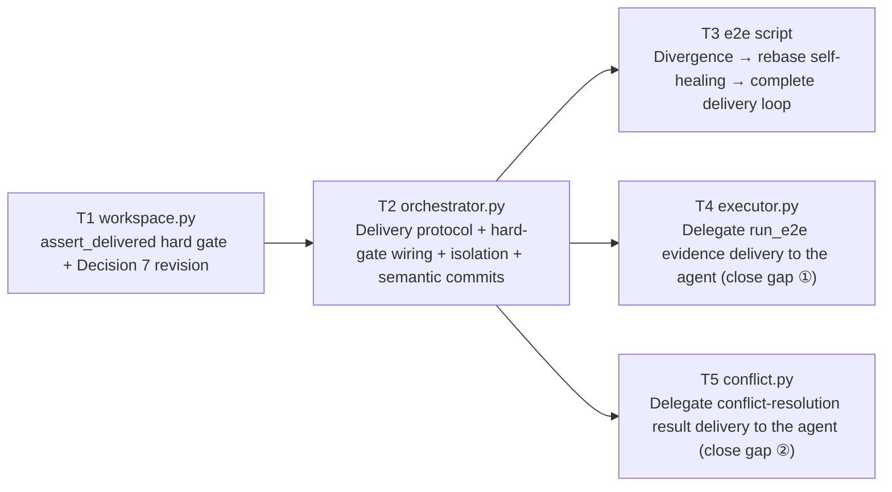

# 0056 · Vigil: delegate git delivery/conflict resolution to the agent (self-healing rebase) + a hard harness gate for head advancement (revise Decision 7)

<!-- This file is maintained by the spec tool: frontmatter is the structured source data (including the tasks DAG); the body is a group-level overview in nine rust-RFC sections. -->

## Summary

In the OpenAgents autonomous loop, git is currently **handled entirely by hardcoded harness logic (Python subprocess)**: the agent only writes files
in the worktree and never touches git. Delivery and conflict resolution fall into a **responsibility vacuum** where “the agent thinks it is done, but the harness silently fails.”
This group redraws the responsibility boundary: **delegate to the agent** the task of “actually getting the results onto the remote”—commit → record
the remote base `BASE` **before** fetch → `git fetch` → if the histories have diverged, `git rebase` and resolve conflicts itself → `git push --force-with-lease=<branch>:$BASE`
(as a delivery protocol in the task prompt, a soft constraint). The harness retains only **one unbypassable hard gate** (hardcoded logic,
not a prompt): after agent delivery, assert that `git rev-parse origin/<branch>` == local HEAD; inequality means “not delivered” → apply
`needs-human` and hand off to a human. Also **revise Decision 7**: change “never force-push” to “never perform a **bare** force-push; allow
`--force-with-lease`, but **only on the agent’s own issue branch**, never on main / protected branches / other people’s branches.”
Also close two related defects: `WorkspaceError` escaping per-issue isolation, and drafting that endlessly piles up identically named `docs: draft spec` commits.

## Motivation

**Current state (background restated here, with no dependency on any external spec).** OpenAgents is an RFC-driven multi-agent framework: the Vigil
recipe, `vigil`, fetches labeled open issues from GitHub each round, dispatches `orchestrator.start_rfc` for each to draft a spec and open a draft PR,
then uses `messages.poll` to advance refine→implement→iterate based on labels/comments/CI. Each issue runs in its own isolated worktree
(`.openagents/worktrees/issue-<n>`). Git mechanisms are concentrated in `workspace.py` (RFC-0005), which knows only git:
`prepare()` creates a worktree and branches from `origin/<base>`; `commit_and_push()` performs `git add -A → commit →
push -u origin <branch>` (ordinary push, `check=True`). A repository-wide iron rule is hardcoded at `workspace.py:9,65`:
**Decision 7: never force-push**. The agent (coding backend) only writes files inside the worktree and **never touches git**—the harness’s
`commit_and_push` handles delivery entirely.

**Symptom: a freeze that looks like an infinite loop.** Issue #123 / PR #127 (“Complete the full e2e loop”) has been frozen for 3 days since 2026-07-03 08:35,
with repeated local redrafting on the same branch and results never reaching the PR head. From the outside, it looks like an infinite loop. Reproduction evidence:

- PR #127: OPEN, head=`6a3d678`, `updatedAt=2026-07-03T08:35:44Z`; the two commit messages are **exactly identical**
  (`2a49ba5`/`6a3d678` are both `docs: draft spec for issue #123`).
- Local `openagents/issue-123` (`3eb6213`) is ahead of the remote by `0abc835` (7-06, same message) + `3eb6213`.
- `git merge-base --is-ancestor 6a3d678 3eb6213` → **no** (local and remote have **diverged**).
- `git branch -r --contains 0abc835` → empty (the 7-06 rewrite was **never pushed**).

**Root causes (at the code level, item by item).**

1. **No self-healing path after divergence.** `commit_and_push` uses an ordinary `push` + `check=True` (`workspace.py:64-72`).
   Once local and remote diverge, git rejects the non-fast-forward push and `check=True` raises an error; the repository-wide “never force-push” policy
   (`workspace.py:9,65`) provides no rebase/reconcile fallback—so every rerun hits the same non-fast-forward wall.
2. **The exception breaks through per-issue isolation.** `WorkspaceError` is a **bare `Exception`** (`workspace.py:26`), not
   a subclass of `OrchestratorError`; meanwhile, the per-issue fallback in Vigil’s discovery stage only catches `except (OrchestratorError,
   GithubError)` (`vigil.py:173`). A single push failure therefore **takes down the entire watch round**, starving all subsequent issues—
   violating Vigil’s isolation contract that “a single issue’s failure must not take down the entire round” (RFC-0004 Decision 8).
3. **The delivery criterion is misaligned.** The current design treats “clean workspace / idempotent no-op push” as “delivered,” effectively substituting
   “no uncommitted changes” for “results have reached the PR head”—precisely the two conditions that diverge in this scenario (local is clean, remote has received nothing).
4. **Identical commit messages conceal retries.** `start_rfc` hardcodes `docs: draft spec for issue #<n>` on every commit
   (`orchestrator.py:283`). Reruns pile up commits with the same message, making the first draft indistinguishable from the Nth rewrite in history; `backfill_rfc`
   has the same problem—it hardcodes `docs: backfill spec for <path>`, and delivery is likewise handled entirely by the harness’s `commit_and_push`
   (the same “agent is kept out of git” pattern as the four dispatch/iteration paths; delegate it as well, see Reference-level ②).

**Why change this now.** These four defects make **normal retries**, such as “redraft,” spin uselessly after divergence, with failures occurring silently.
Issue #123 / PR #127 is stuck outside the closed loop because of this bug; fixing this issue **also unfreezes #127**. The root is the responsibility boundary:
delivery/conflict self-healing, which actually requires “reading conflicts, resolving them semantically, and deciding how to reconcile,” was assigned to a harness
that can only run fixed subprocesses, while the only component with semantic capabilities—the agent—was kept out of git.

## Guide-level explanation

**In one sentence: whoever has semantic capabilities is responsible for landing the results.** Delivery (especially resolving conflicts during a rebase after divergence) requires reading `<<<<<<<`
markers, judging both sides’ intent, and running self-tests—this is the agent’s job; the harness retains only a mechanical hard gate that asks “did it arrive?”

**Delivery protocol delegated to the agent (written into the task prompt, a soft constraint).** Append the following passage to dispatch/iteration task prompts,
making the agent responsible for “landing the changes on remote `<branch>`” all the way through:

```
You are responsible for landing the changes on remote <branch>, until the results have actually been pushed:
1. git add -A && git commit -m "<semantic message>"      # Use different wording for the initial draft / subsequent refine commits; stop using a fixed draft-spec message
2. Record the remote base BASE=$(git rev-parse origin/<branch>); git fetch origin <branch>   # BASE must be captured before fetch
3. Divergence → git rebase origin/<branch>; resolve conflicts yourself, git add -A && git rebase --continue,
   until the rebase completes (do not stop or offload it to needs-human)
4. git push --force-with-lease=<branch>:$BASE origin <branch>
5. Bare git push --force (without a lease) is prohibited; force-with-lease is limited to this branch <branch>
Completion criterion: git rev-parse origin/<branch> == your HEAD; if unequal, keep working
```

**The harness hard gate (hardcoded logic, unbypassable).** After agent delivery, the harness calls `Workspace.assert_delivered`:
after `git fetch origin <branch>`, assert that `git rev-parse origin/<branch>` == local HEAD. Equal = delivered,
allow progress; unequal = the agent judged itself done but did not push the results (**exactly this issue’s reproduction scenario**) → apply the `needs-human` label + post
a signed explanatory comment, then raise `OrchestratorError` so Vigil’s per-issue fallback skips this issue (without taking down the entire round).

**The normal-path experience remains unchanged.** When the remote branch does not exist, or local changes can be pushed as a fast-forward, the protocol above
reduces to an ordinary `push` (for a remote ref that “does not exist / matches BASE,” force-with-lease is a fast-forward push; the git-level result is **byte-for-byte equivalent** to today’s
`push -u`), and the hard gate naturally passes. Behavior changes only for the **divergence** path that currently stalls silently: from “silent stall”
to “the agent self-heals through rebase and pushes with force-with-lease within one round.”

**Safety net.** The agent resolves rebase conflicts itself without offloading them to needs-human—the safety net is that **the resulting PR still requires human review** + the
**head advancement hard gate** above (the agent resolves incorrectly/fails to push → head does not advance → the hard gate blocks it). This restores self-healing
without alerting a human every time merely because “conflict resolution is probabilistic.”

## Reference-level explanation

### Redrawing responsibilities (who does what, with reasons)

| git action | Owner | Reason |
|---|---|---|
| commit / rebase / conflict resolution / `push --force-with-lease` (dispatch/iteration/backfill delivery) | 🟢 **Delegate to agent** (prompt soft constraint) | Reconciliation after divergence requires semantic capabilities (reading conflict markers, judging intent, running self-tests), which only the agent has |
| run_e2e evidence commit + push (T4), merge-gate conflict-resolution result commit + push (T5) | 🟢 **Delegate to agent** (prompt soft constraint) | Closes the last two gaps in “delegate all git after an agent turn to the agent, except read-only checks”; the executor/resolve agent is the actor that “finishes this git step” |
| worktree add/remove/prune, `branch -D`, `fetch`, `git init`, release tag/push (orchestration) | 🔴 Keep in harness | The agent runs inside the worktree and cannot create the sandbox in which it is about to run (a chicken-and-egg problem) |
| `changed_spec_group` diff, `remote_branch_exists`, conflictdiag, backend `status --porcelain` (read-only introspection) | 🟠 Keep in harness | The harness itself needs the results for routing |
| gh: PR/label/comment/merge/update-branch (`github.py`) | 🔵 Keep in harness | External actions of the orchestration layer |
| **`assert_delivered` head advancement hard gate** | 🔴 **Keep in harness (new hardcoded logic)** | Closes “the agent judged itself done but did not push”; the checked party cannot be entrusted to certify itself |

### Technical approach (three changes)

**① `workspace.py`—add a read-only hard gate + revise Decision 7 (the harness no longer blindly pushes agent branches).**
- Add `assert_delivered(*, worktree, branch) -> None`: after `git fetch origin <branch>` (`check=False`,
  so a missing remote branch does not cause an error), obtain `git rev-parse origin/<branch>` and `git rev-parse HEAD`; **raise
  `WorkspaceError` if they differ** (including abbreviated forms of both SHAs). Read-only: no workspace changes and no awareness of GitHub/backend (preserving RFC-0005’s
  “knows only git” boundary). If the remote branch does not exist (rev-parse fails), treat it as “not delivered” → raise (the agent should already have pushed to create the branch).
- Revise the Decision 7 docstring in place (`workspace.py:9,65`): `never force-push` → **`never perform a bare force-push; allow
  --force-with-lease, but only on the agent’s own issue branch openagents/issue-<n>, never on main / protected
  branches / other people’s branches`**. The harness itself **does not execute** force-with-lease (the agent pushes); this constraint is implemented through the prompt protocol
  + hard gate, with the docstring recording its boundaries. (**T4 addition**: `commit_and_push` was originally a commit path only for harness-authored files;
  after run_e2e evidence delivery (④) is also delegated to the agent, it has **no production callers**. Delete it from `workspace.py` under Principle 1
  —the delivery side retains only the read-only `assert_delivered` hard gate, and the harness no longer has any hardcoded logic that “commits/pushes on the agent’s behalf after the agent finishes.”)

**② `orchestrator.py`—wire up the delivery protocol + hard gate + isolation fix + semantic commits.**
- Task prompts: append the “delivery protocol” passage above as the constant `_GIT_DELIVERY_PROTOCOL` to `_DRAFT_RFC_TASK` /
  `_REFINE_RFC_TASK` / `_IMPLEMENT_TASK` / `_ITERATE_TASK` **and `_BACKFILL_RFC_TASK`**—including “capture BASE
  before fetch,” “force-with-lease only on your own working branch,” “bare force prohibited,” and “completion criterion origin==HEAD.” Require
  a semantic commit for the initial draft (draft), refine wording for iterations, and backfill wording for reverse completion; **delete** the hardcoded
  `docs: draft spec for issue #<n>` (`orchestrator.py:283`) and `docs: backfill spec for <path>`
  (backfill_rfc).
- **Routing differences for the backfill reverse-completion path (no originating issue/PR).** `backfill_rfc` is triggered by the CLI
  `oa backfill-rfc <path>` (Spec-0025, **outside** Vigil’s autonomous loop), derives the slug branch
  `openagents/backfill-<slug>` from the code path, and opens the draft PR only **after** delivery—if delivery fails, neither an issue nor a PR exists to label
  `needs-human`. This path therefore **does not use** `_fail_to_human`: after the agent turn, first run the existing harness `spec validate` hard gate
  (which reads the local worktree even if the agent has already committed; validation errors still `raise OrchestratorError` without opening a PR),
  then call `assert_delivered`; if it raises `WorkspaceError`, **directly** `raise OrchestratorError(str(exc)) from exc`
  —the CLI’s top-level `except (OrchestratorError, …)` already converts this into one clean `✗ <message>` line + a nonzero exit. For a manually
  run brownfield bootstrapping command, this **is** its needs-human interface (the human sees the error and intervenes; no GitHub label is needed).
  Backfill has nearly zero divergence risk (the first push to a unique new branch); the hard gate mainly catches “the agent judged itself done but did not push.”
- Post-delivery gate: after the agent turn (`backend.run`) returns, replace the original `commit_and_push` call with
  `self._workspace.assert_delivered(worktree=..., branch=...)`. When `WorkspaceError` is raised, split into two routes based on **whether
  an originating record exists** (see “Suspension must be sticky” below).
- Isolation fix (root cause 2): **wrap `WorkspaceError` at workspace call sites as `OrchestratorError` (or its subclass
  `DeliveryStalled`) and propagate it**. This both fixes Vigil’s `except (OrchestratorError, GithubError)` (`vigil.py:173`),
  which will no longer be breached by a bare `WorkspaceError`, and avoids making `workspace.py` depend back on `orchestrator` (preserving decoupling, Principle 10)
  —translation happens at the orchestrator seam, which already holds both sides.
- **Suspension must be sticky (required fix from PR #141 review).** The initial `_assert_delivered_or_fail` called
  `_fail_to_human` on **every** path to apply the needs-human label + post a comment before raising. But the suspension short-circuit in messages polling **only recognizes
  `record.status == STATUS_BLOCKED`, not labels** (`_process_run`/`_process_coding` have no early return based on labels)
  —on the four paths with a record (refine/implement/iterate/run_e2e), applying only a label without setting status lets the next poll enter
  coding again: `set_e2e_ran_fingerprint` comes after the assertion, and raising prevents the fingerprint from being persisted → **dispatch the executor to actually run again
  + post another identical needs-human comment**. Moreover, the `MAX_ROUNDS` churn fallback only counts after `run_e2e` returns successfully,
  which raising prevents it from reaching. Thus this “audible but equally unbounded” loop of repeated execution + comment spam is precisely the disease this spec aims to eliminate. **Fix**:
  - On the four paths with a record: `_assert_delivered_or_fail` **no longer applies labels/posts comments itself**; instead, it raises the typed
    `DeliveryStalled(OrchestratorError)` (carrying `branch`/`reason`/`pr_number`). `messages._process_run`
    catches `except DeliveryStalled` outside stage routing → `self._block(record, gate="delivery", blocker=reason)`.
    `_block` sets `STATUS_BLOCKED` (outside `_OPEN_STATUSES`, so the next round automatically skips it) + gate + watermark +
    label + structured comment in one operation, making suspension naturally sticky and immediately enabling the “reply with a comment to unblock” path. Add the
    `"delivery"` gate to `_TRIED_BY_GATE` and to the same routing as code in `_unblock_with_comment` (`iterate(reason="human")`).
  - The draft path (`start_rfc`, `pr_number=None`, record has no PR number yet) retains `_fail_to_human`: the issue label
    + Vigil’s discovery stage (`vigil.py:195` skips on seeing `BLOCKED_LABEL`) already make it sticky; it is not handled through messages polling.
  - Authority remains in the messages state machine (`orchestrator` does not import `messages`; the dependency is one-way); orchestrator only raises a signal.

**③ e2e script**—see “End-to-end validation” below.

**④ `executor.py` / `run_e2e`—delegate evidence delivery to the executor agent as well (T4, closing the first remaining gap).** The principle “delegate all git
after an agent turn to the agent, except read-only checks” covered the five dispatch paths draft/refine/implement/iterate/backfill in the initial version (T1-T3),
but missed `run_e2e`: after the executor agent actually runs the system, the harness still delivers evidence on its behalf through the hardcoded
`commit_and_push(message="test: e2e evidence for PR #<n>")` (`orchestrator.py:712`)—the same problem of “the harness performing git on behalf of an agent
after the agent finishes.” The fix follows the same structure as ①②:
- Add a **required parameter** `delivery_protocol: str` to `executor.run_executor`, inserting it into the executor task template **before**
  the final `OUTCOME: PASSED|FAILED` format line (ensuring that the last line of the response remains OUTCOME)—“persist the evidence” now includes
  “**deliver it**”: after writing the evidence, the executor agent follows the protocol to commit it and push it to the remote working branch itself.
- Key decoupling (Principle 10): `executor.py` **still does not import git**; the delivery protocol is injected by `orchestrator.run_e2e`
  (`delivery_protocol=_GIT_DELIVERY_PROTOCOL`), and executor merely inserts it into the prompt as a string. This avoids both an additional backend turn
  “dedicated to delivery” (saving one agent invocation, Principle 1) and coupling executor to git.
- In `run_e2e`, delete the original `commit_and_push` and call `_assert_delivered_or_fail` instead (the head advancement hard gate, reusing T2’s
  `_fail_to_human` routing). Assign this `orchestrator.py` edit to the T2 owner and the deletion of `commit_and_push` from `workspace.py`
  to the T1 owner, avoiding overlapping files within the group (validate D7: overlapping files within a group are an error).

**⑤ `conflict.py`—delegate delivery of conflict-resolution results to the resolve agent as well (T5, closing the second remaining gap).** When the merge gate encounters conflicts,
it dispatches the resolve agent to resolve them semantically. Previously, after resolution, the harness delivered the result on its behalf with `git add -A && git commit --no-edit` (`resolve_branch`) +
`push` (`make_resolver`)—another case of “the harness performing git on behalf of an agent after the agent finishes.” Fix:
- In `_RESOLVE_TASK`, replace “Do not commit yourself; the outer layer will commit everything” with “After self-tests pass, **you yourself must**
  `git add -A && git commit --no-edit` (reusing the default merge message), then `git push origin HEAD:refs/heads/<branch>`.”
  Note that this merge **adds the base on top of this branch in a fast-forward direction**, and the result is a descendant of this branch’s tip, so **an ordinary push suffices; no force is needed**
  (fundamentally different from the `force-with-lease` divergence scenario on the four dispatch/iteration paths; do not apply the same protocol).
- Add a `branch` parameter to `resolve_branch` + record the `pre`-HEAD “during the merge conflict, before the agent turn”; after the agent turn, perform only
  **read-only validation** (matching the user’s boundary of “delegate all git except checks”): ① remaining conflict markers (existing check) ② head advancement (HEAD≠pre,
  catching “resolved the markers but did not commit”) ③ push delivery (`origin/<branch>`==HEAD after `fetch`, catching “committed but did not push,”
  exactly the issue #140 class of freeze). If any check fails → `merge --abort` and safely fall back to `resolved=False` (better to leave it unresolved than resolve it incorrectly,
  and it must not judge itself resolved without having pushed).
- Add a `delivered` flag to `ResolveOutcome`: on the conflict path, the agent has already delivered the result itself (`delivered=True`) → `make_resolver`
  no longer pushes on its behalf; **only for a clean automatic merge** (no agent turn, the merge commit is harness-authored, `delivered=False`) does
  `make_resolver` perform an ordinary push—this is not “git after an agent finishes,” so keeping it in the harness complies with the boundary.

### Key invariants (footgun safeguards)

- **The expected SHA for force-with-lease must come from the remote baseline before `fetch`**: `--force-with-lease=<branch>:$BASE`,
  with `BASE=$(git rev-parse origin/<branch>)` evaluated **before** `git fetch`. Otherwise, after `fetch` refreshes the local tracking ref,
  the lease's expected value becomes the latest remote SHA just fetched, degrading the protection to the equivalent of a bare `--force` (a footgun). This ordering is mandatory
  in steps 2/4 of the prompt protocol, and is also covered by the hard gate as a backstop.
- **force-with-lease is strictly limited to the agent's own working branch**, `openagents/issue-<n>` (dispatch/iteration) or
  `openagents/backfill-<slug>` (reverse backfill); bare `--force` is prohibited under all circumstances; it must never target main, protected branches, or anyone else's branches
  (revised body of Decision 7).
- **Zero regressions**: on the normal paths where the remote branch does not exist or a fast-forward is possible, the git-level result must be byte-for-byte equivalent to today's ordinary push; only the divergent path
  changes behavior (silent hang → self-healing within one round).

### Task DAG + file allocation



| Task | Files (single writer, mutually exclusive) | Dependencies |
|---|---|---|
| T1 | `openagents/workspace.py`, `tests/test_workspace.py` | — |
| T2 | `openagents/orchestrator.py`, `tests/test_orchestrator_delivery.py` | T1 |
| T3 | `scripts/e2e-spec-0056-git-delivery-rebase-selfheal.sh` | T2 |
| T4 | `openagents/executor.py`, `tests/test_executor.py`, `tests/test_orchestrator.py` | T2 |
| T5 | `openagents/conflict.py`, `tests/test_conflict.py`, `tests/test_conflict_guidance.py` | T2 |

> T4's edits to `orchestrator.run_e2e` are assigned to the T2 owner, and deletion of `commit_and_push` is assigned to the T1 owner (`workspace.py`)
> —to avoid overlapping files within the same group (validate D7: overlap within a group is an error); T4's `files` list includes only
> `executor.py` and its tests, for which it actually introduces a new writer. The one-line comment in `messages.py` and test doubles in `tests/test_messages.py` / `tests/test_claim_dedup_integration.py`
> are cleaned up along the way (delete `commit_and_push` stubs whose corresponding implementation no longer exists); these are incidental to T4, not independent writers, and are not listed separately.

### End-to-end verification (outcome testing, Principle 8)

The script `scripts/e2e-spec-0056-git-delivery-rebase-selfheal.sh` runs entirely **offline, without network access or calls to a real LLM/gh**:
1. **Offline deterministic verification**: `ruff check` + `ruff format --check` + the full `pytest -q` suite (covering T1's hard gate/Decision 7,
   and T2's delivery-protocol contract lock + hard-gate routing + isolation).
2. **Offline outcome exercise**: use **real local git** (`git init` two repos to serve as the “remote bare repository + local worktree”)
   to construct the reproduction state—the remote PR branch is ahead of base, and locally redrafting the same spec file causes **divergence**; drive delivery with a fake backend that
   **actually executes the prompt's delivery protocol as git commands**: assert (a) the agent self-heals with `rebase` and pushes with `force-with-lease`,
   and `git rev-parse origin/<branch>` advances to local HEAD (the result reaches the PR head); (b) the negative case—have the fake backend
   “pretend to finish without pushing,” and assert that `assert_delivered` determines “not delivered” → routes to needs-human; (c) assert that the push uses
   `--force-with-lease=<branch>:<BASE>`, with `BASE` being the SHA before fetch, and that bare `--force` **never** appears.

**Browser e2e note**: this feature is a **git delivery/orchestration pipeline** inside the Vigil autonomous loop, with no product-facing frontend
interface (the only observable outcome is “after divergence, the result actually advances to the PR head,” reflected in git refs and GitHub PR metadata, without any
HTTP frontend/dashboard rendering). Browser navigation/screenshot-based e2e is therefore **not applicable** (this environment also has no Playwright/Chrome DevTools MCP);
outcome evidence comes from the CLI/pytest checks above and the script driven by real local git, using the git-ref assertion “does `git rev-parse origin/<branch>` advance to
local HEAD?” as the correct observation surface—consistent with this repository's approach to observing outcomes for similar “orchestration behavior without a frontend”
(such as the changes for sticky short-circuiting of the code-review gate).

## Drawbacks

- **Inherent uncertainty of soft constraints**: the delivery protocol is a soft prompt constraint, and the agent may not follow it (omit `--force-with-lease`,
  capture BASE at the wrong time, or abandon rebase halfway through). Mitigation: the harness's hard gate on head advancement provides a fixed-code backstop—if the protocol is not carried out → head does not
  advance → the hard gate blocks delivery and escalates to a human. The worst outcome is “escalation to a human,” rather than “a silent hang or an incorrect push.”
- **Cognitive burden of allowing force-with-lease**: the repository-wide rule changes from the easy-to-remember absolute rule “never force” to the more nuanced “never use *bare* force;
  use a lease only on your own branch.” Readers of the code must understand lease semantics and the boundary of “your own branch.” Mitigation: the body of Decision 7 +
  the docstring spell out these boundaries in place, and unit tests lock down “own branch only, lease required, BASE is the SHA before fetch.”
- **rebase rewrites history**: force-with-lease pushes the new history after rebase, so the PR's commit SHAs change (the old SHAs are
  discarded). This does not interfere with this loop (delivery is determined by PR head advancement, and human review examines the final state), but future dependencies on “PR comments pinned to old lines/old SHAs”
  would be affected (see Unresolved).
- **Fidelity of fake-backend e2e**: the outcome exercise uses a fake backend that “executes the protocol as git commands,” rather than a real LLM.
  It verifies the **orchestration semantics of the delivery protocol + hard gate**, not “whether a real agent will follow the prompt”—the latter is covered by production Vigil runs and
  human PR review. This boundary is explicitly stated in the script header (evidence layering, Principle 8).
- **Orphan branches caused by the inverted validate-gate ordering after delegating backfill delivery**: after delivery is delegated to the agent, backfill's `spec
  validate` hard gate can run only **after** the agent has committed and pushed (it reads files in the local worktree and still blocks delivery; validate
  errors still `raise`, and no PR is opened). The cost is that if the agent pushes a spec that fails validate, the remote retains an **orphan branch with no PR**
  (in the old flow, validate ran before push, so failure left nothing on the remote). Mitigation: step 6 of `_BACKFILL_RFC_TASK` requires
  the agent to run `spec validate` before delivering according to the protocol. Orphan branches arise only when the agent violates the contract (pushes a draft that fails validation), and they are visible and removable
  through a manually run CLI command (`git push origin --delete`). The option of “splitting this into two backend turns (write first, deliver second) to eliminate the problem entirely”
  was not chosen because backfill is an infrequent, manually initiated bootstrap operation, and does not justify adding an entire extra agent call (Principle 1, Occam's razor).

## Rationale and alternatives

**Why this design.** The root problem is a misplaced responsibility boundary: delivery/conflict self-healing, which requires semantic capabilities, was assigned to a
harness that can only run fixed subprocesses. Delegating delivery to the agent—the only component with semantic capabilities—and retaining only a mechanical hard gate in the harness is the correct solution with the fewest changes: it reuses existing
primitives (the agent backend, `force-with-lease`, and the “agent resolves conflicts” pattern already validated in conflict.py), and introduces no new modules (Occam's razor).
The hard gate is implemented as **fixed code rather than a prompt** because a correctness criterion such as “has delivery occurred?” cannot be left to the checked party to certify for itself.

**Alternative 1: have the harness perform rebase + force-with-lease itself (without delegating to the agent).** Have `commit_and_push` run
`fetch` + `rebase` + `force-with-lease` to retry after a non-fast-forward push failure. Advantages: handled entirely by the harness, no uncertainty from soft constraints, and no prompt changes.
**Rejected**: the reproduction in this issue (redrafting the **same spec file**) necessarily produces **conflicts** during rebase. The harness lacks the semantic capabilities to resolve them
and can only `rebase --abort`, returning to the original state—it cannot address the root cause. Conflict resolution inherently requires an agent; this approach works only for the “divergence without conflicts” subset.

**Alternative 2: `git pull --rebase` / merge the remote into local, then push normally.** Have the harness incorporate the remote into the local branch. **Rejected**:
this encounters the same semantic conflicts (with either `merge` or `rebase`), and merge would accumulate noisy “Merge origin/... ” commits in the PR;
force-with-lease + rebase keeps the history linear and cleaner. Conflicts still require an agent, so this does not address the root cause.

**Alternative 3: directly make `WorkspaceError` a subclass of `OrchestratorError`.** The easiest fix for root cause 2. **Rejected**: this would require
`workspace.py` to `import orchestrator`, introducing a reverse dependency that violates the layering in which “workspace knows only git and is unaware of orchestration” (Principle 10).
Instead, translate the exception with `raise OrchestratorError(...) from exc` at the seam in orchestrator, which already has access to both sides, preserving the layering.

**Alternative 4: put the hard gate in vigil / messages instead of workspace.** **Rejected**: the hard gate consists purely of git read operations (fetch + rev-parse
comparison), so placing it in workspace, which knows only git, provides the strongest cohesion; only routing (marking needs-human) remains in orchestrator. This responsibility split is consistent with the layering
in ①/②.

## Prior art

- **`git push --force-with-lease`** (official git): a safe force push with an “expected remote ref”—it overwrites only if the remote is still at the SHA you last
  saw, preventing a blind `--force` from wiping out someone else's push. These changes use it to relax “never force” to “safe force.”
  The footgun (the lease's expected value must be captured before fetch, or `fetch` refreshes the tracking ref and defeats the protection) is a widely recognized community pitfall; these changes avoid it through
  the explicit ordering “capture BASE before fetch.”
- **The rebase-and-force-push workflow in Gerrit / GitHub PRs**: contributors rebase locally onto the latest base and then force-push
  to update their PR branch, a routine delivery workflow on mainstream PR platforms—these changes apply the convention of “contributors reconcile locally and then update their own branches”
  to an autonomous loop in which “the agent is the contributor.”
- **This repository's `conflict.py` (the changes that dispatch a coding agent to resolve merge conflicts semantically)**: there is already a mature pattern of “encounter a merge conflict → feed the conflicting files to an agent for semantic resolution + self-testing →
  fall back to a human only if resolution fails.” The delivery protocol in these changes has the same structure (the agent resolves conflicts, with safe fallback to a human); it reuses an existing
  pattern for “drafting/iteration delivery,” rather than creating a separate approach.
- **This repository's executor “producer/consumer contract lock” tests** (in `tests/test_executor.py`, locking down that runbook form declarations
  can be parsed): these changes use the same method to add contract-lock unit tests for the delivery-protocol prompt (asserting that the prompt contains key constraints such as force-with-lease, BASE ordering,
  and the prohibition on bare force), preventing accidental damage to the protocol wording.

## Unresolved questions

- **Scope of the hard gate**: The initial version (T1-T3) covers the delivery seams for `start_rfc` (draft, reproduction path) and refine/implement/iterate/backfill;
  **T4/T5 close out the last two places where git operations occur after an agent turn**—delivery of `run_e2e` evidence (delegated to the executor agent) and
  delivery of conflict resolution results at the merge gate (delegated to the resolve agent). This completes coverage of “all git operations after an agent turn are delegated to agents, except read-only checks.”
  `commit_and_push` has no production callers and is therefore removed. If new agent-turn delivery points are added later, follow the same principle: delegate them to agents and use a read-only
  hard gate as a backstop.
- **PR comments pinned to old SHAs**: After rebase and force-with-lease rewrite history, if a mechanism for “pinning review comments to specific commits/
  lines” is introduced in the future, invalidated old SHAs will need to be handled. There is currently no such dependency, so no design is proposed for now.
- **Level of detail in human-facing messages when the hard gate fails**: Should the needs-human comment merely say “head has not advanced; delivery may not have occurred,” or should it include both the local HEAD /
  remote head SHAs to help a human locate the problem? The preference is to include the SHAs (observability, principle 8); the exact wording will be decided during implementation.

## Future possibilities

- **Turn soft constraints into hard enforcement**: Upgrade “force-with-lease is limited to this issue’s branch; bare force is prohibited” from a prompt convention to a
  **push wrapper / pre-push check** (blocking force pushes targeting main or someone else’s branch, and blocking bare force without a lease),
  following the direction of “soft conventions → make violations impossible” (aligned with the approach of runtime owner checks in issue #71).
- **Delivery retry budget**: When an agent fails to advance head with a push in one round, instead of immediately handing off to a human, it could be given a bounded retry budget (pull once more,
  rebase once more) before handing off to a human, reducing human interruptions caused by occasional remote contention.
- **Unified delivery receipt**: Render the delivery sequence “BASE→rebase→force-with-lease→head advances” as a single PR receipt comment
  (like the existing agent run report), allowing people to see directly from the PR “how this version was reconciled.”
