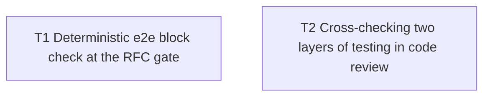

# 0057 · e2e gate hardening: deterministic enforcement of e2e blocks at the RFC gate + cross-checking two layers of testing in code review

<!-- This file is maintained by the spec tool: frontmatter is the structured source data (including the tasks DAG); the body is a group-level overview in the nine-section rust-RFC format. -->

## Summary

Harden two key e2e gating constraints from “soft rubrics buried in the LLM reviewer prompt” into **deterministic/structured** checks:

- **T1 (RFC gate format hardening)**: Before calling the LLM reviewer, `_process_rfc_review` performs a **deterministic** check—the spec groups
  modified on this branch must declare an actual `e2e{intent, method}` testing block in their frontmatter (nonempty after trimming whitespace). If missing, **do not ask
  the LLM; automatically send it back for rework as REWORK** (feed deterministic text to refine_rfc; suspend after exceeding K). This ensures that `run_e2e` always has a block to read
  and that the e2e v2 workflow cannot be silently bypassed through a nondeterministic soft gate.
- **T2 (cross-checking two layers of testing in code review)**: Upgrade the code reviewer's evidence rubric from “read docs/e2e-results/” to
  **two explicit layers**—the first layer = the code author's own tests/self-tests (self-provided evidence in docs/evidence/, the athlete); the second layer = e2e evidence from an independent executor
  (docs/e2e-results/, the referee). Require the reviewer to cross-check them: **when independent evidence is missing, approval must not be based on the author's self-tests**.

The two evidence directories **remain separate** (docs/evidence/ = implementer's own evidence / docs/e2e-results/ = independent referee)—they have different trust levels;
merging them would mix self-provided evidence into independent evidence and destroy the “athlete ≠ referee” separation (Spec-0055 nearly went down this wrong path, which was corrected through empirical evidence from wind-palace PR #19).

## Motivation

**Background (restated here).** Spec-0055 redesigned e2e as follows: the spec declares `e2e{intent,method}` → after CI turns green,
`orchestrator.run_e2e` dispatches an **independent executor** to actually run the tests and write evidence to `docs/e2e-results/<pr>/` → the existing `review_code`
reads that evidence to assess runtime behavior. Gating depends on two LLM review gates: the RFC gate determines “whether the spec should have an e2e block,” and the code gate determines “whether the runtime behavior has been achieved.”

**Empirical finding (wind-palace-of-cc PR #19, a UI feature, produced by running OpenAgents with Spec-0055 included).** Checking the PR's
agent receipt trail entry by entry (`## Review gate verdict (Spec) PASS → ## Implementation report → ## Review gate verdict (code) PASS → Merge`, **with no
`## Evidence execution`**) confirmed that **e2e v2 never started at any point**. The root cause was that both soft LLM gates were fooled by appearances:

1. **The RFC gate failed to require a structured e2e block.** The frontmatter of spec 0005 **had no** `e2e:` block, but its body/tasks were full of e2e
   discussion (one entire Task was `e2e/attention-terminal.spec.ts`). The single nondeterministic reviewer (n=1) saw e2e everywhere
   and made a **semantic** judgment: “e2e is well covered → PASS,” without realizing that it needed to check the **structured frontmatter block** (the only thing
   `run_e2e` reads). → No block → `run_e2e → _e2e_plan → None → silently skipped`; the independent executor never ran.
2. **The code gate used self-tests as grounds for approval.** The implementer delivered a real Playwright test file + screenshots they had taken in `docs/evidence/` +
   “self-tests all green” in the implementation report. The reviewer saw “there are tests, there are screenshots, the author says they tested it” and returned PASS, without checking whether `docs/e2e-results/`
   contained **independent** evidence (it was empty). → It treated **self-provided evidence (athlete = referee)** as independent verification.

**The shared root cause: these two checks are structural checks of “whether the process contract was followed”—precisely what LLMs are worst at and where they are most easily fooled by “it looks tested.”**
Putting enforcement in the reviewer prompt in Spec-0055 was itself a mismatch—something that should have been decided mechanically was handed to a nondeterministic judge susceptible to
rationalizing appearances. Following the spec skill's “harden soft conventions” principle, this group takes these two constraints out of the prompt and turns them into deterministic/structured gates.

## Guide-level explanation

**After T1**: Once a UI/interaction spec (or indeed any spec) is drafted and enters the RFC gate, the orchestration layer **first reads** the modified spec groups' frontmatter itself—
if there is no actual `e2e{intent,method}` block, it **directly returns a deterministic rework message**: “Your spec is missing an e2e testing block. Declare
`e2e:` in the frontmatter with intent (what to verify) + method (prose steps describing how to test it); documentation-only changes/changes with no runtime behavior must also declare it (write
‘No runtime behavior to verify’ in method).” This makes the drafting agent add it—**this step does not ask an LLM, and an LLM cannot fool it**. Only after the block is added does the spec enter LLM review
for a quality assessment. Thus `run_e2e` always has a block to execute, and e2e v2 can no longer be silently bypassed because “the spec forgot to declare it.”

**After T2**: The code gate's reviewer is explicitly told: “Runtime verification has two layers; inspect both and cross-check them”:
- The first layer is **the code author's own tests** (unit tests, screenshots from their own runs, often in `docs/evidence/`)—**the author's claims, which do
  not independently justify approval**;
- The second layer is **the independent executor's e2e** (result.md + screenshots in `docs/e2e-results/<pr>/`)—**evidence from an independent referee**.
The reviewer cross-checks: Is independent evidence present, and does it corroborate the behavior claimed by the author's self-tests? **Independent evidence missing (only self-provided evidence) → return REWORK**.
This closes the gap seen in PR #19, where “only self-tests, no independent evidence” still received PASS.

## Reference-level explanation

### T1 · Deterministic e2e block check at the RFC gate

- `orchestrator.e2e_block_missing(*, pr_number) -> str | None`: ensure worktree → reuse `_e2e_plan`
  to read `metadata.e2e` from the modified spec groups; if `None`, or if `intent`/`method` is empty after trimming whitespace → return the deterministic rework message
  `_E2E_BLOCK_MISSING_MSG`; otherwise return `None`. Read-only; no state changes.
- `messages._process_rfc_review`: Insert after `hold.at_spec` and before `review_rfc` (LLM)—
  if `e2e_block_missing` is non-None → use the same `increment_rounds` path as REWORK (exceeding K → `_block(gate="rfc")`;
  otherwise → `refine_rfc(detail=message)`, with event `reason="refine-e2e-block"`); call LLM review as usual only if it is None.
  Place it **after** `has_label` (2a manual/previous-round approval) and `skip.at_spec` (explicit human bypass)—those two represent explicit human intent to approve,
  which remains respected; this check hardens only the **automatic review** path.
- Add a sentence to `_DRAFT_RFC_TASK`: “**You must declare an `e2e{intent,method}` testing block in the frontmatter** (declare it even for documentation-only changes;
  write ‘No runtime behavior to verify’ in method),” so the drafting agent gets it right on the first attempt and avoids a rework round (soft guidance, not gating—the gate is the deterministic check in the orchestration layer).

### T2 · Cross-checking two layers of testing in code review

- Rewrite `reviewer._EVIDENCE_RUBRIC`: Explicitly declare two layers (self-tests = claims / independent executor = referee), require cross-checking,
  state that **missing independent evidence must not be compensated for by approving based on self-tests**, and give independent evidence precedence if the two conflict. Specify the locations: the first layer points to `docs/evidence/` (self-provided evidence),
  and the second to `docs/e2e-results/<pr>/` (independent evidence). Change only the rubric text; no changes to aggregation/parsing.

### State machine impact

No new status / fields / labels. T1 reuses the existing `rounds`/`MAX_ROUNDS`/`refine_rfc`/`_block(gate="rfc")`; add the event
`reason` value `"refine-e2e-block"` (for observability only; does not participate in routing).

### DAG and file allocation

| Task | Owned files (mutually exclusive) | depends-on |
|---|---|---|
| T1 | `openagents/orchestrator.py`, `openagents/messages.py`, `tests/test_orchestrator.py`, `tests/test_messages.py` | — |
| T2 | `openagents/reviewer.py`, `tests/test_reviewer.py` | — |

(T1/T2 have no dependencies and own mutually exclusive files, so they can run in parallel.)

### This group's e2e testing approach

- **intent**: Prove that the two hardening measures really prevent gaps like the one in PR #19—a spec missing an e2e block is deterministically sent back for rework at the RFC gate (without relying on an LLM);
  the code reviewer rubric explicitly includes cross-checking two layers and “when independent evidence is missing, approval must not be based on self-tests.”
- **method** (offline and deterministic; this group concerns backend orchestration only, with no frontend to navigate): Unit tests (fake orchestrator/github)—feed in a change “without an e2e block”
  and assert that it takes the `refine-e2e-block` path (without calling review_rfc); feed in a change “with an actual e2e block” and assert that it enters LLM review as usual; use grep to assert
  that `_EVIDENCE_RUBRIC` contains the keywords “two layers / independent evidence missing / must not approve based on self-tests.” Script:
  `scripts/e2e-spec-0057-e2e-gate-hardening.sh` (ruff + pytest + grep anchors).

## Drawbacks

- **Every spec is required to declare an e2e block** (even documentation-only changes/refactoring must write `method: No runtime behavior to verify`)—a little more boilerplate; but this is precisely
  an explicit expression of “review the e2e intent of every PR” (the direction already established by Spec-0055), and deterministic rework adds only one refine round.
- **The deterministic check only determines “whether the block exists and is nonempty”; it cannot determine “whether the block's contents actually test the right things”**—quality still depends on LLM review + T2 cross-checking.
  The hardening concerns “whether it exists,” not “whether it is good enough”; these are separate layers.
- **T2 is still an LLM rubric** (the reviewer judges the cross-check between the two layers)—weaker than T1's determinism; however, for the “whether independent evidence files exist” half, the reviewer
  checks whether docs/e2e-results/ contains result.md, which is close to deterministic; only “whether it corroborates the claims” requires judgment.

## Rationale and alternatives

**Why T1 belongs in the orchestration layer rather than `spec validate`.** `spec validate` operates at repository level and applies to **all existing specs**—requiring an e2e
block there would mean backfilling approximately 50 historical specs (low value, high noise). Placing it in `_process_rfc_review` gates only **new specs going through the workflow**, requires no backfilling, and
“automatically sending the RFC back for revision” is exactly what the orchestration layer can do and static CI validation cannot (CI can only fail; it cannot drive an agent to add the missing content).

**Alternative: only increase the number of RFC reviewer votes (n>1).** Multiple LLMs may still be fooled by the same appearances (correlated failures are not independent), and this does not resolve
the mismatch of “giving an LLM something that should be decided mechanically.” A deterministic check is cheaper and more reliable. Rejected as the primary approach; it could serve as an orthogonal enhancement.

**Why the two evidence directories are not merged (correcting the path Spec-0055 nearly took).** docs/evidence (self-provided evidence) and docs/e2e-results (independent evidence)
have different trust levels; merging them would mix self-provided evidence into the independent evidence directory, prevent the reviewer from distinguishing credibility, and let self-provided evidence pass as independent verification. Keeping them separate + T2 cross-checking
preserves “athlete ≠ referee.” (PR #142, which attempted to merge the write side, was closed for this reason.)

## Prior art

- **Spec-0055** (direct predecessor): capability-aware redesign of e2e v2. This group closes two gating loopholes in it (the RFC soft gate can be bypassed, and the code gate accepts self-attestation).
- **Spec-0044**: implementer self-attestation in docs/evidence/ + “no evidence = REWORK.” This group positions it as the “first layer (declaration),” cross-checked against the independent
  executor’s “second layer (judge)” as separate layers, rather than merging them.
- **The spec skill’s principle of “hardening soft conventions”**: as with mutual exclusion for `files` within the same group, turn the soft convention of “do not violate this” into validation/structural rules that make it
  **impossible to violate**. T1 in this group applies this principle to the e2e block.
- **CI required checks / gating**: make structural contracts hard gates rather than reminders to people—this group embeds the gates into deterministic checks in the orchestration layer.

## Unresolved questions

- **Should T1 also be implemented as a `spec validate` warning** (check for nonempty content only in specs that contain an e2e block, without requiring the block to exist) as an additional safeguard? This group initially adds the hard gate only
  at the orchestration layer; whether to add it on the validate side will depend on results from actual use.
- **Would it be worthwhile for the `spec new` scaffolding to prefill an e2e block template for documentation-only specs**, `e2e{intent: "N/A", method: "No runtime behavior to verify"}`,
  to reduce rework? Leave this for Future.
- **Dead-code cleanup beyond Spec-0057** (`worknote._RUNBOOK_HEADER`, `_REASON_LABELS["e2e"]`, `E2E_FORM_VALUES`)
  is orthogonal to this group and will be handled in a separate cleanup effort (keep it out of this group to maintain a single intent).

## Future possibilities

- **Add a semi-deterministic check to the RFC gate requiring that “the method for UI changes must require real screenshots”** (currently judged by the LLM rubric selected through ui_capable routing).
- **Prefill the e2e block in spec new scaffolding** to reduce T1 rework.
- **Machine-readable validation of independent executor evidence** (structured fields in result.md + screenshot existence checks) to make T2’s check for “whether independent evidence exists” deterministic as well.
