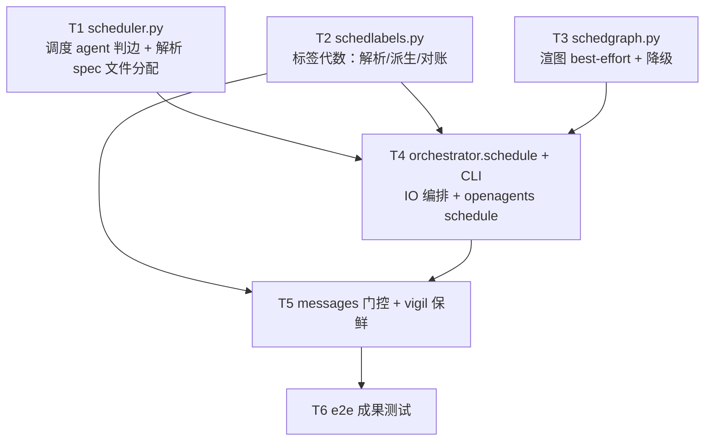

# 0058 · 跨 issue 调度：调度 agent 语义排两类依赖（逻辑序 + 文件冲突序）→ blocked-by 标签 + 本地 DAG 拓扑图 + 实现门控

<!-- 本文件由 spec 工具维护：frontmatter 为结构化源数据（含 tasks DAG），正文为组级 rust-RFC 9 段总览。 -->

## Summary

给 OpenAgents 补上**跨 issue 的顺序概念**。今天有两层并行：组内多 Task 靠 spec 的 `files` 分配互斥地协同、跨 issue 多 worktree 各跑各的——但**没人回答过「这批 issue 里，哪些必须等哪些先做完、哪些能并行」**。

本组派一个**提示词可控的调度 agent**：读所有「已出 RFC」的 open issue（标题 / 正文 + 其 spec 的文件分配与设计），**语义判两类依赖边**——①**逻辑序**（下游要复用 / 依赖上游先落地的接口、模块、协议）②**文件冲突序**（两个 spec 的 `files` 分配有交集 → 并行 implement 必在 rebase / merge 期撞车，应提前排开）——产出一张 issue DAG。

DAG 的**持久唯一真值就是标签**：每条「下游 ← 上游」落成下游 issue 的 `blocked-by:#<上游号>` 标签；一个 issue 若无任何**未满足**的上游，派生 `sched-ready` 标签。围绕这份标签真值，本组交付四件确定性的最小硬闸：

- **落标签**（`openagents schedule` 命令，人 / cron 按需跑 + vigil 每轮发现段后调一次保鲜）；
- **自动剪边解封**：上游合并（issue closed）后，保鲜轮把已满足的 `blocked-by:#N` 摘掉、下游转 `sched-ready`；
- **本地 DAG 拓扑图**：把标签真值渲成 graphviz PNG（本机无 graphviz 时降级为 `.dot` 文本，绝不硬失败），一眼看清波次与并行面（未来前端排程面板的数据底座，理念 8）；
- **实现门控**：`messages` 守候段在派 implement **写代码之前**，查该 issue 是否还挂 `blocked-by:#N` 标签——挂着就停在 rfc-review 等上游合并。**只挡写代码、不挡 RFC 起草**（RFC 仍全并行，依赖本就藏在 RFC 里，必须先写 RFC 再据其排）。

分层严格对齐 #145：**一个调度 agent 做语义判断（决策下放 agent）+ 一层确定性 utils 做解析 / 落标签 / 渲图 / 门控（代码留最小硬闸）**。沿用 Spec-0043（issuecheck）/ Spec-0034（conflictdiag）已验证的「注入 `backend` 的纯逻辑模块 + 渲染降级」形态。

**本组只交付「规划 + 门控」层**，不交付并行执行器本身（「同时起几个 issue」的 worker 池是 issue #137，它未来消费本组产出的 `sched-ready`）。

## Motivation

**现状（就地复述，无需外读）。** OpenAgents 是 RFC / spec 驱动的多 Agent 框架，目标是用多 agent 协作把人从代码细节里解放出来、只做宏观把控（理念 5）。它今天有**两层并行**：

1. **组内多 Task 协同**（同一 worktree）——多个 agent 一起实现一个 spec 组，无冲突的根是每个 Task 用 spec frontmatter 的 `files` 字段**互斥地**声明「单一 writer 所有权」（理念 6）。`spec validate` 对同组内两个 Task 的 `files` 有交集报 error，把「别让两个 Task 抢写同一文件」从自觉硬化成规则。
2. **跨 issue 多 worktree 并行**——不同 issue 各在独立 worktree 里跑，各驱动自己的 spec 组。

调度的入口是**守夜人 `vigil`**（`openagents/vigil.py`），一个薄调度循环：每轮 `_run_one_round` 先跑**发现段** `discover_and_dispatch`（列出带 `openagents` 标签的 open issue，对每个调 `_dispatch_kind` 归类，`fresh` 者派单 `orchestrator.start_rfc` **起草 RFC**、开 draft PR），再跑**守候段** `messages.poll`（按 `rfc-approved` 标签 / 评论 / CI **反应式**推进已开 PR：RFC 评审闸 `_process_rfc_review` 全票 PASS → 打 `rfc-approved` → 派 `orchestrator.implement` **写代码**转正 PR）。

**缺口：跨 issue 之间没有任何顺序概念。**

- 发现段按 `list_issues` 的返回顺序逐个 `start_rfc`（`vigil.py` 决策 5 的串行**仅为避免抢分支，并非语义排序**）；RFC 之后由 `messages.poll` 反应式推进 implement。**谁先谁后完全取决于发现顺序与各 PR 的推进节奏**，没有任何机制表达「A 必须先于 B」。
- spec 的 `files` 分配只在**单组内**保证单一 writer 互斥（issue #71 的运行期 owner 检查也只规划到组级）。**跨 issue** 若两个 spec 的文件分配有交集，并行 implement **必然**在 rebase / merge 期撞车——这是一个本可提前排开的**确定性**冲突，却被推迟到最贵的合并期才爆。

两类序都缺：

1. **逻辑序**——例：「先重构模块 A 的接口，依赖它的 B 才好动」。今天 A、B 同时派单、同时进 implement，下游 B 在上游 A 尚未落地时就写代码，要么返工、要么撞设计。
2. **文件冲突序**——例：两个 spec 都改 `openagents/messages.py`。本可让其一先合、另一后动（rebase 到已含前者的 base），却被放任并行、到合并期才炸。

**且 issue 的真实依赖藏在 RFC 里**（文件分配写在 spec frontmatter 的 `files`、要复用谁的接口写在 RFC 正文的设计里）——**光看 issue 标题 / 正文排不准，必须先写 RFC、再据 RFC 排**。这也是为什么门控只挡「写代码」不挡「起草 RFC」：RFC 是排序的**输入**，必须让它先并行产出。

**为什么现在做、为什么值得。** 这是把「设计期文件所有权即排序依据」这一已在组内成立的原则，**从组内延伸到 issue 之间**。它前置于并行执行器 #137（执行器必须先知道「哪些能并行」才敢真并行），也是理念 8「以成果为中心」的一块拼图——DAG 拓扑图让人一眼看清「这波并行面有多宽、卡在谁身上」，正是人做宏观把控要看的东西。

## Guide-level explanation

站在使用者角度，本组新增一条命令与一层自动行为，其余体验不变。

**1) 跑一次调度（人 / cron 按需）。**

```
openagents schedule
```

它会：

1. 拉所有带 `openagents` 标签、**已出 RFC**（远端已有 `openagents/issue-<N>` 分支 / 已开 PR）的 open issue；
2. 读每个 issue 对应 spec 组的 `files` 分配（`docs/specs/*.md` frontmatter 里 `issue:` 命中该号的那组），连同 issue 标题 / 正文一起喂给**调度 agent**；
3. 调度 agent 语义判两类依赖边，输出「下游 ← 上游」的边集（每条边带 `kind`=`logical`|`file-conflict` 与一句人话理由）；
4. 确定性 utils 把边集**对账**成标签动作：给下游打 `blocked-by:#<上游>`、给无未满足上游的 issue 打 `sched-ready`、把已满足（上游已合并 / 边已不再由 agent 连出）的旧 `blocked-by` 摘掉；
5. 渲一张 `docs/schedule/dag.png`（本机无 graphviz 时退化为 `docs/schedule/dag.dot`），并把边集与波次打印到终端。

跑完后，GitHub 上每个 issue 的标签就是这张 DAG 的持久真值：

```
#150 (本 issue)      labels: openagents, sched-ready
#137 (并行执行器)     labels: openagents, blocked-by:#150      ← 等 #150 合并
#160 (某独立小改)     labels: openagents, sched-ready          ← 与 #150 天然同波并行
```

**2) 门控自动生效（无需人干预）。** 当 `messages` 守候段推进某个 PR 到 RFC 评审通过、准备派 implement 写代码时，先看它对应 issue 是否还挂 `blocked-by:#N`：

- **挂着** → 本轮**不写代码**，停在 rfc-review，日志「⏸ issue #137：仍挂 blocked-by:#150，等上游合并」。RFC 早已并行起草完毕、静候即可。
- **不挂 / 已解封** → 照常派 implement，行为逐字节不变。

**3) 上游合并 → 自动解封。** `#150` 的 PR 合并、issue 关闭后，下一轮 `vigil` 在发现段之后自动调一次 `schedule` 保鲜：`#137` 的 `blocked-by:#150` 因上游已不在 open 集而被摘掉、`#137` 转 `sched-ready`，其 implement 门控随之放开。无需人再跑命令。

**能并行尽量并行。** 调度 agent 只在**确有依据**时连边（下游明确复用上游接口 / 两 spec 文件分配确有交集）；毫无关系的两个 issue **不连**——它们天然同波并行。这正是 `blocked-by:#N` 成对标签（而非整波 `wave-N` 标签）的用意：精确到边、随上游逐条解封，比整波闸更贴「能并行尽量并行」。

## Reference-level explanation

### 分层与数据流

```
openagents schedule (CLI)                     vigil 每轮发现段后
        │                                            │
        └──────────────┬─────────────────────────────┘
                       ▼
        orchestrator.schedule()   ← IO 编排层（拉 issue / 读 spec / 落标签 / 渲图）
                       │
      ┌────────────────┼─────────────────────────────┐
      ▼                ▼                              ▼
 scheduler.py     schedlabels.py                 schedgraph.py
 （调度 agent      （确定性标签代数：              （确定性渲图：标签→DAG→
  语义判边，        blocked-by 解析 / sched-ready   graphviz PNG，无 dot 降级 .dot）
  backend 注入）    派生 / 边→标签动作对账）
                       │
                       ▼  标签是唯一真值
              messages._process_rfc_review
              （实现门控：派 implement 前查 blocked-by，挡写码不挡 RFC）
```

**决策边界（对齐 #145）**：唯一的非确定语义判断（「A 是否依赖 B」）下放给**调度 agent**（`scheduler.py`，`backend` 注入、打桩可测）；其余全是**确定性最小硬闸**——标签代数、渲图、门控都是纯函数 / best-effort IO，不含判断。

### 标签契约（唯一真值）

- `blocked-by:#<N>`：本 issue 有一条未满足的上游边指向 issue `#N`。一个 issue 可挂多个。
- `sched-ready`：本 issue 无任何未满足上游（可入执行波次）；由 utils 在「无 `blocked-by`」时派生，供 #137 的执行器未来消费。
- **满足判定**：`blocked-by:#N` 视为**未满足**当且仅当 `#N` 仍在 open 集内；`#N` 已 closed（合并 / 关闭）即视为已满足，保鲜轮摘除。这是**读时自愈**：门控与渲图都以「当前 open 集」重算，标签滞后一轮也不会误挡。
- **单一 writer**：只有 `schedule`（命令 + vigil 保鲜）写这两类标签；`messages` 门控只**读**。避免多处写标签漂移（沿用 `github.py` 流程标签单一来源的思路）。

### 调度 agent 的判读契约（`scheduler.py`）

镜像 `issuecheck.py` / `align.py` 形态：冻结 dataclass 进、结构化裁决出、`_MARK_*` 稳定标记回解析、`backend` 注入、无 IO、**fail-open**（解析不出明确的边 → 不连边，宁可漏排也不乱连，因为乱连会误挡本可并行的 issue，比漏排更违背「能并行尽量并行」）。

- `IssueContext(number:int, title:str, body:str, owned_files:frozenset[str])`：一个待排 issue 的快照。
- `DepEdge(downstream:int, upstream:int, kind:str, reason:str)`：一条依赖边（`kind` ∈ `logical` | `file-conflict`）。
- `ScheduleVerdict(edges:tuple[DepEdge, ...])`：全量边集。
- `parse_owned_files(*, spec_markdown:str) -> frozenset[str]`：纯解析——从一个 spec 组 markdown 的 frontmatter `tasks[].files` 收集该 issue 的文件分配（排序依据的输入）。
- `schedule(*, issues:list[IssueContext], backend) -> ScheduleVerdict`：内嵌 `_SCHEDULE_TASK`（要求 agent 按标记逐条输出边 + 理由；严令「只在确有依据时连边、独立 issue 不连」），调 `backend.run`、按标记回解析成边集；解析失败 fail-open 返回空边集。

文件冲突是**确定性可辅助**的：`parse_owned_files` 给出的交集是喂给 agent 的强证据，但「谁先谁后」的方向仍是语义判断（哪个 spec 更接近底座 / 改动更小更该先合）——交给 agent，不写死。

### 标签代数（`schedlabels.py`，纯函数）

- 常量 `BLOCKED_BY_PREFIX = "blocked-by:#"`、`SCHED_READY = "sched-ready"`。
- `parse_blocked_by(*, labels) -> set[int]`：从标签名解析出上游号集合。
- `has_unsatisfied_block(*, labels) -> bool`：`messages` 门控读侧——是否还挂任一 `blocked-by:#N`（纯标签存在性检查；「满足」由保鲜轮据 open 集剪除后体现，门控本身不发网络请求判 open）。
- `LabelPlan(adds:dict[int,set[str]], removes:dict[int,set[str]])` + `plan_labels(*, verdict, open_issue_numbers, current_labels) -> LabelPlan`：把边集 + 当前标签对账成**幂等**的 add / remove 集——只对上游仍 open 的边保留 `blocked-by`、上游已不在 open 集的旧 `blocked-by` 进 removes、无剩余 `blocked-by` 者 add `sched-ready`（反之 remove）。幂等：同一世界重复跑不产生标签抖动。

### 渲图（`schedgraph.py`，best-effort，注入 run）

镜像 `conflictdiag.py`：`render(*, edges, open_issue_numbers, out_dir, run) -> Path` 构建 DOT（按拓扑分层着色波次），经注入 `run` 调 `dot -Tpng` 出 PNG；`dot` 缺失（`FileNotFoundError`）/ 非 0 / 任何异常 → **吞异常、退回写 `.dot` 文本文件**并返回其路径，绝不上抛（本机实测无 graphviz，降级路径是常态而非边角）。

### 门控接线（`messages.py`）

`_process_rfc_review`（RFC 评审闸，派 implement 的唯一入口）在**所有 implement 分发路径之前、但在人工放行意图（已带 `rfc-approved` 标签的 2a / `skip.at_spec`）之后**插一道读检：`github.get_issue(number=record.issue_number)` 取 issue 标签 → `schedlabels.has_unsatisfied_block(labels=...)` 为真 → 本轮返回 `{"reason": "blocked-by"}`、**不评审 / 不打 rfc-approved / 不 implement**，停在 rfc-review。放在人工放行之后：人显式 `skip` 或已手打 `rfc-approved` 是强放行意图，仍尊重（与 hold / skip 既有优先级一致）。**不挡 RFC 起草**——起草在 vigil 发现段的 `start_rfc`，本闸完全不碰。

### vigil 保鲜接线（`vigil.py`）

`_run_one_round` 在 `discover_and_dispatch` 之后、`messages.poll` 之前调一次 `orchestrator.schedule()`（best-effort，纳入既有 per-round except 隔离：保鲜失败记日志、不掀翻整轮）。语义：每轮发现可能新增 issue / 上游可能刚合并 → 保鲜一次即让标签真值追上现实、自动剪边解封。

### DAG + 文件分配（Task 拆解）



| Task | files（单一 writer，跨 Task 互斥） | 依赖 |
|---|---|---|
| T1 | `openagents/scheduler.py` · `tests/test_scheduler.py` | — |
| T2 | `openagents/schedlabels.py` · `tests/test_schedlabels.py` | — |
| T3 | `openagents/schedgraph.py` · `tests/test_schedgraph.py` | — |
| T4 | `openagents/orchestrator.py` · `openagents/cli.py` · `tests/test_orchestrator_schedule.py` · `tests/test_cli_schedule.py` | T1, T2, T3 |
| T5 | `openagents/messages.py` · `openagents/vigil.py` · `tests/test_messages_blocked_by_gate.py` · `tests/test_vigil_schedule_refresh.py` | T2, T4 |
| T6 | `scripts/e2e-spec-0058-issue-scheduler.sh` · `tests/test_scheduler_integration.py` | T5 |

**复用既有 `github.py`、不新增标签 IO 出口**：`blocked-by:#N` / `sched-ready` 全走已有的参数化 `issue_add_label(number, name)` / `issue_remove_label(number, name)` / `get_issue(number).labels` / `list_issues(state="open")`——`github.py` 及其测试替身零改动（避免碰共享 prod 文件的 fake 连带回归）。

### e2e 成果测试

脚本：`scripts/e2e-spec-0058-issue-scheduler.sh`。沿用仓库两段式约定（默认离线确定性，`OPENAGENTS_E2E_REAL=1` 追加真实冒烟）：

- **离线确定性段（默认执行）**：ruff lint / format + pytest 全套；再用内存 GitHub 世界 + 桩 backend 驱动一次完整 `schedule`——构造一批 fixture issue（含两 spec 文件分配交集 + 一条逻辑依赖 + 一个独立 issue），断言：下游落 `blocked-by:#<上游>`、独立 issue 落 `sched-ready`、幂等重跑无标签抖动；`messages` 门控对挂 `blocked-by` 的 issue 停在 rfc-review（implement 未被调）、摘除后放行（零回归）；上游 closed 后保鲜轮剪边、下游转 `sched-ready`。
- **DAG 出图成果段**：调 `schedgraph.render` 出 `dag.png`（或降级 `dag.dot`），断言产物存在且含预期波次 / 边。
- **浏览器 e2e（能力自检降级）**：本组交付物是后端编排机制 + graphviz 数据底座，**尚无 product-facing 前端界面可导航**；且本环境实测**无浏览器 MCP（Playwright / chrome-devtools）工具、无 graphviz `dot`**。故设计上：*若*具备浏览器工具，把渲出的 DAG（DOT→SVG / HTML 内嵌）navigate + snapshot + 截图，断言波次分层与并行面可见、console / network 无报错；本环境按能力自检**降级为 `.dot` / `.png` 产物存在性 + DOT 文本内容断言（边与波次），不跳过**（沿 Spec-0055 能力感知降级、Spec-0043「无浏览器降级文本断言」先例）。降级是如实结论：作者自检工具列表后确认不具备浏览器与 graphviz，未来前端排程面板落地后再补真实浏览器导航。

## Drawbacks

- **多一层非确定判断**：调度 agent 判边是 LLM 判读，可能误连（把无关 issue 连成依赖 → 误挡本可并行的 implement）或漏连（该排的没排 → 仍在合并期撞车）。fail-open + 「只在确有依据时连边」把误连侧压小，但漏连侧仍靠人在 DAG 图上兜底。
- **标签滞后**：真值是标签、保鲜靠 `schedule` 跑（vigil 每轮 + 手动）。两次保鲜之间世界变了（上游刚合），门控可能多挡一轮——读时按 open 集自愈使这只是「慢一轮」而非「错」，但不是实时。
- **依赖「RFC 审核通过即合入 main」约定**：跨 issue 读 spec 文件分配假定 spec 已在 main 可见（先合 RFC、再据其排）；未合入 main 的 RFC 的跨分支可见性本组明确不处理，约定不成立时会漏读文件分配。
- **成对 `blocked-by:#N` 标签在稠密图上会膨胀**：一个下游依赖 5 个上游就挂 5 个标签，GitHub 标签面板变吵。换来的是精确到边、逐条解封，权衡见下。

## Rationale and alternatives

**本设计（成对 `blocked-by:#N` 标签 + 调度 agent + 确定性 utils）为什么。** 标签作唯一真值，天然持久、GitHub 原生可见、被门控 / 渲图 / 执行器（未来 #137）共享，无需另建状态存储（理念 1 奥卡姆）。判边下放 agent、其余留确定性硬闸，严格对齐 #145 的分层。

**备选 1：整波 `wave-N` 标签（而非成对边标签）。** 给每个 issue 打 `wave-0` / `wave-1` …，同波并行、逐波推进。更少标签、图更简。**否决**：波是边的**导出量**，直接标波丢掉了「谁挡谁」的边信息——上游 A 合并后，本可只解封依赖 A 的下游，波标签却要等**整波**做完才推进，违背「能并行尽量并行」；且加一个新 issue 要重算全表波号、大面积改标签，抖动大。成对边标签精确到边、随上游逐条解封，是更贴意图的最小表达。

**备选 2：纯确定性排序（只按 spec `files` 交集排，不用 agent）。** 文件冲突序确实可完全确定性算出（交集非空即连边）。**否决**：它只能覆盖两类序里的**文件冲突序**，覆盖不了**逻辑序**（「B 要复用 A 的新接口」这种依赖不体现为文件交集，藏在 RFC 设计正文里，必须语义读）。且文件冲突的**方向**（谁先合）仍是语义权衡。故保留 agent 判边，把 `files` 交集作为喂给 agent 的强确定性证据，而非替代。

**备选 3：把依赖写进 issue / spec 的显式字段（人手动声明 `depends-on: #N`）。** 让人在提 issue 时就填依赖。**否决**：违背理念 8「人做宏观把控、不做细节」——跨 issue 依赖恰恰藏在 RFC 的文件分配与设计里，要人逐对判读正是本组想自动化掉的苦活；且人填的依赖易漏、易过时。agent 据 RFC 自动判、人只在 DAG 图上审，才是对的分工。保留：人仍可手打 `blocked-by:#N`（标签是开放真值），agent 保鲜时尊重人已连的边不乱删。

## Prior art

- **本仓库先例**：Spec-0043（issuecheck）与 Spec-0034（conflictdiag）确立的「注入 `backend` 的纯逻辑判读模块（`_MARK_*` 标记回解析、fail-open / fail-closed 明确）+ best-effort 渲染降级」形态，本组直接沿用（`scheduler.py` 镜像 issuecheck、`schedgraph.py` 镜像 conflictdiag）。spec frontmatter 的 `files` 单一 writer 互斥（`spec validate` 硬化）是「设计期文件所有权」的组内先例，本组把它的**排序用法**延伸到 issue 间。
- **构建系统的依赖 DAG + 拓扑排序**：make / Bazel / Ninja 以文件依赖构 DAG 并拓扑调度并行，是「依赖图驱动并行」的经典范式；本组把「文件」换成「issue」、把「编译」换成「implement」。
- **GitHub / GitLab 的 issue 依赖**：GitHub Projects 无原生 blocked-by 边，社区普遍用 `blocked-by:` / `blocks:` 标签或任务清单模拟——本组的成对标签方案与之同构，只是把「连边」自动化给 agent。
- **graphviz `dot`**：拓扑图渲染的事实标准；本组用它出 PNG，缺失时降级为可移植的 `.dot` 源文本。

## Unresolved questions

- **判边稳定性 / 一致性**：同一批 issue 多次跑 `schedule`，agent 判出的边是否稳定？是否需要「边也做 sticky / 指纹」防抖（如 Spec-0053 的 review sticky）？暂不做，靠 fail-open + 幂等对账压抖，实测再定。
- **保鲜频率**：vigil 每轮都保鲜是否过频（每轮多一次 LLM 判读成本）？是否改为「仅在发现新 issue / 有 PR 合并时」触发？先每轮跑、观察成本再优化。
- **稠密图标签膨胀的上限**：一个下游挂多少 `blocked-by` 算过多、是否需要在图很稠时提示人拆 issue？留作观察。
- **DAG 图产物落盘位置**：`docs/schedule/dag.png` 是否该进 git（GitHub 可见）还是仅本地产物 + CI 漂移检查（如 OVERVIEW.md）？倾向本地产物，待与团队确认。

## Future possibilities

- **#137 并行执行器消费 `sched-ready`**：本组产出的 `sched-ready` 标签正是 worker 池「同时起几个 issue」的输入——执行器只挑 `sched-ready` 的 issue 入池，天然安全并行。
- **前端排程面板**（理念 8）：本组的 DAG（标签真值 + graphviz 数据）是未来前端「排程 / 并行面板」的数据底座，把终端 PNG 升级为可交互的波次视图。
- **延伸 #71 运行期 owner 强制**：本组是「设计期文件所有权 → 跨 issue 排序」；#71 的 lease / CAS 运行期写锁可复用同一份 `files` 分配数据，形成「排序（本组）+ 运行期兜底（#71）」的双层防冲突。
- **边理由回帖**：把 agent 判边的 `reason` 作为署名评论贴到下游 issue，让人审依赖时看得见「为什么被挡」，而不只是一个裸标签。

