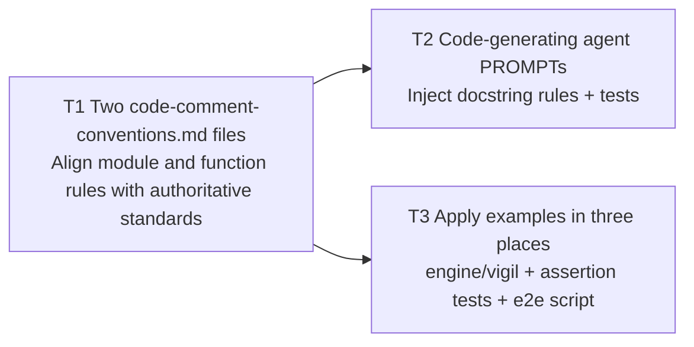

# 0059 · Align comment conventions with PEP 257/PEP 8/Google: compliance at both the module and function docstring levels, so workflow-generated comments comply by construction

<!-- This file is maintained by the spec tool: frontmatter is the structured source data (including the tasks DAG), and the body is a group-level overview in the nine-section rust-RFC format. -->

## Summary

OpenAgents' comment conventions (the rfc and spec copies of `code-comment-conventions.md`) and the
docstrings they teach workflow agents to generate deviate from authoritative Python standards at both the
**module docstring** and **function/class docstring** levels. This spec brings both convention documents
and the PROMPTs of “agents that write code” into alignment with [PEP 257](https://peps.python.org/pep-0257/) /
[PEP 8](https://peps.python.org/pep-0008/) / [Google Python Style Guide §3.8](https://google.github.io/styleguide/pyguide.html),
and implements three examples to demonstrate that the changes work—making comments produced by recipes comply
by construction at the **source** (conventions + prompts), rather than backfilling them individually afterward.

The two core changes:

1. **Module docstrings**: a clean, plain-English, one-line summary first (for users and `help()`) → blank line → usage example →
   `Exports:` listing each exported class/exception/function with a one-line summary; **move the spec-id out of the docstring into a `#` comment at the top of the file**
   (following CPython `argparse.py`'s convention of placing `# Author:` above the docstring), and **prohibit the `"""# Spec-…` form**
   —because `#` inside a triple-quoted string is literal text that enters `__doc__` unchanged and pollutes `help()` output.
2. **Function/class docstrings**: use an **imperative** summary, condensed to **one short line** (≤ one line, ending with a period), and structure parameters/returns/exceptions using
   `Args:` / `Returns:` / `Raises:`; the **spec reference added by OpenAgents for traceability stays inside the docstring as the second line**
   (it is not moved upward at this level; it is a house rule compatible with PEP 257).

## Motivation

### Background: where the conventions live and what they currently look like

CLAUDE.md requires “comments at every level to reference the corresponding RFC/Spec ID.” The rules themselves live in two mirrored files:
`.claude/skills/rfc-driven-development/references/code-comment-conventions.md` and
`.claude/skills/spec-driven-development/references/code-comment-conventions.md`. The “agents that write code”
in the workflow (implementer / the implement·iterate·backfill stages of drafter / replier) generate comments according to these conventions.

The **module docstring example** in the two current convention documents looks like this (spec version):

```python
"""Agent message forwarding router.

Spec-0007/T2: Agent message forwarding mechanism

Provides: receive inter-Agent messages and wrap them as a User query; deliver them to the target Agent's message queue.
"""
```

The actual code produced by a recipe (sample: the first line of `openagents/runtime/engine.py`) is worse:

```python
"""# Spec-0060/T2: runtime.engine — run_agent engine (fill placeholders → dispatch to a backend → collect structured output).
```

### How each level deviates, and where

**Module docstrings (compared against PEP 257 and actual source code from authoritative projects):**

| Authoritative rule | Source | Current state | Verdict |
|---|---|---|---|
| `#` inside triple quotes is **literal text** (Python string semantics) and enters `__doc__` / `help()` unchanged | Python language semantics | The `#` in `"""# Spec-…` pollutes the documentation | ❌ **bug** |
| The first line is a **one-line plain-language summary** (for users, ending with a period), followed by a blank line | PEP 257 / Google §3.8.2 | The spec-id + module name + parenthetical text are all crammed into the first line, written for designers | ❌ |
| **List exported classes/exceptions/functions**, each with a one-line summary | PEP 257 | `run_agent` / `AgentOutputError` are not listed | ❌ |
| **Place metadata (author/copyright) in `#` comments above the docstring or in a trailer at the end** | argparse `# Author:` / requests `:copyright:` | The spec-id is stuffed inside `"""` as the first line | ❌ |
| `__init__.py` must also **list exported submodules/subpackages** | PEP 257 | Still to be checked individually | ❌ |

> PEP 257 states: “The docstring for a module should generally list the classes, exceptions and
> functions (and any other objects) that are exported by the module, with a one-line summary of
> each.” (<https://peps.python.org/pep-0257/>)

**Function/class docstrings (sample: `openagents/recipes/vigil.py::run_vigil`):**

| Authoritative rule | Source | Current state | Verdict |
|---|---|---|---|
| The summary is **one short line** (ending with a period) | Google §3.8.1 / PEP 257 “a phrase” | The first line contains multiple clauses and is excessively long | ❌ |
| The summary uses the **imperative** (“Do this / Return that,” rather than a declarative statement) | PEP 257 “Prescribe … as a command” | Noun phrases / declarative sentences | ❌ |
| **Document parameters/returns/exceptions** (`Args:` / `Returns:` / `Raises:`) | PEP 257 + Google §3.8.3 | Multiple parameters without `Args:`, no `Raises:`; information is scattered through the prose | ❌ |

### Why change the **source** rather than backfill files individually

Comments are **mass-produced** by agents. If we manually fix a few files without changing the conventions and prompts, the code
produced by the next recipe will look the same as before—backfilling can never keep up with generation. This spec therefore targets
**two sources** (the convention documents + the PROMPTs of code-generating agents). The examples are just three anchors
that “demonstrate the changes work,” not the endpoint. A comprehensive batch backfill is a **non-goal** (open a separate issue to avoid
making one PR too large).

## Guide-level explanation

### How authoritative projects actually begin their files (real, verbatim examples)

The module docstrings of three authoritative projects reveal the same pattern.

**CPython `argparse.py`** (<https://github.com/python/cpython/blob/main/Lib/argparse.py>):

```python
# Author: Steven J. Bethard <steven.bethard@gmail.com>.     # ← Metadata goes in # comments, above the docstring

"""Command-line parsing library                             # ← ① One-line plain-language summary (short)

This module is an optparse-inspired command-line parsing library that:   # ← ② Elaboration after a blank line
    - handles both optional and positional arguments
    ...

The module contains the following public classes:          # ← ④ List exported objects
    - ArgumentParser -- The main entry point for command-line parsing...
    - ArgumentError -- The exception raised by ArgumentParser objects...
"""
```

**requests `__init__.py`** (<https://github.com/psf/requests/blob/main/src/requests/__init__.py>):
A one-sentence summary on the first line → `>>>` doctest usage examples → metadata in a `:copyright:` / `:license:` trailer at the end.

**CPython `json/__init__.py`** (<https://github.com/python/cpython/blob/main/Lib/json/__init__.py>):
The first line explains “what this is,” followed by executable usage examples for `dumps` / `loads` in separate sections.

| Order | Content | Authoritative example |
|---|---|---|
| ① | **One-line plain-language summary** (what the module is / does) | "Command-line parsing library" |
| ② | Blank line → expanded description | argparse's bullet list |
| ③ | **Usage examples** (often with `>>>` doctests) | requests / json |
| ④ | **List exported public classes/functions**, each with a one-line summary | "The module contains the following public classes:" |
| ⑤ | Metadata in **`#` comments above the docstring or a trailer at the end** | argparse `# Author:` / requests `:copyright:` |

### What the revised module docstring looks like (example: `engine.py`)

Follow argparse—move the spec-id up into a `#` comment, use a clean English summary on the first line, provide usage examples, and list exports under `Exports:`:

```python
# Spec-0060/T2: runtime.engine — the new stack's sole entry point for dispatching agents (metadata above the docstring, like argparse # Author)

"""Fill an agent's prompt placeholders, dispatch to a backend, and return validated output.

Usage example:
    >>> out = run_agent(triager, backend=claude, work_dir=wt, issue_body=body)
    >>> out["verdict"]
    'actionable'

Exports:
    run_agent -- Fill placeholders → dispatch to a backend → validate the final-line JSON → return a structured dict.
    AgentOutputError -- Raised when agent output violates the OUTPUT_SCHEMA contract (invalid JSON / missing keys / type mismatches).
"""
```

A clean English summary on the first line (without `#`) → usage examples → exports listed under `Exports:`—the same pattern as argparse.

### What the revised function docstring looks like (example: `run_vigil`)

A short, one-line imperative summary → **spec reference kept inside the docstring as the second line** → elaboration → `Args:` / `Raises:`:

```python
def run_vigil(..., *, interval, once, ...) -> None:
    """Run the vigil main loop until interrupted.

    Spec-0065/T2: Graph-driven parallel Vigil main loop—K workers pull from the queue, and the producer replenishes it using level-triggered checks on each tick

    Each round first reclaims dead rows, performs admission + adds dependency edges, then senses / classifies / routes by fingerprint for each subject; as soon as a worker picks up an item,
    it follows the reconcile branch table until blocked. On KeyboardInterrupt, shut down the pool and stop.

    Args:
        interval: Polling interval in seconds; in long-running mode, sleep this long between ticks.
        once: True runs only one round (return once the queue is drained, for periodic cron/CI invocation); False runs continuously.
        ...

    Raises:
        OrchestratorError: The producer thread itself crashes (exceptions from individual subjects / workers are isolated separately and do not propagate).
    """
```

> Note: the “spec reference” inside a function/class is an additional OpenAgents **house rule for traceability**. It can remain
> inside the docstring as the second line (compatible with PEP 257's “summary + blank line + elaboration” structure);
> **only module-level** spec-ids move to `#` comments at the top of the file.

### How the rules get into the agent's head

The PROMPTs of agents that “write code” (implementer / the implement·iterate·backfill stages of drafter / replier)
explicitly include a **checklist of the key points** from the two layers of rules above (module: English summary on the first line + blank line + usage examples + `Exports:` + move spec-id up into
`#` comments + prohibit `"""#`; function: one-line imperative summary + spec reference on the second line + `Args:`/`Returns:`/`Raises:`). This ensures
that agents dispatched by the recipe comply **from the very first line they write**, without requiring lint to chase down corrections afterward.

## Reference-level explanation

### Scope of changes and file allocation (DAG)



- **T1** (the two `.claude/skills/{rfc,spec}-driven-development/references/code-comment-conventions.md` files)—
  is the **source of truth for the rules** used by T2/T3 and must land first. The two files mirror each other (the rfc version uses `RFC-NNNN`, while the spec version uses `Spec-NNNN/Tn` wording),
  each including links to three standards, PEP 257 / PEP 8 / Google, plus links to three real examples, argparse / requests / json.
- **T2** (`openagents/agents/*.py` + new tests) and **T3** (`openagents/runtime/engine.py` +
  `openagents/recipes/vigil.py` + new tests + e2e script) both depend only on T1; **their files do not overlap, so they can proceed in parallel**.

### Acceptance criteria anchors for each Task

- **T1**: Both files contain three standards links + three example links; the module docstring section covers “English summary on the first line / blank line /
  usage examples / `Exports:` / move spec-id up into `#` comments / prohibit `"""#` / list submodules in `__init__.py`”; the function docstring section
  covers “imperative mood / short one-line summary / `Args:`/`Returns:`/`Raises:` / spec reference on the second line.” (Documentation changes;
  acceptance relies on grep anchors + human reading, with no pytest.)
- **T2**: Add `tests/test_agents_docstring_rule.py`, asserting that each code-generating agent's `PROMPT.template`
  contains anchor substrings for both module-level and function-level rules (such as `Exports:`, `Args:`, `prohibit`/`"""#`, and an imperative-mood instruction).
- **T3**: The first line of the `engine.py` module docstring no longer starts with `#`, spec-id becomes a `#` comment line at the top of the file, and the docstring contains
  `Exports:`; the `vigil.py::run_vigil` docstring contains `Args:` and `Raises:`. Add
  `tests/test_docstring_samples.py` to assert that the first character of `engine.__doc__` is not `#` and that it contains `"Exports:"`,
  and that `run_vigil.__doc__` contains `"Args:"` and `"Raises:"`.

### e2e script

`scripts/e2e-spec-0059-docstring-conventions.sh`: `ruff check` + `ruff format --check` +
targeted pytest (`test_agents_docstring_rule.py` + `test_docstring_samples.py`) + grep anchors
(both conventions files contain standards/example links; the engine module docstring has no `"""#`). Collected by the PR e2e signpost.
The change consists solely of documentation + prompts + internal examples, with **no product-facing frontend to navigate**, so there is no browser e2e; offline deterministic
testing is used instead (following the same pattern as Spec-0060/0064)—this is a purely internal change, for which proportionate automated tests provide sufficient evidence (principle 8).

## Drawbacks

- **`.claude/` is a permission-controlled directory.** Both `code-comment-conventions.md` files that T1 needs to modify are under `.claude/skills/…`.
  The OpenAgents environment imposes hard restrictions on writing to `.claude/` / requires explicit human authorization (see Unresolved). If authorization cannot be obtained during implementation,
  T1 cannot land, and this spec can only be reduced to the two remaining parts: “examples + prompts.”
- **There is no hard gate between the conventions and the generated output.** Updating the conventions and PROMPTs merely “makes agents more likely to write correctly”; there is no
  `spec validate` / CI lint gate to **enforce** docstring compliance in new code. A soft convention remains a soft convention (see alternative two under Rationale).
- **The examples cover only two files.** The many existing instances of `"""#` and functions missing `Args:` are outside the scope of this PR. In the short term,
  the conventions and the existing code will coexist with an inconsistent appearance.

## Rationale and alternatives

**This design: change two sources (conventions + prompts) + three example anchors.** The rationale is that agents produce comments at scale—only by putting the standards into
the “source of truth for the rules” and the “prompts used when writing” can compliance become the default output; the examples demonstrate that the changes work in real files and give agents
a template to copy.

- **Alternative one: manually backfill existing docstrings in bulk without changing the conventions/prompts.** Rejected—backfilling cannot keep pace with generation, and the next recipe
  will produce the old style again; changing all files in one PR would also be too large (precisely a non-goal of this issue).
- **Alternative two: add a CI/`spec validate` hard gate to enforce docstring compliance in new code (such as pydocstyle / ruff `D` rules).**
  More thorough (turning a soft convention into a hard requirement, consistent with this skill's principle of “soft conventions → schema/validate rules”), but **outside the scope of this issue**,
  and it requires a separate assessment of false positives and exemptions for existing code. Listed under Future / Unresolved; not included in this round.
- **Alternative three: keep spec-id outside function docstrings as well (move all of them up into `#` comments).** Rejected—function-level spec references are an in-house
  traceability rule, are numerous, and sit next to their functions. Keeping them on the second line of the docstring both accommodates PEP 257's “summary + blank line + elaboration” structure and avoids interrupting
  the first-line summary in `help()`; only **module-level** metadata moves up into `#` comments, following argparse.

## Prior art

- **PEP 257 – Docstring Conventions**: <https://peps.python.org/pep-0257/> (multiline docstring = summary +
  blank line + elaboration; module docstrings list exported objects; functions use the imperative mood).
- **PEP 8 – Comments**: <https://peps.python.org/pep-0008/> (conventions for `#` block comments/inline comments, supporting the practice of moving spec-id up into
  `#` comments at the top of the file).
- **Google Python Style Guide §3.8**: <https://google.github.io/styleguide/pyguide.html> (module docstrings
  §3.8.2; function `Args:`/`Returns:`/`Raises:` §3.8.3).
- **Real source-code examples**: CPython `argparse.py` (metadata moved up into `#` comments + `Exports`-style listing), requests `__init__.py`
  (doctest + trailer), CPython `json/__init__.py` (a first line stating “what it is” + usage sections).

## Unresolved questions

- **Write permission for `.claude/`:** Can authorization to write `.claude/skills/…/code-comment-conventions.md` be obtained when implementing T1?
  If not, should the conventions text be moved under `docs/` and referenced by the skill? (Requires a human decision.)
- **Which agents receive the rules:** This spec selects agents that “generate/modify Python source code” (implementer / drafter /
  replier). Should deliver (which only handles git delivery) and agents that only make judgments (triager / reviewer / curator / admitter / tester)
  also receive them? The preference is not to inject them (these agents do not produce code); human confirmation is requested.
- **Whether to extract the rule text into a shared constant:** Inlining the same docstring rules into 3 PROMPTs in T2 would introduce duplication; is it worth adding an
  `agents/_docstring_rule.py` constant for interpolation into each PROMPT (less drift vs. an additional entity)? The preference is to inline first and extract later as needed.

## Future possibilities

- **Turn it into a hard CI gate** (alternative two): integrate ruff `D` / pydocstyle to enforce docstring compliance in new/modified files, turning a soft convention into
  a rule that cannot be violated—consistent with this skill's established practice of “soft conventions → validate rules.”
- **Backfill all existing code**: open a separate issue to migrate existing `"""#` docstrings and those missing `Args:` to the new conventions, in batches by module.
- **Integration with `spec graph`**: `ARCHITECTURE.md` is generated from module docstrings; standardizing module docstrings can improve the readability of the generated graph
  (the first-line summary becomes the module's one-sentence description).
