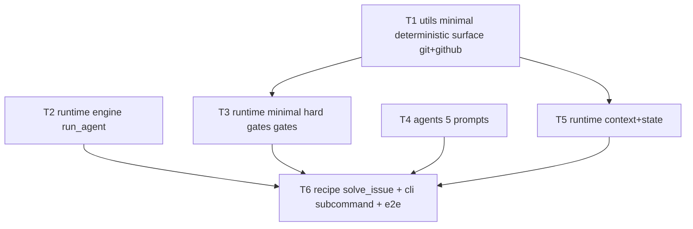

# 0060 · Architecture Refactoring (Batch One): Consolidate the Core into agents (Prompts) + recipes (Orchestration), Delegate Operations to Agents, and Retain Only Minimal Hard Gates + a Deterministic runtime/utils Layer

<!-- This file is maintained by the spec tool: frontmatter is the structured source data (including the tasks DAG), and the body is the group-level overview in the nine-section rust-RFC format. -->

## Summary

**Invert and consolidate** the OpenAgents core back to its original intent—“all operations requiring judgment are performed through agents; humans provide only high-level oversight”—
and realize it as two categories of code: **agents (prompts)** and **recipes (orchestration)**. The core contract:

> **Agents handle all operations requiring judgment (implementation / review decisions / git delivery / conflict resolution / e2e interpretation) and return structured verdicts;
> recipes route solely on those verdicts (sequence / loops / branches) and make no business judgments themselves.**

- `agents/*.py`: one module per agent, containing only a `string.Template` prompt (`PROMPT`) + an
  `OUTPUT_SCHEMA`, with **zero logic**.
- `recipes/*.py`: each flow contains only control flow + `runtime.run_agent` calls, with **no direct git/gh/subprocess calls whatsoever**.
- `runtime/`: the only permitted “mechanism code”—`engine.run_agent` (fill placeholders → dispatch to backend → collect structured output) +
  `gates.py` **minimal hard gates** (verify only objective facts, with no business judgment: assertions that head has advanced, loop iteration caps, PR existence, evidence provenance stamps).
- `utils/`: all deterministic, non-agent primitives (git / gh reads and writes, releases, etc.).

This group is **batch one of an incremental delivery** (the issue's “incremental delivery” constraint): **additively** establish the skeleton of the new stack and make the `solve_issue`
recipe (`plan → implement → review(loop while REWORK) → deliver`) **run end to end on a real issue**, proving that the contract holds;
**leave** the old `orchestrator/messages/vigil/github/workspace` **untouched** (their deletion, migration of `vigil/poll_comments/fleet`,
and invalidation of old specs are deferred to later batches).

## Motivation

**Original intent (CLAUDE.md principles 5–6).** OpenAgents is positioned as decentralized collaboration among multiple agents: agents handle matters requiring judgment, while humans provide only
high-level oversight and accept results based on outcomes (principle 8). The current code, however, has gone in the opposite direction: the vast majority of business logic is **hardcoded in Python**, with agents receiving only
a thin layer of calls.

**Evidence of the current state (`openagents/` in this repository, measured on 2026-07-09).**
- The entire package contains **~8970 lines of Python across 40 modules** (`find openagents -name '*.py' | xargs wc -l` = 8968 total).
- The largest modules are all “operations”: `messages.py`(950), `github.py`(870), `orchestrator.py`(781), `reviewer.py`(510),
  `state.py`(439), plus `conflict.py`(234), `conflictdiag.py`(210), `executor.py`(174), and others.
- Hardcoded git/gh/subprocess operations are scattered throughout (the issue records **92 occurrences**; my spot check with `grep -nE 'subprocess\.|"gh"|"git"'`
  found **34 direct literal calls** in non-spec modules alone; adding indirect calls through the `github.py`/`workspace.py` primitives is consistent with the issue's count).
- The code that actually “calls agents” consists of only two thin layers: `backends/base.py` (`AgentBackend` Protocol: `run(*, work_dir, task,
  context) -> AgentResult`) + `backends/claude_code.py` (feeds the prompt to `claude -p`).
- **There is no `agents/` prompt directory at all** (`ls openagents/agents` = No such file): all prompts are task strings assembled
  inline in Python (the `_DRAFT_RFC_TASK` / refine / implement / iterate text in `orchestrator.py`,
  the rubric in `reviewer.py`, etc.), scattered throughout, inconsistent, and difficult to reuse.

Conclusion: **90% of the Python is “operations” rather than “orchestration,” contrary to the original intent.**

**Why do this now (elevate the lesson from #140 into a general principle).** The painful lesson of issue #140 (recorded in this repository's `git-in-harness-responsibility-
vacuum`): **all git behavior hardcoded into the harness → spinning without progress after divergence (PR#127's clean working tree was treated as “delivered” even though head had not advanced) →
decision: delegate git delivery/conflicts to agents (agents perform their own rebases; `force-with-lease` only on their own branch), leaving the harness with just one deterministic hard gate checking “has head
actually advanced?”** (`assert_delivered_or_fail`, see Spec-0056). This lesson is not specific to git; it is a microcosm of the entire
architecture: **hardcoding any operation “requiring judgment” into the harness will lead to spinning without progress or lying in edge cases; delegate it to an agent + retain minimal objective hard gates
as a backstop.** This group elevates that lesson from a single special case into an **overarching architectural principle**, reorganizing directories and responsibility boundaries in one pass.

**Why the core contract is necessary.** An orchestration loop must determine “did the review pass?” to know whether to run another iteration. If Python is forbidden from containing business judgments, then
**branch conditions must come from agents' structured output**: the reviewer agent returns `{"verdict": "PASS" | "REWORK", "reason": "..."}`,
and the recipe looks only at `verdict` to decide whether to loop or proceed. Without structured verdicts, “zero hardcoded business judgment” cannot hold—this is the technical foundation of the refactoring.

## Guide-level explanation

**What an agent looks like (`agents/reviewer.py`)—only strings and placeholders, zero logic:**

```python
# openagents/agents/reviewer.py   # Spec-0060/T4
from string import Template

PROMPT = Template("""You are a reviewer agent. Review the changes in PR #$pr_number and check each acceptance criterion.
At the end, output only one line of JSON: {"verdict": "PASS" | "REWORK", "reason": "..."}
Original issue text:
$issue_body
""")
OUTPUT_SCHEMA = {"verdict": str, "reason": str}
```

Use `string.Template` (`$placeholder`), **not f-strings / `.format` / `.md`**: an f-string cannot be stored as a value for later substitution;
the `{}` in `.format` conflicts with the `{}` in JSON examples in prompts; `.md` cannot distinguish placeholders and has no schema. `Template`'s `$name`
supports deferred `substitute` without interfering with JSON's `{}`.

**What a recipe looks like (`recipes/solve_issue.py`)—pure control flow, routing only on verdicts:**

```python
# openagents/recipes/solve_issue.py   # Spec-0060/T6 (illustrative, not the final implementation)
from openagents.runtime import engine, gates
from openagents import agents

def solve_issue(*, issue_number, backend, ctx):
    engine.run_agent(agents.planner,     backend=backend, **ctx.for_plan(issue_number))
    engine.run_agent(agents.implementer, backend=backend, **ctx.for_implement(issue_number))
    for _ in gates.round_cap():                        # Hard gate: iteration cap to prevent infinite loops
        v = engine.run_agent(agents.reviewer, backend=backend, **ctx.for_review(issue_number))
        if v["verdict"] == "PASS":
            break
        engine.run_agent(agents.implementer, backend=backend, feedback=v["reason"], **ctx.for_iterate(issue_number))
    d = engine.run_agent(agents.deliver, backend=backend, **ctx.for_deliver(issue_number))
    gates.assert_head_advanced(before=d["base_sha"], workspace=ctx.workspace)   # Hard gate: was it really delivered?
    return d
```

The recipe **does not itself judge** “is the code correct / did the review pass / how should conflicts be resolved”—it only reads the `verdict`/decision fields returned by the agent to decide
loop-or-next, and calls **minimal hard gates** at key points to backstop the agent's own claims (preventing lies and infinite loops). `github.py` / `evidence_gate` /
`conflict` “disappear” as whole components: they become instructions in the corresponding agent prompts + tool operations performed by the agents themselves.

**The boundary for minimal hard gates (fully consistent with the division of responsibilities with agents):**
- **Belongs in hard gates (`runtime/gates.py`, deterministic Python)**: whether head has advanced (was it really delivered?, #140's `assert_delivered`),
  loop iteration caps (prevent infinite loops), PR number / branch existence, evidence provenance stamps (`head_sha` matching, Spec-0055).
- **Belongs to agents**: whether code is correct, review PASS/REWORK, how to resolve conflicts, how to interpret e2e results.
- In one sentence: **requires judgment → agent; objectively mechanical → deterministic code.** Releasing (creating a tag from HEAD + generating a changelog) is mechanical and requires zero judgment,
  so it precisely **should not** be delegated to an agent—it belongs in `utils/release.py`, following the same boundary as “minimal hard gates,” rather than constituting an exception.

**What you can do after this batch is delivered**: `oa solve <issue>` (or an equivalent subcommand) uses the **new stack** and the `solve_issue` recipe to run through a real
issue, with all CI checks green—proving that the contract of “zero business judgment in recipes + verdicts from agents + minimal hard gates as a backstop” holds in a real end-to-end flow. Old commands
(`vigil`, etc.) continue using the old code in this batch, with zero regressions.

## Reference-level explanation

### Target architecture (general principle; this group implements only the additive skeleton + the solve_issue vertical slice)

```
openagents/
  cli.py          # Thin entry point: parse commands → call recipes or utils; contains zero business logic
  agents/         # ① Prompts: python + string.Template, zero logic, only strings and placeholders
  recipes/        # ② Orchestration: pure control flow, calls only runtime.run_agent, chains agents through sequences/loops/branches
  runtime/        # ③ Engine + minimal hard gates: the only permitted “mechanism code”
    engine.py     #   run_agent: read agents.PROMPT → fill placeholders → dispatch to backend → collect structured output
    gates.py      #   Minimal hard gates: assertions that head has advanced, loop iteration caps, PR existence, evidence provenance stamps
    context.py    #   Assemble placeholder values: PR history injection, etc. (read through utils.github)
    state.py      #   Persist issue→run state + comment cursors
  backends/       # ④ CLI adapters: base.py / claude_code.py / codex.py (untouched in this group)
  utils/          # ⑤ Everything deterministic and non-agent: github / git / release / notes / spec/ …
```

### Final destinations of the 40 legacy modules (migration mapping; **deletions deferred to later batches**)

| Destination | Source legacy modules | Change |
|---|---|---|
| **agents/** (prompts) | Inline refine/implement/iterate text in orchestrator; reviewer, executor, conflict, conflictdiag, align, issuecheck; the decision-making portion of backfill | **Reduce Python logic to prompt strings**, delegating decisions to the agent |
| **recipes/** (orchestration) | Stage sequencing in orchestrator; vigil, fleet; routing in messages | Retain only **control flow**, delegating all operations to agents |
| **runtime/** (engine + hard gates) | Backend invocation logic, agentcontext, state, the objective validation portion of evidence_gate, assert_delivered from #140 | Hard gates retain only objective fact verification |
| **backends/** | backends/ unchanged | Largely unchanged; add codex later |
| **utils/** (deterministic) | github, workspace→git, identity, config, envcheck, release, hold, skip, blocknote/worknote/replynote→notes, results, spec/, templates | Mechanical operations; no agent dispatch |

### Delivery scope for this batch (batch one = additive vertical slice, no big-bang refactor)

To fulfill the issue's requirements to “avoid a one-shot big-bang refactor; migrate one recipe at a time” and address “test migration risks” (delegating git previously broke ~6 test git-fakes,
see #140), this batch **only adds files, without modifying/deleting any legacy modules**: the new and legacy stacks coexist, and `cli.py` gains a subcommand that uses the new stack. Thus:
① Zero regressions for the legacy orchestrator/messages/vigil and their 11 test stubs; ② Once the contracts have been validated on a real issue, later batches will migrate
recipes one by one, delete the corresponding legacy modules, and retire their specs.

- **`runtime.engine.run_agent(agent_module, *, backend, **placeholders) -> dict`**: Read `agent_module.PROMPT`
  → `Template.substitute(**placeholders)` → `backend.run(work_dir, task=prompt, context=...)` → Parse the JSON on the final line
  of the agent output, validate keys and types against `agent_module.OUTPUT_SCHEMA` → Return a dict. **The engine knows nothing about any specific workflow**
  (swapping in a different set of agents/recipes requires zero changes; decoupling under principle 10).
- **`runtime.gates`**: `snapshot_head(*, workspace)` (**called by the recipe before dispatching deliver**, deterministically records the objective
  baseline `before`—never use the agent's self-reported `base_sha`, otherwise the agent could report a fake baseline and make the gate always pass; see #140),
  `assert_head_advanced(*, before, workspace)` (head has not advanced → raise, guarding against the no-op behavior in #140; returns the actual after),
  `round_cap(*, max_rounds)` (generator/counter; limit exceeded → raise, preventing infinite loops), `assert_pr_exists(*, pr_number)`,
  `assert_evidence_stamp(*, head_sha, claimed)` (evidence provenance stamp mismatch → raise, Spec-0055). **Only verifies objective facts; contains no
  business judgments**—this is the final deterministic line of defense for checking agent self-reports and preventing lies/infinite loops. This batch wires three gates into solve_issue
  (`round_cap` + `assert_head_advanced` + `assert_evidence_stamp`, with `before` obtained deterministically via `snapshot_head`);
  `assert_pr_exists` will be wired in during the batch that adds the “open PR step” (see the “no open PR step” item in this batch's delivery scope and Unresolved).
- **`runtime.context` / `runtime.state`**: `context` assembles placeholder values (injecting PR history/issue body, calling `utils.github` for reads);
  `state` persists issue→run state + comment cursors. To avoid touching the legacy `state.py` (439 lines, targeted by multiple test stubs), the new `runtime/state.py`
  uses an **independent state-file namespace** (the new stack has its own set), leaving the legacy `state.py` in place unchanged.
- **`agents/` (5 in this batch, required by solve_issue)**: `planner` (draft/refine RFCs), `implementer` (implement according to the RFC / iterate based on feedback),
  `reviewer` (review → `{verdict, reason}`), `deliver` (git commit/push/resolve conflicts → structured delivery report, absorbing the decision-making from conflict/
  conflictdiag), `tester` (independent e2e execution + interpretation). `triager`/`replier` belong to `vigil`/`poll_comments` and are deferred to later batches.
- **`utils/` (this batch establishes only the minimal surface required by solve_issue)**: `utils/git.py` (head-sha / porcelain / worktree, thin wrappers around existing
  `workspace.py` primitives), `utils/github.py` (gh pr reads + machine comment writes, thin wrappers around existing `github.py` primitives). **Thin re-exports** provide
  a stable import surface for the new stack **without copying** the 870-line github.py (Occam's razor, principle 1); moving entire legacy modules into utils/ and putting release/notes/
  spec/ in their proper locations are deferred to later batches.
- **`recipes/solve_issue.py`**: `plan → implement → review(loop while REWORK, round_cap as a safeguard) → deliver
  (snapshot_head deterministically records before → assert_head_advanced + assert_evidence_stamp as safeguards)`, containing only control flow +
  `run_agent`/`gates` calls, with **zero direct git/gh/subprocess calls** (`before` is also obtained through `gates.snapshot_head`; the
  recipe does not touch git).
- **Delivery assumption for this batch: no “open PR” step; the PR number may be absent (`pr_number=0` as a fallback)**: This vertical slice focuses on decision
  routing and hard gates for `plan→…→deliver`, and **does not include `gh pr create`**—planner/implementer only commit+push, and deliver only pushes the branch. Thus, it works end to end for issues
  **with an existing PR** (such as this issue, #145); for **brand-new issues without a PR yet**, reviewer/deliver receive `pr_number=0`,
  and context falls back to “issue body only.” The batch that adds “open PR” must complete this support (hence `assert_pr_exists` is not wired in for this batch). This is also
  the source of tension between the three branch-push locations (planner/implementer/deliver) and the comment that “deliver is the final delivery step”—**consolidation into a single delivery point** is likewise deferred to later
  batches (see Unresolved / Future possibilities).
- **`cli.py`**: Add a subcommand that uses the new-stack `solve_issue` (additive; existing subcommand routing remains unchanged).

### DAG and file allocation



| Task | Owned files (exclusive within this batch) | depends-on |
|---|---|---|
| T1 | `openagents/utils/__init__.py`, `openagents/utils/git.py`, `openagents/utils/github.py`, `tests/test_utils_git.py`, `tests/test_utils_github.py` | — |
| T2 | `openagents/runtime/__init__.py`, `openagents/runtime/engine.py`, `tests/test_runtime_engine.py` | — |
| T3 | `openagents/runtime/gates.py`, `tests/test_runtime_gates.py` | T1 |
| T4 | `openagents/agents/__init__.py`, `openagents/agents/planner.py`, `openagents/agents/implementer.py`, `openagents/agents/reviewer.py`, `openagents/agents/deliver.py`, `openagents/agents/tester.py`, `tests/test_agents_prompts.py` | — |
| T5 | `openagents/runtime/context.py`, `openagents/runtime/state.py`, `tests/test_runtime_context.py` | T1 |
| T6 | `openagents/recipes/__init__.py`, `openagents/recipes/solve_issue.py`, `openagents/cli.py`, `tests/test_recipe_solve_issue.py`, `scripts/e2e-spec-0060-agents-recipes-core.sh` | T2, T3, T4, T5 |

(`runtime/__init__.py` belongs to T2 and serves only as a package marker; downstream code uses `from openagents.runtime.engine import run_agent` /
`from openagents.runtime import gates, context, state` to import individual modules, preventing `__init__` from becoming a shared write target across Tasks.)

### e2e testing approach for this batch

- **intent**: Demonstrate that the architectural contracts hold along the **actual execution path**—the `solve_issue` recipe routes solely according to agents' structured decisions (PASS→next /
  REWORK→loop), making zero business judgments itself; the minimal hard gates actually provide safeguards (head has not advanced / round limit exceeded → raise); `agents/*` truly contains no logic,
  and `recipes/*` truly contains no direct git/gh/subprocess calls.
- **method (offline and deterministic—this batch is purely backend orchestration, with no frontend to navigate; I have checked the tool list myself: no Playwright / Chrome DevTools
  MCP, so no browser e2e is planned)**:
  1. **Contract routing unit tests** (`tests/test_recipe_solve_issue.py`, with a fake backend supplying canned structured output): reviewer returns
     `{"verdict":"REWORK"}` twice in succession, then `{"verdict":"PASS"}` → Assert that implementer is called for 2 iterations and the loop
     proceeds to next after PASS; deliver reports that head has not advanced → `assert_head_advanced` raises; reviewer always returns REWORK → `round_cap` raises at the limit.
  2. **Zero-logic/zero-IO grep anchors** (e2e script): `agents/*.py` contains only `Template(` + `OUTPUT_SCHEMA` and **no `def `/
     `import subprocess`/`gh`/`git` calls**; `recipes/solve_issue.py` contains **no `subprocess`/`"gh"`/`"git"`/direct
     `import ... github`/`workspace`** (only through `runtime.run_agent` + `gates`).
  3. **Real-issue smoke test (dogfood, Phase-3 human acceptance/runbook, not a deterministic CI gate)**: `oa solve <a real issue>` successfully runs through the new stack,
     with all PR CI checks green—this is the issue's 5th acceptance criterion, recorded in the runbook as outcome acceptance (principle 8), rather than included in the offline script.
- **Script**: `scripts/e2e-spec-0060-agents-recipes-core.sh` (ruff check + ruff format --check + targeted pytest +
  grep anchors), collected by the PR e2e signpost.

## Drawbacks

- **A transition period with both old and new stacks**: Batch one establishes the new stack additively while retaining the old stack, so the repository temporarily has two invocation paths (`orchestrator` vs
  `recipes`), and the line count rises slightly instead of falling. This is the necessary cost of “avoiding a big bang and switching one recipe at a time”; consolidation (deleting old modules and substantially reducing the line count) comes in later batches.
- **`utils/git` and `utils/github` are thin re-exports**: This batch does not actually move `workspace.py`/`github.py` into `utils/`; it only wraps them in
  a stable import interface. This creates temporary redundancy in which “two names refer to the same implementation,” until the actual move in a later batch.
- **Minimal hard gates cannot determine “correctness”**: `assert_head_advanced` only proves that “head has advanced”; it cannot prove that “the delivered content is correct.” Correctness still relies on
  the reviewer agent. What is hardened is objective facts such as “whether anything was actually delivered/whether there is an infinite loop,” rather than quality—the two belong to separate layers, as designed.
- **Agent structured output may not conform to the schema**: After business judgments move into agents, `run_agent` depends on agents producing valid JSON; when an agent
  goes off track and emits invalid JSON, the engine needs explicit failure semantics (see Unresolved).

## Rationale and alternatives

**Why prompts use Python `string.Template` rather than `.md`.** `.md` cannot declare `OUTPUT_SCHEMA`, has no placeholder types, and requires an additional
loader; Python modules are inherently importable, can coexist with schemas, and can be directly asserted by tests to contain “no logic.” Compared with
f-strings (which cannot be stored as values for deferred substitution) and `.format` (whose `{}` conflicts with JSON examples in prompts), `Template` with its `$name` syntax is the only choice that simultaneously supports “storage, deferred substitution,
and no conflict with JSON `{}`.”

**Why retain “minimal hard gates” instead of pursuing absolutely zero hardcoding.** #140 has already demonstrated that relying entirely on agents' own reports can lead to spinning without progress/lying in edge cases (a clean workspace
being treated as a completed delivery). Retaining a deterministic fallback gate that **checks only objective facts** costs very little and prevents spinning without progress/infinite loops/lying. The boundary precisely follows
the division of responsibilities with agents: objective, mechanical work stays in code; work requiring judgment is delegated to agents.

**Alternative A: A one-shot big-bang refactor (move 40 modules directly and delete the old stack).** Rejected—the issue explicitly requires “delivery in batches”; delegating git in #140 alone broke
~6 test git-fakes. Moving 40 modules at once would break 11 test stubs simultaneously + make the PR too large to review, destroying the old stack before the contracts are verified and making the risk unmanageable.
This batch chooses an additive vertical slice: first validate the contracts with a real issue, then migrate and delete the old code one recipe at a time.

**Alternative B: Move the old modules directly into `utils/git` and `utils/github` (instead of thin re-exports).** Rejected (for this batch)—moving `github.py`(870)/
`workspace.py`(122) would change import paths referenced by 11 test stubs, triggering exactly the test-migration risk this batch explicitly seeks to avoid. Thin re-exports decouple “moving”
from “establishing contracts,” leaving later batches to bear the regression cost of the move separately.

**Alternative C: Let recipes grep agents' natural-language output for branch conditions (without structured schemas).** Rejected—that would move business judgments
(“does this passage count as PASS?”) back into Python, which is precisely what this refactor aims to eliminate. Structured `OUTPUT_SCHEMA` is the technical prerequisite for “zero business judgment in recipes.”

## Prior art

- **issue #140 / Spec-0056 (the direct source of the idea)**: Delegate git delivery/conflict handling to agents (agents perform their own rebases; `force-with-lease` is restricted to the current
  branch) + retain only the `assert_delivered_or_fail` “head has advanced” hard gate in the harness. This batch **elevates this from a git-specific case to an overarching architectural principle**;
  `gates.assert_head_advanced` is its generalization.
- **Spec-0055 (e2e capability awareness + evidence provenance stamps)**: Deterministic verification of `head_sha` matches. This batch's `gates.assert_evidence_stamp`
  follows that approach.
- **Spec-0057 “Hardening soft conventions”**: Turn soft “do not violate this” conventions into deterministic/structural rules. This batch's “zero business judgment in recipes” takes this to
  the architectural level—structurally, business judgments can only appear in agents.
- **rust-lang/rfcs** (the nine-section form of this spec itself); **Unix “separation of mechanism and policy”**: `runtime` is mechanism, and `recipes`+`agents`
  are policy; replacing the policy requires zero changes to the mechanism.
- **Agent orchestration frameworks such as LangChain / CrewAI**: Separating prompts from orchestration is common practice; this batch differs in its strict contract of “strictly zero business judgment in recipes,
  all judgments made through structured agent decisions + minimal objective hard gates as a fallback.”

## Unresolved questions

- **Failure semantics when the engine encounters invalid JSON from an agent / output that does not conform to `OUTPUT_SCHEMA`**: Raise immediately (letting the higher-level recipe handle it as one
  REWORK round), or retry a limited number of times? This batch leans toward “raise + let the recipe layer handle it through rounds”; settle this definitively during implementation.
- **The expressiveness of `OUTPUT_SCHEMA`**: Is the minimal “key → Python type” dict (`{"verdict": str}`) used in this batch sufficient, or are enumerated
  value constraints (`verdict ∈ {PASS,REWORK}`) needed? Start minimally, leaving value-domain validation to instructions in the agent prompt + later hardening as needed.
- **How `runtime/state` and the old `state.py` will ultimately merge**: This batch keeps them alongside each other in separate namespaces; how the two state systems will eventually be unified (migration or
  discarding the old one) is left to the batch that takes on the `vigil` migration.
- **Subcommand naming**: Should the entry point for the new stack be called `oa solve`, or reuse `oa run`? The user will decide during review; this does not affect this batch's file allocation.
- **The “open a PR” step + wiring up `assert_pr_exists`** (reviews #2/#3): This batch's solve_issue does not include `gh pr create`, so `pr_number`
  may be 0, and `assert_pr_exists` is defined and unit-tested but **not wired into the recipe** (for a brand-new issue with no PR, wiring it in would always raise). The batch that takes on “opening a PR”
  will add `gh pr create` and then wire `assert_pr_exists` into the gates preceding deliver.
- **Consolidation into a single delivery point** (review #4): Currently, planner/implementer/deliver all commit+push, which is in tension with “centralizing delivery in deliver”;
  a later batch will consolidate intermediate branch pushes into a single delivery point (deliver), leaving planner/implementer to create local commits only.

## Future possibilities

- **Later batches (after this batch)**: `recipes/vigil.py` (repeatedly poll issues → solve_issue, absorbing the old Vigil),
  `recipes/poll_comments.py` (fetch new comments on each PR → route to the corresponding agent by stage, absorbing `messages` routing),
  `recipes/fleet.py` (multiple repositories/multiple agents claiming work in the same worktree); `agents/triager` (align+issuecheck), `agents/replier`.
  Each recipe migration deletes the corresponding old modules + **invalidates their specs** (a spec cannot be invalidated while its old code is still alive, so invalidation is tied to the deletion batch).
- **Complete relocation into `utils/`**: Actually move all of `workspace→git`, `github`, `release`, `blocknote/worknote/replynote→notes`, `hold`/`skip`,
  `results`/`board`, `spec/`, and `templates` into `utils/`; reduce `runtime/`+`backends/`+`recipes/` to a few hundred lines.
- **`backends/codex.py`**: Add a Codex adapter to validate the backend abstraction's generality across heterogeneous CLI agents (the principle: compatibility with claude code /
  codex / nexau).
- **issue #71 runtime owner checks**: `files` mutual exclusion represents design-time ownership; hardening it into runtime lease/CAS follows the same principle as this refactor's “structurally impossible
  to violate.”
