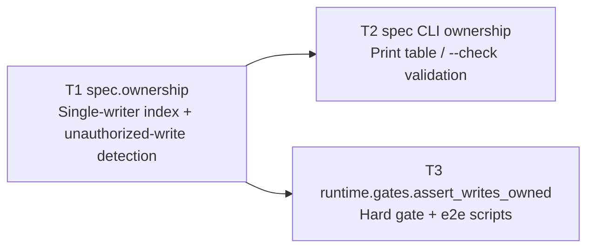

# 0071 · Turn “single-writer” file ownership from a design-time declaration into an enforceable runtime guard

<!-- This file is maintained by the spec tool: frontmatter is the structured source data (including the tasks DAG), and the body is a group-level overview in the nine-section rust-RFC format. -->

## Summary

OpenAgents’ **collaborative work mode** (multiple agents implementing one spec group in parallel in the same worktree) has **write contention**: two
agents may modify the same file at the same time—an agent version of a **data race**. Currently, this is maintained solely through **Principle 6, “Each Task occupies a mutually exclusive set of
`files`,” + manual reviewer inspection + self-discipline**; `spec validate` also checks only at **design time** that `files` within the same group do not overlap (error),
with **no runtime enforcement**—an agent can write files that do not belong to its Task without anything stopping it.

Drawing on Rust’s **unique ownership + exclusive `&mut` access** (aliasing XOR mutability, eliminating data races at compile time),
this spec advances “single writer” from a **design-time declaration** to an **enforceable runtime guard**, implementing three thin layers:

1. **`spec.ownership` (pure parser)**: builds a **single-writer index** (path → unique
   owner Task) from a group’s `tasks[].files`, then uses it to determine “which writes in a changeset target unowned files” (unauthorized writes); generated artifacts (the group’s spec md /
   `OVERVIEW.md` / `ARCHITECTURE.md`) are always allowed.
2. **`runtime.gates.assert_writes_owned` (hard gate)**: an exception-raising rejection primitive—after harness delivery, it reads the set of files actually changed,
   and unauthorized writes directly trigger `GateError`, at the same layer and in the same style as `assert_head_advanced` / `assert_evidence_stamp`.
3. **`spec ownership` (CLI interface)**: without `--check`, prints the single-writer ownership table (human-readable + greppable);
   `--check --group --changed` validates a changeset and returns exit code 1 if there are unauthorized writes (callable by CI/harnesses).

This round implements **only the “file ownership” half** (the “unauthorized writes are blocked by the harness” acceptance criterion in issue #71). **Versioned shared-state
CAS** (readers obtain immutable snapshots with version numbers; writers supply `expected_version`) and the **capability manifest**
(`capabilities: [read_fs]` + child-agent permissions ⊆ parent permissions) are the other half, listed under Future with a separate issue to be opened, to avoid making one PR too large.

## Motivation

### Background: the “agent version of a data race” in collaborative mode

Principles 2/6 allow **multiple agents within the same project to collaboratively implement one spec group**, with each Task using frontmatter `files`
to declare a set of files it **exclusively owns**. This “file allocation” applies Rust’s “unique ownership” to agent orchestration: a file
has only one writer Task at any given time; other Tasks have read-only access. The problem is that **so far, this is only a prose convention + a design-time
check**:

- `spec validate`’s `_file_overlap_checks` checks only at **design time** (when writing the spec) that **`files` within the same group do not overlap**
  (error); overlap across groups produces only a warning.
- Once an agent starts **running**, no mechanism prevents it from writing **files that do not belong to its Task**. Principle 6’s “Each Task occupies
  a mutually exclusive set of files” and the reviewer gate both fundamentally **rely on everyone’s self-discipline**—which inevitably breaks down at scale.

The `Task` dataclass’s docstring has long reserved this extension point (original wording): “`files` is a single-writer ownership declaration (Principle 6 /
the **structured source** for runtime owner checks in issue #71).” This spec delivers on that promise of “runtime owner checks.”

### Borrowing Rust’s approach (learning the idea, not writing Rust)

Rust uses **aliasing XOR mutability** (either aliasing or mutability) to eliminate data races at compile time: at any given moment, a value is either
read-only for multiple readers (`&T`, with arbitrarily many concurrent readers), or writable by exactly one party (`&mut T`, exclusive); **“someone reading while someone else
writes” is never allowed**. Mapped to multi-agent systems:

| Soft convention (an imperative in prose) | Corresponding Rust concept | Hardened by this spec into |
|---|---|---|
| Do not let two agents write the same file at the same time | Unique ownership + exclusive `&mut` access | Each file has a unique owner Task within the group; writing a file outside one’s own `files` → rejected by `assert_writes_owned` |
| Unauthorized writes must be blocked by a mechanism, rather than relying on self-discipline | Compile-time borrow checking | `spec.ownership.unowned_writes` turns design-time declarations into an executable runtime decision |

### Why implement the “file ownership” half first

Issue #71 lists two implementation paths (module-level comments / spec file allocation) and two halves of acceptance (**unauthorized writes are blocked** + **versioned shared-state
reads and writes with CAS**). For the **file ownership** half:

- **The structured source is already in place**—`tasks[].files` is existing machine-parseable frontmatter (issue #69 already moved file allocation into
  `Reference-level explanation` while retaining the structured source), so no new declaration format is needed;
- **The decision is pure set arithmetic**—“changeset ⊆ declared files ∪ generated artifacts,” with no need to introduce heavyweight mechanisms such as leases or SQLite
  (Principle 1, Occam’s razor);
- **Enforcement already has a home**—`runtime.gates` is precisely the layer for “minimal hard gates, called on the harness side”; adding
  `assert_writes_owned` fits the existing hard gates exactly.

By contrast, **versioned shared-state CAS + capability manifest** requires changes to the `state.json` read/write protocol and the agent sandbox model, making it a larger
piece of work. Forcing it into this PR would violate “the 6-Task limit + pairwise disjoint files + one feature per PR.” This round therefore stays focused,
with the other half listed under Future.

## Guide-level explanation

Three layers, from pure logic to the operational interface:

### ① Single-writer index (`spec.ownership`)

```python
from openagents.spec import model, ownership

group = next(g for g in model.load_all(specs_root=Path("docs/specs")) if g.number == "0071")

index = ownership.build_index(group=group)
index.owner_of(path="openagents/spec/ownership.py")   # -> '0071/T1' (unique owner)
index.owner_of(path="does/not/exist.py")              # -> None (unowned)

# Unauthorized writes in a changeset (files declared by no Task in this group and not generated artifacts):
ownership.unowned_writes(group=group, changed_paths=[
    "openagents/spec/ownership.py",   # Owned (T1) → allowed
    "docs/specs/OVERVIEW.md",         # Generated artifact → allowed
    "evil.py",                        # Unowned → unauthorized
])                                    # -> ['evil.py']
```

**Generated artifacts are always allowed**: when resolving an issue, a changeset inevitably touches three types of generated artifacts in addition to each Task’s `files`—the group’s
spec markdown (`NNNN-slug.md`), `OVERVIEW.md` re-rendered by `spec render`, and
`ARCHITECTURE.md` re-rendered by `spec graph`. By convention, they are not included in `tasks[].files`, but these writes are certainly not unauthorized, so `generated_artifacts` adds them
to the allowed set.

### ② Harness hard gate (`runtime.gates.assert_writes_owned`)

```python
from openagents.runtime import gates

# Called by the harness after agent delivery (changed_paths comes from git diff --name-only):
gates.assert_writes_owned(group=group, changed_paths=changed)   # Unauthorized writes → raise GateError
```

Alongside `assert_head_advanced` (whether head has advanced) and `assert_evidence_stamp` (whether the evidence stamp is correct), this is
a deterministic defense that “backs up agent self-reports and prevents lying/infinite loops,” **reading only objective facts, with zero business judgment** (“whether the code is correct” belongs to
the reviewer agent).

### ③ CLI interface (`spec ownership`)

```console
$ spec ownership                       # Print the single-writer ownership table (owner Task → declared files)
# Single-writer ownership table (Spec-0071: owner Task → declared files)
0071/T1	openagents/spec/ownership.py
0071/T1	tests/test_spec_ownership.py
0071/T2	openagents/spec/cli.py
...

$ spec ownership --check --group 0071 --changed "openagents/spec/ownership.py,evil.py"
[error] evil.py: Unauthorized write (no Task in group 0071 declares this file, and it is not a generated artifact)
✗ Unauthorized-write check failed: 1 unowned write
$ echo $?
1
```

CI or a harness can call `spec ownership --check` directly to block “unauthorized writes” without writing Python.

## Reference-level explanation

### Scope of changes and file allocation (DAG)



- **T1** (`openagents/spec/ownership.py` + `tests/test_spec_ownership.py`) is the pure parser and **source of truth for the rules**,
  implemented first. T2 and T3 both depend only on T1; **their files do not overlap, so they can proceed in parallel**.
- **T2** (`openagents/spec/cli.py` + `tests/test_spec_cli.py`) provides thin routing that delegates to `ownership`.
- **T3** (`openagents/runtime/gates.py` + `tests/test_gates_ownership.py` +
  `scripts/e2e-spec-0071-*.sh`) adds the exception-raising hard gate + e2e scripts.

### Key decision: the set of files allowed to be written

The core of `unowned_writes(group, changed_paths, specs_root)` is a set expression:

```
allowed = { files of all Tasks in the group } ∪ generated_artifacts(group, specs_root)
offenders = sorted({ p for p in changed_paths if p ∉ allowed })
```

- `build_index` uses `dict.setdefault` (**first declarer wins**) to ensure determinism—two Tasks declaring the same file within one group
  is itself a `spec validate` error; this index **does not repeat** that validation and simply takes the first owner for lookup (single responsibility, Principle 10).
- `generated_artifacts` uses `model.group_path` to construct the path to the group’s spec md, then adds the fixed paths
  `{specs_root}/OVERVIEW.md` and `{specs_root}/ARCHITECTURE.md`. `specs_root` is injectable → hermetic testing is possible
  (testing that “a custom root means the old default generated-artifact paths are no longer allowed”).

### The two enforcement interfaces

- **Programmatic**: `runtime.gates.assert_writes_owned` — called by the harness/orchestrator after delivery; raising `GateError`
  is the existing “rejection” signal (as with the other hard gates). This PR **provides the primitive** with comprehensive unit tests; wiring it into
  the actual delivery path in `recipes.vigil` (calling it after reading `git diff --name-only`) is the **next increment**—that path must also determine
  “which spec group this delivery corresponds to,” which touches a substantial amount of Vigil internals. Following Occam’s razor, it is left out of this PR (see Unresolved).
- **CLI/CI**: `spec ownership --check` — blocks unauthorized writes without requiring Python code, providing a runtime
  guard interface that **can be run right now**.

### Layering and dependencies

`runtime.gates` adds imports of `spec.ownership` / `spec.model` (runtime → spec). This is a reasonable direction:
**the harness enforces the ownership declared by the spec**, so it naturally depends on the spec model; the `spec` layer does not depend on `runtime` in return (no cycle).
`ARCHITECTURE.md` is re-rendered with `spec graph` to include this new edge.

## Drawbacks

- **Covers only the “file ownership” half of the issue.** Versioned shared-state CAS and the capability manifest are not implemented; there is still no mechanism to enforce restrictions on
  concurrent writes to `state.json` or unauthorized filesystem/network access by read-only agents (listed under Future).
- **The hard gate is not yet wired into the live Vigil delivery path.** This PR provides the `assert_writes_owned` primitive + the `spec ownership
  --check` interface, but does not change `recipes.vigil` to call it automatically on every delivery—true “automatic runtime rejection” still needs
  one final connection (see Unresolved / Future). Enforcement currently relies on CI/the harness **explicitly calling** `--check`.
- **Ownership granularity is at the “Task” level, not the “agent instance” level.** The current automated path is “one agent per issue handles the entire spec,”
  so the changeset only needs to be ⊆ the files of the **entire group** ∪ generated artifacts; finer checks for true “exclusive ownership by each per-Task-agent” must wait
  until the collaborative multi-agent-per-worktree mode is actually implemented, so there is something to check (see Prior art / the original text of issue #71).

## Rationale and alternatives

**This design: three thin layers of mechanisms (pure parser + hard-gate primitive + CLI interface), addressing only the file ownership half of the issue.** The reasoning is that
the structured source (`tasks[].files`) is already in place, the decision is a pure set operation, and enforcement already has a home in `runtime.gates`. Turning design-time
declarations into executable runtime checks uses the smallest set of entities (one pure module + one hard-gate function + one subcommand) to address the most
practical and testable half of issue #71.

- **Alternative 1: add ownership checks to `spec validate` (design time), without runtime checks.** Rejected—the core request of issue #71
  is precisely to move from **design-time declarations** to **runtime enforcement**. `spec validate` already checks overlaps at design time; adding more checks there would still be design-time checking.
- **Alternative 2: declare owners in module-level docstrings (path 1 in the issue), and enforce this through `spec graph` docstring scanning.**
  Feasible, but heavier and prone to drift—each source file’s docstring would need `Owner: 0071/T1`, creating two sources of truth
  that must be reconciled with `tasks[].files`, violating the “single source of truth” principle. `tasks[].files` is already the **sole** machine-parseable ownership source; using it directly requires fewer entities (principle 1).
- **Alternative 3: implement versioned shared-state CAS + capabilities in this round as well.** Rejected—this touches the `state.json` read/write protocol and
  the agent sandbox model, far exceeding the limit of one PR / 6 Tasks, and these are mechanisms relatively independent of file ownership. Keep them separate and carry them forward under Future.
- **Alternative 4: wire the hard gate directly into the `recipes.vigil` delivery path (automatic rejection in this round).** Appealing, but risky—Vigil must
  determine “which spec group this delivery corresponds to” and read `git diff`, which substantially affects concurrent workers and existing tests. Following Occam’s razor, this round delivers
  the primitive + CLI first, with wiring listed under Future (the same incremental approach as Spec-0055 e2e: “gate primitive first, recipe integration later”).

## Prior art

- **Rust ownership & borrowing, Send/Sync** (*The Rust Programming Language*, chapters on ownership and fearless concurrency):
  aliasing XOR mutability eliminates data races at compile time—this spec brings “unique ownership” to agent file writes.
- **Rust RFC governance process**: [rust-lang/rfcs](https://github.com/rust-lang/rfcs) (RFC before implementation + team
  ownership)—each area has an owning team = the social-level counterpart of “unique ownership,” and is the source of principle 4, “change the rfc/spec before changing
  the code.”
- **issue #69** (a prerequisite for this issue): converted specs to the Rust RFC format, incorporated the DAG + file assignments into
  `Reference-level explanation`, and **retained `tasks[].files` as the structured source**—this spec consumes precisely that reserved
  machine-parseable source.
- **OpenAgents’ existing hard gates** (`runtime.gates`: `assert_head_advanced` / `assert_merge_allowed` /
  `assert_evidence_stamp`, Spec-0060/0017/0055): this spec’s `assert_writes_owned` sits at the same layer and follows the same style
  (only reads objective facts, raises `GateError`), adding another line of defense in which “the harness backs up agents’ self-reports.”

## Unresolved questions

- **When and how to wire the hard gate into live Vigil:** How should each worker in `recipes.vigil` determine “which
  spec group this delivery corresponds to” after delivery, read `git diff --name-only`, and call `assert_writes_owned`? The preference is to reuse the location where `snapshot_head`
  “deterministically records the baseline before delivery,” but the impact on concurrent workers and existing tests needs assessment, so it is not wired in this round and is listed under Future.
- **Resolution after an unauthorized write is rejected:** Once the live integration is in place, if an agent writes to an unauthorized file, should the result be needs-human, or should the agent rebase
  away its unauthorized changes itself? The preference is needs-human (consistent with other hard-gate failures), to be decided during integration.
- **Whether cross-group overlaps should also be blocked at runtime:** Currently, only “writes without an owner within this group” are blocked. Cross-group `files` overlaps are
  warnings in `spec validate` (a collaboration signal). Whether they should also be blocked at runtime will be reconsidered once the collaborative multi-agent-per-worktree mode is implemented.

## Future possibilities

- **Versioned shared-state CAS** (the other half of issue #71): readers obtain immutable snapshots with version numbers; writers supply
  `expected_version` when writing, and a mismatch is rejected (compare-and-swap)—eliminating “someone writes while someone else is reading” from `state.json`.
- **Capability manifest + permission propagation to sub-agents**: the manifest declares `capabilities: [read_fs]`, and the harness
  enforces the declarations, directly blocking unauthorized access; sub-agent permissions are enforced to be ⊆ parent-agent permissions (the counterpart of automatic Send/Sync propagation).
- **Wire `assert_writes_owned` into the `recipes.vigil` delivery path**: upgrade “runtime rejection” from “CI/the harness explicitly calls
  `--check`” to “automatically blocks on every delivery,” adding the final connection missing from this PR.
- **Fine-grained per-Task-agent checks**: once the collaborative multi-agent-per-worktree mode is actually implemented, tighten “changeset ⊆ the files of the entire
  group” to “each agent may write only the files of its own Task,” truly aligning with Rust’s `&mut` exclusivity.
