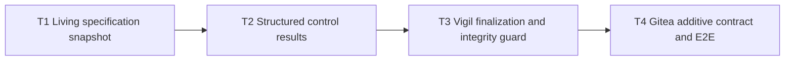

# 0075 · Structured needs-human Handoff and Label Integrity Guard

<!-- This file is maintained by the spec tool: frontmatter is the structured source data (including the tasks DAG), and the body is a group-level overview in the nine-section rust-RFC format. -->

## Summary

Change `needs-human` from “instructing the Agent to call forge APIs itself to add labels and comments” into a structured control result returned by the Agent to Vigil. The runtime recognizes `{"needs_human": true, "reason": "..."}`, and Vigil handles the handoff centrally through the existing additive label APIs and signed comments. At the same time, compare subject labels before and after every Agent action. If an Agent bypasses the protocol and incorrectly uses Gitea's replace-labels API, causing existing labels to disappear, Vigil rereads the labels, adds back only those still missing, then blocks with `needs-human` and records diagnostics. Gitea driver tests explicitly lock down the requirement that adding labels must use `POST`, while cross-repository acceptance testing ensures that source, plane, priority, and round are not overwritten by the blocking exit path.

## Motivation

OpenAgents intends `needs-human` to be a first-class safety exit: when an Agent encounters work beyond its authorization, ambiguous requirements, external service failures, or work it cannot reliably complete, it should stop automatic execution and hand the reason to a human. However, the current `_NEEDS_HUMAN_CONTRACT` requires each Agent to **add the `needs-human` label and leave a comment itself** on the issue/PR. The Agent has a forge token and can execute arbitrary commands; the prompt does not force it to call `openagents.utils.github.issue_add_label/add_label`, so it may construct HTTP requests directly based on Swagger or prior experience.

An actual Gitea run has already exposed this boundary. Before entering delivery, issue #7 had `from-synthesize + P1 + openagents + ready`; when the execution Agent requested human intervention, it sent:

```text
PUT /api/v1/repos/designer/auto-designer-work/issues/7/labels
```

Gitea v1.22.6 defines this endpoint as **Replace an issue's labels**, so only `needs-human` remained afterward. In the same round, #10 and #14 were handled by the framework's `_park_needs_human`, using `POST .../labels`, and all existing business labels were preserved. This shows that the problem is neither Gitea lacking an additive API nor the previously fixed server-side label filter, but that “the control plane delegated safety-critical writes to a general-purpose Agent.”

Labels are not decorative: upstream uses `proposal/report/ready` to indicate the plane, `from-*` to indicate the source, and `P*` and `round-*` for debugging, filtering, and attribution. Vigil itself also relies on `ready/openagents/needs-human/review-*` for routing. A single replace operation damages multiple consumers at once, and the current flow can only see `needs-human` on the next tick and treat it as a normal terminal state, without identifying that metadata has been lost.

Two layers of protection are therefore necessary: the normal path must no longer have Agents write blocking labels directly; even if an Agent ignores the contract or uses the raw token, the orchestration layer must be able to detect and restore unintended deletions caused by an action. OpenAgents does not need to understand every category of auto-designer business label. It only needs to maintain a general invariant: “An ordinary Agent action may add facts, but must not silently delete labels that already existed when it began.”

## Guide-level explanation

All Agents dispatched through Vigil can still actively decide that “this must be handed to a human,” but their final output becomes:

```json
{"needs_human": true, "reason": "The upstream test service keeps returning 503; further code changes cannot be verified for correctness"}
```

The Agent is no longer required to look up the issue number, call GitHub/Gitea APIs, choose an HTTP method, or sign the comment itself. `reason` must be nonempty and describe the specific blocker and verified facts; on normal completion, the Agent still returns its original final-line JSON schema.

The runtime recognizes this special envelope before validating ordinary role results and passes it back to Vigil as a typed `NeedsHumanRequest`. Vigil catches it and calls the single central handling function, `_park_needs_human`:

```text
Agent structured exit
        │
        ▼
runtime raises NeedsHumanRequest(reason)
        │
        ▼
Vigil _park_needs_human(subject, signed reason, agent_id)
        │
        ├── issue → issue_add_label (additive)
        └── PR    → add_label       (additive)
```

When Gitea is the forge, the request to add labels must be `POST /issues/{n}/labels`; `PUT` means explicit replacement only and is not permitted in this path. `_park_needs_human` preserves the existing idempotency and signed-comment semantics, and the next tick still classifies the subject as TERMINAL, leaving user-visible behavior unchanged.

The orchestration layer also checks label integrity around every `_act`: it records the subject's labels before the action and rereads them afterward. Normal label additions are allowed. If any label that existed before the action disappears afterward, and this is not a deletion explicitly owned by the framework's current branch, it is classified as an integrity violation. For example:

```text
before: ready, from-synthesize, P1, round-1
after:  needs-human
missing: ready, from-synthesize, P1, round-1
```

Before restoring labels, Vigil rereads the latest labels once more and uses only additive APIs to add back items that are still missing, avoiding overwriting concurrent additions. It then uses `_park_needs_human` to leave diagnostics containing the Agent identity, missing labels, and subject. The final state should be:

```text
ready, from-synthesize, P1, round-1, needs-human
```

In other words, the violating action is still blocked and automatic delivery does not continue, but the label metadata is restored. The guard does not remove newly added labels. Terminal paths that are already merged/closed do not perform restoration. Cleanup of stale review verdicts explicitly performed by Vigil and human-triggered removal of the `needs-human` block remain the responsibility of existing framework functions and are not misclassified as Agent deletions.

## Reference-level explanation

### 1. Structured control result

`runtime.engine` adds a typed `NeedsHumanRequest`, containing at least a nonempty `reason: str`. After `run_agent` parses the Agent's final line of JSON, it processes it in the following order:

1. The JSON is an object and `needs_human is true`: validate that `reason` is a string that is nonempty after trimming whitespace; if valid, raise a typed `NeedsHumanRequest`;
2. `needs_human` is present but its value is not `true`, or reason is missing/empty: fail with an explicit protocol error, without falling back to ordinary role output;
3. Other objects: continue with the existing `parse_response` and role schema validation;
4. Non-JSON output, backend failures, and timeouts: retain the existing error paths.

The special envelope must take precedence over the different response schemas of individual Agents. Otherwise, merger, deliver, replier, and others would treat it as an invalid ordinary response with missing fields, preventing centralized handling. It is only a control result and does not count as the Agent having completed its work.

`_NEEDS_HUMAN_CONTRACT` is changed to require the single-line JSON output above and explicitly prohibit Agents from modifying labels or sending handoff comments themselves. This contract remains injected into all Agent branches, including replier and conflict resolver; wording in old prompts that says “add the label yourself,” along with tests targeting that wording, is replaced at the same time.

### 2. Centralized handling in Vigil

`_reconcile` catches `NeedsHumanRequest` at the boundary where it calls `_act`, but first retains that control signal and performs the post-action label integrity read. If labels are missing, it restores them first, then uses the current subject and worker identity to generate a signed body and calls `_park_needs_human`. The current round stops without incrementing the ordinary “zero progress” attempt count. The body contains at least the reason; issue/PR numbers or arbitrary comment signatures supplied by the Agent are not trusted.

The error propagation boundary remains narrow: only the typed control signal is converted into a human handoff. Ordinary exceptions continue through the existing requeue/attempt/watchdog flow, avoiding misclassifying every parsing bug or transient network interruption as a business-level needs-human condition.

### 3. Action label integrity guard

The guard surrounds only general-purpose Agent actions initiated by `_act` and does not change `_sense/_classify/_intake`. Its input baseline comes from `facts.labels` observed immediately before the action; after the action finishes, it retrieves the latest labels through the existing forge-neutral subject read path:

```text
missing = baseline_labels - latest_labels - allowed_removals
```

`allowed_removals` must be provided explicitly by the calling branch; broad exemptions based on label prefixes are not allowed. The initial rules for this group are:

- The set is empty for ordinary issue/PR Agent actions;
- No restoration occurs after merge/closed, because the subject has entered a forge terminal state;
- For `review-or-fix`, only the subpath where facts indicate “dispatch a reviewer to generate a new verdict” may place the exact stale `review-approved:<sha>` and `review-changes-requested:<sha>` labels from the baseline on the allowlist; the set remains empty for the subpath that dispatches an implementer for rework when CHANGES_REQUESTED@head already exists;
- The framework's removal of `needs-human` after a human crosses the watermark completes before `_act` and is therefore outside the guard window.

After detecting missing labels:

1. Read the subject again; if it is terminal, only record diagnostics and exit restoration;
2. Compute the labels that are still missing and call `issue_add_label` or `add_label` for each one; these calls must be idempotent and additive;
3. Call `_park_needs_human`, with a comment listing the missing labels and restoration results, using the framework signature;
4. Stop the current round without continuing to merge, review, or the next action.

If restoring a label fails, the exception continues to propagate to the existing queue recovery mechanism. Do not attempt to restore everything at once with replace-all, and do not remove labels added by the Agent. This makes the worst-case outcome of concurrent writes duplicate additive requests, rather than another overwrite.

Structured handoff also performs the integrity check: even if the Agent has already damaged labels through a raw API before returning the envelope, Vigil completes restoration first and then applies the centralized `needs-human` handling. If no damage occurred, the central park operation only adds the label.

### 4. Forge driver contract

This group does not add a public “replace labels” capability. `openagents.utils.gitea.issue_add_label` continues to resolve the label id first, then uses:

```text
POST /api/v1/repos/{owner}/{repo}/issues/{number}/labels
body: {"labels": [label_id]}
```

The PR version, `add_label`, reuses the issue version because a Gitea PR is also an issue. Unit tests must assert the path, body, and HTTP method together, preventing a future refactor from changing POST to the semantically different PUT while tests still pass. The GitHub driver already provides additive semantics through `gh issue edit --add-label`. The guard calls only the forge abstraction and does not branch on auto-designer's label categories.

### 5. Validation and cross-repository contract

Unit tests cover:

- Normal schemas for each role remain unaffected by the special envelope;
- Valid/invalid needs-human envelopes;
- Vigil calls `_park_needs_human` exactly once for a structured exit, without having the Agent write to the forge itself;
- An Agent that only adds labels does not trigger the guard;
- When an Agent deletes one or more labels, the guard reads a second time, adds back only those still missing, and blocks;
- A concurrent re-addition before restoration does not cause further damage;
- merged/closed subjects and explicit framework deletions are not resurrected;
- Gitea add-label permits only POST.

A deterministic E2E script uses a hermetic fake forge to simulate an Agent replacing `[ready, from-synthesize, P1, round-1]` with `[needs-human]`, asserting the restored union, signed diagnostics, and TERMINAL classification. Integration testing against a real Gitea instance with auto-designer's companion specification 0039 further verifies that, after blocking, issue details still project as `ready / from-synthesize / P1 / round-1`, the timeline shows only the additive `+needs-human`, and there are no metadata-loss alerts.

### 6. DAG and File Allocation



| Task | Responsibility | Exclusive files |
|---|---|---|
| T1 | 0075 specification, failure boundaries, and acceptance criteria | `docs/specs/0075-needs-human-label-integrity.md` |
| T2 | Recognize the special envelope and define typed control signals | `runtime/engine.py`, runtime tests |
| T3 | Revise Agent/merger contracts, centralize park, and guard labels before and after actions | `recipes/vigil.py`, `agents/merger.py`, vigil/merger tests |
| T4 | Lock down Gitea POST semantics and provide hermetic E2E | `utils/gitea.py`, driver tests, e2e script |

The `files` allocations within this group are mutually exclusive; T3 depends only on the forge-neutral `github` module facade, while T4 verifies the current Gitea backend implementation without hardcoding auto-designer domain labels into OpenAgents.

## Drawbacks

- Each Agent action requires one additional subject read afterward. If a deletion is detected, a second read is required, followed by label-by-label restoration. This cost occurs only at action boundaries where an Agent has already been dispatched; it does not enter observation-only polling.
- `NeedsHumanRequest` becomes a second output envelope outside all role schemas, so the runtime and tests must maintain clear precedence.
- The Agent still holds a forge token and could theoretically continue making destructive writes before its process exits; the guard can detect and repair label deletions when `_act` returns, but it is not a permission sandbox. Completely eliminating this capability requires a credential proxy / least-privilege broker, which is outside this group's scope.
- Treating label deletion as an anomaly by default is conservative. Legitimate deletions in the current workflow are concentrated in framework functions, so the boundary is manageable; if an Agent is authorized to change labels in the future, the action contract must be explicitly extended rather than disabling the guard.
- The already-damaged #7 will not be automatically rewritten. Historical repair requires human confirmation of which labels should be restored, to avoid silently turning a code release into a data migration.

## Rationale and alternatives

“Structured intent + orchestration-layer side effects” was chosen because `needs-human` is control flow rather than a business implementation result. Vigil already owns the subject, agent identity, forge backend, idempotent park, and signature rules; making every Agent repeat these details would only increase divergence and the prompt injection surface.

The integrity guard is retained as well, rather than only changing the prompt. The actual incident occurred precisely because the Agent did not use the framework helper; prompts cannot constitute a permission boundary, and a model upgrade or a different backend could lead to raw PUT being chosen again. The guard based on before-and-after snapshots does not depend on specific commands and can cover direct HTTP, CLI misuse, and similar future regressions.

The first alternative is to expose an `openagents mark-needs-human` CLI to the Agent and continue allowing it to invoke the command itself. This is easier to use than raw curl, but still depends on the Agent following the prompt and cannot detect label deletions caused by other commands, so it is not used as a safety boundary.

The second alternative is to withhold the forge token from the Agent entirely. This is a stronger direction, but deliver/merger/replier currently still need to push branches, open PRs, reply, and merge; it requires an independent capability broker and a per-action authorization protocol. That belongs to subsequent security architecture work and should not block this data integrity fix.

The third alternative is to backfill the current state on the auto-designer board using historical labels. This can only make the corruption “look normal”; it cannot restore the Gitea source of truth, and Vigil and other consumers would still read bad data. The accompanying auto-designer specification 0039 therefore provides only observation and alerting, rather than replacing the fix in this repository.

Label-by-label additive restoration was chosen over restoring the complete set with PUT to preserve concurrent additions made after the baseline. Gitea already provides POST add-label, so there is no need to simulate compare-and-swap; a second read before restoration further narrows the race window.

## Prior art

- GitHub Actions step outputs, special CI exit codes, and typed reconcile errors in Kubernetes controllers all treat “retry needed / human intervention needed” as orchestration signals, rather than having business processes directly change control-plane state.
- Kubernetes controllers maintain object invariants through observe → diff → reconcile; this group's label guard likewise compares facts before and after an action and restores them through idempotent additive writes.
- Database migration tools commonly distinguish INSERT/UPSERT from whole-table replacement; Gitea's POST add-label / PUT replace-labels has the same danger boundary, and method-level tests should lock down semantics rather than merely assert the URL.

## Unresolved questions

This version has no unresolved questions that block implementation. The initial guard adopts the conservative contract that “an Agent must not delete any existing labels”; if an Agent truly needs to perform a label migration in the future, explicit, testable `allowed_removals` should be added to the `_act` action, rather than implicitly guessing based on label prefixes or Agent names.

Whether to further revoke Agents' forge tokens is deferred to a dedicated capability broker design; this group's acceptance criteria do not depend on that security hardening.

## Future possibilities

- Introduce a least-privilege forge broker: Agents return only structured operation proposals, and Vigil validates them before executing comment/label/merge on their behalf.
- Turn integrity violations into structured telemetry so the auto-designer timeline can display the Agent id, restoration result, and associated run.
- Add declarative policy for labels (immutable, exclusive, framework-owned), allowing the guard to be generated from a protocol manifest rather than applying a uniform conservative rule.
- Reuse a forge-neutral label monotonicity suite in the GitHub and Gitea contract tests.
- After human confirmation, provide a one-time repair tool to preview and restore the last known labels of already-damaged issues from the Gitea timeline.
