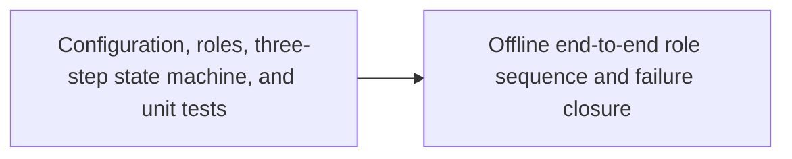

# 0082 · Minimal Objective-Preserving Development Flow

<!-- This file is maintained by the spec tool: frontmatter is the structured source data (including the tasks DAG), and the body is a group-level overview in the nine-section rust-RFC format. -->

## Summary

Add optional `flow: minimal`. It fixes the judgment-based delivery chain for a single issue at three calls: Spec Writer freezes the original issue and writes a compact, implementable Spec; Implementer implements it in one pass; Acceptance Reviewer directly replays the original failure and assigns `PASS / PARTIAL / FAIL` against the original issue. Only PASS can authorize deterministic merging; BLOCKED, PARTIAL, and FAIL all terminate the flow, without shrinking scope or repeating audits to obtain “success.”

Also add experimental `flow: generate-only`: it first writes the same compact Spec, but then dispatches a constrained coding executor only once, skips CI, e2e, Acceptance, Reviewer, and the Merger LLM, and merges mechanically through structural hard gates. It is used to observe what the model naturally produces without quality gates; merged does not mean the objective has been verified.

## Motivation

For a single issue, the current Vigil runs Drafter, Architect, possibly a redraft, Implementer, Reviewer, possibly re-implement/re-review, and Merger in sequence. Actual runs show that this chain can easily turn “preserve the original objective” into “prove at each layer that the current Spec is internally consistent”: Architect can request removal of parts that are difficult to bring to completion, Drafter narrows delivery by marking them as non-goals or future work, and Reviewer ultimately assigns PASS only against the reduced Spec. Meanwhile, each role rereads the same source code and revalidates the same boundaries, producing hundreds of tool calls even for simple changes.

The minimal flow tests a different hypothesis: a single issue that has already passed requirements admission no longer needs a design-committee-style pipeline. What it needs is a short objective contract that cannot be reduced, a developer responsible for implementation, and an acceptance reviewer who evaluates the result from the perspective of the original issue. If the underlying layer is read-only or current capabilities are insufficient, the correct result is BLOCKED/PARTIAL, rather than degrading into an easy-to-pass prompt change.

## Guide-level explanation

With `flow: minimal` configured, users still apply discovery labels to issues and have Vigil create worktrees and PRs in the same way. Only the judgment chain changes:

1. **Spec Writer** receives the full original issue text, performs at most bounded code location work, and writes a compact Spec centered on a single Task. The Spec must include an “original objective contract” and falsifiable acceptance criteria; it may change the implementation path, but may not remove objectives. If the complete solution cannot be delivered, it returns `BLOCKED`; Vigil records the blocker on the issue and does not open a PR.
2. **Implementer** reads this Spec and the same original issue text, then implements it directly. Validation prioritizes replaying the original failure; expanding into unrelated investigations of the entire repository, all versions, or the entire filesystem to demonstrate “rigor” is prohibited.
3. **Acceptance Reviewer** does not redo the architectural design; it answers only whether the original failure has disappeared at the current head. `PASS` means the objective is fully satisfied; `PARTIAL` means the result is valuable but does not fully resolve the issue; `FAIL` means the result is ineffective or introduces a regression. The latter two both stop the flow without merging.

After step 1, `generate-only` switches to a **coding executor**: it executes only the compact Spec’s sole implementation task, and is prohibited from rewriting objectives, reviewing, self-testing, or expanding the investigation; after commit/push, it enters the mechanical PR queue directly. Vigil’s existing curator manages the issue `blocked_by` DAG, and `--parallel 4` runs concurrently only those issues whose dependencies are satisfied; irreversible merges into the same base are serialized through a critical section.

After a pass, the Merger LLM is no longer called. Vigil rechecks CI, head binding, repository integrity, and the review-approved label, then directly calls the forge’s idempotent merge primitive.

## Reference-level explanation

Add a top-level `flow` configuration field with valid values `standard | minimal`, defaulting to `standard`. Both the resolved `AgentConfig` and `RepoPlan` carry this value so that configuration is preserved for both single-repository and fleet operation.

With this group’s extensions, the valid values become `standard | minimal | generate-only`. generate-only reuses the compact Spec digest, worktree isolation, head-advanced, evidence-stamp, PR head binding, and forge conflict detection; the head-bound approval label it writes mechanically is only a state-machine token and does not express a quality PASS.

`stages.minimal_spec` calls the new `agents.spec_writer`. Its output is `READY | BLOCKED`; READY writes only `docs/objectives/issue-N.md`, a compact contract with five fixed sections (original objective, invariants, implementation path, falsifiable acceptance criteria, and one implementation task), without invoking the standard flow’s nine-section RFC/DAG/render/graph. It must pass the existing head-advance and evidence-stamp hard gates, after which `minimal_design_snapshot` validates the fixed sections and the 120-line limit and records a byte-level digest; the same digest is rechecked before merging. BLOCKED does not require creating an empty commit.

In the minimal branch, `_do_solve` skips Architect and calls Implementer only once after creating the PR, passing an explicit minimal contract and the original issue. Under minimal, `_sense` treats the independent e2e stage as folded into implementation and acceptance, avoiding an additional Tester call.

`stages.acceptance` calls the new `agents.acceptance`, with the original issue, candidate Spec, diff/PR context, and existing evidence as input. Its output is strictly enumerated as `PASS | PARTIAL | FAIL`. Under minimal, `_do_review_or_fix` does not use the review-changes-requested loop: PASS produces a head-bound review-approved; PARTIAL/FAIL call the existing `_fail_automation`, persisting the reason verbatim.

`stages.merge_mechanical` executes only the forge merge primitive after `gates.assert_merge_allowed`; the minimal branch of `_do_merge` still executes the repository-integrity and design-digest hard gates before taking action.

Task DAG:

Offline outcome script: `scripts/e2e-spec-0082-minimal-objective-delivery-flow.sh`. This round will also perform a real Gitea + GLM trial run using an existing experimental issue, with the actual results recorded in the experiment’s role_runs; this run is used to evaluate the flow and is not presented as hermetic CI.

## Drawbacks

The minimal flow deliberately gives up multiple rounds of architectural debate, the full RFC template, and automatic rework; if the first implementation is incomplete, it stops with PARTIAL. Throughput is higher, but the first-attempt success rate may be lower than standard. Acceptance remains a semantic judgment; pure code cannot prove that the model will never misjudge. Mechanical merging eliminates one LLM call, but also removes the Merger’s ability to handle exceptions beyond the hard gates as they arise; all exceptions follow the existing machine failure path.

generate-only is more aggressive: code that is incorrect, untested, or fails to satisfy the objective may also be merged, so its results can be used only for isolated experiments and retrospective evaluation, and cannot count toward the production success rate. Dependency inference relies on the existing curator and forge-native edges; undeclared semantic conflicts can surface only at the PR mergeability stage.

## Rationale and alternatives

Add a profile within the existing Vigil rather than a new runner because queues, claim, worktree, forge, recovery, auditing, and hard gates are already correctly in place; copying them would only create a second state machine. Choose three judgment roles rather than two to prevent Implementer from accepting its own work; remove the independent Architect, Tester, traditional Reviewer, and Merger to prevent the same problem from being reinterpreted four times.

The alternative of “using only stages to skip architecture/e2e” is insufficient: it still makes the traditional Reviewer treat the current Spec as authoritative, still offers only PASS/REWORK, still performs automatic rework, and still calls Merger. The alternative of “retaining Architect but limiting the tool budget” only reduces time; it does not change the incentive to obtain PASS after shrinking the objective.

## Prior art

Direct delivery of a single issue by a single agent is an existing principle in the repository’s `CLAUDE.md`; the existing Vigil worktree and deterministic hard gates provide a reusable foundation. A principle similar to trunk-based delivery is to base irreversible merging on a small number of objective thresholds, rather than having multiple roles repeatedly prove the same design.

## Unresolved questions

This round leaves no open questions requiring a user decision first: minimal is explicitly an optional experimental profile, and standard remains the default; the results of the real trial run will determine whether to expand its use.

## Future possibilities

If the real trial run demonstrates that the three-step flow is effective, the original failure trace could be attached to the issue as a structured artifact rather than appearing only in the body; tool calls per step, model latency, and objective outcome could also be collected to compare standard/minimal. If Acceptance has a high misjudgment rate, one arbitration pass limited to disputed evidence could be added, but repeated reconnaissance across the entire chain must not be restored.
