# Spec architecture

> Generated by `spec graph` from the code and docstrings under `openagents/`. Do not edit by hand.

## Subsystems and components

### openagents

_Deliver software from issues using Spec-driven agent workflows._

| Component | Responsibility (first line of the module docstring) |
|----|----|
| `__init__.py` | Deliver software from issues using Spec-driven agent workflows. |
| `cli.py` | Expose OpenAgents project, delivery, reporting, and dashboard commands. |

### openagents.agents

_Define role prompts and output schemas._

| Component | Responsibility (first line of the module docstring) |
|----|----|
| `__init__.py` | Define role prompts and output schemas. |
| `acceptance.py` | Judge a candidate using independent evidence against the original issue. |
| `architect.py` | Review an admitted objective's implementation architecture before coding. |
| `coordinator.py` | Spec-0091: cheap advice, never authoritative dependencies. |
| `curator.py` | Propose blocking dependencies for new issues. |
| `deliver.py` | Define the Git delivery prompt and delivery receipt schema. |
| `drafter.py` | Define the drafting, backfill, refinement, and implementation prompts. |
| `executor.py` | Define the constrained coding executor used by generate-only delivery. |
| `implementer.py` | Define the prompt for implementing an approved Spec or applying feedback. |
| `merger.py` | Define the final merge action after deterministic gates pass. |
| `replier.py` | Define reply prompts for issue comments and pull request comments. |
| `reviewer.py` | Define the code-review prompt and verdict schema. |
| `spec_writer.py` | Define the compact, objective-preserving specification role. |
| `tester.py` | Define the independent end-to-end test prompt and evidence schema. |
| `triager.py` | Decide whether an issue can be assigned without further clarification. |

### openagents.backends

_Adapt agent execution engines to the shared backend protocol._

| Component | Responsibility (first line of the module docstring) |
|----|----|
| `__init__.py` | Adapt agent execution engines to the shared backend protocol. |
| `base.py` | Define the backend protocol, invocation result, and shared execution limits. |
| `claude_code.py` | Run Claude Code in the assigned worktree and stream its progress. |
| `nexau.py` | NexAU coding backend for Anthropic-compatible Messages gateways. |

### openagents.desktop

_Serve delivery status and live streams to the desktop dashboard._

| Component | Responsibility (first line of the module docstring) |
|----|----|
| `__init__.py` | Serve delivery status and live streams to the desktop dashboard. |
| `daemon.py` | Serve the desktop dashboard over local HTTP and server-sent events. |

### openagents.observations

_Spec-0087: artifact-owned observation evidence and scoped gap requests._

| Component | Responsibility (first line of the module docstring) |
|----|----|
| `__init__.py` | Spec-0087: artifact-owned observation evidence and scoped gap requests. |
| `capabilities.py` | Spec-0092/T3: offline declarations of this installation's evidence reader. |
| `evidence.py` | Spec-0087: read opaque, issue-scoped evidence without understanding runtime events. |
| `execution_contracts.py` | Spec-0093/T1: validate and project publisher-owned execution facts. |
| `gaps.py` | Spec-0087: runner-authenticated gap reports, persisted before transmission. |

### openagents.recipes

_Orchestrate OpenAgents delivery workflows._

| Component | Responsibility (first line of the module docstring) |
|----|----|
| `__init__.py` | Orchestrate OpenAgents delivery workflows. |
| `backfill.py` | Backfill a Spec from existing code and open a draft pull request. |
| `stages.py` | Run individual delivery stages and enforce their result contracts. |
| `vigil.py` | Autonomous, level-triggered Vigil orchestration. |

### openagents.runtime

_Provide shared mechanisms for role invocation, gates, context, and state._

| Component | Responsibility (first line of the module docstring) |
|----|----|
| `__init__.py` | Provide shared mechanisms for role invocation, gates, context, and state. |
| `context.py` | Assemble role arguments and context from repository facts. |
| `engine.py` | Render a role prompt, dispatch it to a backend, and validate its result. |
| `evidence.py` | Validate head-bound behavioral evidence emitted by Tester. |
| `gates.py` | Verify objective repository facts before delivery or merge. |
| `invocation.py` | Fail-open, redacted audit records for delivery-side agent invocations. |
| `legacy.py` | Fail-closed detection for pre-Spec-0081 terminal state. |
| `preflight.py` | Spec-0091: bounded, fail-open advice and transactional queue tie-breaking. |
| `research.py` | Normalize and render bounded, objective repository evidence for role reuse. |
| `state.py` | Persist delivery run state and comment cursors in a project-local namespace. |
| `timing.py` | Record phase transitions and reconstruct wall-clock timelines across polls. |
| `token_usage.py` | Spec-0079: privacy-minimal, append-only token usage ledger. |
| `tool_usage.py` | Privacy-preserving, append-only tool-usage telemetry for agent invocations. |

### openagents.spec

_Read, validate, and render the active Markdown Spec snapshot._

| Component | Responsibility (first line of the module docstring) |
|----|----|
| `__init__.py` | Read, validate, and render the active Markdown Spec snapshot. |
| `cli.py` | Create, validate, and render OpenAgents Specs. |
| `graph.py` | Generate the architecture view from module docstrings and internal imports. |
| `model.py` | Read and write numbered Markdown Specs with structured YAML frontmatter. |
| `mutate.py` | Create Spec groups, add tasks, and remove abandoned tasks from the snapshot. |
| `ownership.py` | Resolve the single-writer owner of each Spec-declared file and flag unowned writes. |
| `render.py` | Generate the Spec overview, task board, dependency graphs, and ownership report. |
| `reservation.py` | Reserve spec numbers atomically in a shared Git remote before writing a group. |
| `schema.py` | Define the JSON Schema for Spec frontmatter and tasks. |
| `signpost.py` | Extract declared end-to-end verification scripts and render a PR signpost. |
| `validate.py` | Validate Spec structure, task dependencies, and file ownership. |

### openagents.utils

_Provide deterministic repository, configuration, and process helpers._

| Component | Responsibility (first line of the module docstring) |
|----|----|
| `__init__.py` | Provide deterministic repository, configuration, and process helpers. |
| `agent_config.py` | Load and validate the project configuration in .openagents/openagents.yml. |
| `align.py` | Restate an issue objective, scope, and exclusions before creating it. |
| `config.py` | Bind the current Git checkout to its OpenAgents project configuration. |
| `envcheck.py` | Check optional browser verification prerequisites without changing the environment. |
| `fleet.py` | Multi-repository process supervision shared by the autonomous Vigil stack. |
| `forge.py` | Dispatch forge operations to the configured GitHub or Gitea driver. |
| `git.py` | Provide deterministic Git operations shared by the runtime and recipes. |
| `gitea.py` | Implement the shared forge interface using Gitea REST endpoints. |
| `github.py` | Implement the shared forge interface through the GitHub CLI. |
| `identity.py` | Identify the local agent and sign comments on issues and pull requests. |
| `proc.py` | Track backend process ownership and terminate the associated process tree. |
| `release.py` | Publish a versioned branch and tag after checking main for release readiness. |
| `replynote.py` | Render a reply quoting the original comment. |
| `results.py` | Render and open the local delivery dashboard from recorded run state. |
| `selfupdate.py` | Check whether OpenAgents can safely update from its source checkout. |
| `skip.py` | Resolve one-run stage overrides passed to vigil --skip. |
| `streams.py` | Route live backend output to the stream for the current subject. |
| `worknote.py` | Render implementation and iteration receipts for pull request comments. |
| `workspace.py` | Manage isolated worktrees and their Git lifecycle. |

## Import graph

```mermaid
graph LR
    nopenagents["openagents"]
    nopenagents_agents["openagents.agents"]
    nopenagents_agents_acceptance["agents.acceptance"]
    nopenagents_agents_architect["agents.architect"]
    nopenagents_agents_coordinator["agents.coordinator"]
    nopenagents_agents_curator["agents.curator"]
    nopenagents_agents_deliver["agents.deliver"]
    nopenagents_agents_drafter["agents.drafter"]
    nopenagents_agents_executor["agents.executor"]
    nopenagents_agents_implementer["agents.implementer"]
    nopenagents_agents_merger["agents.merger"]
    nopenagents_agents_replier["agents.replier"]
    nopenagents_agents_reviewer["agents.reviewer"]
    nopenagents_agents_spec_writer["agents.spec_writer"]
    nopenagents_agents_tester["agents.tester"]
    nopenagents_agents_triager["agents.triager"]
    nopenagents_backends["openagents.backends"]
    nopenagents_backends_base["backends.base"]
    nopenagents_backends_claude_code["backends.claude_code"]
    nopenagents_backends_nexau["backends.nexau"]
    nopenagents_cli["openagents.cli"]
    nopenagents_desktop["openagents.desktop"]
    nopenagents_desktop_daemon["desktop.daemon"]
    nopenagents_observations["openagents.observations"]
    nopenagents_observations_capabilities["observations.capabilities"]
    nopenagents_observations_evidence["observations.evidence"]
    nopenagents_observations_execution_contracts["observations.execution_contracts"]
    nopenagents_observations_gaps["observations.gaps"]
    nopenagents_recipes["openagents.recipes"]
    nopenagents_recipes_backfill["recipes.backfill"]
    nopenagents_recipes_stages["recipes.stages"]
    nopenagents_recipes_vigil["recipes.vigil"]
    nopenagents_runtime["openagents.runtime"]
    nopenagents_runtime_context["runtime.context"]
    nopenagents_runtime_engine["runtime.engine"]
    nopenagents_runtime_evidence["runtime.evidence"]
    nopenagents_runtime_gates["runtime.gates"]
    nopenagents_runtime_invocation["runtime.invocation"]
    nopenagents_runtime_legacy["runtime.legacy"]
    nopenagents_runtime_preflight["runtime.preflight"]
    nopenagents_runtime_research["runtime.research"]
    nopenagents_runtime_state["runtime.state"]
    nopenagents_runtime_timing["runtime.timing"]
    nopenagents_runtime_token_usage["runtime.token_usage"]
    nopenagents_runtime_tool_usage["runtime.tool_usage"]
    nopenagents_spec["openagents.spec"]
    nopenagents_spec_cli["spec.cli"]
    nopenagents_spec_graph["spec.graph"]
    nopenagents_spec_model["spec.model"]
    nopenagents_spec_mutate["spec.mutate"]
    nopenagents_spec_ownership["spec.ownership"]
    nopenagents_spec_render["spec.render"]
    nopenagents_spec_reservation["spec.reservation"]
    nopenagents_spec_schema["spec.schema"]
    nopenagents_spec_signpost["spec.signpost"]
    nopenagents_spec_validate["spec.validate"]
    nopenagents_utils["openagents.utils"]
    nopenagents_utils_agent_config["utils.agent_config"]
    nopenagents_utils_align["utils.align"]
    nopenagents_utils_config["utils.config"]
    nopenagents_utils_envcheck["utils.envcheck"]
    nopenagents_utils_fleet["utils.fleet"]
    nopenagents_utils_forge["utils.forge"]
    nopenagents_utils_git["utils.git"]
    nopenagents_utils_gitea["utils.gitea"]
    nopenagents_utils_github["utils.github"]
    nopenagents_utils_identity["utils.identity"]
    nopenagents_utils_proc["utils.proc"]
    nopenagents_utils_release["utils.release"]
    nopenagents_utils_replynote["utils.replynote"]
    nopenagents_utils_results["utils.results"]
    nopenagents_utils_selfupdate["utils.selfupdate"]
    nopenagents_utils_skip["utils.skip"]
    nopenagents_utils_streams["utils.streams"]
    nopenagents_utils_worknote["utils.worknote"]
    nopenagents_utils_workspace["utils.workspace"]
    nopenagents_agents --> nopenagents_agents_deliver
    nopenagents_agents --> nopenagents_agents_drafter
    nopenagents_agents --> nopenagents_agents_implementer
    nopenagents_agents --> nopenagents_agents_replier
    nopenagents_agents --> nopenagents_agents_reviewer
    nopenagents_agents --> nopenagents_agents_tester
    nopenagents_agents --> nopenagents_agents_triager
    nopenagents_backends_claude_code --> nopenagents_backends_base
    nopenagents_backends_claude_code --> nopenagents_runtime_invocation
    nopenagents_backends_claude_code --> nopenagents_utils
    nopenagents_backends_claude_code --> nopenagents_utils_proc
    nopenagents_backends_claude_code --> nopenagents_utils_streams
    nopenagents_backends_nexau --> nopenagents_backends_base
    nopenagents_backends_nexau --> nopenagents_runtime_invocation
    nopenagents_cli --> nopenagents_backends_claude_code
    nopenagents_cli --> nopenagents_backends_nexau
    nopenagents_cli --> nopenagents_desktop
    nopenagents_cli --> nopenagents_desktop_daemon
    nopenagents_cli --> nopenagents_observations_capabilities
    nopenagents_cli --> nopenagents_recipes
    nopenagents_cli --> nopenagents_recipes_backfill
    nopenagents_cli --> nopenagents_recipes_vigil
    nopenagents_cli --> nopenagents_runtime
    nopenagents_cli --> nopenagents_runtime_engine
    nopenagents_cli --> nopenagents_runtime_gates
    nopenagents_cli --> nopenagents_runtime_legacy
    nopenagents_cli --> nopenagents_runtime_state
    nopenagents_cli --> nopenagents_runtime_timing
    nopenagents_cli --> nopenagents_runtime_token_usage
    nopenagents_cli --> nopenagents_runtime_tool_usage
    nopenagents_cli --> nopenagents_utils
    nopenagents_cli --> nopenagents_utils_agent_config
    nopenagents_cli --> nopenagents_utils_align
    nopenagents_cli --> nopenagents_utils_config
    nopenagents_cli --> nopenagents_utils_envcheck
    nopenagents_cli --> nopenagents_utils_forge
    nopenagents_cli --> nopenagents_utils_git
    nopenagents_cli --> nopenagents_utils_github
    nopenagents_cli --> nopenagents_utils_identity
    nopenagents_cli --> nopenagents_utils_release
    nopenagents_cli --> nopenagents_utils_results
    nopenagents_cli --> nopenagents_utils_selfupdate
    nopenagents_desktop_daemon --> nopenagents_utils
    nopenagents_desktop_daemon --> nopenagents_utils_streams
    nopenagents_observations_evidence --> nopenagents_observations
    nopenagents_observations_evidence --> nopenagents_observations_execution_contracts
    nopenagents_observations_evidence --> nopenagents_observations_gaps
    nopenagents_observations_evidence --> nopenagents_utils
    nopenagents_observations_evidence --> nopenagents_utils_forge
    nopenagents_observations_gaps --> nopenagents_runtime_invocation
    nopenagents_observations_gaps --> nopenagents_utils
    nopenagents_observations_gaps --> nopenagents_utils_forge
    nopenagents_recipes_backfill --> nopenagents_recipes
    nopenagents_recipes_backfill --> nopenagents_recipes_stages
    nopenagents_recipes_backfill --> nopenagents_utils
    nopenagents_recipes_backfill --> nopenagents_utils_forge
    nopenagents_recipes_backfill --> nopenagents_utils_git
    nopenagents_recipes_stages --> nopenagents_agents
    nopenagents_recipes_stages --> nopenagents_agents_acceptance
    nopenagents_recipes_stages --> nopenagents_agents_architect
    nopenagents_recipes_stages --> nopenagents_agents_deliver
    nopenagents_recipes_stages --> nopenagents_agents_drafter
    nopenagents_recipes_stages --> nopenagents_agents_executor
    nopenagents_recipes_stages --> nopenagents_agents_implementer
    nopenagents_recipes_stages --> nopenagents_agents_merger
    nopenagents_recipes_stages --> nopenagents_agents_reviewer
    nopenagents_recipes_stages --> nopenagents_agents_spec_writer
    nopenagents_recipes_stages --> nopenagents_agents_triager
    nopenagents_recipes_stages --> nopenagents_runtime
    nopenagents_recipes_stages --> nopenagents_runtime_context
    nopenagents_recipes_stages --> nopenagents_runtime_engine
    nopenagents_recipes_stages --> nopenagents_runtime_evidence
    nopenagents_recipes_stages --> nopenagents_runtime_gates
    nopenagents_recipes_stages --> nopenagents_runtime_research
    nopenagents_recipes_stages --> nopenagents_spec
    nopenagents_recipes_stages --> nopenagents_spec_model
    nopenagents_recipes_stages --> nopenagents_spec_validate
    nopenagents_recipes_stages --> nopenagents_utils
    nopenagents_recipes_stages --> nopenagents_utils_forge
    nopenagents_recipes_stages --> nopenagents_utils_workspace
    nopenagents_recipes_vigil --> nopenagents
    nopenagents_recipes_vigil --> nopenagents_agents
    nopenagents_recipes_vigil --> nopenagents_agents_curator
    nopenagents_recipes_vigil --> nopenagents_agents_replier
    nopenagents_recipes_vigil --> nopenagents_agents_tester
    nopenagents_recipes_vigil --> nopenagents_backends_base
    nopenagents_recipes_vigil --> nopenagents_cli
    nopenagents_recipes_vigil --> nopenagents_observations_execution_contracts
    nopenagents_recipes_vigil --> nopenagents_observations_gaps
    nopenagents_recipes_vigil --> nopenagents_recipes
    nopenagents_recipes_vigil --> nopenagents_recipes_stages
    nopenagents_recipes_vigil --> nopenagents_runtime
    nopenagents_recipes_vigil --> nopenagents_runtime_context
    nopenagents_recipes_vigil --> nopenagents_runtime_engine
    nopenagents_recipes_vigil --> nopenagents_runtime_evidence
    nopenagents_recipes_vigil --> nopenagents_runtime_gates
    nopenagents_recipes_vigil --> nopenagents_runtime_legacy
    nopenagents_recipes_vigil --> nopenagents_runtime_preflight
    nopenagents_recipes_vigil --> nopenagents_runtime_research
    nopenagents_recipes_vigil --> nopenagents_runtime_state
    nopenagents_recipes_vigil --> nopenagents_runtime_timing
    nopenagents_recipes_vigil --> nopenagents_utils
    nopenagents_recipes_vigil --> nopenagents_utils_agent_config
    nopenagents_recipes_vigil --> nopenagents_utils_config
    nopenagents_recipes_vigil --> nopenagents_utils_fleet
    nopenagents_recipes_vigil --> nopenagents_utils_forge
    nopenagents_recipes_vigil --> nopenagents_utils_git
    nopenagents_recipes_vigil --> nopenagents_utils_identity
    nopenagents_recipes_vigil --> nopenagents_utils_proc
    nopenagents_recipes_vigil --> nopenagents_utils_streams
    nopenagents_runtime_context --> nopenagents_runtime_state
    nopenagents_runtime_context --> nopenagents_utils
    nopenagents_runtime_context --> nopenagents_utils_forge
    nopenagents_runtime_engine --> nopenagents_observations_evidence
    nopenagents_runtime_engine --> nopenagents_observations_execution_contracts
    nopenagents_runtime_engine --> nopenagents_observations_gaps
    nopenagents_runtime_engine --> nopenagents_runtime
    nopenagents_runtime_engine --> nopenagents_runtime_context
    nopenagents_runtime_engine --> nopenagents_runtime_invocation
    nopenagents_runtime_engine --> nopenagents_runtime_token_usage
    nopenagents_runtime_engine --> nopenagents_runtime_tool_usage
    nopenagents_runtime_gates --> nopenagents_spec
    nopenagents_runtime_gates --> nopenagents_spec_model
    nopenagents_runtime_gates --> nopenagents_spec_ownership
    nopenagents_runtime_gates --> nopenagents_spec_render
    nopenagents_runtime_gates --> nopenagents_spec_validate
    nopenagents_runtime_gates --> nopenagents_utils
    nopenagents_runtime_gates --> nopenagents_utils_forge
    nopenagents_runtime_gates --> nopenagents_utils_git
    nopenagents_runtime_legacy --> nopenagents_utils
    nopenagents_runtime_legacy --> nopenagents_utils_forge
    nopenagents_runtime_preflight --> nopenagents_agents
    nopenagents_runtime_preflight --> nopenagents_agents_coordinator
    nopenagents_runtime_preflight --> nopenagents_runtime
    nopenagents_runtime_preflight --> nopenagents_runtime_engine
    nopenagents_runtime_preflight --> nopenagents_runtime_token_usage
    nopenagents_runtime_state --> nopenagents_observations_execution_contracts
    nopenagents_runtime_state --> nopenagents_runtime
    nopenagents_runtime_state --> nopenagents_runtime_research
    nopenagents_runtime_token_usage --> nopenagents_backends_base
    nopenagents_runtime_token_usage --> nopenagents_runtime_tool_usage
    nopenagents_spec_cli --> nopenagents_spec
    nopenagents_spec_cli --> nopenagents_spec_graph
    nopenagents_spec_cli --> nopenagents_spec_model
    nopenagents_spec_cli --> nopenagents_spec_mutate
    nopenagents_spec_cli --> nopenagents_spec_ownership
    nopenagents_spec_cli --> nopenagents_spec_render
    nopenagents_spec_cli --> nopenagents_spec_reservation
    nopenagents_spec_cli --> nopenagents_spec_schema
    nopenagents_spec_cli --> nopenagents_spec_validate
    nopenagents_spec_mutate --> nopenagents_spec
    nopenagents_spec_mutate --> nopenagents_spec_model
    nopenagents_spec_mutate --> nopenagents_spec_render
    nopenagents_spec_mutate --> nopenagents_spec_reservation
    nopenagents_spec_ownership --> nopenagents_spec
    nopenagents_spec_ownership --> nopenagents_spec_model
    nopenagents_spec_render --> nopenagents_spec
    nopenagents_spec_render --> nopenagents_spec_model
    nopenagents_spec_signpost --> nopenagents_spec
    nopenagents_spec_signpost --> nopenagents_spec_model
    nopenagents_spec_validate --> nopenagents_spec
    nopenagents_spec_validate --> nopenagents_spec_model
    nopenagents_spec_validate --> nopenagents_spec_schema
    nopenagents_utils_agent_config --> nopenagents_utils
    nopenagents_utils_agent_config --> nopenagents_utils_forge
    nopenagents_utils_agent_config --> nopenagents_utils_github
    nopenagents_utils_align --> nopenagents_backends_base
    nopenagents_utils_config --> nopenagents_utils_github
    nopenagents_utils_envcheck --> nopenagents_backends_claude_code
    nopenagents_utils_fleet --> nopenagents_utils_agent_config
    nopenagents_utils_forge --> nopenagents_utils
    nopenagents_utils_forge --> nopenagents_utils_gitea
    nopenagents_utils_forge --> nopenagents_utils_github
    nopenagents_utils_git --> nopenagents_utils_workspace
    nopenagents_utils_gitea --> nopenagents_utils_github
    nopenagents_utils_identity --> nopenagents_runtime_state
    nopenagents_utils_identity --> nopenagents_utils
    nopenagents_utils_identity --> nopenagents_utils_forge
    nopenagents_utils_release --> nopenagents_runtime_state
    nopenagents_utils_release --> nopenagents_utils
    nopenagents_utils_release --> nopenagents_utils_forge
    nopenagents_utils_release --> nopenagents_utils_github
    nopenagents_utils_results --> nopenagents_runtime_state
```

