# 架构现状（ARCHITECTURE）

> 本文件由 `spec graph` 自动生成，请勿手工编辑。源 = `openagents/` 的代码与 docstring。

## 子系统与组件

### openagents

_OpenAgents —— RFC 驱动的多 Agent 框架。_

| 组件 | 职责（文件级 docstring 首行） |
|----|----|
| `__init__.py` | OpenAgents —— RFC 驱动的多 Agent 框架。 |
| `cli.py` | # Spec-0064/T5: CLI 入口——人面向收敛为 vigil / issue / backfill-rfc / release 四命令。 |

### openagents.agents

_# Spec-0060/T4 + Spec-0064/T6: agents —— 提示词层：每个 agent 一个模块，仅含 PROMPT_

| 组件 | 职责（文件级 docstring 首行） |
|----|----|
| `__init__.py` | # Spec-0060/T4 + Spec-0064/T6: agents —— 提示词层：每个 agent 一个模块，仅含 PROMPT |
| `admitter.py` | # Spec-0065/T1: agents.admitter —— 读人在准入对话里的回话 → 人到底点头没有（零逻辑）。 |
| `curator.py` | # Spec-0065/T1: agents.curator —— 依赖排序：读 ready open issue 快照 + 已有依赖边（锚点） |
| `deliver.py` | # Spec-0060/T4: agents.deliver —— 版本控制提交/推送/解冲突 → 结构化交付报告的提示词（零逻辑）。 |
| `drafter.py` | # Spec-0062/T1: agents.drafter —— RFC 生命周期起草判断 → 结构化交付报告的提示词（零逻辑）。 |
| `implementer.py` | # Spec-0060/T4: agents.implementer —— 按 RFC 实现 / 按反馈迭代的提示词（零逻辑）。 |
| `merger.py` | # Spec-0017/T3: agents.merger —— 落合并动作 → 结构化合并报告的提示词（零逻辑）。 |
| `replier.py` | # Spec-0061/T2: agents.replier —— 回应 PR 上的人类评论 → 结构化回复（零逻辑）。 |
| `reviewer.py` | # Spec-0060/T4: agents.reviewer —— 评审 → 结构化裁决的提示词（零逻辑）。 |
| `tester.py` | # Spec-0060/T4: agents.tester —— 独立 e2e 执行 + 判读的提示词（零逻辑）。 |
| `triager.py` | # Spec-0061/T2: agents.triager —— issue 分诊：对齐 + 冲突自检 → 结构化裁决（零逻辑）。 |

### openagents.backends

_RFC-0001 T1: 后端适配层。_

| 组件 | 职责（文件级 docstring 首行） |
|----|----|
| `__init__.py` | RFC-0001 T1: 后端适配层。 |
| `base.py` | RFC-0001 T1: 后端抽象层 —— AgentBackend 协议与 AgentResult。 |
| `claude_code.py` | RFC-0001 T2 + RFC-0003: Claude Code 后端适配器。 |

### openagents.desktop

_# Spec-0073/T2: 本地 daemon 接口（HTTP+SSE），供 Electron 桌面 app 读 work_queue/GitHub/流。_

| 组件 | 职责（文件级 docstring 首行） |
|----|----|
| `__init__.py` | # Spec-0073/T2: 本地 daemon 接口（HTTP+SSE），供 Electron 桌面 app 读 work_queue/GitHub/流。 |
| `daemon.py` | # Spec-0073/T2: 本地 daemon 接口（HTTP + SSE），只听 127.0.0.1。 |

### openagents.recipes

_# Spec-0060/T6 + Spec-0064/T6: recipes —— 编排层：每个 flow 只有控制流 + runtime.run_agent_

| 组件 | 职责（文件级 docstring 首行） |
|----|----|
| `__init__.py` | # Spec-0060/T6 + Spec-0064/T6: recipes —— 编排层：每个 flow 只有控制流 + runtime.run_agent |
| `backfill.py` | # Spec-0064/T4: recipes.backfill —— backfill-rfc path 驱动追溯单列（纯控制流，零业务判断）。 |
| `stages.py` | # Spec-0064/T2: recipes.stages —— 九个阶段抽成 `Vigil` 类外的独立自由函数（可单独寻址）。 |
| `vigil.py` | # Spec-0065/T2: recipes.vigil —— 图驱动的并行守夜 `run_vigil`（**level-triggered reconcile**，K=1 即串行）。 |

### openagents.runtime

_# Spec-0060/T2: runtime —— 唯一允许的「机制代码」层（引擎 + 最小硬闸 + 上下文/状态）。_

| 组件 | 职责（文件级 docstring 首行） |
|----|----|
| `__init__.py` | # Spec-0060/T2: runtime —— 唯一允许的「机制代码」层（引擎 + 最小硬闸 + 上下文/状态）。 |
| `context.py` | # Spec-0060/T5: runtime.context —— 组装占位符的值，供 recipe 传给 engine.run_agent。 |
| `engine.py` | Fill an agent's prompt placeholders, dispatch to a backend, and return validated output. |
| `gates.py` | # Spec-0060/T3: runtime.gates —— 最小硬闸（只验客观事实，不含业务判断）。 |
| `state.py` | # Spec-0060/T5: runtime.state —— 新栈 run 状态 + comment 游标持久化（独立命名空间）。 |
| `timing.py` | # Spec-0066/T1: runtime.timing —— 墙钟阶段计时的旁路事件流 + 跨轮重建聚合器。 |

### openagents.spec

_spec —— 「Spec 活快照」数据层与工具（markdown 单文件形态）。_

| 组件 | 职责（文件级 docstring 首行） |
|----|----|
| `__init__.py` | spec —— 「Spec 活快照」数据层与工具（markdown 单文件形态）。 |
| `cli.py` | spec CLI（console_script: `spec`）：new / add-task / render / validate / abandon / graph。 |
| `graph.py` | spec graph：从代码生成「对代码的唯一映射」（现状架构视图）。 |
| `model.py` | spec 数据层：Task / Overview / Metadata / Group 模型与 **markdown 单文件** round-trip 读写。 |
| `mutate.py` | spec new / add-task / abandon：在组 markdown 文件上增改 Task + 自动 render。 |
| `ownership.py` | Resolve the single-writer owner of each spec-declared file and flag unowned writes. |
| `render.py` | spec render：把源数据派生成唯一人读视图 OVERVIEW.md。 |
| `schema.py` | spec JSON Schema —— 组 markdown frontmatter / Task 的结构校验单一真源。 |
| `signpost.py` | spec 端到端验证指路牌：从一个 spec 组的组级 Overview 抽取 e2e 脚本并渲染指路牌。 |
| `validate.py` | spec 校验：JSON Schema + 语义规则（files 重叠 / DAG 无环 / 血缘引用）。 |

### openagents.utils

_# Spec-0060/T1: utils —— 所有确定性、非 agent 的原语的归口包。_

| 组件 | 职责（文件级 docstring 首行） |
|----|----|
| `__init__.py` | # Spec-0060/T1: utils —— 所有确定性、非 agent 的原语的归口包。 |
| `agent_config.py` | # Spec-0064/T1: utils.agent_config —— `.openagents/openagents.yml` 声明式配置加载器。 |
| `align.py` | Spec-0020/T1: issue 前门对齐——把模糊想法复述成「要做 X / 边界 Y / 不做 Z」。 |
| `blocknote.py` | Spec-0032/T3: 结构化阻塞评论构造（纯函数模块，解耦理念 10）。 |
| `config.py` | RFC-0001 T1: 项目绑定（决策 10）。 |
| `envcheck.py` | Spec-0030/T2: init 前端 e2e 环境体检（纯函数、read-only、从不抛、非阻塞）。 |
| `fleet.py` | Spec-0027/T2: 多仓库统管的并发编排（每仓库一子进程跑现有 Vigil + 日志聚合 + 错误隔离）。 |
| `fleet_config.py` | Spec-0027/T1: 多仓库统管的配置加载（YAML 解析 + jsonschema 校验 + 默认合并）。 |
| `git.py` | # Spec-0060/T1: utils.git —— 新栈的确定性 git 稳定 import 面。 |
| `github.py` | RFC-0001 T3: GitHub 集成层 —— 对 gh CLI 的薄封装。 |
| `hold.py` | Spec-0020/T2: vigil --hold 闸门配置模型。 |
| `identity.py` | RFC-0011 T2: 本地 agent 身份 + 评论签名。 |
| `notes.py` | # Spec-0061/T1: utils.notes —— PR/issue 评论正文渲染的稳定 import 面（纯函数、零 IO）。 |
| `proc.py` | 进程工具：子进程认领（backend 自报 PID）/ 进程树 SIGKILL / 直接子进程枚举。 |
| `release.py` | Spec-0023/T3: release 模块 —— 把持续推进的 main 物化成一个版本（人唯一的宏观决策点）。 |
| `replynote.py` | Spec-0036/T2: 引用原评论的回应构造（纯函数模块，解耦理念 10，与 blocknote 对称）。 |
| `results.py` | RFC-0001 T6: 成果层——读取 State 渲染本地成果看板并启动查看（决策 9）。 |
| `selfupdate.py` | # Spec-0070/T1: openagents 自更新预检——每次 `openagents` 命令前保证跑在最新快照。 |
| `skip.py` | Spec-0054/T1: vigil --skip 逐闸旁路开关配置模型（与 hold.py 对称）。 |
| `streams.py` | # Spec-0073/T1: agent 输出按 subject 分流（stream tee）。 |
| `worknote.py` | Spec-0051/T3: agent「本轮做了什么」回执渲染（纯函数模块，解耦理念 10，与 blocknote/replynote 对称）。 |
| `workspace.py` | RFC-0005 T1: worktree 生命周期 + git 封装（从 orchestrator 抽出）。 |

## 依赖关系图（import）

```mermaid
graph LR
    nopenagents["openagents"]
    nopenagents_agents["openagents.agents"]
    nopenagents_agents_admitter["agents.admitter"]
    nopenagents_agents_curator["agents.curator"]
    nopenagents_agents_deliver["agents.deliver"]
    nopenagents_agents_drafter["agents.drafter"]
    nopenagents_agents_implementer["agents.implementer"]
    nopenagents_agents_merger["agents.merger"]
    nopenagents_agents_replier["agents.replier"]
    nopenagents_agents_reviewer["agents.reviewer"]
    nopenagents_agents_tester["agents.tester"]
    nopenagents_agents_triager["agents.triager"]
    nopenagents_backends["openagents.backends"]
    nopenagents_backends_base["backends.base"]
    nopenagents_backends_claude_code["backends.claude_code"]
    nopenagents_cli["openagents.cli"]
    nopenagents_desktop["openagents.desktop"]
    nopenagents_desktop_daemon["desktop.daemon"]
    nopenagents_recipes["openagents.recipes"]
    nopenagents_recipes_backfill["recipes.backfill"]
    nopenagents_recipes_stages["recipes.stages"]
    nopenagents_recipes_vigil["recipes.vigil"]
    nopenagents_runtime["openagents.runtime"]
    nopenagents_runtime_context["runtime.context"]
    nopenagents_runtime_engine["runtime.engine"]
    nopenagents_runtime_gates["runtime.gates"]
    nopenagents_runtime_state["runtime.state"]
    nopenagents_runtime_timing["runtime.timing"]
    nopenagents_spec["openagents.spec"]
    nopenagents_spec_cli["spec.cli"]
    nopenagents_spec_graph["spec.graph"]
    nopenagents_spec_model["spec.model"]
    nopenagents_spec_mutate["spec.mutate"]
    nopenagents_spec_ownership["spec.ownership"]
    nopenagents_spec_render["spec.render"]
    nopenagents_spec_schema["spec.schema"]
    nopenagents_spec_signpost["spec.signpost"]
    nopenagents_spec_validate["spec.validate"]
    nopenagents_utils["openagents.utils"]
    nopenagents_utils_agent_config["utils.agent_config"]
    nopenagents_utils_align["utils.align"]
    nopenagents_utils_blocknote["utils.blocknote"]
    nopenagents_utils_config["utils.config"]
    nopenagents_utils_envcheck["utils.envcheck"]
    nopenagents_utils_fleet["utils.fleet"]
    nopenagents_utils_fleet_config["utils.fleet_config"]
    nopenagents_utils_git["utils.git"]
    nopenagents_utils_github["utils.github"]
    nopenagents_utils_hold["utils.hold"]
    nopenagents_utils_identity["utils.identity"]
    nopenagents_utils_notes["utils.notes"]
    nopenagents_utils_proc["utils.proc"]
    nopenagents_utils_release["utils.release"]
    nopenagents_utils_replynote["utils.replynote"]
    nopenagents_utils_results["utils.results"]
    nopenagents_utils_selfupdate["utils.selfupdate"]
    nopenagents_utils_skip["utils.skip"]
    nopenagents_utils_streams["utils.streams"]
    nopenagents_utils_worknote["utils.worknote"]
    nopenagents_utils_workspace["utils.workspace"]
    nopenagents_agents --> nopenagents_agents_deliver
    nopenagents_agents --> nopenagents_agents_drafter
    nopenagents_agents --> nopenagents_agents_implementer
    nopenagents_agents --> nopenagents_agents_replier
    nopenagents_agents --> nopenagents_agents_reviewer
    nopenagents_agents --> nopenagents_agents_tester
    nopenagents_agents --> nopenagents_agents_triager
    nopenagents_backends_claude_code --> nopenagents_backends_base
    nopenagents_backends_claude_code --> nopenagents_utils
    nopenagents_backends_claude_code --> nopenagents_utils_proc
    nopenagents_backends_claude_code --> nopenagents_utils_streams
    nopenagents_cli --> nopenagents_backends_claude_code
    nopenagents_cli --> nopenagents_desktop
    nopenagents_cli --> nopenagents_desktop_daemon
    nopenagents_cli --> nopenagents_recipes
    nopenagents_cli --> nopenagents_recipes_backfill
    nopenagents_cli --> nopenagents_recipes_vigil
    nopenagents_cli --> nopenagents_runtime
    nopenagents_cli --> nopenagents_runtime_engine
    nopenagents_cli --> nopenagents_runtime_gates
    nopenagents_cli --> nopenagents_runtime_state
    nopenagents_cli --> nopenagents_runtime_timing
    nopenagents_cli --> nopenagents_utils
    nopenagents_cli --> nopenagents_utils_agent_config
    nopenagents_cli --> nopenagents_utils_align
    nopenagents_cli --> nopenagents_utils_config
    nopenagents_cli --> nopenagents_utils_envcheck
    nopenagents_cli --> nopenagents_utils_git
    nopenagents_cli --> nopenagents_utils_github
    nopenagents_cli --> nopenagents_utils_identity
    nopenagents_cli --> nopenagents_utils_release
    nopenagents_cli --> nopenagents_utils_results
    nopenagents_cli --> nopenagents_utils_selfupdate
    nopenagents_desktop_daemon --> nopenagents_utils
    nopenagents_desktop_daemon --> nopenagents_utils_streams
    nopenagents_recipes_backfill --> nopenagents_recipes
    nopenagents_recipes_backfill --> nopenagents_recipes_stages
    nopenagents_recipes_backfill --> nopenagents_utils
    nopenagents_recipes_backfill --> nopenagents_utils_git
    nopenagents_recipes_backfill --> nopenagents_utils_github
    nopenagents_recipes_stages --> nopenagents_agents
    nopenagents_recipes_stages --> nopenagents_agents_admitter
    nopenagents_recipes_stages --> nopenagents_agents_deliver
    nopenagents_recipes_stages --> nopenagents_agents_drafter
    nopenagents_recipes_stages --> nopenagents_agents_implementer
    nopenagents_recipes_stages --> nopenagents_agents_merger
    nopenagents_recipes_stages --> nopenagents_agents_reviewer
    nopenagents_recipes_stages --> nopenagents_agents_triager
    nopenagents_recipes_stages --> nopenagents_runtime
    nopenagents_recipes_stages --> nopenagents_runtime_context
    nopenagents_recipes_stages --> nopenagents_runtime_engine
    nopenagents_recipes_stages --> nopenagents_runtime_gates
    nopenagents_recipes_stages --> nopenagents_utils
    nopenagents_recipes_stages --> nopenagents_utils_github
    nopenagents_recipes_vigil --> nopenagents
    nopenagents_recipes_vigil --> nopenagents_agents
    nopenagents_recipes_vigil --> nopenagents_agents_curator
    nopenagents_recipes_vigil --> nopenagents_agents_replier
    nopenagents_recipes_vigil --> nopenagents_agents_tester
    nopenagents_recipes_vigil --> nopenagents_cli
    nopenagents_recipes_vigil --> nopenagents_recipes
    nopenagents_recipes_vigil --> nopenagents_recipes_stages
    nopenagents_recipes_vigil --> nopenagents_runtime
    nopenagents_recipes_vigil --> nopenagents_runtime_context
    nopenagents_recipes_vigil --> nopenagents_runtime_engine
    nopenagents_recipes_vigil --> nopenagents_runtime_state
    nopenagents_recipes_vigil --> nopenagents_runtime_timing
    nopenagents_recipes_vigil --> nopenagents_utils
    nopenagents_recipes_vigil --> nopenagents_utils_agent_config
    nopenagents_recipes_vigil --> nopenagents_utils_config
    nopenagents_recipes_vigil --> nopenagents_utils_fleet
    nopenagents_recipes_vigil --> nopenagents_utils_git
    nopenagents_recipes_vigil --> nopenagents_utils_github
    nopenagents_recipes_vigil --> nopenagents_utils_identity
    nopenagents_recipes_vigil --> nopenagents_utils_proc
    nopenagents_recipes_vigil --> nopenagents_utils_streams
    nopenagents_runtime_context --> nopenagents_utils
    nopenagents_runtime_context --> nopenagents_utils_github
    nopenagents_runtime_gates --> nopenagents_spec
    nopenagents_runtime_gates --> nopenagents_spec_model
    nopenagents_runtime_gates --> nopenagents_spec_ownership
    nopenagents_runtime_gates --> nopenagents_utils
    nopenagents_runtime_gates --> nopenagents_utils_git
    nopenagents_runtime_gates --> nopenagents_utils_github
    nopenagents_spec_cli --> nopenagents_spec
    nopenagents_spec_cli --> nopenagents_spec_graph
    nopenagents_spec_cli --> nopenagents_spec_model
    nopenagents_spec_cli --> nopenagents_spec_mutate
    nopenagents_spec_cli --> nopenagents_spec_ownership
    nopenagents_spec_cli --> nopenagents_spec_render
    nopenagents_spec_cli --> nopenagents_spec_schema
    nopenagents_spec_cli --> nopenagents_spec_validate
    nopenagents_spec_mutate --> nopenagents_spec
    nopenagents_spec_mutate --> nopenagents_spec_model
    nopenagents_spec_mutate --> nopenagents_spec_render
    nopenagents_spec_ownership --> nopenagents_spec
    nopenagents_spec_ownership --> nopenagents_spec_model
    nopenagents_spec_render --> nopenagents_spec
    nopenagents_spec_render --> nopenagents_spec_model
    nopenagents_spec_signpost --> nopenagents_spec
    nopenagents_spec_signpost --> nopenagents_spec_model
    nopenagents_spec_validate --> nopenagents_spec
    nopenagents_spec_validate --> nopenagents_spec_model
    nopenagents_spec_validate --> nopenagents_spec_schema
    nopenagents_utils_agent_config --> nopenagents_utils
    nopenagents_utils_agent_config --> nopenagents_utils_github
    nopenagents_utils_align --> nopenagents_backends_base
    nopenagents_utils_config --> nopenagents_utils_github
    nopenagents_utils_envcheck --> nopenagents_backends_claude_code
    nopenagents_utils_fleet --> nopenagents
    nopenagents_utils_fleet --> nopenagents_cli
    nopenagents_utils_fleet --> nopenagents_utils
    nopenagents_utils_fleet --> nopenagents_utils_config
    nopenagents_utils_fleet --> nopenagents_utils_fleet_config
    nopenagents_utils_fleet --> nopenagents_utils_hold
    nopenagents_utils_fleet_config --> nopenagents_utils
    nopenagents_utils_fleet_config --> nopenagents_utils_github
    nopenagents_utils_git --> nopenagents_utils_workspace
    nopenagents_utils_identity --> nopenagents_runtime_state
    nopenagents_utils_identity --> nopenagents_utils
    nopenagents_utils_identity --> nopenagents_utils_github
    nopenagents_utils_notes --> nopenagents_utils_blocknote
    nopenagents_utils_notes --> nopenagents_utils_replynote
    nopenagents_utils_notes --> nopenagents_utils_worknote
    nopenagents_utils_release --> nopenagents_runtime_state
    nopenagents_utils_release --> nopenagents_utils
    nopenagents_utils_release --> nopenagents_utils_github
    nopenagents_utils_results --> nopenagents_runtime_state
    nopenagents_utils_skip --> nopenagents_utils_hold
```

