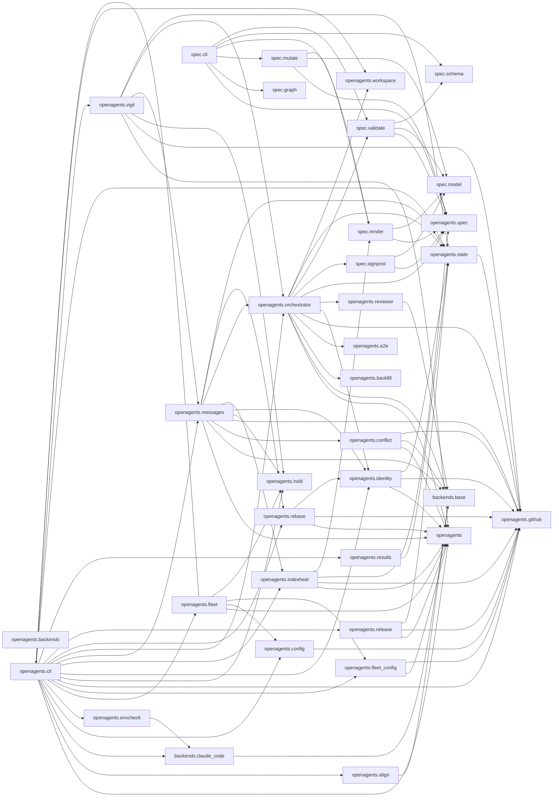

# 架构现状（ARCHITECTURE）

> 本文件由 `spec graph` 自动生成，请勿手工编辑。源 = `openagents/` 的代码与 docstring。

## 子系统与组件

### openagents

_OpenAgents —— RFC 驱动的多 Agent 框架。_

| 组件 | 职责（文件级 docstring 首行） |
|----|----|
| `__init__.py` | OpenAgents —— RFC 驱动的多 Agent 框架。 |
| `align.py` | Spec-0020/T1: issue 前门对齐——把模糊想法复述成「要做 X / 边界 Y / 不做 Z」。 |
| `backfill.py` | Spec-0025/T1: 代码盘点助手——扫存量代码路径产出结构化 inventory。 |
| `cli.py` | RFC-0001 T1 + RFC-0005: CLI 入口。 |
| `config.py` | RFC-0001 T1: 项目绑定（决策 10）。 |
| `conflict.py` | Spec-0028/T2：merge 冲突派 coding agent 语义解冲突——indexheal 的语义化兄弟。 |
| `e2e.py` | RFC-0013: 实跑端到端脚本并把「合否 + 日志末尾」渲染成 PR 评论（纯旁路模块）。 |
| `envcheck.py` | Spec-0030/T2: init 前端 e2e 环境体检（纯函数、read-only、从不抛、非阻塞）。 |
| `fleet.py` | Spec-0027/T2: 多仓库统管的并发编排（每仓库一子进程跑现有 Vigil + 日志聚合 + 错误隔离）。 |
| `fleet_config.py` | Spec-0027/T1: 多仓库统管的配置加载（YAML 解析 + jsonschema 校验 + 默认合并）。 |
| `github.py` | RFC-0001 T3: GitHub 集成层 —— 对 gh CLI 的薄封装。 |
| `hold.py` | Spec-0020/T2: vigil --hold 闸门配置模型。 |
| `identity.py` | RFC-0011 T2: 本地 agent 身份 + 评论签名。 |
| `indexheal.py` | issue #48：索引冲突自愈——同步 base 后自动重渲 OVERVIEW。 |
| `messages.py` | RFC-0001 T5 + RFC-0005 + RFC-0012: PR 消息机制 + CI 监控，按**阶段**路由 GitHub 事件。 |
| `orchestrator.py` | RFC-0005: issue → RFC-first → 代码 的原子操作编排（取代单体 solve）。 |
| `rebase.py` | RFC-0009 T2: 合并后自动同步其余 open PR 的扇出模块。 |
| `release.py` | Spec-0023/T3: release 模块 —— 把持续推进的 main 物化成一个版本（人唯一的宏观决策点）。 |
| `results.py` | RFC-0001 T6: 成果层——读取 State 渲染本地成果看板并启动查看（决策 9）。 |
| `reviewer.py` | RFC-0012 T1: reviewer 编排模块 —— N 并行评审 + 裁决聚合。 |
| `state.py` | RFC-0001 T4: 状态持久化层（决策 4）。 |
| `vigil.py` | RFC-0004: openagents vigil —— 守夜人模式（自主 issue→PR 全流程循环）。 |
| `workspace.py` | RFC-0005 T1: worktree 生命周期 + git 封装（从 orchestrator 抽出）。 |

### openagents.backends

_RFC-0001 T1: 后端适配层。_

| 组件 | 职责（文件级 docstring 首行） |
|----|----|
| `__init__.py` | RFC-0001 T1: 后端适配层。 |
| `base.py` | RFC-0001 T1: 后端抽象层 —— AgentBackend 协议与 AgentResult。 |
| `claude_code.py` | RFC-0001 T2 + RFC-0003: Claude Code 后端适配器。 |

### openagents.spec

_spec —— 「Spec 活快照」数据层与工具（markdown 单文件形态）。_

| 组件 | 职责（文件级 docstring 首行） |
|----|----|
| `__init__.py` | spec —— 「Spec 活快照」数据层与工具（markdown 单文件形态）。 |
| `cli.py` | spec CLI（console_script: `spec`）：new / add-task / render / validate / abandon / graph。 |
| `graph.py` | spec graph：从代码生成「对代码的唯一映射」（现状架构视图）。 |
| `model.py` | spec 数据层：Task / Overview / Metadata / Group 模型与 **markdown 单文件** round-trip 读写。 |
| `mutate.py` | spec new / add-task / abandon：在组 markdown 文件上增改 Task + 自动 render。 |
| `render.py` | spec render：把源数据派生成唯一人读视图 OVERVIEW.md。 |
| `schema.py` | spec JSON Schema —— 组 markdown frontmatter / Task 的结构校验单一真源。 |
| `signpost.py` | spec 端到端验证指路牌：从一个 spec 组的组级 Overview 抽取 e2e 脚本并渲染指路牌。 |
| `validate.py` | spec 校验：JSON Schema + 语义规则（files 重叠 / DAG 无环 / 血缘引用）。 |

## 依赖关系图（import）

