# 架构现状（ARCHITECTURE）

> 本文件由 `spec graph` 自动生成，请勿手工编辑。源 = `openagents/` 的代码与 docstring。

## 子系统与组件

### openagents

_OpenAgents —— RFC 驱动的多 Agent 框架。_

| 组件 | 职责（文件级 docstring 首行） |
|----|----|
| `__init__.py` | OpenAgents —— RFC 驱动的多 Agent 框架。 |
| `agentcontext.py` | Spec-0052/T1：统一 agent 上下文构造——build_agent_context。 |
| `align.py` | Spec-0020/T1: issue 前门对齐——把模糊想法复述成「要做 X / 边界 Y / 不做 Z」。 |
| `backfill.py` | Spec-0025/T1: 代码盘点助手——扫存量代码路径产出结构化 inventory。 |
| `blocknote.py` | Spec-0032/T3: 结构化阻塞评论构造（纯函数模块，解耦理念 10）。 |
| `cli.py` | RFC-0001 T1 + RFC-0005: CLI 入口。 |
| `config.py` | RFC-0001 T1: 项目绑定（决策 10）。 |
| `conflict.py` | Spec-0028/T2：merge 冲突派 coding agent 语义解冲突。 |
| `conflictdiag.py` | Spec-0034/T1：worktree-free 的合并冲突诊断采集 + 「卡在哪」段格式化（解耦新模块，理念 10）。 |
| `envcheck.py` | Spec-0030/T2: init 前端 e2e 环境体检（纯函数、read-only、从不抛、非阻塞）。 |
| `executor.py` | Spec-0055/T2·T3: executor —— 独立的运行时验证 agent（单一自主 agent，无 form 分派）。 |
| `fleet.py` | Spec-0027/T2: 多仓库统管的并发编排（每仓库一子进程跑现有 Vigil + 日志聚合 + 错误隔离）。 |
| `fleet_config.py` | Spec-0027/T1: 多仓库统管的配置加载（YAML 解析 + jsonschema 校验 + 默认合并）。 |
| `github.py` | RFC-0001 T3: GitHub 集成层 —— 对 gh CLI 的薄封装。 |
| `hold.py` | Spec-0020/T2: vigil --hold 闸门配置模型。 |
| `identity.py` | RFC-0011 T2: 本地 agent 身份 + 评论签名。 |
| `issuecheck.py` | Spec-0043/T2: issue 进 RFC 前的自洽性自检——判读标题/正文是否有「会直接影响修法」的冲突。 |
| `messages.py` | RFC-0001 T5 + RFC-0005 + RFC-0012: PR 消息机制 + CI 监控，按**阶段**路由 GitHub 事件。 |
| `orchestrator.py` | RFC-0005: issue → RFC-first → 代码 的原子操作编排（取代单体 solve）。 |
| `release.py` | Spec-0023/T3: release 模块 —— 把持续推进的 main 物化成一个版本（人唯一的宏观决策点）。 |
| `replynote.py` | Spec-0036/T2: 引用原评论的回应构造（纯函数模块，解耦理念 10，与 blocknote 对称）。 |
| `results.py` | RFC-0001 T6: 成果层——读取 State 渲染本地成果看板并启动查看（决策 9）。 |
| `reviewer.py` | RFC-0012 T1: reviewer 编排模块 —— N 并行评审 + 裁决聚合。 |
| `skip.py` | Spec-0054/T1: vigil --skip 逐闸旁路开关配置模型（与 hold.py 对称）。 |
| `state.py` | RFC-0001 T4: 状态持久化层（决策 4）。 |
| `vigil.py` | RFC-0004: openagents vigil —— 守夜人模式（自主 issue→PR 全流程循环）。 |
| `worknote.py` | Spec-0051/T3: agent「本轮做了什么」回执渲染（纯函数模块，解耦理念 10，与 blocknote/replynote 对称）。 |
| `workspace.py` | RFC-0005 T1: worktree 生命周期 + git 封装（从 orchestrator 抽出）。 |

### openagents.agents

_# Spec-0060/T4: agents —— 提示词层：每个 agent 一个模块，仅含 PROMPT（string.Template）+_

| 组件 | 职责（文件级 docstring 首行） |
|----|----|
| `__init__.py` | # Spec-0060/T4: agents —— 提示词层：每个 agent 一个模块，仅含 PROMPT（string.Template）+ |
| `deliver.py` | # Spec-0060/T4: agents.deliver —— 版本控制提交/推送/解冲突 → 结构化交付报告的提示词（零逻辑）。 |
| `drafter.py` | # Spec-0062/T1: agents.drafter —— RFC 生命周期起草判断 → 结构化交付报告的提示词（零逻辑）。 |
| `implementer.py` | # Spec-0060/T4: agents.implementer —— 按 RFC 实现 / 按反馈迭代的提示词（零逻辑）。 |
| `planner.py` | # Spec-0060/T4: agents.planner —— 起草/精炼 RFC 的提示词（零逻辑）。 |
| `replier.py` | # Spec-0061/T2: agents.replier —— 回应 PR 上的人类评论 → 结构化回复（零逻辑）。 |
| `reviewer.py` | # Spec-0060/T4: agents.reviewer —— 评审 → 结构化裁决的提示词（零逻辑）。 |
| `tester.py` | # Spec-0060/T4: agents.tester —— 独立 e2e 执行 + 判读的提示词（零逻辑）。 |
| `triager.py` | # Spec-0061/T2: agents.triager —— issue 分诊：对齐 + 冲突自检 → 结构化裁决（零逻辑）。 |

### openagents.backends

_RFC-0001 T1: 后端适配层。_

| 组件 | 职责（文件级 docstring 首行） |
|----|----|
| `__init__.py` | RFC-0001 T1: 后端适配层。 |
| `base.py` | RFC-0001 T1: 后端抽象层 —— AgentBackend 协议与 AgentResult。 |
| `claude_code.py` | RFC-0001 T2 + RFC-0003: Claude Code 后端适配器。 |

### openagents.recipes

_# Spec-0060/T6: recipes —— 编排层：每个 flow 只有控制流 + runtime.run_agent 调用，_

| 组件 | 职责（文件级 docstring 首行） |
|----|----|
| `__init__.py` | # Spec-0060/T6: recipes —— 编排层：每个 flow 只有控制流 + runtime.run_agent 调用， |
| `fleet.py` | # Spec-0061/T3: recipes.fleet —— 多仓库并发守夜（每仓库一子进程跑新栈 vigil，纯控制流）。 |
| `merge_pr.py` | # Spec-0062/T2: recipes.merge_pr —— PR 合并流水线（纯控制流，零业务判断）。 |
| `poll_comments.py` | # Spec-0061/T3: recipes.poll_comments —— 守候段：回应 PR 上的新人类评论（纯控制流，零业务判断）。 |
| `rfc_lifecycle.py` | # Spec-0062/T1: recipes.rfc_lifecycle —— RFC 生命周期五入口（纯控制流，零业务判断）。 |
| `solve_issue.py` | # Spec-0060/T6: recipes.solve_issue —— 求解一个 issue 的编排（纯控制流，零业务判断）。 |
| `vigil.py` | # Spec-0061/T3: recipes.vigil —— 发现→分诊→派单 循环（纯控制流，零业务判断）。 |

### openagents.runtime

_# Spec-0060/T2: runtime —— 唯一允许的「机制代码」层（引擎 + 最小硬闸 + 上下文/状态）。_

| 组件 | 职责（文件级 docstring 首行） |
|----|----|
| `__init__.py` | # Spec-0060/T2: runtime —— 唯一允许的「机制代码」层（引擎 + 最小硬闸 + 上下文/状态）。 |
| `context.py` | # Spec-0060/T5: runtime.context —— 组装占位符的值，供 recipe 传给 engine.run_agent。 |
| `engine.py` | # Spec-0060/T2: runtime.engine —— run_agent 引擎（填占位符 → 派 backend → 收结构化输出）。 |
| `gates.py` | # Spec-0060/T3: runtime.gates —— 最小硬闸（只验客观事实，不含业务判断）。 |
| `state.py` | # Spec-0060/T5: runtime.state —— 新栈 run 状态 + comment 游标持久化（独立命名空间）。 |

### openagents.spec

_spec —— 「Spec 活快照」数据层与工具（markdown 单文件形态）。_

| 组件 | 职责（文件级 docstring 首行） |
|----|----|
| `__init__.py` | spec —— 「Spec 活快照」数据层与工具（markdown 单文件形态）。 |
| `cli.py` | spec CLI（console_script: `spec`）：new / add-task / render / validate / abandon / graph。 |
| `graph.py` | spec graph：从代码生成「对代码的唯一映射」（现状架构视图）。 |
| `model.py` | spec 数据层：Task / Overview / Metadata / Group 模型与 **markdown 单文件** round-trip 读写。 |
| `mutate.py` | spec new / add-task / abandon：在组 markdown 文件上增改 Task + 自动 render。 |
| `render.py` | spec render：把源数据派生成唯一人读视图 OVERVIEW.md。 |
| `schema.py` | spec JSON Schema —— 组 markdown frontmatter / Task 的结构校验单一真源。 |
| `signpost.py` | spec 端到端验证指路牌：从一个 spec 组的组级 Overview 抽取 e2e 脚本并渲染指路牌。 |
| `validate.py` | spec 校验：JSON Schema + 语义规则（files 重叠 / DAG 无环 / 血缘引用）。 |

### openagents.utils

_# Spec-0060/T1: utils —— 所有确定性、非 agent 的原语的归口包。_

| 组件 | 职责（文件级 docstring 首行） |
|----|----|
| `__init__.py` | # Spec-0060/T1: utils —— 所有确定性、非 agent 的原语的归口包。 |
| `config.py` | # Spec-0061/T1: utils.config —— 项目绑定 preflight 的稳定 import 面。 |
| `envcheck.py` | # Spec-0061/T1: utils.envcheck —— 前端 e2e 环境体检的稳定 import 面（只读、不抛、非阻塞）。 |
| `fleet_config.py` | # Spec-0061/T1: utils.fleet_config —— 多仓库统管配置解析的稳定 import 面（纯解析/校验）。 |
| `git.py` | # Spec-0060/T1: utils.git —— 新栈的确定性 git 稳定 import 面。 |
| `github.py` | # Spec-0060/T1 + Spec-0061/T1: utils.github —— 新栈的 gh 读写完整稳定 import 面。 |
| `hold.py` | # Spec-0061/T1: utils.hold —— --hold 分级监督闸意图解析的稳定 import 面（纯逻辑、零 IO）。 |
| `identity.py` | # Spec-0061/T1: utils.identity —— 本实例身份 + 评论签名的稳定 import 面。 |
| `notes.py` | # Spec-0061/T1: utils.notes —— PR/issue 评论正文渲染的稳定 import 面（纯函数、零 IO）。 |
| `release.py` | # Spec-0061/T1: utils.release —— 发版确定性原语的稳定 import 面。 |
| `results.py` | # Spec-0061/T1: utils.results —— 成果看板渲染的稳定 import 面。 |
| `skip.py` | # Spec-0061/T1: utils.skip —— --skip 逐闸旁路意图解析的稳定 import 面（纯逻辑、零 IO）。 |

## 依赖关系图（import）

```mermaid
graph LR
    nopenagents["openagents"]
    nopenagents_agentcontext["openagents.agentcontext"]
    nopenagents_agents["openagents.agents"]
    nopenagents_agents_deliver["agents.deliver"]
    nopenagents_agents_drafter["agents.drafter"]
    nopenagents_agents_implementer["agents.implementer"]
    nopenagents_agents_planner["agents.planner"]
    nopenagents_agents_replier["agents.replier"]
    nopenagents_agents_reviewer["agents.reviewer"]
    nopenagents_agents_tester["agents.tester"]
    nopenagents_agents_triager["agents.triager"]
    nopenagents_align["openagents.align"]
    nopenagents_backends["openagents.backends"]
    nopenagents_backends_base["backends.base"]
    nopenagents_backends_claude_code["backends.claude_code"]
    nopenagents_backfill["openagents.backfill"]
    nopenagents_blocknote["openagents.blocknote"]
    nopenagents_cli["openagents.cli"]
    nopenagents_config["openagents.config"]
    nopenagents_conflict["openagents.conflict"]
    nopenagents_conflictdiag["openagents.conflictdiag"]
    nopenagents_envcheck["openagents.envcheck"]
    nopenagents_executor["openagents.executor"]
    nopenagents_fleet["openagents.fleet"]
    nopenagents_fleet_config["openagents.fleet_config"]
    nopenagents_github["openagents.github"]
    nopenagents_hold["openagents.hold"]
    nopenagents_identity["openagents.identity"]
    nopenagents_issuecheck["openagents.issuecheck"]
    nopenagents_messages["openagents.messages"]
    nopenagents_orchestrator["openagents.orchestrator"]
    nopenagents_recipes["openagents.recipes"]
    nopenagents_recipes_fleet["recipes.fleet"]
    nopenagents_recipes_merge_pr["recipes.merge_pr"]
    nopenagents_recipes_poll_comments["recipes.poll_comments"]
    nopenagents_recipes_rfc_lifecycle["recipes.rfc_lifecycle"]
    nopenagents_recipes_solve_issue["recipes.solve_issue"]
    nopenagents_recipes_vigil["recipes.vigil"]
    nopenagents_release["openagents.release"]
    nopenagents_replynote["openagents.replynote"]
    nopenagents_results["openagents.results"]
    nopenagents_reviewer["openagents.reviewer"]
    nopenagents_runtime["openagents.runtime"]
    nopenagents_runtime_context["runtime.context"]
    nopenagents_runtime_engine["runtime.engine"]
    nopenagents_runtime_gates["runtime.gates"]
    nopenagents_runtime_state["runtime.state"]
    nopenagents_skip["openagents.skip"]
    nopenagents_spec["openagents.spec"]
    nopenagents_spec_cli["spec.cli"]
    nopenagents_spec_graph["spec.graph"]
    nopenagents_spec_model["spec.model"]
    nopenagents_spec_mutate["spec.mutate"]
    nopenagents_spec_render["spec.render"]
    nopenagents_spec_schema["spec.schema"]
    nopenagents_spec_signpost["spec.signpost"]
    nopenagents_spec_validate["spec.validate"]
    nopenagents_state["openagents.state"]
    nopenagents_utils["openagents.utils"]
    nopenagents_utils_config["utils.config"]
    nopenagents_utils_envcheck["utils.envcheck"]
    nopenagents_utils_fleet_config["utils.fleet_config"]
    nopenagents_utils_git["utils.git"]
    nopenagents_utils_github["utils.github"]
    nopenagents_utils_hold["utils.hold"]
    nopenagents_utils_identity["utils.identity"]
    nopenagents_utils_notes["utils.notes"]
    nopenagents_utils_release["utils.release"]
    nopenagents_utils_results["utils.results"]
    nopenagents_utils_skip["utils.skip"]
    nopenagents_vigil["openagents.vigil"]
    nopenagents_worknote["openagents.worknote"]
    nopenagents_workspace["openagents.workspace"]
    nopenagents_agentcontext --> nopenagents
    nopenagents_agentcontext --> nopenagents_github
    nopenagents_agentcontext --> nopenagents_identity
    nopenagents_agents --> nopenagents_agents_deliver
    nopenagents_agents --> nopenagents_agents_implementer
    nopenagents_agents --> nopenagents_agents_planner
    nopenagents_agents --> nopenagents_agents_reviewer
    nopenagents_agents --> nopenagents_agents_tester
    nopenagents_align --> nopenagents_backends_base
    nopenagents_backends_claude_code --> nopenagents_backends_base
    nopenagents_cli --> nopenagents
    nopenagents_cli --> nopenagents_align
    nopenagents_cli --> nopenagents_backends_claude_code
    nopenagents_cli --> nopenagents_config
    nopenagents_cli --> nopenagents_envcheck
    nopenagents_cli --> nopenagents_fleet
    nopenagents_cli --> nopenagents_fleet_config
    nopenagents_cli --> nopenagents_github
    nopenagents_cli --> nopenagents_hold
    nopenagents_cli --> nopenagents_identity
    nopenagents_cli --> nopenagents_messages
    nopenagents_cli --> nopenagents_orchestrator
    nopenagents_cli --> nopenagents_recipes_fleet
    nopenagents_cli --> nopenagents_recipes_poll_comments
    nopenagents_cli --> nopenagents_recipes_solve_issue
    nopenagents_cli --> nopenagents_recipes_vigil
    nopenagents_cli --> nopenagents_release
    nopenagents_cli --> nopenagents_results
    nopenagents_cli --> nopenagents_runtime_context
    nopenagents_cli --> nopenagents_runtime_state
    nopenagents_cli --> nopenagents_skip
    nopenagents_cli --> nopenagents_state
    nopenagents_cli --> nopenagents_utils
    nopenagents_cli --> nopenagents_utils_fleet_config
    nopenagents_cli --> nopenagents_utils_git
    nopenagents_cli --> nopenagents_vigil
    nopenagents_cli --> nopenagents_workspace
    nopenagents_config --> nopenagents_github
    nopenagents_conflict --> nopenagents
    nopenagents_conflict --> nopenagents_backends_base
    nopenagents_conflict --> nopenagents_github
    nopenagents_conflictdiag --> nopenagents
    nopenagents_conflictdiag --> nopenagents_github
    nopenagents_envcheck --> nopenagents_backends_claude_code
    nopenagents_executor --> nopenagents_backends_base
    nopenagents_fleet --> nopenagents
    nopenagents_fleet --> nopenagents_cli
    nopenagents_fleet --> nopenagents_config
    nopenagents_fleet --> nopenagents_fleet_config
    nopenagents_fleet --> nopenagents_hold
    nopenagents_fleet_config --> nopenagents
    nopenagents_fleet_config --> nopenagents_github
    nopenagents_identity --> nopenagents
    nopenagents_identity --> nopenagents_github
    nopenagents_identity --> nopenagents_state
    nopenagents_issuecheck --> nopenagents_backends_base
    nopenagents_messages --> nopenagents
    nopenagents_messages --> nopenagents_backends_base
    nopenagents_messages --> nopenagents_blocknote
    nopenagents_messages --> nopenagents_conflict
    nopenagents_messages --> nopenagents_conflictdiag
    nopenagents_messages --> nopenagents_executor
    nopenagents_messages --> nopenagents_github
    nopenagents_messages --> nopenagents_hold
    nopenagents_messages --> nopenagents_identity
    nopenagents_messages --> nopenagents_orchestrator
    nopenagents_messages --> nopenagents_replynote
    nopenagents_messages --> nopenagents_skip
    nopenagents_messages --> nopenagents_state
    nopenagents_messages --> nopenagents_worknote
    nopenagents_orchestrator --> nopenagents
    nopenagents_orchestrator --> nopenagents_agentcontext
    nopenagents_orchestrator --> nopenagents_backends_base
    nopenagents_orchestrator --> nopenagents_backfill
    nopenagents_orchestrator --> nopenagents_executor
    nopenagents_orchestrator --> nopenagents_github
    nopenagents_orchestrator --> nopenagents_identity
    nopenagents_orchestrator --> nopenagents_issuecheck
    nopenagents_orchestrator --> nopenagents_reviewer
    nopenagents_orchestrator --> nopenagents_spec
    nopenagents_orchestrator --> nopenagents_spec_model
    nopenagents_orchestrator --> nopenagents_spec_signpost
    nopenagents_orchestrator --> nopenagents_spec_validate
    nopenagents_orchestrator --> nopenagents_state
    nopenagents_orchestrator --> nopenagents_workspace
    nopenagents_recipes_fleet --> nopenagents
    nopenagents_recipes_fleet --> nopenagents_cli
    nopenagents_recipes_fleet --> nopenagents_config
    nopenagents_recipes_fleet --> nopenagents_fleet
    nopenagents_recipes_fleet --> nopenagents_utils_fleet_config
    nopenagents_recipes_merge_pr --> nopenagents_agents
    nopenagents_recipes_merge_pr --> nopenagents_agents_deliver
    nopenagents_recipes_merge_pr --> nopenagents_agents_reviewer
    nopenagents_recipes_merge_pr --> nopenagents_runtime
    nopenagents_recipes_merge_pr --> nopenagents_runtime_context
    nopenagents_recipes_merge_pr --> nopenagents_runtime_engine
    nopenagents_recipes_merge_pr --> nopenagents_runtime_gates
    nopenagents_recipes_merge_pr --> nopenagents_runtime_state
    nopenagents_recipes_merge_pr --> nopenagents_utils
    nopenagents_recipes_merge_pr --> nopenagents_utils_github
    nopenagents_recipes_merge_pr --> nopenagents_utils_hold
    nopenagents_recipes_merge_pr --> nopenagents_utils_skip
    nopenagents_recipes_poll_comments --> nopenagents_agents
    nopenagents_recipes_poll_comments --> nopenagents_agents_replier
    nopenagents_recipes_poll_comments --> nopenagents_runtime
    nopenagents_recipes_poll_comments --> nopenagents_runtime_context
    nopenagents_recipes_poll_comments --> nopenagents_runtime_engine
    nopenagents_recipes_poll_comments --> nopenagents_runtime_state
    nopenagents_recipes_poll_comments --> nopenagents_utils
    nopenagents_recipes_poll_comments --> nopenagents_utils_github
    nopenagents_recipes_poll_comments --> nopenagents_utils_identity
    nopenagents_recipes_rfc_lifecycle --> nopenagents_agents
    nopenagents_recipes_rfc_lifecycle --> nopenagents_agents_drafter
    nopenagents_recipes_rfc_lifecycle --> nopenagents_runtime
    nopenagents_recipes_rfc_lifecycle --> nopenagents_runtime_engine
    nopenagents_recipes_rfc_lifecycle --> nopenagents_runtime_gates
    nopenagents_recipes_rfc_lifecycle --> nopenagents_utils
    nopenagents_recipes_rfc_lifecycle --> nopenagents_utils_git
    nopenagents_recipes_rfc_lifecycle --> nopenagents_utils_github
    nopenagents_recipes_rfc_lifecycle --> nopenagents_utils_identity
    nopenagents_recipes_solve_issue --> nopenagents_agents
    nopenagents_recipes_solve_issue --> nopenagents_agents_deliver
    nopenagents_recipes_solve_issue --> nopenagents_agents_implementer
    nopenagents_recipes_solve_issue --> nopenagents_agents_planner
    nopenagents_recipes_solve_issue --> nopenagents_agents_reviewer
    nopenagents_recipes_solve_issue --> nopenagents_runtime
    nopenagents_recipes_solve_issue --> nopenagents_runtime_engine
    nopenagents_recipes_solve_issue --> nopenagents_runtime_gates
    nopenagents_recipes_vigil --> nopenagents_agents
    nopenagents_recipes_vigil --> nopenagents_agents_triager
    nopenagents_recipes_vigil --> nopenagents_recipes_solve_issue
    nopenagents_recipes_vigil --> nopenagents_runtime
    nopenagents_recipes_vigil --> nopenagents_runtime_context
    nopenagents_recipes_vigil --> nopenagents_runtime_engine
    nopenagents_recipes_vigil --> nopenagents_runtime_state
    nopenagents_recipes_vigil --> nopenagents_utils
    nopenagents_recipes_vigil --> nopenagents_utils_git
    nopenagents_recipes_vigil --> nopenagents_utils_github
    nopenagents_release --> nopenagents
    nopenagents_release --> nopenagents_github
    nopenagents_release --> nopenagents_state
    nopenagents_results --> nopenagents_state
    nopenagents_reviewer --> nopenagents_backends_base
    nopenagents_runtime_context --> nopenagents_utils
    nopenagents_runtime_context --> nopenagents_utils_github
    nopenagents_runtime_gates --> nopenagents_utils
    nopenagents_runtime_gates --> nopenagents_utils_git
    nopenagents_runtime_gates --> nopenagents_utils_github
    nopenagents_skip --> nopenagents_hold
    nopenagents_spec_cli --> nopenagents_spec
    nopenagents_spec_cli --> nopenagents_spec_graph
    nopenagents_spec_cli --> nopenagents_spec_mutate
    nopenagents_spec_cli --> nopenagents_spec_render
    nopenagents_spec_cli --> nopenagents_spec_schema
    nopenagents_spec_cli --> nopenagents_spec_validate
    nopenagents_spec_mutate --> nopenagents_spec
    nopenagents_spec_mutate --> nopenagents_spec_model
    nopenagents_spec_mutate --> nopenagents_spec_render
    nopenagents_spec_render --> nopenagents_spec
    nopenagents_spec_render --> nopenagents_spec_model
    nopenagents_spec_signpost --> nopenagents_spec
    nopenagents_spec_signpost --> nopenagents_spec_model
    nopenagents_spec_validate --> nopenagents_spec
    nopenagents_spec_validate --> nopenagents_spec_model
    nopenagents_spec_validate --> nopenagents_spec_schema
    nopenagents_state --> nopenagents_github
    nopenagents_utils_config --> nopenagents_config
    nopenagents_utils_envcheck --> nopenagents_envcheck
    nopenagents_utils_fleet_config --> nopenagents_fleet_config
    nopenagents_utils_git --> nopenagents_workspace
    nopenagents_utils_github --> nopenagents_github
    nopenagents_utils_hold --> nopenagents_hold
    nopenagents_utils_identity --> nopenagents_identity
    nopenagents_utils_notes --> nopenagents_blocknote
    nopenagents_utils_notes --> nopenagents_replynote
    nopenagents_utils_notes --> nopenagents_worknote
    nopenagents_utils_release --> nopenagents_release
    nopenagents_utils_results --> nopenagents_results
    nopenagents_utils_skip --> nopenagents_skip
    nopenagents_vigil --> nopenagents
    nopenagents_vigil --> nopenagents_github
    nopenagents_vigil --> nopenagents_hold
    nopenagents_vigil --> nopenagents_identity
    nopenagents_vigil --> nopenagents_messages
    nopenagents_vigil --> nopenagents_orchestrator
    nopenagents_vigil --> nopenagents_skip
    nopenagents_vigil --> nopenagents_state
```

