# Spec 总览（OVERVIEW）

> 本文件由 `spec render` 自动生成，请勿手工编辑（Spec-0014/T3）。

## TL;DR（人话速览）

### 0001 MVP — 单 issue → 单 agent → 真实 PR 的最小自举闭环
OpenAgents 的最小可用自举闭环：拉一个 issue、派一个 agent、用 Claude Code 后端把它做成一个真实的 GitHub PR。产出包骨架、CLI、后端适配、单 issue 编排、PR 评论消息机制和成果看板，是整个项目的起点。

### 0002 OpenAgents 主动提 issue
让 OpenAgents 不只被动接 issue，还能主动给仓库提 issue。加 github 层 create_issue、CLI issue 子命令，并给自动发现的 issue 打上发现标签、确保标签存在。

### 0003 issue 求解隔离 —— 每 issue 独立 worktree + 分支基线锁定最新 main
每个 issue 在独立 git worktree 里求解、分支基线锁定最新 origin/main，避免多 issue 互相污染。同时加实时事件流反馈、可中断恢复的幂等求解，以及 CLI 统一错误处理（异常不吐 traceback）。

### 0004 openagents vigil —— 守夜人模式（自主 issue→PR 全流程循环）
守夜人模式：让 OpenAgents 自主循环跑「发现 issue → 求解 → 提 PR」全流程，不用人盯着。含标签门控的 issue 发现、发现段+守候段两段循环与单 issue 错误隔离，以及 vigil 子命令和端到端脚本。

### 0005 solve 原子化拆分 + RFC-first 评审循环
把原来一坨的 solve 拆成四个原子操作，并引入 RFC-first 评审循环（先写 RFC 再写代码）。抽出 workspace 模块、扩展 github/state、把消息按阶段过滤掉自评论，CLI 去掉 solve 换成 4 个子命令。

### 0006 守夜人识别 PR/issue 关闭作为终止信号
守夜人要懂得收手：当一个 PR 或 issue 被关闭时，把它识别成终止信号，不再继续求解，避免对已放弃的工作空转。

### 0007 守夜人恢复——激活 solving 为 resume 入口，修复 start_rfc 中途崩溃的孤儿 run
修复守夜人半路崩溃留下的孤儿 run：把 solving 状态当成 resume 入口，让 start_rfc 中途崩溃后能接着干而不是从头再来。含 state/orchestrator/vigil 三处改动和崩溃恢复脚本。

### 0008 PR 正文「端到端验证」指路牌（从 RFC 自动生成）
在 PR 正文里自动生成一段「怎么做端到端验证」的指路牌，内容从该分支新增的 RFC 自动解析渲染，让审核者一眼知道如何验收。

### 0009 合并后自动 rebase 其他 open PR
一个 PR 合并进 main 后，自动把其余还开着的 PR rebase 到最新 main，省去手动 rebase。含 github 层 list_open_prs/update_branch、扇出模块、合并后集成和手动 sync-prs 命令。

### 0010 gh 瞬时错误重试 + 守夜循环单轮容错
给跟 GitHub 打交道加韧性：gh 命令遇到瞬时错误时指数退避重试，守夜循环每一轮用 try/except 兜底，单轮出错不拖垮整个循环。

### 0011 本地 Agent 身份 + 评论签名（区分自评论与真人评论，根治 poll 自循环）
给本地 agent 一个持久身份并在评论上盖签名，从而区分「自己发的评论」和「真人评论」，根治 poll 把自己评论当新消息的自循环问题。

### 0012 test 分支门控流程 —— 人只在「提 issue」与「promote」介入
改成 test 分支门控流程，人只在「提 issue」和「promote 上线」两处介入：N 个 reviewer 并行评审聚合裁决，promote 模块预检后快进 main，中间全自动。

### 0013 实跑端到端脚本并把「合否 + 日志」作为 PR 评论（RFC-0008 指路牌 → 实跑结果延伸）
在 PR 转正前真正跑一遍端到端脚本，把「跑通没有 + 日志」作为带签名的 PR 评论贴出来。是 0008 指路牌（告诉怎么测）到实跑结果（直接给结论）的延伸。

### 0014 用「Spec 活快照 + 演化历史」取代 RFC —— Spec 永远与代码一一对应，legacy 沉淀到历史
用「Spec 活快照 + 演化历史」取代 RFC：Spec 永远和当前代码一一对应，旧版本沉淀到 history、不再是流水账。含数据层/schema、validate、render（OVERVIEW）、amend/abandon、CLI 和迁移。

### 0015 spec 人类可读 summary：填 group 级 summary 字段 + render 大白话 TL;DR
给每个 spec 加一段面向人的大白话 TL;DR：metadata 增组级 summary 字段、spec new 必填、validate 强制非空、render 在 OVERVIEW 顶部逐 feature 展示，并迁移补齐所有现存 spec。是 #59 人类监督闸门的地基。

### 0020 人类监督闸门：提 issue 前需求对齐 + vigil 分级 --hold 闸控
给 OpenAgents 加两道人类监督闸门：提 issue 前的「需求对齐」（把模糊想法复述成 做什么X/边界Y/不做Z 让人确认），以及 vigil 自治循环的分级 --hold 闸（在 spec 批准、PR 合并等关键点停下等人点头）。让人从盯细节转向把控宏观；只在关键节点插入可配置暂停，不改既有 issue→PR 自动流程的内部逻辑。

### 0021 修复 reviewer 长回复截断在 VERDICT 之前→UNPARSED→假非PASS 空耗 rounds 误触 needs-human
修 reviewer 长回复被截断在 VERDICT 行之前、导致解析失败（UNPARSED）被误判成「非 PASS」、白白空耗 vigil rounds 甚至误触 needs-human 的 bug。做法：裁决 token 前置、按首行解析、区分「评审本身无效」与「真 REWORK」、加单次重解析与诚实升级。只改 reviewer 解析与编排层容错，不改裁决标准本身。

### 0022 代码闸可合并性预检 + poll 错误隔离 + 裁决评论幂等
代码闸（merge gate）三处加固：合并前预检 PR 可合并性（不可合并直接跳过、不空转崩溃 poll）、poll 阶段隔离单个 PR 的错误不拖垮整轮、裁决评论幂等避免刷屏重复 PASS。迁移自旧 metadata（原无 summary，按标题与任务补齐）。

### 0023 退役 test 分支:main 持续推进 + release/vX.Y.Z 版本分支发布
退役 test 分支,反转旧的「test 门控」模型:main 成为日常自动流转分支(reviewer 闸+CI 全绿后自动合入,持续推进),发版时把 main 发布到 release/vX.Y.Z 分支并打 vX.Y.Z tag(版本号从最新 tag 自动递增,默认 patch)。人的触点从 promote 改为 release;promote.py 重命名重定向为 release.py,全链路 base 默认 test→main,去掉 test 分支自举,CI 仅 main 触发。

### 0024 spec 转 rust-RFC 形态:总览先行 + 单 spec 自包含
把 spec 改成 rust-RFC 9 段总览为主体(总览先行、单 spec 自包含),DAG + 文件分配收进 Reference-level;数据模型/校验/skill/README/orchestrator 一并对齐,回填 19 个存量 spec。

### 0025 brownfield 反向补全 RFC:扫存量代码生成 9 段 RFC 草稿
新增 backfill-rfc <path> 子命令:扫存量代码 → 派 coding agent 反推 rust-RFC 9 段 spec 草稿(必填四段据实回填、难反推段标待补)→ 经 spec validate 后开 draft PR 交人评审,让 brownfield 仓库接入 RFC 驱动闭环。

### 0026 README 最简用法:紧跟安装方法之后新增 Quickstart 段
在 README「安装」之后、「快速上手」之前插入一段「最简用法 / Quickstart」,把最短可用路径 init → issue → vigil 放最前,并点明日常只用 issue+vigil、poll/watch/rfc 等是不发现新 issue 的单步调试工具。只动 README 文案与结构,不改任何 CLI 行为。

### 0027 多仓库统管:单进程按配置文件并发守夜一组仓库
新增 openagents vigil-all 命令:单进程读一份 YAML 配置(仓库列表 + 全局默认 + 每仓库可选覆盖 interval/labels/base/hold),为每个仓库起一个隔离子进程复用现有 Vigil 并发守夜(发现→派单→守候),各读写自己的 .openagents/state.json,统一带仓库前缀聚合日志;单仓库 vigil 命令与底层逻辑零改动。

### 0028 PR 自动化两处改进：spec 草稿 PR 内嵌 9 段总览摘要 + merge 冲突派 agent 语义解冲突
spec 草稿 PR 正文内嵌总览摘要三段；merge 真冲突派 coding agent 语义解决，分层降级 indexheal→agent→人工。

### 0029 统一 rfc→spec 命名硬切并退场 rfc-driven-development 技能
把仓库残留的 rfc 命名全量改为 spec：删除 rfc-driven-development 技能目录、改 CLAUDE.md/README 散文、重命名 openagents/+tests/ 里的标识符与 CLI 子命令、并硬切三个线上/持久化值（GitHub 标签 rfc-approved→spec-approved、状态 rfc-review→spec-review、reviewer kind 'rfc'→'spec'），无兼容垫片；清扫覆盖每个活源文件与活模板——含包级 docstring openagents/__init__.py 的招牌标语与看板模板 openagents/templates/board.html 的 RFC-0001。冻结/prior-art allowlist（显式保留、不清扫、e2e 不误报）：历史 spec/设计文档正文里的 RFC-NNNN、rust-RFC 形态名、openagents/spec/ 与 tests/test_spec_* 里记录旧 rfc.py 改名的历史引用、scripts/e2e-rfc-*.sh 历史脚本名。

### 0030 init 环境体检：检测 browser MCP 与权限放行（非阻塞）+ 前端 e2e 方法论引导
在 openagents init 的 preflight 里加一段非阻塞环境体检：读 ~/.claude.json 检测 browser MCP（playwright/chrome-devtools）是否注册、读 OpenAgents 派 claude 的有效权限模式是否为全放行（bypassPermissions），缺失则打印安装/设置方式但不阻断 init；同时把「具备浏览器工具就优先设计前端浏览器 e2e」的条件式引导写进 in-code 方法论面（起草 prompt 模板 + reviewer rubric）。只检测+提示+方法论文案，不自动改 MCP 配置/权限、不在编排核心耦合 MCP、不驱动浏览器跑断言。

### 0031 merge 闸解挂语义重设计：人解挂后派 agent 主动解冲突、有界重试再挂起
人摘 needs-human 解挂 merge 冲突后不即时重挂，而是进入 armed 模式派 agent 有界重试解冲突，用尽仍冲突才重新挂起

### 0032 needs-human 全程在 GitHub 闭环：阻塞留足信息 + 人回新评论即自动解挂喂内容重试
阻塞时按 gate 留一条信息充分的结构化评论；检测到 block 之后的新人类评论即自动摘 needs-human + 把评论当 detail 喂给对应闸 agent，恢复流转——人机交流全程在 PR 评论里闭环（仅新评论 + 仅人类签名过滤，定向解除 RFC-0019 的不读评论限制）

### 0033 openagents init 新建远端后自动 git remote add origin
冷启动新建 GitHub 仓库后补做 git remote add origin，修复后续 gh 命令 no git remotes found

### 0034 冲突/挂起通知带可定位诊断 + 合并扇出重发收敛——让「具体什么 conflict」结构上答得出
冲突通知不再是无诊断的静态罐头：新增 worktree-free 的 git merge-tree 诊断采集（冲突文件清单 + 关键 hunk 摘要），喂进 merge 闸挂起评论与合并扇出冲突评论的「卡在哪」段；并让扇出对已 needs-human 的 PR 不再机械重发，把人机沟通交回 #89 的 blocked 读侧闭环

### 0036 解挂后 agent 读取并正面回应人的评论：merge 闸也喂评论内容 + 编排层确定性贴回引用原评论
让评论驱动协作真正双向：所有闸（含此前丢弃内容的 merge 闸）解挂都把人类评论喂给 agent；agent 完成本轮动作后，由编排层确定性贴回一条引用原评论的签名回应（答追问/说明做了什么/解不了讲清原因），复用既有发帖出口、不依赖 prompt 记性、不踩 headless 发帖权限坑

### 0038 合并冲突改拉式同步 + 解冲突 agent 用带签名工具自回评论
守夜人合并/冲突处理从「推式扇出+确定性 heal」改为「门2 拉式同步+agent 能动性」；解冲突 agent 用带签名 reply-comment 工具亲自回人类评论（根治牛头不对马嘴）

### 0039 vigil 多后端并发派单去重：引入「已派发」认领标签（第 3 道闸 + 过期回收）
给发现段加一道跨后端可见的 GitHub「已派发」认领标签闸，把同一 issue 被多后端重复派单的概率压到可接受，并用标签事件时戳做过期回收兜底僵尸认领。

### 0041 hold-merge PASS 后夯住待合并：已通过的 PR 冻结成 needs-human，消除同码复审震荡
reviewer PASS 且 hold.at_merge 时把 PR 从「pr-open 空转、下轮重审」改为「置 BLOCKED + 打 needs-human + 贴『✅ 已通过评审，待你合并』」，复用既有冻结机制让 poll 自动跳过、不再重审，从根上消除同一 commit 被非确定 reviewer 反复 PASS/REWORK 的复审震荡；附带净化挂起评论里泄漏的 reviewer scratchpad。

### 0042 PR close→reopen 后复活被冻死的 run：closed 不是真终态
poll 发现本地 closed 的 run 对应 PR 在 GitHub 又变回 OPEN（reopen）时按 draft→rfc-review / 转正→pr-open 复活它、清 closed 续跑既有流程；用 closed_at 复活窗口把「每轮对所有历史 closed run 发 gh 查 reopen」的成本上界住，超窗口即真终态；is_merged 仍是不可逆终态不参与复活。

## 全局看板

| 组 | 任务 | 标题 | 状态 | 依赖 | 涉及文件 |
|----|----|----|----|----|----|
| 0001 | 0001/T1 | 包骨架 + CLI 框架 + 后端接口契约 | done | — | openagents/__init__.py<br>openagents/cli.py<br>openagents/config.py<br>openagents/backends/__init__.py<br>openagents/backends/base.py<br>pyproject.toml<br>tests/test_cli.py<br>tests/test_config.py<br>tests/test_base.py |
| 0001 | 0001/T2 | Claude Code 后端适配器 | done | T1 | openagents/backends/claude_code.py<br>tests/test_backend_claude_code.py |
| 0001 | 0001/T3 | GitHub 集成（issue/PR/comment） | done | T1 | openagents/github.py<br>tests/test_github.py |
| 0001 | 0001/T4 | 单 issue → 单 agent 编排 + 状态 | done | T2, T3 | openagents/orchestrator.py<br>openagents/state.py<br>tests/test_orchestrator.py<br>tests/test_state.py |
| 0001 | 0001/T5 | PR comment 消息机制 | done | T3, T4 | openagents/messages.py<br>tests/test_messages.py |
| 0001 | 0001/T6 | 成果看板 + 本地启动命令 | done | T4 | openagents/results.py<br>openagents/templates/board.html<br>tests/test_results.py |
| 0002 | 0002/T1 | github 层 create_issue | done | — | openagents/github.py<br>tests/test_github.py |
| 0002 | 0002/T2 | CLI issue 子命令 | done | T1 | openagents/cli.py<br>tests/test_cli.py |
| 0003 | 0003/T1 | solve/iterate 改用每 issue worktree + `origin/<base>` 基线 + `--base` 选项 | done | — | openagents/orchestrator.py<br>openagents/cli.py<br>tests/test_orchestrator.py<br>tests/test_cli.py |
| 0003 | 0003/T2 | 求解实时反馈：后端 stream-json 事件流 + 编排阶段进度行 | done | — | openagents/backends/claude_code.py<br>tests/test_backend_claude_code.py |
| 0003 | 0003/T3 | solve 幂等可恢复（按 State 分流 fresh/resume）+ issue↔PR 绑定 + gh 兜底 | done | T1 | openagents/state.py<br>openagents/github.py<br>tests/test_state.py<br>tests/test_github.py |
| 0004 | 0004/T1 | github 层 `list_issues`（标签门控的 issue 发现） | done | — | openagents/github.py<br>tests/test_github.py |
| 0004 | 0004/T2 | `Vigil` 守夜人循环模块（发现段 + 守候段 + 错误隔离） | done | T1 | openagents/vigil.py<br>tests/test_vigil.py |
| 0004 | 0004/T3 | CLI `vigil` 子命令 + 端到端脚本 | done | T2 | openagents/cli.py<br>tests/test_cli.py<br>scripts/e2e-rfc-0004-vigil.sh |
| 0005 | 0005/T1 | workspace 模块抽取 | done | — | openagents/workspace.py<br>tests/test_workspace.py |
| 0005 | 0005/T2 | orchestrator 瘦身为四原子操作 | done | T1, T3, T4 | openagents/orchestrator.py<br>tests/test_orchestrator.py |
| 0005 | 0005/T3 | github 扩展（draft / mark_ready / has_label / current_login） | done | — | openagents/github.py<br>tests/test_github.py |
| 0005 | 0005/T4 | state 扩展（rfc-review 状态） | done | — | openagents/state.py<br>tests/test_state.py |
| 0005 | 0005/T5 | messages 阶段化 + 过滤自评论 | done | T2, T4 | openagents/messages.py<br>tests/test_messages.py |
| 0005 | 0005/T6 | cli 改造（去 solve，加 4 子命令）+ e2e | done | T2, T5 | openagents/cli.py<br>tests/test_cli.py<br>scripts/e2e-rfc-0005-rfc-first.sh |
| 0006 | 0006/T1 | closed PR 识别为终止信号 | done | — | openagents/github.py<br>openagents/state.py<br>openagents/messages.py<br>tests/test_github.py<br>tests/test_messages.py |
| 0007 | 0007/T1 | state：record_run 增 status 形参（一次写 rfc-review） | done | — | openagents/state.py<br>tests/test_state.py |
| 0007 | 0007/T2 | orchestrator：start_rfc 增 resume + 合并落盘 | done | T1 | openagents/orchestrator.py<br>tests/test_orchestrator.py |
| 0007 | 0007/T3 | vigil：发现段 solving 恢复三路分流 | done | T2 | openagents/vigil.py<br>tests/test_vigil.py |
| 0007 | 0007/T4 | e2e 崩溃恢复脚本 + README 登记 | done | T3 | scripts/e2e-rfc-0007-resume.sh<br>docs/rfcs/README.md |
| 0008 | 0008/T1 | RFC 解析与指路牌渲染（纯模块） | done | — | openagents/rfc.py<br>tests/test_rfc.py |
| 0008 | 0008/T2 | 定位本分支新增的 RFC 文件 | done | — | openagents/workspace.py<br>tests/test_workspace.py |
| 0008 | 0008/T3 | 接线进 PR 正文编排 | done | T1, T2 | openagents/orchestrator.py<br>tests/test_orchestrator.py |
| 0008 | 0008/T4 | 端到端脚本 + RFC 索引 | done | T3 | scripts/e2e-rfc-0008-pr-e2e-signpost.sh<br>docs/rfcs/README.md |
| 0009 | 0009/T1 | github 层 `list_open_prs` + `update_branch` | done | — | openagents/github.py<br>tests/test_github.py |
| 0009 | 0009/T2 | `rebase_open_prs` 扇出模块 | done | T1 | openagents/rebase.py<br>tests/test_rebase.py |
| 0009 | 0009/T3 | `messages.poll` 合并后扇出集成 | done | T2 | openagents/messages.py<br>tests/test_messages.py |
| 0009 | 0009/T4 | `openagents sync-prs` 手动命令 | done | T2 | openagents/cli.py<br>tests/test_cli.py |
| 0009 | 0009/T5 | 端到端脚本 | done | T3, T4 | scripts/e2e-rfc-0009-auto-rebase.sh |
| 0010 | 0010/T1 | `_run_gh` 瞬时错误重试 + 指数退避 | done | — | openagents/github.py<br>tests/test_github.py |
| 0010 | 0010/T2 | `vigil.run` 单轮 try/except 兜底 | done | — | openagents/vigil.py<br>tests/test_vigil.py |
| 0011 | 0011/T1 | state 层 agent_id 持久化 | done | — | openagents/state.py<br>tests/test_state.py |
| 0011 | 0011/T2 | identity 模块（身份解析 + 评论签名） | done | T1 | openagents/identity.py<br>tests/test_identity.py |
| 0011 | 0011/T3 | poll 判定剔除自评论 + 游标简化 | done | T2, T5 | openagents/messages.py<br>tests/test_messages.py |
| 0011 | 0011/T4 | orchestrator 回贴评论盖章 | done | T2 | openagents/orchestrator.py<br>tests/test_orchestrator.py |
| 0011 | 0011/T5 | rebase 冲突评论盖章 | done | T2 | openagents/rebase.py<br>tests/test_rebase.py |
| 0011 | 0011/T6 | CLI 接线 + 下线 current_login | done | T3, T4, T5 | openagents/cli.py<br>openagents/github.py<br>tests/test_cli.py<br>tests/test_github.py |
| 0012 | 0012/T1 | reviewer 编排模块（N 并行 + 裁决聚合） | done | — | openagents/reviewer.py<br>tests/test_reviewer.py |
| 0012 | 0012/T2 | github 扩展（base/merge/label/branch） | done | — | openagents/github.py<br>tests/test_github.py |
| 0012 | 0012/T3 | state 扩展（rounds + STATUS_BLOCKED） | done | — | openagents/state.py<br>tests/test_state.py |
| 0012 | 0012/T4 | promote 模块（预检 + 快进 main） | done | T2, T3 | openagents/promote.py<br>tests/test_promote.py |
| 0012 | 0012/T5 | 闸接入（messages 路由 + orchestrator 评审/base） | done | T1, T2, T3 | openagents/messages.py<br>openagents/orchestrator.py<br>tests/test_messages.py<br>tests/test_orchestrator.py |
| 0012 | 0012/T6 | CLI/vigil 接线（promote 命令 + base 默认 + init 兜底） | done | T4, T5 | openagents/cli.py<br>openagents/vigil.py<br>tests/test_cli.py<br>scripts/e2e-rfc-0012-gated-flow.sh |
| 0013 | 0013/T1 | e2e 实跑封装 + 结果评论渲染（纯模块） | done | — | openagents/e2e.py<br>tests/test_e2e.py |
| 0013 | 0013/T2 | rfc.script_path_for（复用 extract_e2e 定位脚本） | done | — | openagents/rfc.py<br>tests/test_rfc.py |
| 0013 | 0013/T3 | implement 转正前实跑 + 签名结果评论接线 | done | T1, T2 | openagents/orchestrator.py<br>tests/test_orchestrator.py |
| 0013 | 0013/T4 | 端到端脚本 + RFC 索引 | done | T3 | scripts/e2e-rfc-0013-implement-e2e-comment.sh<br>docs/rfcs/README.md |
| 0014 | 0014/T1 | 数据层 + JSON Schema + 依赖/入口声明 | done | — | openagents/spec/__init__.py<br>openagents/spec/model.py<br>openagents/spec/schema.py<br>pyproject.toml<br>tests/test_spec_model.py |
| 0014 | 0014/T2 | spec validate（schema + 语义校验） | done | T1 | openagents/spec/validate.py<br>tests/test_spec_validate.py |
| 0014 | 0014/T3 | spec render → OVERVIEW.md（看板/关系图/冲突/DAG/演化图） | done | T1 | openagents/spec/render.py<br>tests/test_spec_render.py |
| 0014 | 0014/T4 | spec amend / abandon（历史追加 + 自动 render） | done | T1, T3 | openagents/spec/mutate.py<br>tests/test_spec_mutate.py |
| 0014 | 0014/T5 | spec CLI + 编号校验脚本 + CI 接线 | done | T2, T3, T4 | openagents/spec/cli.py<br>scripts/check-spec-number-conflicts.py<br>.github/workflows/ci.yml<br>tests/test_spec_cli.py |
| 0014 | 0014/T6 | 迁移脚本 + spec-driven skill + specs README + e2e | done | T2, T3 | scripts/migrate-rfc-to-spec.py<br>tests/test_migrate_rfc_to_spec.py<br>.claude/skills/spec-driven-development/SKILL.md<br>.claude/skills/spec-driven-development/references/<br>docs/specs/README.md<br>scripts/e2e-spec-0014-spec-driven.sh |
| 0015 | 0015/T1 | 数据层：metadata 增 group 级 summary 字段 | done | — | openagents/spec/schema.py<br>openagents/spec/model.py<br>tests/test_spec_model.py |
| 0015 | 0015/T2 | 授权路径：spec new --summary（cli + mutate） | done | T1 | openagents/spec/mutate.py<br>openagents/spec/cli.py<br>tests/test_spec_mutate.py<br>tests/test_spec_cli.py |
| 0015 | 0015/T3 | 闸门：validate 强制 summary 非空 | done | T1 | openagents/spec/validate.py<br>tests/test_spec_validate.py |
| 0015 | 0015/T4 | 人读视图：render 顶部 TL;DR 区块 | done | T1 | openagents/spec/render.py<br>tests/test_spec_render.py |
| 0015 | 0015/T5 | 迁移：补齐 14 个现有 spec 的 summary + 重渲染 | done | T3, T4 | docs/specs/OVERVIEW.md |
| 0020 | 0020/T1 | 前门对齐模块：把模糊想法复述成 X/边界Y/不做Z | done | — | openagents/align.py<br>tests/test_align.py |
| 0020 | 0020/T2 | hold 配置模型：解析 spec,merge 成闸门集合 | done | — | openagents/hold.py<br>tests/test_hold.py |
| 0020 | 0020/T3 | 流水线分级闸：hold 穿到 poll 两道闸分流 | done | T2 | openagents/vigil.py<br>openagents/messages.py<br>tests/test_vigil.py<br>tests/test_messages.py |
| 0020 | 0020/T4 | CLI 接线：issue 前门对齐 + vigil --hold 标志 | done | T1, T2, T3 | openagents/cli.py<br>tests/test_cli.py |
| 0020 | 0020/T5 | e2e 脚本：演示停在 spec → 人批 → 继续 | done | T3, T4 | scripts/e2e-spec-0020-hold-gate.sh |
| 0021 | 0021/T1 | reviewer 侧:前置裁决 token + 首行解析 + 区分「评审无效」+ 单次重解析 | done | — | openagents/reviewer.py<br>tests/test_reviewer.py |
| 0021 | 0021/T2 | 编排层:评审无效不吃 round、空反馈不空转、独立重试上限后诚实升级 | done | T1 | openagents/messages.py<br>tests/test_messages.py<br>openagents/state.py<br>tests/test_state.py |
| 0022 | 0022/T1 | github.mergeability：查询 PR 可合并性（mergeable / mergeStateStatus） | done | — | openagents/github.py<br>tests/test_github.py |
| 0022 | 0022/T2 | 代码闸可合并性预检 + poll 单 PR 错误隔离 | done | T1 | openagents/messages.py<br>tests/test_messages.py |
| 0022 | 0022/T3 | 裁决评论幂等：同一裁决不每轮重发 | done | — | openagents/orchestrator.py<br>tests/test_orchestrator.py |
| 0023 | 0023/T1 | github 层:base 默认 main + 去 test 分支自举 | done | — | openagents/github.py<br>tests/test_github.py<br>tests/test_ensure_prerequisites.py |
| 0023 | 0023/T2 | orchestrator + vigil:base 默认 main | done | — | openagents/orchestrator.py<br>tests/test_orchestrator.py<br>openagents/vigil.py |
| 0023 | 0023/T3 | promote→release 模块:建 release/vX.Y.Z 分支 + 打 tag + 版本递增 | done | T1 | openagents/release.py<br>tests/test_release.py<br>openagents/promote.py<br>tests/test_promote.py |
| 0023 | 0023/T4 | CLI:release 子命令 + base 默认 main | done | T2, T3 | openagents/cli.py<br>tests/test_cli.py |
| 0023 | 0023/T5 | CI 工作流 + indexheal 测试 + 旧 spec 0012 收尾 | done | — | .github/workflows/ci.yml<br>tests/test_indexheal.py<br>docs/specs/0012-test-branch-gated-flow.md<br>openagents/messages.py<br>openagents/state.py<br>scripts/e2e-spec-0023-release-flow.sh |
| 0024 | 0024/T1 | spec 数据模型:组级 Overview 9 段 + Task 瘦身 | done | — | openagents/spec/model.py<br>tests/test_spec_model.py |
| 0024 | 0024/T2 | 校验质量门槛:必填段 + 自包含 warning + schema 瘦身 | done | T1 | openagents/spec/schema.py<br>openagents/spec/validate.py<br>tests/test_spec_validate.py |
| 0024 | 0024/T3 | spec new 9 段脚手架 + signpost/cli/mutate 适配 | done | T2 | openagents/spec/signpost.py<br>tests/test_spec_signpost.py<br>tests/test_spec_cli.py<br>tests/test_spec_mutate.py |
| 0024 | 0024/T4 | skill + references + README + orchestrator 对齐 rust-RFC | done | T3 | .claude/skills/spec-driven-development/SKILL.md<br>.claude/skills/spec-driven-development/references/task-fields.md<br>docs/specs/README.md<br>openagents/orchestrator.py<br>tests/test_orchestrator.py |
| 0024 | 0024/T5 | 回填 19 个存量 spec + e2e 脚本 | done | T3 | scripts/e2e-spec-0024-rfc-form.sh<br>docs/specs/0023-retire-test-branch-main-advancing-release.md |
| 0025 | 0025/T1 | 代码盘点助手:扫 path 产出 inventory | done | — | openagents/backfill.py<br>tests/test_backfill.py |
| 0025 | 0025/T2 | 编排方法 backfill_rfc + 反向 RFC prompt | done | T1 | openagents/orchestrator.py<br>tests/test_orchestrator.py |
| 0025 | 0025/T3 | CLI 接线 backfill-rfc <path> | done | T2 | openagents/cli.py<br>tests/test_cli.py |
| 0025 | 0025/T4 | e2e 脚本演示反向补全闭环 | done | T3 | scripts/e2e-spec-0025-backfill-rfc.sh |
| 0026 | 0026/T1 | 插入最简用法/Quickstart 段并同步目录锚点 | done | — | README.md |
| 0026 | 0026/T2 | e2e 脚本断言 Quickstart 段位置 | done | T1 | scripts/e2e-spec-0026-readme-quickstart.sh |
| 0027 | 0027/T1 | 配置加载:YAML 解析 + jsonschema 校验 + 默认合并 | done | — | openagents/fleet_config.py<br>tests/test_fleet_config.py |
| 0027 | 0027/T2 | 并发编排:每仓库一子进程跑现有 Vigil + 日志聚合 + 错误隔离 | done | T1 | openagents/fleet.py<br>tests/test_fleet.py |
| 0027 | 0027/T3 | CLI 接线 vigil-all(--config/--once) | done | T2 | openagents/cli.py<br>tests/test_cli_fleet.py |
| 0027 | 0027/T4 | e2e 脚本演示多仓库统管闭环 | done | T3 | scripts/e2e-spec-0027-vigil-all.sh |
| 0028 | 0028/T1 | 改进1：总览摘要 digest + PR 正文接线 | done | — | openagents/spec/signpost.py<br>openagents/orchestrator.py<br>tests/test_signpost_digest.py<br>tests/test_orchestrator_pr_body.py |
| 0028 | 0028/T2 | 改进2：conflict.py 语义解冲突（纯决策 + IO 工厂） | done | — | openagents/conflict.py<br>tests/test_conflict.py |
| 0028 | 0028/T3 | 改进2：接线 rebase / messages / cli（分层降级 + 门控） | done | T2 | openagents/rebase.py<br>openagents/messages.py<br>openagents/cli.py<br>tests/test_rebase_resolve.py<br>tests/test_messages_resolve.py |
| 0028 | 0028/T4 | hermetic e2e 脚本（无网络、不触真实 LLM） | done | T1, T3 | scripts/e2e-spec-0028-pr-digest-and-conflict.sh |
| 0029 | 0029/T1 | 文档与技能退场 | pending | — | CLAUDE.md<br>README.md<br>docs/specs/README.md<br>.claude/skills/rfc-driven-development/ |
| 0029 | 0029/T2 | 线上/持久化值硬切 | pending | — | openagents/state.py<br>openagents/github.py<br>openagents/reviewer.py<br>tests/test_state.py<br>tests/test_github.py<br>tests/test_reviewer.py<br>tests/test_ensure_prerequisites.py |
| 0029 | 0029/T3 | orchestrator/backfill 内部标识符重命名 | pending | T2 | openagents/orchestrator.py<br>openagents/backfill.py<br>tests/test_orchestrator.py<br>tests/test_orchestrator_pr_body.py<br>tests/test_backfill.py |
| 0029 | 0029/T4 | CLI 子命令与 messages/vigil 消费者对齐 | pending | T3 | openagents/cli.py<br>openagents/messages.py<br>openagents/vigil.py<br>tests/test_cli.py<br>tests/test_messages.py<br>tests/test_messages_resolve.py<br>tests/test_vigil.py |
| 0029 | 0029/T5 | 残余 RFC-NNNN 注释清扫 | pending | T4 | openagents/__init__.py<br>openagents/e2e.py<br>openagents/workspace.py<br>openagents/rebase.py<br>openagents/results.py<br>openagents/templates/board.html<br>openagents/release.py<br>openagents/config.py<br>openagents/fleet.py<br>openagents/identity.py<br>openagents/backends/__init__.py<br>openagents/backends/base.py<br>openagents/backends/claude_code.py<br>tests/test_e2e.py<br>tests/test_workspace.py<br>tests/test_rebase.py<br>tests/test_results.py<br>tests/test_release.py<br>tests/test_config.py<br>tests/test_fleet.py<br>tests/test_identity.py<br>tests/test_base.py<br>tests/test_backend_claude_code.py |
| 0029 | 0029/T6 | 端到端校验脚本：断言零残余 rfc | pending | T1, T5 | scripts/e2e-spec-0029-rfc-to-spec.sh |
| 0030 | 0030/T1 | 权限模式最小开关：常量改为读 OPENAGENTS_PERMISSION_MODE | done | — | openagents/backends/claude_code.py<br>tests/test_backend_claude_code.py |
| 0030 | 0030/T2 | 体检核心模块 envcheck：browser MCP 检测 + 权限模式读取 + 报告渲染 | done | T1 | openagents/envcheck.py<br>tests/test_envcheck.py |
| 0030 | 0030/T3 | 把环境体检接进 openagents init（非阻塞） | done | T2 | openagents/cli.py<br>tests/test_cli.py |
| 0030 | 0030/T4 | 条件式 browser-e2e 方法论文案：起草 prompt 模板 + reviewer rubric | done | — | openagents/orchestrator.py<br>openagents/reviewer.py<br>tests/test_orchestrator.py<br>tests/test_reviewer.py |
| 0030 | 0030/T5 | e2e 脚本：体检两态输出 + 方法论文案注入断言 | done | T3, T4 | scripts/e2e-spec-0030-init-env-check.sh |
| 0031 | 0031/T1 | state：block_gate/merge_attempts 字段 + 计数/重置方法 | done | — | openagents/state.py<br>tests/test_state_merge_unblock.py |
| 0031 | 0031/T2 | messages：merge 闸 armed 解挂语义 + MAX_MERGE_ATTEMPTS knob | done | T1 | openagents/messages.py<br>tests/test_messages_merge_unblock.py |
| 0031 | 0031/T3 | hermetic e2e 脚本（无网络、不触真实 LLM/gh） | done | T1, T2 | scripts/e2e-spec-0031-merge-unblock-agent-resolve.sh |
| 0032 | 0032/T1 | state：block_watermark 字段 + setter | done | — | openagents/state.py<br>tests/test_state_needs_human_unblock.py |
| 0032 | 0032/T2 | github：remove_label 幂等封装 | done | — | openagents/github.py<br>tests/test_github_remove_label.py |
| 0032 | 0032/T3 | blocknote：结构化阻塞评论构造（新模块） | done | — | openagents/blocknote.py<br>tests/test_blocknote.py |
| 0032 | 0032/T4 | identity：new_human_comments 读侧复活 | done | — | openagents/identity.py<br>tests/test_identity_new_human_comments.py |
| 0032 | 0032/T5 | messages：_block enrich + watermark + 回评论解挂路由 | done | T1, T2, T3, T4 | openagents/messages.py<br>tests/test_messages_needs_human_unblock.py |
| 0032 | 0032/T6 | hermetic e2e 脚本（无网络、不触真实 LLM/gh） | done | T5 | scripts/e2e-spec-0032-needs-human-comment-unblock.sh |
| 0033 | 0033/T1 | _bootstrap 新建远端后 git remote add origin | done | — | openagents/config.py |
| 0033 | 0033/T2 | 回归测试 + e2e 覆盖 remote-add 路径 | done | T1 | tests/test_config.py<br>scripts/e2e-spec-0033-init-remote-add.sh |
| 0034 | 0034/T1 | conflictdiag：merge-tree 诊断采集 + 格式化（新模块） | done | — | openagents/conflictdiag.py<br>tests/test_conflictdiag.py |
| 0034 | 0034/T2 | rebase：扇出冲突评论带诊断 + 已 needs-human 不重发 | done | T1 | openagents/rebase.py<br>tests/test_rebase_conflict_diag.py |
| 0034 | 0034/T3 | messages：merge 闸 blocker 带诊断 + 扇出注入诊断器 | done | T1 | openagents/messages.py<br>tests/test_messages_conflict_diag.py |
| 0034 | 0034/T4 | hermetic e2e 脚本（无网络、不触真实 LLM/gh/git 远端） | done | T2, T3 | scripts/e2e-spec-0034-conflict-diagnostics.sh |
| 0036 | 0036/T1 | state：unblock_detail 字段 + setter | done | — | openagents/state.py<br>tests/test_state_unblock_detail.py |
| 0036 | 0036/T2 | replynote：引用原评论的回应构造（新模块） | done | — | openagents/replynote.py<br>tests/test_replynote.py |
| 0036 | 0036/T3 | conflict：解冲突器接受人类 guidance | done | — | openagents/conflict.py<br>tests/test_conflict_guidance.py |
| 0036 | 0036/T4 | orchestrator：原子操作回传 summary + 人类解挂 prompt + announce 开关 | done | — | openagents/orchestrator.py<br>tests/test_orchestrator_comment_reply.py |
| 0036 | 0036/T5 | messages：merge 喂内容 + 三闸确定性贴回引用原评论 | done | T1, T2, T3, T4 | openagents/messages.py<br>tests/test_messages_comment_reply.py<br>tests/test_messages_needs_human_unblock.py<br>tests/test_messages_merge_unblock.py |
| 0036 | 0036/T6 | hermetic e2e 脚本（无网络、不触真实 LLM/gh） | done | T5 | scripts/e2e-spec-0036-unblock-comment-read-and-reply.sh |
| 0038 | 0038/T1 | 门2 拉式同步 + 删 push 扇出 | done | — | openagents/messages.py<br>tests/test_messages.py<br>tests/test_messages_resolve.py<br>tests/test_messages_conflict_diag.py<br>tests/test_messages_merge_unblock.py<br>tests/test_messages_comment_reply.py |
| 0038 | 0038/T2 | 删死代码 + CONFLICT_COMMENT 迁移 | done | — | openagents/conflictdiag.py<br>tests/test_conflictdiag.py<br>scripts/e2e-spec-0034-conflict-diagnostics.sh |
| 0038 | 0038/T3 | 解冲突 agent 用带签名工具自回评论 | done | — | openagents/conflict.py<br>openagents/cli.py<br>openagents/orchestrator.py<br>tests/test_conflict.py<br>tests/test_conflict_guidance.py<br>tests/test_cli.py<br>scripts/e2e-spec-0036-unblock-comment-read-and-reply.sh |
| 0039 | 0039/T1 | github 认领原语层 | done | — | openagents/github.py<br>tests/test_github_claim_label.py |
| 0039 | 0039/T2 | 发现段第 3 道闸 + 过期回收 | done | T1 | openagents/vigil.py<br>tests/test_vigil_claim.py |
| 0039 | 0039/T3 | start_rfc 认领打标与清理 | done | T1 | openagents/orchestrator.py<br>tests/test_orchestrator_claim.py |
| 0039 | 0039/T4 | 端到端去重成果测试（含浏览器看板断言） | done | T2, T3 | scripts/e2e-spec-0039-vigil-claim-dedup.sh<br>tests/test_claim_dedup_integration.py |
| 0041 | 0041/T2 | 「✅ 已通过评审，待你合并」成功文案 | done | — | openagents/blocknote.py<br>tests/test_blocknote_hold_merge.py |
| 0041 | 0041/T3 | 净化 reviewer scratchpad | done | — | openagents/reviewer.py<br>tests/test_reviewer_feedback_distill.py |
| 0041 | 0041/T1 | hold-merge 夯住 + merge-hold 解挂路由 | done | T2 | openagents/messages.py<br>tests/test_messages_hold_merge_freeze.py |
| 0041 | 0041/T4 | 端到端成果测试（含浏览器看板「冻结后稳定」断言） | done | T1, T2, T3 | scripts/e2e-spec-0041-hold-merge-freeze.sh<br>tests/test_hold_merge_freeze_integration.py |
| 0042 | 0042/T1 | state：closed_at 字段 + set_closed_at setter | pending | — | openagents/state.py<br>tests/test_state_closed_at.py |
| 0042 | 0042/T2 | github：is_open / is_draft 只读薄封装 | pending | — | openagents/github.py<br>tests/test_github_is_open_draft.py |
| 0042 | 0042/T3 | messages：复活窗口守卫 + reopen 复活 reconcile | pending | T1, T2 | openagents/messages.py<br>tests/test_messages_reopen_revive.py |
| 0042 | 0042/T4 | 端到端成果测试（含浏览器看板『close→reopen 复活』断言） | pending | T1, T2, T3 | scripts/e2e-spec-0042-reopen-revive-closed-run.sh<br>tests/test_reopen_revive_integration.py |

## 跨 feature 关系图

```mermaid
graph LR
    subgraph G0001[0001 mvp-issue-to-pr-loop]
        n0001_T1["T1 包骨架 + CLI 框架 + 后端接口契约"]
        n0001_T2["T2 Claude Code 后端适配器"]
        n0001_T3["T3 GitHub 集成（issue/PR/comment）"]
        n0001_T4["T4 单 issue → 单 agent 编排 + 状态"]
        n0001_T5["T5 PR comment 消息机制"]
        n0001_T6["T6 成果看板 + 本地启动命令"]
    end
    subgraph G0002[0002 create-issue]
        n0002_T1["T1 github 层 create_issue"]
        n0002_T2["T2 CLI issue 子命令"]
    end
    subgraph G0003[0003 issue-worktree-isolation]
        n0003_T1["T1 solve/iterate 改用每 issue worktree + `origin/<base>` 基线 + `--base` 选项"]
        n0003_T2["T2 求解实时反馈：后端 stream-json 事件流 + 编排阶段进度行"]
        n0003_T3["T3 solve 幂等可恢复（按 State 分流 fresh/resume）+ issue↔PR 绑定 + gh 兜底"]
    end
    subgraph G0004[0004 vigil-autonomous-loop]
        n0004_T1["T1 github 层 `list_issues`（标签门控的 issue 发现）"]
        n0004_T2["T2 `Vigil` 守夜人循环模块（发现段 + 守候段 + 错误隔离）"]
        n0004_T3["T3 CLI `vigil` 子命令 + 端到端脚本"]
    end
    subgraph G0005[0005 solve-atomization-rfc-first-loop]
        n0005_T1["T1 workspace 模块抽取"]
        n0005_T2["T2 orchestrator 瘦身为四原子操作"]
        n0005_T3["T3 github 扩展（draft / mark_ready / has_label / current_login）"]
        n0005_T4["T4 state 扩展（rfc-review 状态）"]
        n0005_T5["T5 messages 阶段化 + 过滤自评论"]
        n0005_T6["T6 cli 改造（去 solve，加 4 子命令）+ e2e"]
    end
    subgraph G0006[0006 closed-pr-issue-termination]
        n0006_T1["T1 closed PR 识别为终止信号"]
    end
    subgraph G0007[0007 vigil-solving-resume]
        n0007_T1["T1 state：record_run 增 status 形参（一次写 rfc-review）"]
        n0007_T2["T2 orchestrator：start_rfc 增 resume + 合并落盘"]
        n0007_T3["T3 vigil：发现段 solving 恢复三路分流"]
        n0007_T4["T4 e2e 崩溃恢复脚本 + README 登记"]
    end
    subgraph G0008[0008 pr-e2e-signpost]
        n0008_T1["T1 RFC 解析与指路牌渲染（纯模块）"]
        n0008_T2["T2 定位本分支新增的 RFC 文件"]
        n0008_T3["T3 接线进 PR 正文编排"]
        n0008_T4["T4 端到端脚本 + RFC 索引"]
    end
    subgraph G0009[0009 auto-rebase-open-prs-on-merge]
        n0009_T1["T1 github 层 `list_open_prs` + `update_branch`"]
        n0009_T2["T2 `rebase_open_prs` 扇出模块"]
        n0009_T3["T3 `messages.poll` 合并后扇出集成"]
        n0009_T4["T4 `openagents sync-prs` 手动命令"]
        n0009_T5["T5 端到端脚本"]
    end
    subgraph G0010[0010 gh-transient-retry-and-vigil-round-guard]
        n0010_T1["T1 `_run_gh` 瞬时错误重试 + 指数退避"]
        n0010_T2["T2 `vigil.run` 单轮 try/except 兜底"]
    end
    subgraph G0011[0011 agent-identity-comment-signature]
        n0011_T1["T1 state 层 agent_id 持久化"]
        n0011_T2["T2 identity 模块（身份解析 + 评论签名）"]
        n0011_T3["T3 poll 判定剔除自评论 + 游标简化"]
        n0011_T4["T4 orchestrator 回贴评论盖章"]
        n0011_T5["T5 rebase 冲突评论盖章"]
        n0011_T6["T6 CLI 接线 + 下线 current_login"]
    end
    subgraph G0012[0012 test-branch-gated-flow]
        n0012_T1["T1 reviewer 编排模块（N 并行 + 裁决聚合）"]
        n0012_T2["T2 github 扩展（base/merge/label/branch）"]
        n0012_T3["T3 state 扩展（rounds + STATUS_BLOCKED）"]
        n0012_T4["T4 promote 模块（预检 + 快进 main）"]
        n0012_T5["T5 闸接入（messages 路由 + orchestrator 评审/base）"]
        n0012_T6["T6 CLI/vigil 接线（promote 命令 + base 默认 + init 兜底）"]
    end
    subgraph G0013[0013 implement-e2e-run-result-comment]
        n0013_T1["T1 e2e 实跑封装 + 结果评论渲染（纯模块）"]
        n0013_T2["T2 rfc.script_path_for（复用 extract_e2e 定位脚本）"]
        n0013_T3["T3 implement 转正前实跑 + 签名结果评论接线"]
        n0013_T4["T4 端到端脚本 + RFC 索引"]
    end
    subgraph G0014[0014 spec-snapshot-replaces-rfc]
        n0014_T1["T1 数据层 + JSON Schema + 依赖/入口声明"]
        n0014_T2["T2 spec validate（schema + 语义校验）"]
        n0014_T3["T3 spec render → OVERVIEW.md（看板/关系图/冲突/DAG/演化图）"]
        n0014_T4["T4 spec amend / abandon（历史追加 + 自动 render）"]
        n0014_T5["T5 spec CLI + 编号校验脚本 + CI 接线"]
        n0014_T6["T6 迁移脚本 + spec-driven skill + specs README + e2e"]
    end
    subgraph G0015[0015 spec-human-summary]
        n0015_T1["T1 数据层：metadata 增 group 级 summary 字段"]
        n0015_T2["T2 授权路径：spec new --summary（cli + mutate）"]
        n0015_T3["T3 闸门：validate 强制 summary 非空"]
        n0015_T4["T4 人读视图：render 顶部 TL;DR 区块"]
        n0015_T5["T5 迁移：补齐 14 个现有 spec 的 summary + 重渲染"]
    end
    subgraph G0020[0020 human-oversight-gates]
        n0020_T1["T1 前门对齐模块：把模糊想法复述成 X/边界Y/不做Z"]
        n0020_T2["T2 hold 配置模型：解析 spec,merge 成闸门集合"]
        n0020_T3["T3 流水线分级闸：hold 穿到 poll 两道闸分流"]
        n0020_T4["T4 CLI 接线：issue 前门对齐 + vigil --hold 标志"]
        n0020_T5["T5 e2e 脚本：演示停在 spec → 人批 → 继续"]
    end
    subgraph G0021[0021 reviewer-truncated-verdict-fix]
        n0021_T1["T1 reviewer 侧:前置裁决 token + 首行解析 + 区分「评审无效」+ 单次重解析"]
        n0021_T2["T2 编排层:评审无效不吃 round、空反馈不空转、独立重试上限后诚实升级"]
    end
    subgraph G0022[0022 merge-gate-mergeability-precheck]
        n0022_T1["T1 github.mergeability：查询 PR 可合并性（mergeable / mergeStateStatus）"]
        n0022_T2["T2 代码闸可合并性预检 + poll 单 PR 错误隔离"]
        n0022_T3["T3 裁决评论幂等：同一裁决不每轮重发"]
    end
    subgraph G0023[0023 retire-test-branch-main-advancing-release]
        n0023_T1["T1 github 层:base 默认 main + 去 test 分支自举"]
        n0023_T2["T2 orchestrator + vigil:base 默认 main"]
        n0023_T3["T3 promote→release 模块:建 release/vX.Y.Z 分支 + 打 tag + 版本递增"]
        n0023_T4["T4 CLI:release 子命令 + base 默认 main"]
        n0023_T5["T5 CI 工作流 + indexheal 测试 + 旧 spec 0012 收尾"]
    end
    subgraph G0024[0024 spec-rfc-form-overview-first]
        n0024_T1["T1 spec 数据模型:组级 Overview 9 段 + Task 瘦身"]
        n0024_T2["T2 校验质量门槛:必填段 + 自包含 warning + schema 瘦身"]
        n0024_T3["T3 spec new 9 段脚手架 + signpost/cli/mutate 适配"]
        n0024_T4["T4 skill + references + README + orchestrator 对齐 rust-RFC"]
        n0024_T5["T5 回填 19 个存量 spec + e2e 脚本"]
    end
    subgraph G0025[0025 brownfield-backfill-rfc]
        n0025_T1["T1 代码盘点助手:扫 path 产出 inventory"]
        n0025_T2["T2 编排方法 backfill_rfc + 反向 RFC prompt"]
        n0025_T3["T3 CLI 接线 backfill-rfc <path>"]
        n0025_T4["T4 e2e 脚本演示反向补全闭环"]
    end
    subgraph G0026[0026 readme-quickstart-after-install]
        n0026_T1["T1 插入最简用法/Quickstart 段并同步目录锚点"]
        n0026_T2["T2 e2e 脚本断言 Quickstart 段位置"]
    end
    subgraph G0027[0027 multi-repo-vigil]
        n0027_T1["T1 配置加载:YAML 解析 + jsonschema 校验 + 默认合并"]
        n0027_T2["T2 并发编排:每仓库一子进程跑现有 Vigil + 日志聚合 + 错误隔离"]
        n0027_T3["T3 CLI 接线 vigil-all(--config/--once)"]
        n0027_T4["T4 e2e 脚本演示多仓库统管闭环"]
    end
    subgraph G0028[0028 pr-digest-and-conflict-agent]
        n0028_T1["T1 改进1：总览摘要 digest + PR 正文接线"]
        n0028_T2["T2 改进2：conflict.py 语义解冲突（纯决策 + IO 工厂）"]
        n0028_T3["T3 改进2：接线 rebase / messages / cli（分层降级 + 门控）"]
        n0028_T4["T4 hermetic e2e 脚本（无网络、不触真实 LLM）"]
    end
    subgraph G0029[0029 unify-rfc-to-spec-naming]
        n0029_T1["T1 文档与技能退场"]
        n0029_T2["T2 线上/持久化值硬切"]
        n0029_T3["T3 orchestrator/backfill 内部标识符重命名"]
        n0029_T4["T4 CLI 子命令与 messages/vigil 消费者对齐"]
        n0029_T5["T5 残余 RFC-NNNN 注释清扫"]
        n0029_T6["T6 端到端校验脚本：断言零残余 rfc"]
    end
    subgraph G0030[0030 init-browser-e2e-env-check]
        n0030_T1["T1 权限模式最小开关：常量改为读 OPENAGENTS_PERMISSION_MODE"]
        n0030_T2["T2 体检核心模块 envcheck：browser MCP 检测 + 权限模式读取 + 报告渲染"]
        n0030_T3["T3 把环境体检接进 openagents init（非阻塞）"]
        n0030_T4["T4 条件式 browser-e2e 方法论文案：起草 prompt 模板 + reviewer rubric"]
        n0030_T5["T5 e2e 脚本：体检两态输出 + 方法论文案注入断言"]
    end
    subgraph G0031[0031 merge-unblock-agent-resolve]
        n0031_T1["T1 state：block_gate/merge_attempts 字段 + 计数/重置方法"]
        n0031_T2["T2 messages：merge 闸 armed 解挂语义 + MAX_MERGE_ATTEMPTS knob"]
        n0031_T3["T3 hermetic e2e 脚本（无网络、不触真实 LLM/gh）"]
    end
    subgraph G0032[0032 needs-human-comment-unblock-loop]
        n0032_T1["T1 state：block_watermark 字段 + setter"]
        n0032_T2["T2 github：remove_label 幂等封装"]
        n0032_T3["T3 blocknote：结构化阻塞评论构造（新模块）"]
        n0032_T4["T4 identity：new_human_comments 读侧复活"]
        n0032_T5["T5 messages：_block enrich + watermark + 回评论解挂路由"]
        n0032_T6["T6 hermetic e2e 脚本（无网络、不触真实 LLM/gh）"]
    end
    subgraph G0033[0033 init-remote-add-origin]
        n0033_T1["T1 _bootstrap 新建远端后 git remote add origin"]
        n0033_T2["T2 回归测试 + e2e 覆盖 remote-add 路径"]
    end
    subgraph G0034[0034 conflict-notification-diagnostics]
        n0034_T1["T1 conflictdiag：merge-tree 诊断采集 + 格式化（新模块）"]
        n0034_T2["T2 rebase：扇出冲突评论带诊断 + 已 needs-human 不重发"]
        n0034_T3["T3 messages：merge 闸 blocker 带诊断 + 扇出注入诊断器"]
        n0034_T4["T4 hermetic e2e 脚本（无网络、不触真实 LLM/gh/git 远端）"]
    end
    subgraph G0036[0036 unblock-comment-read-and-reply]
        n0036_T1["T1 state：unblock_detail 字段 + setter"]
        n0036_T2["T2 replynote：引用原评论的回应构造（新模块）"]
        n0036_T3["T3 conflict：解冲突器接受人类 guidance"]
        n0036_T4["T4 orchestrator：原子操作回传 summary + 人类解挂 prompt + announce 开关"]
        n0036_T5["T5 messages：merge 喂内容 + 三闸确定性贴回引用原评论"]
        n0036_T6["T6 hermetic e2e 脚本（无网络、不触真实 LLM/gh）"]
    end
    subgraph G0038[0038 pull-sync-and-agent-reply]
        n0038_T1["T1 门2 拉式同步 + 删 push 扇出"]
        n0038_T2["T2 删死代码 + CONFLICT_COMMENT 迁移"]
        n0038_T3["T3 解冲突 agent 用带签名工具自回评论"]
    end
    subgraph G0039[0039 vigil-dispatch-claim-label]
        n0039_T1["T1 github 认领原语层"]
        n0039_T2["T2 发现段第 3 道闸 + 过期回收"]
        n0039_T3["T3 start_rfc 认领打标与清理"]
        n0039_T4["T4 端到端去重成果测试（含浏览器看板断言）"]
    end
    subgraph G0041[0041 hold-merge-freeze]
        n0041_T2["T2 「✅ 已通过评审，待你合并」成功文案"]
        n0041_T3["T3 净化 reviewer scratchpad"]
        n0041_T1["T1 hold-merge 夯住 + merge-hold 解挂路由"]
        n0041_T4["T4 端到端成果测试（含浏览器看板「冻结后稳定」断言）"]
    end
    subgraph G0042[0042 reopen-revive-closed-run]
        n0042_T1["T1 state：closed_at 字段 + set_closed_at setter"]
        n0042_T2["T2 github：is_open / is_draft 只读薄封装"]
        n0042_T3["T3 messages：复活窗口守卫 + reopen 复活 reconcile"]
        n0042_T4["T4 端到端成果测试（含浏览器看板『close→reopen 复活』断言）"]
    end
    n0001_T2 --> n0001_T1
    n0001_T3 --> n0001_T1
    n0001_T4 --> n0001_T2
    n0001_T4 --> n0001_T3
    n0001_T5 --> n0001_T3
    n0001_T5 --> n0001_T4
    n0001_T6 --> n0001_T4
    n0002_T2 --> n0002_T1
    n0003_T3 --> n0003_T1
    n0004_T2 --> n0004_T1
    n0004_T3 --> n0004_T2
    n0005_T2 --> n0005_T1
    n0005_T2 --> n0005_T3
    n0005_T2 --> n0005_T4
    n0005_T5 --> n0005_T2
    n0005_T5 --> n0005_T4
    n0005_T6 --> n0005_T2
    n0005_T6 --> n0005_T5
    n0007_T2 --> n0007_T1
    n0007_T3 --> n0007_T2
    n0007_T4 --> n0007_T3
    n0008_T3 --> n0008_T1
    n0008_T3 --> n0008_T2
    n0008_T4 --> n0008_T3
    n0009_T2 --> n0009_T1
    n0009_T3 --> n0009_T2
    n0009_T4 --> n0009_T2
    n0009_T5 --> n0009_T3
    n0009_T5 --> n0009_T4
    n0011_T2 --> n0011_T1
    n0011_T3 --> n0011_T2
    n0011_T3 --> n0011_T5
    n0011_T4 --> n0011_T2
    n0011_T5 --> n0011_T2
    n0011_T6 --> n0011_T3
    n0011_T6 --> n0011_T4
    n0011_T6 --> n0011_T5
    n0012_T4 --> n0012_T2
    n0012_T4 --> n0012_T3
    n0012_T5 --> n0012_T1
    n0012_T5 --> n0012_T2
    n0012_T5 --> n0012_T3
    n0012_T6 --> n0012_T4
    n0012_T6 --> n0012_T5
    n0013_T3 --> n0013_T1
    n0013_T3 --> n0013_T2
    n0013_T4 --> n0013_T3
    n0014_T2 --> n0014_T1
    n0014_T3 --> n0014_T1
    n0014_T4 --> n0014_T1
    n0014_T4 --> n0014_T3
    n0014_T5 --> n0014_T2
    n0014_T5 --> n0014_T3
    n0014_T5 --> n0014_T4
    n0014_T6 --> n0014_T2
    n0014_T6 --> n0014_T3
    n0015_T2 --> n0015_T1
    n0015_T3 --> n0015_T1
    n0015_T4 --> n0015_T1
    n0015_T5 --> n0015_T3
    n0015_T5 --> n0015_T4
    n0020_T3 --> n0020_T2
    n0020_T4 --> n0020_T1
    n0020_T4 --> n0020_T2
    n0020_T4 --> n0020_T3
    n0020_T5 --> n0020_T3
    n0020_T5 --> n0020_T4
    n0021_T2 --> n0021_T1
    n0022_T2 --> n0022_T1
    n0023_T3 --> n0023_T1
    n0023_T4 --> n0023_T2
    n0023_T4 --> n0023_T3
    n0024_T2 --> n0024_T1
    n0024_T3 --> n0024_T2
    n0024_T4 --> n0024_T3
    n0024_T5 --> n0024_T3
    n0025_T2 --> n0025_T1
    n0025_T3 --> n0025_T2
    n0025_T4 --> n0025_T3
    n0026_T2 --> n0026_T1
    n0027_T2 --> n0027_T1
    n0027_T3 --> n0027_T2
    n0027_T4 --> n0027_T3
    n0028_T3 --> n0028_T2
    n0028_T4 --> n0028_T1
    n0028_T4 --> n0028_T3
    n0029_T3 --> n0029_T2
    n0029_T4 --> n0029_T3
    n0029_T5 --> n0029_T4
    n0029_T6 --> n0029_T1
    n0029_T6 --> n0029_T5
    n0030_T2 --> n0030_T1
    n0030_T3 --> n0030_T2
    n0030_T5 --> n0030_T3
    n0030_T5 --> n0030_T4
    n0031_T2 --> n0031_T1
    n0031_T3 --> n0031_T1
    n0031_T3 --> n0031_T2
    n0032_T5 --> n0032_T1
    n0032_T5 --> n0032_T2
    n0032_T5 --> n0032_T3
    n0032_T5 --> n0032_T4
    n0032_T6 --> n0032_T5
    n0033_T2 --> n0033_T1
    n0034_T2 --> n0034_T1
    n0034_T3 --> n0034_T1
    n0034_T4 --> n0034_T2
    n0034_T4 --> n0034_T3
    n0036_T5 --> n0036_T1
    n0036_T5 --> n0036_T2
    n0036_T5 --> n0036_T3
    n0036_T5 --> n0036_T4
    n0036_T6 --> n0036_T5
    n0039_T2 --> n0039_T1
    n0039_T3 --> n0039_T1
    n0039_T4 --> n0039_T2
    n0039_T4 --> n0039_T3
    n0041_T1 --> n0041_T2
    n0041_T4 --> n0041_T1
    n0041_T4 --> n0041_T2
    n0041_T4 --> n0041_T3
    n0042_T3 --> n0042_T1
    n0042_T3 --> n0042_T2
    n0042_T4 --> n0042_T1
    n0042_T4 --> n0042_T2
    n0042_T4 --> n0042_T3
    n0023_T1 -.supersedes.-> n0012_T2
    n0023_T2 -.supersedes.-> n0012_T5
    n0023_T3 -.supersedes.-> n0012_T4
    n0023_T4 -.supersedes.-> n0012_T6
```

## 文件冲突报告

| 文件 | 涉及组 |
|----|----|
| .claude/skills/spec-driven-development/SKILL.md | 0014, 0024 |
| .github/workflows/ci.yml | 0014, 0023 |
| README.md | 0026, 0029 |
| docs/rfcs/README.md | 0007, 0008, 0013 |
| docs/specs/README.md | 0014, 0024, 0029 |
| openagents/__init__.py | 0001, 0029 |
| openagents/backends/__init__.py | 0001, 0029 |
| openagents/backends/base.py | 0001, 0029 |
| openagents/backends/claude_code.py | 0001, 0003, 0029, 0030 |
| openagents/backfill.py | 0025, 0029 |
| openagents/blocknote.py | 0032, 0041 |
| openagents/cli.py | 0001, 0002, 0003, 0004, 0005, 0009, 0011, 0012, 0020, 0023, 0025, 0027, 0028, 0029, 0030, 0038 |
| openagents/config.py | 0001, 0029, 0033 |
| openagents/conflict.py | 0028, 0036, 0038 |
| openagents/conflictdiag.py | 0034, 0038 |
| openagents/e2e.py | 0013, 0029 |
| openagents/fleet.py | 0027, 0029 |
| openagents/github.py | 0001, 0002, 0003, 0004, 0005, 0006, 0009, 0010, 0011, 0012, 0022, 0023, 0029, 0032, 0039, 0042 |
| openagents/identity.py | 0011, 0029, 0032 |
| openagents/messages.py | 0001, 0005, 0006, 0009, 0011, 0012, 0020, 0021, 0022, 0023, 0028, 0029, 0031, 0032, 0034, 0036, 0038, 0041, 0042 |
| openagents/orchestrator.py | 0001, 0003, 0005, 0007, 0008, 0011, 0012, 0013, 0022, 0023, 0024, 0025, 0028, 0029, 0030, 0036, 0038, 0039 |
| openagents/promote.py | 0012, 0023 |
| openagents/rebase.py | 0009, 0011, 0028, 0029, 0034 |
| openagents/release.py | 0023, 0029 |
| openagents/results.py | 0001, 0029 |
| openagents/reviewer.py | 0012, 0021, 0029, 0030, 0041 |
| openagents/rfc.py | 0008, 0013 |
| openagents/spec/cli.py | 0014, 0015 |
| openagents/spec/model.py | 0014, 0015, 0024 |
| openagents/spec/mutate.py | 0014, 0015 |
| openagents/spec/render.py | 0014, 0015 |
| openagents/spec/schema.py | 0014, 0015, 0024 |
| openagents/spec/signpost.py | 0024, 0028 |
| openagents/spec/validate.py | 0014, 0015, 0024 |
| openagents/state.py | 0001, 0003, 0005, 0006, 0007, 0011, 0012, 0021, 0023, 0029, 0031, 0032, 0036, 0042 |
| openagents/templates/board.html | 0001, 0029 |
| openagents/vigil.py | 0004, 0007, 0010, 0012, 0020, 0023, 0029, 0039 |
| openagents/workspace.py | 0005, 0008, 0029 |
| pyproject.toml | 0001, 0014 |
| scripts/e2e-spec-0034-conflict-diagnostics.sh | 0034, 0038 |
| scripts/e2e-spec-0036-unblock-comment-read-and-reply.sh | 0036, 0038 |
| tests/test_backend_claude_code.py | 0001, 0003, 0029, 0030 |
| tests/test_backfill.py | 0025, 0029 |
| tests/test_base.py | 0001, 0029 |
| tests/test_cli.py | 0001, 0002, 0003, 0004, 0005, 0009, 0011, 0012, 0020, 0023, 0025, 0029, 0030, 0038 |
| tests/test_config.py | 0001, 0029, 0033 |
| tests/test_conflict.py | 0028, 0038 |
| tests/test_conflict_guidance.py | 0036, 0038 |
| tests/test_conflictdiag.py | 0034, 0038 |
| tests/test_e2e.py | 0013, 0029 |
| tests/test_ensure_prerequisites.py | 0023, 0029 |
| tests/test_fleet.py | 0027, 0029 |
| tests/test_github.py | 0001, 0002, 0003, 0004, 0005, 0006, 0009, 0010, 0011, 0012, 0022, 0023, 0029 |
| tests/test_identity.py | 0011, 0029 |
| tests/test_messages.py | 0001, 0005, 0006, 0009, 0011, 0012, 0020, 0021, 0022, 0029, 0038 |
| tests/test_messages_comment_reply.py | 0036, 0038 |
| tests/test_messages_conflict_diag.py | 0034, 0038 |
| tests/test_messages_merge_unblock.py | 0031, 0036, 0038 |
| tests/test_messages_needs_human_unblock.py | 0032, 0036 |
| tests/test_messages_resolve.py | 0028, 0029, 0038 |
| tests/test_orchestrator.py | 0001, 0003, 0005, 0007, 0008, 0011, 0012, 0013, 0022, 0023, 0024, 0025, 0029, 0030 |
| tests/test_orchestrator_pr_body.py | 0028, 0029 |
| tests/test_promote.py | 0012, 0023 |
| tests/test_rebase.py | 0009, 0011, 0029 |
| tests/test_release.py | 0023, 0029 |
| tests/test_results.py | 0001, 0029 |
| tests/test_reviewer.py | 0012, 0021, 0029, 0030 |
| tests/test_rfc.py | 0008, 0013 |
| tests/test_spec_cli.py | 0014, 0015, 0024 |
| tests/test_spec_model.py | 0014, 0015, 0024 |
| tests/test_spec_mutate.py | 0014, 0015, 0024 |
| tests/test_spec_render.py | 0014, 0015 |
| tests/test_spec_validate.py | 0014, 0015, 0024 |
| tests/test_state.py | 0001, 0003, 0005, 0007, 0011, 0012, 0021, 0029 |
| tests/test_vigil.py | 0004, 0007, 0010, 0020, 0029 |
| tests/test_workspace.py | 0005, 0008, 0029 |

## 各 feature 详情

### 0001 MVP — 单 issue → 单 agent → 真实 PR 的最小自举闭环（issue #0）

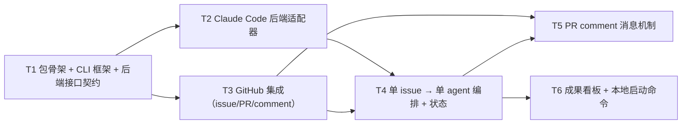

演化图：

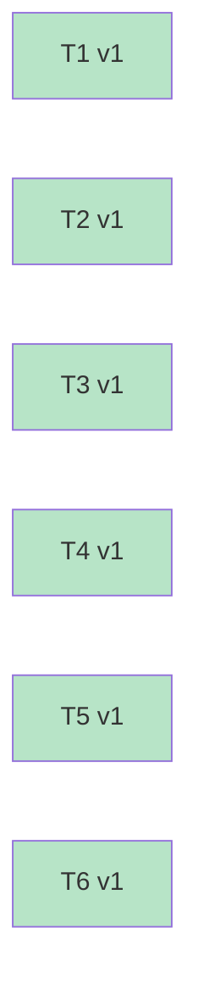

### 0002 OpenAgents 主动提 issue（issue #0）

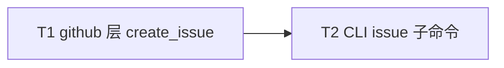

演化图：

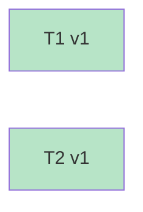

### 0003 issue 求解隔离 —— 每 issue 独立 worktree + 分支基线锁定最新 main（issue #0）

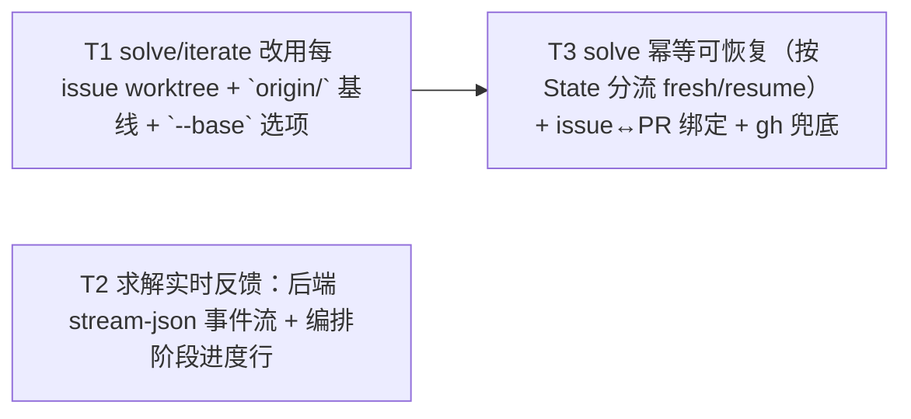

演化图：

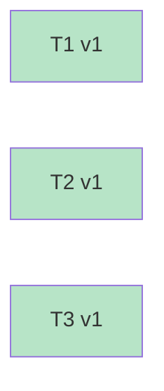

### 0004 openagents vigil —— 守夜人模式（自主 issue→PR 全流程循环）（issue #9）

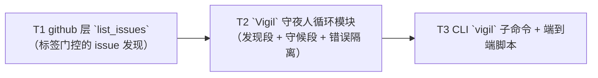

演化图：


### 0005 solve 原子化拆分 + RFC-first 评审循环（issue #0）

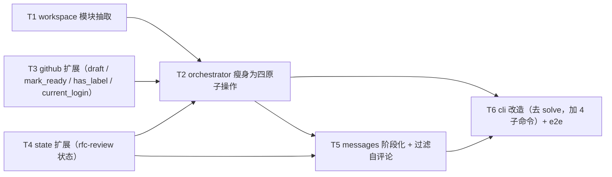

演化图：


### 0006 守夜人识别 PR/issue 关闭作为终止信号（issue #0）

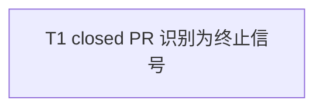

演化图：

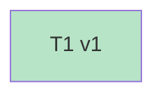

### 0007 守夜人恢复——激活 solving 为 resume 入口，修复 start_rfc 中途崩溃的孤儿 run（issue #0）

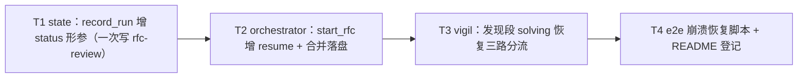

演化图：

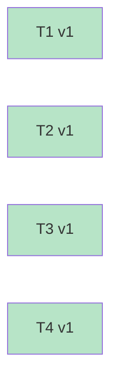

### 0008 PR 正文「端到端验证」指路牌（从 RFC 自动生成）（issue #0）

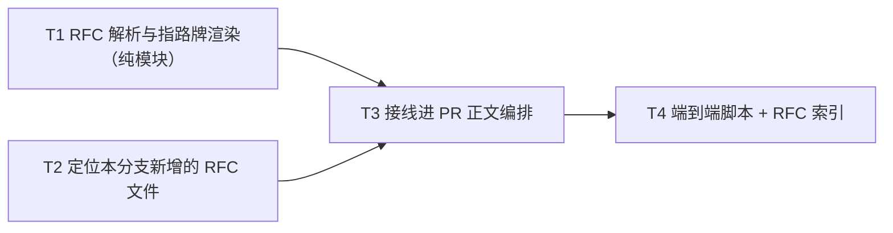

演化图：


### 0009 合并后自动 rebase 其他 open PR（issue #24）

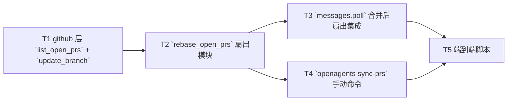

演化图：

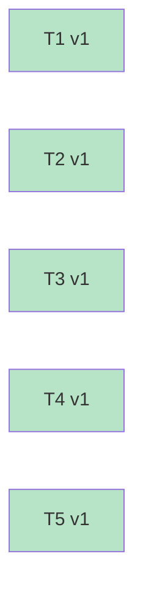

### 0010 gh 瞬时错误重试 + 守夜循环单轮容错（issue #0）

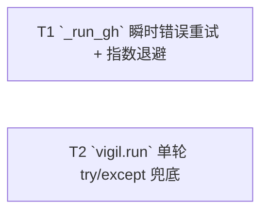

演化图：

```mermaid
graph LR
    v_T1_1["T1 v1"]
    v_T2_1["T2 v1"]
    classDef st_done fill:#b7e4c7;
    class v_T1_1 st_done;
    class v_T2_1 st_done;
```

### 0011 本地 Agent 身份 + 评论签名（区分自评论与真人评论，根治 poll 自循环）（issue #28）

```mermaid
graph LR
    nT1["T1 state 层 agent_id 持久化"]
    nT2["T2 identity 模块（身份解析 + 评论签名）"]
    nT3["T3 poll 判定剔除自评论 + 游标简化"]
    nT4["T4 orchestrator 回贴评论盖章"]
    nT5["T5 rebase 冲突评论盖章"]
    nT6["T6 CLI 接线 + 下线 current_login"]
    nT1 --> nT2
    nT2 --> nT3
    nT5 --> nT3
    nT2 --> nT4
    nT2 --> nT5
    nT3 --> nT6
    nT4 --> nT6
    nT5 --> nT6
```

演化图：

```mermaid
graph LR
    v_T1_1["T1 v1"]
    v_T2_1["T2 v1"]
    v_T3_1["T3 v1"]
    v_T4_1["T4 v1"]
    v_T5_1["T5 v1"]
    v_T6_1["T6 v1"]
    classDef st_done fill:#b7e4c7;
    class v_T1_1 st_done;
    class v_T2_1 st_done;
    class v_T3_1 st_done;
    class v_T4_1 st_done;
    class v_T5_1 st_done;
    class v_T6_1 st_done;
```

### 0012 test 分支门控流程 —— 人只在「提 issue」与「promote」介入（issue #32）

```mermaid
graph LR
    nT1["T1 reviewer 编排模块（N 并行 + 裁决聚合）"]
    nT2["T2 github 扩展（base/merge/label/branch）"]
    nT3["T3 state 扩展（rounds + STATUS_BLOCKED）"]
    nT4["T4 promote 模块（预检 + 快进 main）"]
    nT5["T5 闸接入（messages 路由 + orchestrator 评审/base）"]
    nT6["T6 CLI/vigil 接线（promote 命令 + base 默认 + init 兜底）"]
    nT2 --> nT4
    nT3 --> nT4
    nT1 --> nT5
    nT2 --> nT5
    nT3 --> nT5
    nT4 --> nT6
    nT5 --> nT6
```

演化图：

```mermaid
graph LR
    v_T1_1["T1 v1"]
    v_T2_1["T2 v1"]
    v_T3_1["T3 v1"]
    v_T4_1["T4 v1"]
    v_T5_1["T5 v1"]
    v_T6_1["T6 v1"]
    classDef st_done fill:#b7e4c7;
    class v_T1_1 st_done;
    class v_T2_1 st_done;
    class v_T3_1 st_done;
    class v_T4_1 st_done;
    class v_T5_1 st_done;
    class v_T6_1 st_done;
```

### 0013 实跑端到端脚本并把「合否 + 日志」作为 PR 评论（RFC-0008 指路牌 → 实跑结果延伸）（issue #31）

```mermaid
graph LR
    nT1["T1 e2e 实跑封装 + 结果评论渲染（纯模块）"]
    nT2["T2 rfc.script_path_for（复用 extract_e2e 定位脚本）"]
    nT3["T3 implement 转正前实跑 + 签名结果评论接线"]
    nT4["T4 端到端脚本 + RFC 索引"]
    nT1 --> nT3
    nT2 --> nT3
    nT3 --> nT4
```

演化图：

```mermaid
graph LR
    v_T1_1["T1 v1"]
    v_T2_1["T2 v1"]
    v_T3_1["T3 v1"]
    v_T4_1["T4 v1"]
    classDef st_done fill:#b7e4c7;
    class v_T1_1 st_done;
    class v_T2_1 st_done;
    class v_T3_1 st_done;
    class v_T4_1 st_done;
```

### 0014 用「Spec 活快照 + 演化历史」取代 RFC —— Spec 永远与代码一一对应，legacy 沉淀到历史（issue #35）

```mermaid
graph LR
    nT1["T1 数据层 + JSON Schema + 依赖/入口声明"]
    nT2["T2 spec validate（schema + 语义校验）"]
    nT3["T3 spec render → OVERVIEW.md（看板/关系图/冲突/DAG/演化图）"]
    nT4["T4 spec amend / abandon（历史追加 + 自动 render）"]
    nT5["T5 spec CLI + 编号校验脚本 + CI 接线"]
    nT6["T6 迁移脚本 + spec-driven skill + specs README + e2e"]
    nT1 --> nT2
    nT1 --> nT3
    nT1 --> nT4
    nT3 --> nT4
    nT2 --> nT5
    nT3 --> nT5
    nT4 --> nT5
    nT2 --> nT6
    nT3 --> nT6
```

演化图：

```mermaid
graph LR
    v_T1_1["T1 v1"]
    v_T2_1["T2 v1"]
    v_T3_1["T3 v1"]
    v_T4_1["T4 v1"]
    v_T5_1["T5 v1"]
    v_T6_1["T6 v1"]
    classDef st_done fill:#b7e4c7;
    class v_T1_1 st_done;
    class v_T2_1 st_done;
    class v_T3_1 st_done;
    class v_T4_1 st_done;
    class v_T5_1 st_done;
    class v_T6_1 st_done;
```

### 0015 spec 人类可读 summary：填 group 级 summary 字段 + render 大白话 TL;DR（issue #58）

```mermaid
graph LR
    nT1["T1 数据层：metadata 增 group 级 summary 字段"]
    nT2["T2 授权路径：spec new --summary（cli + mutate）"]
    nT3["T3 闸门：validate 强制 summary 非空"]
    nT4["T4 人读视图：render 顶部 TL;DR 区块"]
    nT5["T5 迁移：补齐 14 个现有 spec 的 summary + 重渲染"]
    nT1 --> nT2
    nT1 --> nT3
    nT1 --> nT4
    nT3 --> nT5
    nT4 --> nT5
```

演化图：

```mermaid
graph LR
    v_T1_1["T1 v1"]
    v_T2_1["T2 v1"]
    v_T3_1["T3 v1"]
    v_T4_1["T4 v1"]
    v_T5_1["T5 v1"]
    classDef st_done fill:#b7e4c7;
    class v_T1_1 st_done;
    class v_T2_1 st_done;
    class v_T3_1 st_done;
    class v_T4_1 st_done;
    class v_T5_1 st_done;
```

### 0020 人类监督闸门：提 issue 前需求对齐 + vigil 分级 --hold 闸控（issue #59）

```mermaid
graph LR
    nT1["T1 前门对齐模块：把模糊想法复述成 X/边界Y/不做Z"]
    nT2["T2 hold 配置模型：解析 spec,merge 成闸门集合"]
    nT3["T3 流水线分级闸：hold 穿到 poll 两道闸分流"]
    nT4["T4 CLI 接线：issue 前门对齐 + vigil --hold 标志"]
    nT5["T5 e2e 脚本：演示停在 spec → 人批 → 继续"]
    nT2 --> nT3
    nT1 --> nT4
    nT2 --> nT4
    nT3 --> nT4
    nT3 --> nT5
    nT4 --> nT5
```

演化图：

```mermaid
graph LR
    v_T1_1["T1 v1"]
    v_T2_1["T2 v1"]
    v_T3_1["T3 v1"]
    v_T4_1["T4 v1"]
    v_T5_1["T5 v1"]
    classDef st_done fill:#b7e4c7;
    class v_T1_1 st_done;
    class v_T2_1 st_done;
    class v_T3_1 st_done;
    class v_T4_1 st_done;
    class v_T5_1 st_done;
```

### 0021 修复 reviewer 长回复截断在 VERDICT 之前→UNPARSED→假非PASS 空耗 rounds 误触 needs-human（issue #63）

```mermaid
graph LR
    nT1["T1 reviewer 侧:前置裁决 token + 首行解析 + 区分「评审无效」+ 单次重解析"]
    nT2["T2 编排层:评审无效不吃 round、空反馈不空转、独立重试上限后诚实升级"]
    nT1 --> nT2
```

演化图：

```mermaid
graph LR
    v_T1_1["T1 v1"]
    v_T2_1["T2 v1"]
    classDef st_done fill:#b7e4c7;
    class v_T1_1 st_done;
    class v_T2_1 st_done;
```

### 0022 代码闸可合并性预检 + poll 错误隔离 + 裁决评论幂等（issue #62）

```mermaid
graph LR
    nT1["T1 github.mergeability：查询 PR 可合并性（mergeable / mergeStateStatus）"]
    nT2["T2 代码闸可合并性预检 + poll 单 PR 错误隔离"]
    nT3["T3 裁决评论幂等：同一裁决不每轮重发"]
    nT1 --> nT2
```

演化图：

```mermaid
graph LR
    v_T1_1["T1 v1"]
    v_T2_1["T2 v1"]
    v_T3_1["T3 v1"]
    classDef st_done fill:#b7e4c7;
    class v_T1_1 st_done;
    class v_T2_1 st_done;
    class v_T3_1 st_done;
```

### 0023 退役 test 分支:main 持续推进 + release/vX.Y.Z 版本分支发布（issue #68）

```mermaid
graph LR
    nT1["T1 github 层:base 默认 main + 去 test 分支自举"]
    nT2["T2 orchestrator + vigil:base 默认 main"]
    nT3["T3 promote→release 模块:建 release/vX.Y.Z 分支 + 打 tag + 版本递增"]
    nT4["T4 CLI:release 子命令 + base 默认 main"]
    nT5["T5 CI 工作流 + indexheal 测试 + 旧 spec 0012 收尾"]
    nT1 --> nT3
    nT2 --> nT4
    nT3 --> nT4
```

演化图：

```mermaid
graph LR
    v_T1_1["T1 v1"]
    v_T2_1["T2 v1"]
    v_T3_1["T3 v1"]
    v_T4_1["T4 v1"]
    v_T5_1["T5 v1"]
    classDef st_done fill:#b7e4c7;
    class v_T1_1 st_done;
    class v_T2_1 st_done;
    class v_T3_1 st_done;
    class v_T4_1 st_done;
    class v_T5_1 st_done;
```

### 0024 spec 转 rust-RFC 形态:总览先行 + 单 spec 自包含（issue #69）

```mermaid
graph LR
    nT1["T1 spec 数据模型:组级 Overview 9 段 + Task 瘦身"]
    nT2["T2 校验质量门槛:必填段 + 自包含 warning + schema 瘦身"]
    nT3["T3 spec new 9 段脚手架 + signpost/cli/mutate 适配"]
    nT4["T4 skill + references + README + orchestrator 对齐 rust-RFC"]
    nT5["T5 回填 19 个存量 spec + e2e 脚本"]
    nT1 --> nT2
    nT2 --> nT3
    nT3 --> nT4
    nT3 --> nT5
```

演化图：

```mermaid
graph LR
    v_T1_1["T1 v1"]
    v_T2_1["T2 v1"]
    v_T3_1["T3 v1"]
    v_T4_1["T4 v1"]
    v_T5_1["T5 v1"]
    classDef st_done fill:#b7e4c7;
    class v_T1_1 st_done;
    class v_T2_1 st_done;
    class v_T3_1 st_done;
    class v_T4_1 st_done;
    class v_T5_1 st_done;
```

### 0025 brownfield 反向补全 RFC:扫存量代码生成 9 段 RFC 草稿（issue #73）

```mermaid
graph LR
    nT1["T1 代码盘点助手:扫 path 产出 inventory"]
    nT2["T2 编排方法 backfill_rfc + 反向 RFC prompt"]
    nT3["T3 CLI 接线 backfill-rfc <path>"]
    nT4["T4 e2e 脚本演示反向补全闭环"]
    nT1 --> nT2
    nT2 --> nT3
    nT3 --> nT4
```

演化图：

```mermaid
graph LR
    v_T1_1["T1 v1"]
    v_T2_1["T2 v1"]
    v_T3_1["T3 v1"]
    v_T4_1["T4 v1"]
    classDef st_done fill:#b7e4c7;
    class v_T1_1 st_done;
    class v_T2_1 st_done;
    class v_T3_1 st_done;
    class v_T4_1 st_done;
```

### 0026 README 最简用法:紧跟安装方法之后新增 Quickstart 段（issue #75）

```mermaid
graph LR
    nT1["T1 插入最简用法/Quickstart 段并同步目录锚点"]
    nT2["T2 e2e 脚本断言 Quickstart 段位置"]
    nT1 --> nT2
```

演化图：

```mermaid
graph LR
    v_T1_1["T1 v1"]
    v_T2_1["T2 v1"]
    classDef st_done fill:#b7e4c7;
    class v_T1_1 st_done;
    class v_T2_1 st_done;
```

### 0027 多仓库统管:单进程按配置文件并发守夜一组仓库（issue #77）

```mermaid
graph LR
    nT1["T1 配置加载:YAML 解析 + jsonschema 校验 + 默认合并"]
    nT2["T2 并发编排:每仓库一子进程跑现有 Vigil + 日志聚合 + 错误隔离"]
    nT3["T3 CLI 接线 vigil-all(--config/--once)"]
    nT4["T4 e2e 脚本演示多仓库统管闭环"]
    nT1 --> nT2
    nT2 --> nT3
    nT3 --> nT4
```

演化图：

```mermaid
graph LR
    v_T1_1["T1 v1"]
    v_T2_1["T2 v1"]
    v_T3_1["T3 v1"]
    v_T4_1["T4 v1"]
    classDef st_done fill:#b7e4c7;
    class v_T1_1 st_done;
    class v_T2_1 st_done;
    class v_T3_1 st_done;
    class v_T4_1 st_done;
```

### 0028 PR 自动化两处改进：spec 草稿 PR 内嵌 9 段总览摘要 + merge 冲突派 agent 语义解冲突（issue #79）

```mermaid
graph LR
    nT1["T1 改进1：总览摘要 digest + PR 正文接线"]
    nT2["T2 改进2：conflict.py 语义解冲突（纯决策 + IO 工厂）"]
    nT3["T3 改进2：接线 rebase / messages / cli（分层降级 + 门控）"]
    nT4["T4 hermetic e2e 脚本（无网络、不触真实 LLM）"]
    nT2 --> nT3
    nT1 --> nT4
    nT3 --> nT4
```

演化图：

```mermaid
graph LR
    v_T1_1["T1 v1"]
    v_T2_1["T2 v1"]
    v_T3_1["T3 v1"]
    v_T4_1["T4 v1"]
    classDef st_done fill:#b7e4c7;
    class v_T1_1 st_done;
    class v_T2_1 st_done;
    class v_T3_1 st_done;
    class v_T4_1 st_done;
```

### 0029 统一 rfc→spec 命名硬切并退场 rfc-driven-development 技能（issue #81）

```mermaid
graph LR
    nT1["T1 文档与技能退场"]
    nT2["T2 线上/持久化值硬切"]
    nT3["T3 orchestrator/backfill 内部标识符重命名"]
    nT4["T4 CLI 子命令与 messages/vigil 消费者对齐"]
    nT5["T5 残余 RFC-NNNN 注释清扫"]
    nT6["T6 端到端校验脚本：断言零残余 rfc"]
    nT2 --> nT3
    nT3 --> nT4
    nT4 --> nT5
    nT1 --> nT6
    nT5 --> nT6
```

演化图：

```mermaid
graph LR
    v_T1_1["T1 v1"]
    v_T2_1["T2 v1"]
    v_T3_1["T3 v1"]
    v_T4_1["T4 v1"]
    v_T5_1["T5 v1"]
    v_T6_1["T6 v1"]
    classDef st_pending fill:#eeeeee;
    class v_T1_1 st_pending;
    class v_T2_1 st_pending;
    class v_T3_1 st_pending;
    class v_T4_1 st_pending;
    class v_T5_1 st_pending;
    class v_T6_1 st_pending;
```

### 0030 init 环境体检：检测 browser MCP 与权限放行（非阻塞）+ 前端 e2e 方法论引导（issue #85）

```mermaid
graph LR
    nT1["T1 权限模式最小开关：常量改为读 OPENAGENTS_PERMISSION_MODE"]
    nT2["T2 体检核心模块 envcheck：browser MCP 检测 + 权限模式读取 + 报告渲染"]
    nT3["T3 把环境体检接进 openagents init（非阻塞）"]
    nT4["T4 条件式 browser-e2e 方法论文案：起草 prompt 模板 + reviewer rubric"]
    nT5["T5 e2e 脚本：体检两态输出 + 方法论文案注入断言"]
    nT1 --> nT2
    nT2 --> nT3
    nT3 --> nT5
    nT4 --> nT5
```

演化图：

```mermaid
graph LR
    v_T1_1["T1 v1"]
    v_T2_1["T2 v1"]
    v_T3_1["T3 v1"]
    v_T4_1["T4 v1"]
    v_T5_1["T5 v1"]
    classDef st_done fill:#b7e4c7;
    class v_T1_1 st_done;
    class v_T2_1 st_done;
    class v_T3_1 st_done;
    class v_T4_1 st_done;
    class v_T5_1 st_done;
```

### 0031 merge 闸解挂语义重设计：人解挂后派 agent 主动解冲突、有界重试再挂起（issue #84）

```mermaid
graph LR
    nT1["T1 state：block_gate/merge_attempts 字段 + 计数/重置方法"]
    nT2["T2 messages：merge 闸 armed 解挂语义 + MAX_MERGE_ATTEMPTS knob"]
    nT3["T3 hermetic e2e 脚本（无网络、不触真实 LLM/gh）"]
    nT1 --> nT2
    nT1 --> nT3
    nT2 --> nT3
```

演化图：

```mermaid
graph LR
    v_T1_1["T1 v1"]
    v_T2_1["T2 v1"]
    v_T3_1["T3 v1"]
    classDef st_done fill:#b7e4c7;
    class v_T1_1 st_done;
    class v_T2_1 st_done;
    class v_T3_1 st_done;
```

### 0032 needs-human 全程在 GitHub 闭环：阻塞留足信息 + 人回新评论即自动解挂喂内容重试（issue #89）

```mermaid
graph LR
    nT1["T1 state：block_watermark 字段 + setter"]
    nT2["T2 github：remove_label 幂等封装"]
    nT3["T3 blocknote：结构化阻塞评论构造（新模块）"]
    nT4["T4 identity：new_human_comments 读侧复活"]
    nT5["T5 messages：_block enrich + watermark + 回评论解挂路由"]
    nT6["T6 hermetic e2e 脚本（无网络、不触真实 LLM/gh）"]
    nT1 --> nT5
    nT2 --> nT5
    nT3 --> nT5
    nT4 --> nT5
    nT5 --> nT6
```

演化图：

```mermaid
graph LR
    v_T1_1["T1 v1"]
    v_T2_1["T2 v1"]
    v_T3_1["T3 v1"]
    v_T4_1["T4 v1"]
    v_T5_1["T5 v1"]
    v_T6_1["T6 v1"]
    classDef st_done fill:#b7e4c7;
    class v_T1_1 st_done;
    class v_T2_1 st_done;
    class v_T3_1 st_done;
    class v_T4_1 st_done;
    class v_T5_1 st_done;
    class v_T6_1 st_done;
```

### 0033 openagents init 新建远端后自动 git remote add origin（issue #93）

```mermaid
graph LR
    nT1["T1 _bootstrap 新建远端后 git remote add origin"]
    nT2["T2 回归测试 + e2e 覆盖 remote-add 路径"]
    nT1 --> nT2
```

演化图：

```mermaid
graph LR
    v_T1_1["T1 v1"]
    v_T2_1["T2 v1"]
    classDef st_done fill:#b7e4c7;
    class v_T1_1 st_done;
    class v_T2_1 st_done;
```

### 0034 冲突/挂起通知带可定位诊断 + 合并扇出重发收敛——让「具体什么 conflict」结构上答得出（issue #92）

```mermaid
graph LR
    nT1["T1 conflictdiag：merge-tree 诊断采集 + 格式化（新模块）"]
    nT2["T2 rebase：扇出冲突评论带诊断 + 已 needs-human 不重发"]
    nT3["T3 messages：merge 闸 blocker 带诊断 + 扇出注入诊断器"]
    nT4["T4 hermetic e2e 脚本（无网络、不触真实 LLM/gh/git 远端）"]
    nT1 --> nT2
    nT1 --> nT3
    nT2 --> nT4
    nT3 --> nT4
```

演化图：

```mermaid
graph LR
    v_T1_1["T1 v1"]
    v_T2_1["T2 v1"]
    v_T3_1["T3 v1"]
    v_T4_1["T4 v1"]
    classDef st_done fill:#b7e4c7;
    class v_T1_1 st_done;
    class v_T2_1 st_done;
    class v_T3_1 st_done;
    class v_T4_1 st_done;
```

### 0036 解挂后 agent 读取并正面回应人的评论：merge 闸也喂评论内容 + 编排层确定性贴回引用原评论（issue #97）

```mermaid
graph LR
    nT1["T1 state：unblock_detail 字段 + setter"]
    nT2["T2 replynote：引用原评论的回应构造（新模块）"]
    nT3["T3 conflict：解冲突器接受人类 guidance"]
    nT4["T4 orchestrator：原子操作回传 summary + 人类解挂 prompt + announce 开关"]
    nT5["T5 messages：merge 喂内容 + 三闸确定性贴回引用原评论"]
    nT6["T6 hermetic e2e 脚本（无网络、不触真实 LLM/gh）"]
    nT1 --> nT5
    nT2 --> nT5
    nT3 --> nT5
    nT4 --> nT5
    nT5 --> nT6
```

演化图：

```mermaid
graph LR
    v_T1_1["T1 v1"]
    v_T2_1["T2 v1"]
    v_T3_1["T3 v1"]
    v_T4_1["T4 v1"]
    v_T5_1["T5 v1"]
    v_T6_1["T6 v1"]
    classDef st_done fill:#b7e4c7;
    class v_T1_1 st_done;
    class v_T2_1 st_done;
    class v_T3_1 st_done;
    class v_T4_1 st_done;
    class v_T5_1 st_done;
    class v_T6_1 st_done;
```

### 0038 合并冲突改拉式同步 + 解冲突 agent 用带签名工具自回评论（issue #96）

```mermaid
graph LR
    nT1["T1 门2 拉式同步 + 删 push 扇出"]
    nT2["T2 删死代码 + CONFLICT_COMMENT 迁移"]
    nT3["T3 解冲突 agent 用带签名工具自回评论"]
```

演化图：

```mermaid
graph LR
    v_T1_1["T1 v1"]
    v_T2_1["T2 v1"]
    v_T3_1["T3 v1"]
    classDef st_done fill:#b7e4c7;
    class v_T1_1 st_done;
    class v_T2_1 st_done;
    class v_T3_1 st_done;
```

### 0039 vigil 多后端并发派单去重：引入「已派发」认领标签（第 3 道闸 + 过期回收）（issue #102）

```mermaid
graph LR
    nT1["T1 github 认领原语层"]
    nT2["T2 发现段第 3 道闸 + 过期回收"]
    nT3["T3 start_rfc 认领打标与清理"]
    nT4["T4 端到端去重成果测试（含浏览器看板断言）"]
    nT1 --> nT2
    nT1 --> nT3
    nT2 --> nT4
    nT3 --> nT4
```

演化图：

```mermaid
graph LR
    v_T1_1["T1 v1"]
    v_T2_1["T2 v1"]
    v_T3_1["T3 v1"]
    v_T4_1["T4 v1"]
    classDef st_done fill:#b7e4c7;
    class v_T1_1 st_done;
    class v_T2_1 st_done;
    class v_T3_1 st_done;
    class v_T4_1 st_done;
```

### 0041 hold-merge PASS 后夯住待合并：已通过的 PR 冻结成 needs-human，消除同码复审震荡（issue #106）

```mermaid
graph LR
    nT2["T2 「✅ 已通过评审，待你合并」成功文案"]
    nT3["T3 净化 reviewer scratchpad"]
    nT1["T1 hold-merge 夯住 + merge-hold 解挂路由"]
    nT4["T4 端到端成果测试（含浏览器看板「冻结后稳定」断言）"]
    nT2 --> nT1
    nT1 --> nT4
    nT2 --> nT4
    nT3 --> nT4
```

演化图：

```mermaid
graph LR
    v_T1_1["T1 v1"]
    v_T2_1["T2 v1"]
    v_T3_1["T3 v1"]
    v_T4_1["T4 v1"]
    classDef st_done fill:#b7e4c7;
    class v_T1_1 st_done;
    class v_T2_1 st_done;
    class v_T3_1 st_done;
    class v_T4_1 st_done;
```

### 0042 PR close→reopen 后复活被冻死的 run：closed 不是真终态（issue #108）

```mermaid
graph LR
    nT1["T1 state：closed_at 字段 + set_closed_at setter"]
    nT2["T2 github：is_open / is_draft 只读薄封装"]
    nT3["T3 messages：复活窗口守卫 + reopen 复活 reconcile"]
    nT4["T4 端到端成果测试（含浏览器看板『close→reopen 复活』断言）"]
    nT1 --> nT3
    nT2 --> nT3
    nT1 --> nT4
    nT2 --> nT4
    nT3 --> nT4
```

演化图：

```mermaid
graph LR
    v_T1_1["T1 v1"]
    v_T2_1["T2 v1"]
    v_T3_1["T3 v1"]
    v_T4_1["T4 v1"]
    classDef st_pending fill:#eeeeee;
    class v_T1_1 st_pending;
    class v_T2_1 st_pending;
    class v_T3_1 st_pending;
    class v_T4_1 st_pending;
```
