# Spec 总览（OVERVIEW）

> 本文件由 `spec render` 自动生成，请勿手工编辑（Spec-0014/T3）。

## TL;DR（人话速览）

### 0001 MVP — 单 issue → 单 agent → 真实 PR 的最小自举闭环
OpenAgents 的最小可用自举闭环：拉一个 issue、派一个 agent、用 Claude Code 后端把它做成一个真实的 GitHub PR。产出包骨架、CLI、后端适配、单 issue 编排、PR 评论消息机制和成果看板，是整个项目的起点。

### 0002 OpenAgents 主动提 issue
让 OpenAgents 不只被动接 issue，还能主动给仓库提 issue。加 github 层 create_issue、CLI issue 子命令，并给自动发现的 issue 打上发现标签、确保标签存在。

### 0003 issue 求解隔离 —— 每 issue 独立 worktree + 分支基线锁定最新 main
每个 issue 在独立 git worktree 里求解、分支基线锁定最新 origin/main，避免多 issue 互相污染。同时加实时事件流反馈、可中断恢复的幂等求解，以及 CLI 统一错误处理（异常不吐 traceback）。

### 0004 openagents vigil —— 守夜人模式（自主 issue→PR 全流程循环）
守夜人模式：让 OpenAgents 自主循环跑「发现 issue → 求解 → 提 PR」全流程，不用人盯着。含标签门控的 issue 发现、发现段+守候段两段循环与单 issue 错误隔离，以及 vigil 子命令和端到端脚本。

### 0005 solve 原子化拆分 + RFC-first 评审循环
把原来一坨的 solve 拆成四个原子操作，并引入 RFC-first 评审循环（先写 RFC 再写代码）。抽出 workspace 模块、扩展 github/state、把消息按阶段过滤掉自评论，CLI 去掉 solve 换成 4 个子命令。

### 0006 守夜人识别 PR/issue 关闭作为终止信号
守夜人要懂得收手：当一个 PR 或 issue 被关闭时，把它识别成终止信号，不再继续求解，避免对已放弃的工作空转。

### 0007 守夜人恢复——激活 solving 为 resume 入口，修复 start_rfc 中途崩溃的孤儿 run
修复守夜人半路崩溃留下的孤儿 run：把 solving 状态当成 resume 入口，让 start_rfc 中途崩溃后能接着干而不是从头再来。含 state/orchestrator/vigil 三处改动和崩溃恢复脚本。

### 0008 PR 正文「端到端验证」指路牌（从 RFC 自动生成）
在 PR 正文里自动生成一段「怎么做端到端验证」的指路牌，内容从该分支新增的 RFC 自动解析渲染，让审核者一眼知道如何验收。

### 0009 合并后自动 rebase 其他 open PR
一个 PR 合并进 main 后，自动把其余还开着的 PR rebase 到最新 main，省去手动 rebase。含 github 层 list_open_prs/update_branch、扇出模块、合并后集成和手动 sync-prs 命令。

### 0010 gh 瞬时错误重试 + 守夜循环单轮容错
给跟 GitHub 打交道加韧性：gh 命令遇到瞬时错误时指数退避重试，守夜循环每一轮用 try/except 兜底，单轮出错不拖垮整个循环。

### 0011 本地 Agent 身份 + 评论签名（区分自评论与真人评论，根治 poll 自循环）
给本地 agent 一个持久身份并在评论上盖签名，从而区分「自己发的评论」和「真人评论」，根治 poll 把自己评论当新消息的自循环问题。

### 0012 test 分支门控流程 —— 人只在「提 issue」与「promote」介入
改成 test 分支门控流程，人只在「提 issue」和「promote 上线」两处介入：N 个 reviewer 并行评审聚合裁决，promote 模块预检后快进 main，中间全自动。

### 0013 实跑端到端脚本并把「合否 + 日志」作为 PR 评论（RFC-0008 指路牌 → 实跑结果延伸）
在 PR 转正前真正跑一遍端到端脚本，把「跑通没有 + 日志」作为带签名的 PR 评论贴出来。是 0008 指路牌（告诉怎么测）到实跑结果（直接给结论）的延伸。

### 0014 用「Spec 活快照 + 演化历史」取代 RFC —— Spec 永远与代码一一对应，legacy 沉淀到历史
用「Spec 活快照 + 演化历史」取代 RFC：Spec 永远和当前代码一一对应，旧版本沉淀到 history、不再是流水账。含数据层/schema、validate、render（OVERVIEW）、amend/abandon、CLI 和迁移。

### 0015 spec 人类可读 summary：填 group 级 summary 字段 + render 大白话 TL;DR
给每个 spec 加一段面向人的大白话 TL;DR：metadata 增组级 summary 字段、spec new 必填、validate 强制非空、render 在 OVERVIEW 顶部逐 feature 展示，并迁移补齐所有现存 spec。是 #59 人类监督闸门的地基。

### 0017 PR 生命周期(create/ready/merge)下放 agent：draft 升为一等事实、level-triggered 自愈转正 + 合并硬闸兜底
把 mark_ready / merge 两个 PR 生命周期动作从确定性一次性直调改为 agent 职责，并给 draft 补上 level-triggered 自愈通路，消除「一次性动作脱靶就永久卡死」的不可复位死角。
- e2e 意图：证明「PR 生命周期动作下放 agent + draft 升为一等事实的 level-triggered 自愈」这条架构契约在离线确定性链路上成立——(1) deliver agent 的完成判据含「PR 非 draft」（转正归它）；(2) 稳态 reconcile 分支表把 is_draft 当成每 tick 复检的一等维度：一个已交付但仍 draft 的 green+approved PR 下一 tick 经 _ACT_READY 自愈转正、再下一 tick 才落 merge，且 draft 自愈分支严格排在 merge 分支之前（任何 PR 都不在 draft 态被合、merge:human 时人拿到已转正可直接合的 PR——直闭
  - 测法：本组是纯后端编排 + agent 提示词，无 product-facing 前端可导航；已自检工具列表：无 Playwright / Chrome DevTools MCP，故不设浏览器 e2e，改用离线确定性测法（沿用 Spec-0060/0061/0064/0065 同款）： 1. 快照/提示词针对性 pytest（假 gh JSON / Template.substitute，不触真实仓库/网络/LLM）：    pr_snapshot 解析 isDraft→is_draft（true/false/缺失→默认 False）；PRSnapshot 加 is_draft 后既有    构造点仍可零改实例化；deliver.PROMPT 含 `gh pr ready` 与「非 draft」完成判据；merger.PROMPT 含    `gh pr merge` 与 needs-human 一等出口。 2. 硬闸针对性 pytest（假 CheckSnapshot/PRSnapshot 快照注入，不触网）：gates.assert_merge_allowed 在    CI 非全绿 / 无 review-approved label / label sha≠head 三情形各抛 GateError，唯全绿+approved@head    放行；stages.merge 闸放行→派 merger agent、闸抛→不派 agent（断言 merger 未被调用）。 3. reconcile 分支表针对性 pytest（纯函数 _classify / 假 backend 喂 canned 裁决）：    _fingerprint 字段集 == dataclasses.fields(_Facts) 全集且含 is_draft（转正改 fp = 真进展）；    green+approved@head+is_draft → _ACT_READY（断言绝不 _ACT_MERGE），非 draft 才 _ACT_MERGE，    draft 自愈分支严格在 merge 分支之前；_do_ready 调 github.mark_ready 幂等；_do_solve 不再直调    github.mark_ready（grep 锚点）；_do_merge 经 stages.merge 派 merger。 4. 离线 e2e 脚本 scripts/e2e-spec-0017-pr-lifecycle-delegated-to-agent.sh（ruff check + ruff    format --check + 上述针对性 pytest + grep 锚点：_do_solve 无 github.mark_ready、stages.merge 无    github.merge_pr 裸直调），被 PR e2e signpost 采集。反复调 run_vigil(once=True) 一 tick 一步：    delivered+is_draft+green+approved 的 PR → tick₁ 转正（is_draft False）→ tick₂ 才 merge；    merge:human 配置下 → tick₁ 先转正 → tick₂ park needs-human（断言人拿到的是非 draft PR）。 5. 真实自主环冒烟（dogfood，Phase-3 人验 / runbook，非 CI 确定性闸）：oa vigil 跑通一个 issue→PR，    观测 deliver 后 PR 直接非 draft、且残留 draft 能被下一轮转正——作为成果验收（理念 8）记入 runbook。 

### 0020 人类监督闸门：提 issue 前需求对齐 + vigil 分级 --hold 闸控
给 OpenAgents 加两道人类监督闸门：提 issue 前的「需求对齐」（把模糊想法复述成 做什么X/边界Y/不做Z 让人确认），以及 vigil 自治循环的分级 --hold 闸（在 spec 批准、PR 合并等关键点停下等人点头）。让人从盯细节转向把控宏观；只在关键节点插入可配置暂停，不改既有 issue→PR 自动流程的内部逻辑。

### 0021 修复 reviewer 长回复截断在 VERDICT 之前→UNPARSED→假非PASS 空耗 rounds 误触 needs-human
修 reviewer 长回复被截断在 VERDICT 行之前、导致解析失败（UNPARSED）被误判成「非 PASS」、白白空耗 vigil rounds 甚至误触 needs-human 的 bug。做法：裁决 token 前置、按首行解析、区分「评审本身无效」与「真 REWORK」、加单次重解析与诚实升级。只改 reviewer 解析与编排层容错，不改裁决标准本身。

### 0022 代码闸可合并性预检 + poll 错误隔离 + 裁决评论幂等
代码闸（merge gate）三处加固：合并前预检 PR 可合并性（不可合并直接跳过、不空转崩溃 poll）、poll 阶段隔离单个 PR 的错误不拖垮整轮、裁决评论幂等避免刷屏重复 PASS。迁移自旧 metadata（原无 summary，按标题与任务补齐）。

### 0023 退役 test 分支:main 持续推进 + release/vX.Y.Z 版本分支发布
退役 test 分支,反转旧的「test 门控」模型:main 成为日常自动流转分支(reviewer 闸+CI 全绿后自动合入,持续推进),发版时把 main 发布到 release/vX.Y.Z 分支并打 vX.Y.Z tag(版本号从最新 tag 自动递增,默认 patch)。人的触点从 promote 改为 release;promote.py 重命名重定向为 release.py,全链路 base 默认 test→main,去掉 test 分支自举,CI 仅 main 触发。

### 0024 spec 转 rust-RFC 形态:总览先行 + 单 spec 自包含
把 spec 改成 rust-RFC 9 段总览为主体(总览先行、单 spec 自包含),DAG + 文件分配收进 Reference-level;数据模型/校验/skill/README/orchestrator 一并对齐,回填 19 个存量 spec。

### 0025 brownfield 反向补全 RFC:扫存量代码生成 9 段 RFC 草稿
新增 backfill-rfc <path> 子命令:扫存量代码 → 派 coding agent 反推 rust-RFC 9 段 spec 草稿(必填四段据实回填、难反推段标待补)→ 经 spec validate 后开 draft PR 交人评审,让 brownfield 仓库接入 RFC 驱动闭环。

### 0026 README 最简用法:紧跟安装方法之后新增 Quickstart 段
在 README「安装」之后、「快速上手」之前插入一段「最简用法 / Quickstart」,把最短可用路径 init → issue → vigil 放最前,并点明日常只用 issue+vigil、poll/watch/rfc 等是不发现新 issue 的单步调试工具。只动 README 文案与结构,不改任何 CLI 行为。

### 0027 多仓库统管:单进程按配置文件并发守夜一组仓库
新增 openagents vigil-all 命令:单进程读一份 YAML 配置(仓库列表 + 全局默认 + 每仓库可选覆盖 interval/labels/base/hold),为每个仓库起一个隔离子进程复用现有 Vigil 并发守夜(发现→派单→守候),各读写自己的 .openagents/state.json,统一带仓库前缀聚合日志;单仓库 vigil 命令与底层逻辑零改动。

### 0028 PR 自动化两处改进：spec 草稿 PR 内嵌 9 段总览摘要 + merge 冲突派 agent 语义解冲突
spec 草稿 PR 正文内嵌总览摘要三段；merge 真冲突派 coding agent 语义解决，分层降级 indexheal→agent→人工。

### 0029 统一 rfc→spec 命名硬切并退场 rfc-driven-development 技能
把仓库残留的 rfc 命名全量改为 spec：删除 rfc-driven-development 技能目录、改 CLAUDE.md/README 散文、重命名 openagents/+tests/ 里的标识符与 CLI 子命令、并硬切三个线上/持久化值（GitHub 标签 rfc-approved→spec-approved、状态 rfc-review→spec-review、reviewer kind 'rfc'→'spec'），无兼容垫片；清扫覆盖每个活源文件与活模板——含包级 docstring openagents/__init__.py 的招牌标语与看板模板 openagents/templates/board.html 的 RFC-0001。冻结/prior-art allowlist（显式保留、不清扫、e2e 不误报）：历史 spec/设计文档正文里的 RFC-NNNN、rust-RFC 形态名、openagents/spec/ 与 tests/test_spec_* 里记录旧 rfc.py 改名的历史引用、scripts/e2e-rfc-*.sh 历史脚本名。

### 0030 init 环境体检：检测 browser MCP 与权限放行（非阻塞）+ 前端 e2e 方法论引导
在 openagents init 的 preflight 里加一段非阻塞环境体检：读 ~/.claude.json 检测 browser MCP（playwright/chrome-devtools）是否注册、读 OpenAgents 派 claude 的有效权限模式是否为全放行（bypassPermissions），缺失则打印安装/设置方式但不阻断 init；同时把「具备浏览器工具就优先设计前端浏览器 e2e」的条件式引导写进 in-code 方法论面（起草 prompt 模板 + reviewer rubric）。只检测+提示+方法论文案，不自动改 MCP 配置/权限、不在编排核心耦合 MCP、不驱动浏览器跑断言。

### 0031 merge 闸解挂语义重设计：人解挂后派 agent 主动解冲突、有界重试再挂起
人摘 needs-human 解挂 merge 冲突后不即时重挂，而是进入 armed 模式派 agent 有界重试解冲突，用尽仍冲突才重新挂起

### 0032 needs-human 全程在 GitHub 闭环：阻塞留足信息 + 人回新评论即自动解挂喂内容重试
阻塞时按 gate 留一条信息充分的结构化评论；检测到 block 之后的新人类评论即自动摘 needs-human + 把评论当 detail 喂给对应闸 agent，恢复流转——人机交流全程在 PR 评论里闭环（仅新评论 + 仅人类签名过滤，定向解除 RFC-0019 的不读评论限制）

### 0033 openagents init 新建远端后自动 git remote add origin
冷启动新建 GitHub 仓库后补做 git remote add origin，修复后续 gh 命令 no git remotes found

### 0034 冲突/挂起通知带可定位诊断 + 合并扇出重发收敛——让「具体什么 conflict」结构上答得出
冲突通知不再是无诊断的静态罐头：新增 worktree-free 的 git merge-tree 诊断采集（冲突文件清单 + 关键 hunk 摘要），喂进 merge 闸挂起评论与合并扇出冲突评论的「卡在哪」段；并让扇出对已 needs-human 的 PR 不再机械重发，把人机沟通交回 #89 的 blocked 读侧闭环

### 0036 解挂后 agent 读取并正面回应人的评论：merge 闸也喂评论内容 + 编排层确定性贴回引用原评论
让评论驱动协作真正双向：所有闸（含此前丢弃内容的 merge 闸）解挂都把人类评论喂给 agent；agent 完成本轮动作后，由编排层确定性贴回一条引用原评论的签名回应（答追问/说明做了什么/解不了讲清原因），复用既有发帖出口、不依赖 prompt 记性、不踩 headless 发帖权限坑

### 0038 合并冲突改拉式同步 + 解冲突 agent 用带签名工具自回评论
守夜人合并/冲突处理从「推式扇出+确定性 heal」改为「门2 拉式同步+agent 能动性」；解冲突 agent 用带签名 reply-comment 工具亲自回人类评论（根治牛头不对马嘴）

### 0039 vigil 多后端并发派单去重：引入「已派发」认领标签（第 3 道闸 + 过期回收）
给发现段加一道跨后端可见的 GitHub「已派发」认领标签闸，把同一 issue 被多后端重复派单的概率压到可接受，并用标签事件时戳做过期回收兜底僵尸认领。

### 0040 重设计 e2e：说明书驱动 + 独立执行 + 证据评审门控（Phase 1 骨架）
把 e2e 从「实现者顺手写脚本、implement 里一次性跑、贴条不门控」升级为「spec 声明 e2e 意图 → 代码写完由实现者把意图定稿成可执行说明书 → 独立 executor agent 按形态（cli/api/backend）真跑系统产出证据文件 → 证据闸 reviewer 拿 RFC 意图对照证据门控合并」，并把「要不要验」上移到 RFC 闸、「行为验收」从代码 reviewer 划给证据闸。
- e2e 意图：证明「独立执行 + 证据固化 + 证据闸门控合并 + 上游强制」骨架真的有牙——证据 FAIL 必须挡住合并、证据 PASS 才放行。
  - 测法：1. 造 fixture PR/worktree + 声明 cli 形态的 runbook，跑 executor → 证据文件落在 docs/e2e-results/<pr>/。 2. 喂「意图未达成」证据给证据闸 → 判 FAIL 且链路走 iterate(reason=e2e)、不调用 merge_pr。 3. 喂「达成」证据 → 判 PASS 且照常放行 merge。 

### 0041 hold-merge PASS 后夯住待合并：已通过的 PR 冻结成 needs-human，消除同码复审震荡
reviewer PASS 且 hold.at_merge 时把 PR 从「pr-open 空转、下轮重审」改为「置 BLOCKED + 打 needs-human + 贴『✅ 已通过评审，待你合并』」，复用既有冻结机制让 poll 自动跳过、不再重审，从根上消除同一 commit 被非确定 reviewer 反复 PASS/REWORK 的复审震荡；附带净化挂起评论里泄漏的 reviewer scratchpad。

### 0042 PR close→reopen 后复活被冻死的 run：closed 不是真终态
poll 发现本地 closed 的 run 对应 PR 在 GitHub 又变回 OPEN（reopen）时按 draft→rfc-review / 转正→pr-open 复活它、清 closed 续跑既有流程；用 closed_at 复活窗口把「每轮对所有历史 closed run 发 gh 查 reopen」的成本上界住，超窗口即真终态；is_merged 仍是不可逆终态不参与复活。

### 0043 issue 进入 RFC 前自检标题/正文是否影响修法：命中冲突先打 needs-human 对齐、不直接生成 spec
在 vigil 发现段派单 start_rfc 之前插一道 issuecheck 轻量自检：用注入 backend 判读 issue 标题/正文是否存在「会直接影响修法」的内在冲突（标题修法≠正文修法、根因≠修法、互斥修法未取舍、修 A 报 B、已知取舍未声明）；命中则不起草 spec，改为打 needs-human + 贴一条列出冲突点与候选修法的对齐评论，等人对齐；未命中照常派单。以 needs-human 标签为持久冻结信号（_dispatch_kind 跳过），使同一 issue 的非确定判读只跑一次、不复审震荡。

### 0044 「端到端跑真 app 并截图」验证 skill：UI/产品行为改动须有真实运行证据
移植反惰性的『端到端跑真 app 并截图』判断/纪律 skill 进仓库，并把『产品对外行为改动必须有 tracked 真运行证据、宣称测过但无证据=REWORK』硬化进 OpenAgents 的派单 prompt 与 reviewer rubric，杜绝『宣称测过但没测』。

### 0045 Spec-0037 后清理旧 rebase/indexheal 口径
扫掉 rebase.py/indexheal.py/sync-prs 删除后残留在 openagents/tests 注释里的 rebase_open_prs、rebase.CONFLICT_COMMENT、indexheal→conflict→人工 等活文档口径，让注释与拉式同步现状对齐

### 0047 评审裁决按「实质内容」去重（同结论·理由不同照发）
把 _post_review_decision 的去重从「同结论=重复」改成「同结论且同反馈才算重复」——多轮 REWORK 理由各异时中间轮裁决评论不再被吞、人盯 PR 能看清每轮卡点演变，同时保留 PR #61「33 条相同 PASS」的防刷屏去重。

### 0048 Review 防「架构骨架冒充完整实现」：强化 reviewer prompt 防 design-as-implementation
在 reviewer 的 code/rfc rubric 与「无证据=REWORK」规则里加一层『防 design-as-implementation』硬检查，杜绝 PR 用架构文档/模块骨架/单测/正确门控位置冒充自动化执行链路的完整实现——改为逐条要求主流程触发点·被调用证据·artifact 自动产出并 commit·正例放行/反例阻断，缺任一条判 REWORK 并写明「只实现骨架，未证明完整链路」。

### 0049 vigil 多后端派单认领去互撕：resume 免认领 + 认领带归属 + 二次确认退让
消除 vigil 多后端认领标签反复互撕：resume 不再重复认领(止血) + 认领编码 agent 归属(署名认领评论) + 认领后 read-after-write 退让，使同一 issue 任一时刻只被一个后端有效认领、他方识别并退让。

### 0050 Review 不通过理由增强可读性：强制 reviewer 反馈输出为一段简短中文
在 reviewer 的 _RUBRIC_TAIL 输出格式规约里加一条硬要求——REASON/ISSUES/NEXT 等所有面向人类的裁决理由必须用一段简短的中文书写（直击要害、避免长篇英文堆砌），让人能在 GitHub 评审评论里直接读懂并处理；配套单测锚定该文本 + 浏览器成果 e2e（把真实评审评论渲染出来、截图并断言反馈摘要为简短中文）。
- e2e 意图：本改动是纯 prompt 文本硬化（reviewer 的 _RUBRIC_TAIL 加「理由必须简短中文」硬规约），无运行时行为变更、无浏览器可跑成果；「反馈摘要须为简短中文」这条约束的可验证成果，是离线确定性地跑通真实 render_decision 渲染路径 + 机器可验证的可读性判据（CJK 占比/长度），而非需要真 LLM 或浏览器交互的界面闭环。
  - 测法：1. 跑 scripts/e2e-spec-0050-review-reason-chinese-readability.sh 离线段全绿：ruff check + ruff format --check + pytest -q 全套通过；grep 锚点断言 _RUBRIC_TAIL 含 T1 语言/长度硬规则关键字（简短 / 中文 / REASON·ISSUES·NEXT）。 2. 用代表性简短中文 feedback fixture 喂真实 reviewer.render_decision(kind=code) 渲染出评论 markdown 并抽「反馈摘要」块，断言 CJK 字符占比 ≥ 阈值 且 总长度 ≤ 阈值，渲染出的 GitHub 风格 HTML 页存 tracked docs/evidence/spec-0050/。 3. RED 反证：同一判据喂「旧式长篇英文 feedback fixture」应判不通过（CJK 占比低/超长），对照 HTML 一并存证，证明判据能区分、绿非恒真。 

### 0051 统一 agent 执行后回贴 PR 评论：补齐 implement/iterate/finalize_runbook/executor/证据闸的静默步骤（可观测性收口）
把「派 agent 执行→执行完在 PR 回贴一条署名说明评论」从各方法零散自接、收口到编排层（messages）统一：给 executor/evidence_gate/编排步骤各配 render_* 纯函数，在 _process_rfc_review/_process_coding/_evidence_gate 的收口点统一「执行完→render_*→identity.post_signed_comment（带防刷屏去重）」，补齐 implement / iterate(ci·review·e2e) / finalize_runbook / run_executor / review_evidence 五处静默步骤，让人盯 PR 即知每步进展（理念 8），且 executor/evidence_gate 保持不碰 IO 的解耦定位（理念 10）。

### 0052 统一 agent 上下文注入：所有派单入口带 PR 号 + 注入本 PR 对话历史
抽一个统一的 build_agent_context(pr_number, extra_detail) 入口，所有派 agent 入口（orchestrator 各原子操作 + reviewer）统一走它：既保证 PR 号进入 prompt（refine_rfc/implement 补上），又把本 PR 对话历史（历轮评审裁决 + 作者回复 + 人类评论，带作者与轮次、截断去噪）注入 context，消除各模板自拼装的分叉；reviewer 附「落盘产物为准、评论仅供参考」rubric 以保留其独立读仓库的价值。

### 0053 代码评审闸每轮重审：代码状态未变时复用上轮 PASS（对照 k8s Tide sticky approve / tree-hash）
给代码评审闸引入「PR 净改动指纹」短路：reviewer 全票 PASS 时落盘指纹，下一轮进 review_code 前比指纹一致则复用 PASS、跳过重审——止住 base 前进（BEHIND→update_branch→CI 重跑）触发的同码空转重审。

### 0054 vigil 逐闸旁路开关：--skip 按需关闭任一流水线闸门 + README 闸门树
新增 CLI 临时 flag `openagents vigil --skip <gates>`，与 --hold 对称、纯解析无 IO，可按需把 issue/spec/code/ci/evidence（及 all）中任一闸视为 PASS 放行（可合并性预检闸不提供 --skip——见 Rationale 备选 4）；默认不传全闸开启、零回归；--hold 与 --skip 对同一闸的矛盾表达报错；并把全部闸门以树形写进 README。

### 0055 e2e v2：能力感知 + 说明书直喂 + 合并 review（重设计 0040）
把 e2e 从 0040 的「form 分派 + runbook 定稿 + 独立证据闸」三层机械脚手架，重设计为「启动时固化浏览器能力状态量 → RFC 写 prose 测法（能力决定要不要求截图）→ 独立 executor agent 运行时自检工具真跑并把截图/声明写进 docs/e2e-results/<pr>/ → 现有 review 同时判代码+证据（reviewer 亲眼看图）」，砍掉 finalize_runbook/form 枚举/独立 evidence_gate；流水线在 CI 后跑 executor 再 review，配源码指纹（排除证据目录）幂等闸与 sticky 复用，证据 commit 意外弄红 CI 走 bad_ci_after_e2e 挂起。

### 0056 vigil：git 交付/冲突下放 agent（rebase 自愈）+ harness head 前移硬闸（修订决策 7）
把 git 交付/冲突自愈从 harness 死写下放给 agent（commit→记 fetch 前基点 BASE→rebase 解冲突→push --force-with-lease=<branch>:BASE），harness 只保留一道不可绕过的 head 前移硬闸（origin/<branch>≠本地 HEAD → needs-human）；修订决策 7 允许 --force-with-lease 但仅限本 issue 分支、绝不裸 force。

### 0057 e2e 门控硬化：RFC 闸确定性强制 e2e 块 + 代码 review 两重测试交叉比对
wind-palace PR #19 暴露 e2e v2 被两道非确定 LLM 软闸绕过：RFC 闸没逼出结构化 e2e 块（被 spec 正文的 e2e 讨论骗过）→ run_e2e 空过；代码 review 把实现者自测（docs/evidence/ 自证）当成放行依据、没要求独立 executor 证据（docs/e2e-results/）。本组把这两条从软 rubric 硬化：T1 RFC 闸在调 LLM 前加一道确定性检查——改动 spec 缺真实 e2e 块（intent+method 非空）直接自动返工，不问 LLM；T2 代码 review rubric 明说运行时验证有两重（实现者自测=声明 / 独立 executor=裁判），要求交叉比对、独立证据缺失不得凭自测放行。两个证据目录保持分开（自证 vs 独立）。

### 0060 架构重构（批次一）：核心收敛为 agents（提示词）+ recipes（编排），操作下放 agent，仅留最小硬闸 + runtime/utils 确定性层
把「一切需判断的操作走 agent、人只做宏观」的初心从 #140 的 git 特例上升为架构总原则：核心只留 agents（string.Template 提示词，零逻辑）+ recipes（纯控制流编排）；agent 返回结构化裁决，recipe 只按裁决路由（顺序/循环/分支），自己不做任何业务判断；runtime 是唯一机制层（run_agent 引擎 + 最小硬闸：head 前移断言/轮次上限/PR 存在性/证据溯源戳），确定性非 agent 操作归 utils。本组是分批交付的批次一：additive 立起新栈（runtime/agents/recipes/utils 骨架）并让 solve_issue recipe（plan→implement→review 循环 while REWORK→deliver）端到端跑通一个真实 issue 验证契约成立，不动旧 orchestrator/messages/vigil（其删除与旧 spec 作废留后续批次）。
- e2e 意图：证明架构契约在真实链路上成立——solve_issue recipe 只按 agent 的结构化裁决路由（PASS→next / REWORK→loop）、自身零业务判断；最小硬闸真能兜底（head 未前移 / 超轮次 → raise）；agents/* 确无逻辑、recipes/* 确无 git/gh/subprocess 直接调用。
  - 测法：本组是纯后端编排，无前端可导航；已自检工具列表：无 Playwright / Chrome DevTools MCP， 故不设浏览器 e2e，改用离线确定性测法： 1. 契约路由单测（tests/test_recipe_solve_issue.py，假 backend 喂 canned 结构化输出）：    reviewer 连回两次 {'verdict':'REWORK'} 再一次 {'verdict':'PASS'} → 断言 implementer    被迭代调用 2 次、循环在 PASS 后 next；deliver 报告 head 未前移 → assert_head_advanced    raise；reviewer 恒 REWORK → round_cap 到上限 raise。 2. 零逻辑 / 零 IO grep 锚点（e2e 脚本）：agents/*.py 只含 Template( + OUTPUT_SCHEMA 且无    def / import subprocess / gh / git 调用；recipes/solve_issue.py 无 subprocess / 'gh' /    'git' / 直接 import github\|workspace（只经 runtime.run_agent + gates）。 3. 真实 issue 冒烟（dogfood，Phase-3 人验 / runbook，非 CI 确定性闸）：oa solve <真实 issue>    走新栈跑通、PR CI 全绿——issue 第 5 条验收，作为成果验收（理念 8）在 runbook 记录，不塞进离线脚本。 脚本：scripts/e2e-spec-0060-agents-recipes-core.sh（ruff check + ruff format --check + 针对性 pytest + grep 锚点），被 PR e2e signpost 采集。 

### 0061 架构重构（批次二）：立起 vigil/poll_comments/fleet 三条 recipe + triager/replier agent + utils 全量稳定面
承接 Spec-0060 批次一的架构契约（一切需判断的操作走 agent、recipe 只按结构化裁决路由、runtime 留最小硬闸、utils 归确定性原语），把留给后续批次的三条 recipe（vigil 发现→分诊→派单循环 / poll_comments PR 新人类评论回应 / fleet 多仓库并发）与两个 agent（triager 吸收 align+issuecheck 的 issue 对齐/冲突自检判断、replier 吸收评论回复判断）additive 立起，并把 utils 从批次一的 git/github 两个薄再导出扩成覆盖 release/notes/hold/skip/results/identity/config/envcheck/fleet_config 的完整稳定 import 面——让新栈能自足编排一个 issue 从发现到交付的全生命周期，不再直接 import 旧模块。仍 additive、不删旧 orchestrator/vigil/messages/fleet 及其测试桩（其删除与旧 spec 作废留最终收敛批次）。
- e2e 意图：证明批次二架构契约在离线确定性链路上成立——vigil recipe 只按 triager 结构化裁决路由（actionable→dispatch / 否→_park）、去重三闸确定性滤新；poll_comments 只做拉新人类评论→replier→签名回帖→游标推进纯控制流、单 PR 失败错误隔离；fleet 复用旧 Fleet 监管器扇出新栈 vigil；triager/replier 零逻辑、三 recipe 不直调 gh/git/subprocess。
  - 测法：形态：纯后端编排，无 product-facing 前端可导航；自检工具列表无 Playwright / Chrome DevTools MCP， 故不设浏览器 e2e，改用离线确定性测法： 1. 契约路由 + 各层针对性 pytest（假 backend 喂 canned 结构化裁决，不触真实 LLM/网络/仓库）：    vigil 分诊路由 + 去重三闸；poll_comments 游标推进/错误隔离；fleet 扇出 + worker；CLI 三命令解析转发。 2. 零逻辑 / 零 IO grep 锚点（e2e 脚本）：triager/replier 只含 Template( + OUTPUT_SCHEMA 且无    def/subprocess；三 recipe 无 subprocess、不直接 import 原始 openagents.github/workspace（只经 utils）。 3. 真实多仓守夜冒烟（dogfood，Phase-3 人验 / runbook，非 CI 确定性闸）：oa vigil-new / oa fleet    跑通、PR CI 全绿——作为成果验收（理念 8）在 runbook 记录，不塞进离线脚本。 脚本：scripts/e2e-spec-0061-agents-recipes-flows.sh（ruff check + ruff format --check + 针对性 pytest + grep 锚点），被 PR e2e signpost 采集。 

### 0062 架构重构（收敛批）：全量迁移 RFC 生命周期 + PR 合并流水线到新栈，删旧两栈合一
承接 Spec-0060/0061 立起的 agents/recipes/runtime/utils 新栈，一次性把仍 100% 留在旧栈的两大块——orchestrator 的 RFC 生命周期(rfc/backfill/refine/implement/iterate)与 messages 的 PR 合并流水线(mergeability/CI/e2e/review/merge 阶段机)——按既定分界线(判断走 agent、机械留确定性 recipe/gates/utils)重立为新栈 recipe，CLI 全量改接新栈，再把 15 个原语(含 fleet/align)物理搬迁进 utils 并删掉 10 个纯编排/判断旧模块(orchestrator/messages/vigil/reviewer/issuecheck/backfill/agentcontext/executor/conflict/conflictdiag)、收敛其测试桩，flat 层收敛为 cli/__init__/state 三文件，实现两栈合一。

### 0063 state 归一：折叠旧 State 进 RuntimeState 并删 state.py，flat 层收敛为 cli+__init__
承接 Spec-0062 两栈合一收尾：把旧 openagents/state.py 仍存活的三处生产读（agent_id 存储 / ui_capable 存储 / release+board 的 all_runs+RunRecord）迁到新栈 runtime.RuntimeState，STATUS_* 与 BLOCKED_LABEL/PR 改由权威源（runtime + utils.github）供给，随后删掉 state.py——flat 顶层最终仅剩 cli.py + __init__.py。因 .openagents/ 全 gitignore、state 文件为本地临时态，无需数据迁移。

### 0064 收敛 recipes 到 vigil+issue：声明式 stages YAML 定义 agent/human/skip 阶段归属
把 recipes 层 6→3 收敛（stages/vigil/backfill），人面向入口收敛为 vigil+issue+backfill-rfc+release，用一份声明式 .openagents/openagents.yml（agents/stages 三态/release）作「用哪些 agent + 每道闸归谁把关」的单一真源，阶段抽成 Vigil 类外的独立自由函数由 run_vigil 按 stages 策略路由，并给 CI/e2e/review 三闸接上「失败→派 implementer 迭代→下轮从 conflict 重进」的统一打回回环。
- e2e 意图：证明「声明式 stages 策略路由 + recipes 层 6→3 收敛」的架构契约在离线确定性链路上成立——同一 issue 环，喂不同 .openagents/openagents.yml，agent_config 加载出的三态策略能真正驱动 run_vigil 分支（agent→调 stage 函数 / human→停等人 / skip→跳过），「不许零闸」守卫拦掉 review:skip+merge:agent，conflict/merge:skip 被拒；CI/e2e/review 失败经统一回环派 implementer 迭代、下轮从 conflict 重进；确定性硬闸（head 前移/证据戳/round_cap）不受 stages 管辖恒在；收敛后 recipes/ 仅剩 stages/vigil/backfill，人面向仅 vigil/issue/backfill-rfc/release + 隐藏 reply-comment。
  - 测法：形态：纯后端配置 + 编排 + CLI 收敛，无 product-facing 前端可导航；自检工具列表无 Playwright / Chrome DevTools MCP，故不设浏览器 e2e，改用离线确定性测法（沿用 Spec-0060/0061/0062 同款）： 1. 配置层针对性 pytest（假 YAML 串，不触真实仓库/网络）：agent_config 解析 agents/stages/release/    defaults/repos + 内建默认全回落 + 每仓 override 合并；三态每闸合法取值校验（conflict/merge 拒    skip、rfc 仅 agent/skip、硬闸名进 stages 直接 reject）；「不许零闸」守卫拒 review:skip+merge:agent；    rfc:skip 出显式告警。 2. 编排层针对性 pytest（假 backend 喂 canned 结构化裁决，不触真实 LLM/网络/仓库）：run_vigil 按    注入 config 的三态断言 agent/human/skip 三分支；合并流水线 conflict→ci→e2e→review→merge 序；    CI/e2e/review 失败→派 implementer→下轮从 conflict 重进的回环；stages 关不掉确定性硬闸。 3. grep 锚点（e2e 脚本）：recipes/ 仅剩 {stages,vigil,backfill,__init__}.py；全库对已删    recipes（solve_issue/merge_pr/poll_comments/rfc_lifecycle/fleet）与 agents.planner 的裸 import    零命中；stages 九原子函数均显式收参（无位置参数、无 private 默认值）；agent 回评论盖签名闭环    （identity.post_signed_comment 漏签 edit 补，非只 warn）。 4. 真实自主环冒烟（dogfood，Phase-3 人验 / runbook，非 CI 确定性闸）：oa vigil 用一份最小    openagents.yml（rfc:skip + merge:human）跑通一个 issue→PR、PR CI 全绿——作为成果验收（理念 8）    在 runbook 记录，不塞进离线脚本。 脚本：scripts/e2e-spec-0064-declarative-stages-converge.sh（ruff check + ruff format --check + 针对性 pytest + grep 锚点），被 PR e2e signpost 采集。 

### 0065 图驱动的并行守夜：LLM 排依赖边（落 GitHub 原生 dependencies）+ vigil level-triggered reconcile 并行跑前沿
把守夜从「每轮全量扫、串行做一个 issue」重构为两面。准入面（agentic）：新 issue 过三态门控、审过打 ready label 作准入令牌，再由 LLM curator 排出彼此的依赖关系，边写进 GitHub 原生 issue dependencies（blocked_by，2025-08 GA）。执行面（机械）：level-triggered reconcile——生产者每 tick 对每个 subject 读一次 GitHub 现态，纯函数给出四值判定（IN_FLIGHT / TERMINAL / QUIET / ACTIONABLE），只有 ACTIONABLE 入队；K 个常驻 worker 各原子领一个 subject，跑一张 reconcile 分支表（人有新话 → 依赖未满足 → 无 PR → 冲突 → CI → e2e → review → merge，顺序即硬依赖）推到卡在外部为止。状态量的落处按「决定 vs 事实」切开：**我们做的决定打 label**（ready 准入 / needs-human 终态 / review 裁决——裁决绑 commit，故 label 名里必须带 head sha：`review-approved:<sha7>`，否则审完再 push 会合并没人审过的代码），**GitHub 自己的事实读原生**（CI / mergeable，本就绑 sha，复制成 label 就是造第二份真相要对账）。agent 干不动时的**正常收口是它自己打 needs-human + 留理由**（一等出口，当场 TERMINAL、轮询停止、零多余 LLM 调用）。刻意不做变更检测（边沿会丢，见 k8s level-triggered 原则），代价是三种 **agent 自己看不见**的死法要护栏：它没意识到自己在空转（不会主动叫人，且每轮留的评论还会刷新时间戳让看门狗不响）→ 收工时盖 attempt 指纹戳（存 GitHub 评论；**戳本身不能改 fp**，故 facts 不含 comment id，否则护栏自毁成死循环）；状态该动却不动（agent 压根没被叫起）→ 看门狗（age 从 GitHub 时间戳算，零本地记忆）。认领落 SQLite 单表（队列 + 归属 + 崩溃计数，一 subject 一行 UNIQUE），存活证明落 fcntl.flock：抢得到锁 ⇒ 内核已回收持有者的锁 ⇒ 它确已死，故不用租约、不猜死亡，双跑是结构性的零而非小概率。SQLite 与 flock 同把部署钉在单机，多机替换点收在 4 个 claim 函数里。承 0062–0064 收敛弧线：两面控制流全内联进 recipes.vigil 的内部函数、不新开模块，旧串行实现直接删除（git history 即回退点，不留死代码副本），recipes 守恒为 3（stages / backfill / vigil）。新增文件：agents/curator.py（排依赖的零逻辑 Template）、agents/admitter.py（三态门控 human 态准入对话的 **fail-closed 人闸**：判「人到底点头没有」——拿 fail-open 的 triager 顶这个位子，人明说「先别做」也会被判可派单，人闸当场退化成一台偏向「是」的 agent 闸；且这道闸必须**认人**（只认 OWNER/MEMBER/COLLABORATOR 的话）并在叫 agent 前先盖 try 戳，否则闸门 fail-closed 而钥匙挂在门外、agent 一判崩就每 tick 重烧一次 LLM）、utils/proc.py（按线程的 PID 认领桶 + kill_tree + flock fd 继承登记，供硬超时精确杀本次调用起的进程树）、离线 e2e 脚本；utils/github.py 补读侧函数（pr_snapshot / check_snapshot / list_blocked_by / add_blocked_by / pr_for_branch）。

## 全局看板

| 组 | 任务 | 标题 | 状态 | 依赖 | 涉及文件 |
|----|----|----|----|----|----|
| 0001 | 0001/T1 | 包骨架 + CLI 框架 + 后端接口契约 | done | — | openagents/__init__.py<br>openagents/cli.py<br>openagents/config.py<br>openagents/backends/__init__.py<br>openagents/backends/base.py<br>pyproject.toml<br>tests/test_cli.py<br>tests/test_config.py<br>tests/test_base.py |
| 0001 | 0001/T2 | Claude Code 后端适配器 | done | T1 | openagents/backends/claude_code.py<br>tests/test_backend_claude_code.py |
| 0001 | 0001/T3 | GitHub 集成（issue/PR/comment） | done | T1 | openagents/github.py<br>tests/test_github.py |
| 0001 | 0001/T4 | 单 issue → 单 agent 编排 + 状态 | done | T2, T3 | openagents/orchestrator.py<br>openagents/state.py<br>tests/test_orchestrator.py<br>tests/test_state.py |
| 0001 | 0001/T5 | PR comment 消息机制 | done | T3, T4 | openagents/messages.py<br>tests/test_messages.py |
| 0001 | 0001/T6 | 成果看板 + 本地启动命令 | done | T4 | openagents/results.py<br>openagents/templates/board.html<br>tests/test_results.py |
| 0002 | 0002/T1 | github 层 create_issue | done | — | openagents/github.py<br>tests/test_github.py |
| 0002 | 0002/T2 | CLI issue 子命令 | done | T1 | openagents/cli.py<br>tests/test_cli.py |
| 0003 | 0003/T1 | solve/iterate 改用每 issue worktree + `origin/<base>` 基线 + `--base` 选项 | done | — | openagents/orchestrator.py<br>openagents/cli.py<br>tests/test_orchestrator.py<br>tests/test_cli.py |
| 0003 | 0003/T2 | 求解实时反馈：后端 stream-json 事件流 + 编排阶段进度行 | done | — | openagents/backends/claude_code.py<br>tests/test_backend_claude_code.py |
| 0003 | 0003/T3 | solve 幂等可恢复（按 State 分流 fresh/resume）+ issue↔PR 绑定 + gh 兜底 | done | T1 | openagents/state.py<br>openagents/github.py<br>tests/test_state.py<br>tests/test_github.py |
| 0004 | 0004/T1 | github 层 `list_issues`（标签门控的 issue 发现） | done | — | openagents/github.py<br>tests/test_github.py |
| 0004 | 0004/T2 | `Vigil` 守夜人循环模块（发现段 + 守候段 + 错误隔离） | done | T1 | openagents/vigil.py<br>tests/test_vigil.py |
| 0004 | 0004/T3 | CLI `vigil` 子命令 + 端到端脚本 | done | T2 | openagents/cli.py<br>tests/test_cli.py<br>scripts/e2e-rfc-0004-vigil.sh |
| 0005 | 0005/T1 | workspace 模块抽取 | done | — | openagents/workspace.py<br>tests/test_workspace.py |
| 0005 | 0005/T2 | orchestrator 瘦身为四原子操作 | done | T1, T3, T4 | openagents/orchestrator.py<br>tests/test_orchestrator.py |
| 0005 | 0005/T3 | github 扩展（draft / mark_ready / has_label / current_login） | done | — | openagents/github.py<br>tests/test_github.py |
| 0005 | 0005/T4 | state 扩展（rfc-review 状态） | done | — | openagents/state.py<br>tests/test_state.py |
| 0005 | 0005/T5 | messages 阶段化 + 过滤自评论 | done | T2, T4 | openagents/messages.py<br>tests/test_messages.py |
| 0005 | 0005/T6 | cli 改造（去 solve，加 4 子命令）+ e2e | done | T2, T5 | openagents/cli.py<br>tests/test_cli.py<br>scripts/e2e-rfc-0005-rfc-first.sh |
| 0006 | 0006/T1 | closed PR 识别为终止信号 | done | — | openagents/github.py<br>openagents/state.py<br>openagents/messages.py<br>tests/test_github.py<br>tests/test_messages.py |
| 0007 | 0007/T1 | state：record_run 增 status 形参（一次写 rfc-review） | done | — | openagents/state.py<br>tests/test_state.py |
| 0007 | 0007/T2 | orchestrator：start_rfc 增 resume + 合并落盘 | done | T1 | openagents/orchestrator.py<br>tests/test_orchestrator.py |
| 0007 | 0007/T3 | vigil：发现段 solving 恢复三路分流 | done | T2 | openagents/vigil.py<br>tests/test_vigil.py |
| 0007 | 0007/T4 | e2e 崩溃恢复脚本 + README 登记 | done | T3 | scripts/e2e-rfc-0007-resume.sh<br>docs/rfcs/README.md |
| 0008 | 0008/T1 | RFC 解析与指路牌渲染（纯模块） | done | — | openagents/rfc.py<br>tests/test_rfc.py |
| 0008 | 0008/T2 | 定位本分支新增的 RFC 文件 | done | — | openagents/workspace.py<br>tests/test_workspace.py |
| 0008 | 0008/T3 | 接线进 PR 正文编排 | done | T1, T2 | openagents/orchestrator.py<br>tests/test_orchestrator.py |
| 0008 | 0008/T4 | 端到端脚本 + RFC 索引 | done | T3 | scripts/e2e-rfc-0008-pr-e2e-signpost.sh<br>docs/rfcs/README.md |
| 0009 | 0009/T1 | github 层 `list_open_prs` + `update_branch` | done | — | openagents/github.py<br>tests/test_github.py |
| 0009 | 0009/T2 | `rebase_open_prs` 扇出模块 | done | T1 | openagents/rebase.py<br>tests/test_rebase.py |
| 0009 | 0009/T3 | `messages.poll` 合并后扇出集成 | done | T2 | openagents/messages.py<br>tests/test_messages.py |
| 0009 | 0009/T4 | `openagents sync-prs` 手动命令 | done | T2 | openagents/cli.py<br>tests/test_cli.py |
| 0009 | 0009/T5 | 端到端脚本 | done | T3, T4 | scripts/e2e-rfc-0009-auto-rebase.sh |
| 0010 | 0010/T1 | `_run_gh` 瞬时错误重试 + 指数退避 | done | — | openagents/github.py<br>tests/test_github.py |
| 0010 | 0010/T2 | `vigil.run` 单轮 try/except 兜底 | done | — | openagents/vigil.py<br>tests/test_vigil.py |
| 0011 | 0011/T1 | state 层 agent_id 持久化 | done | — | openagents/state.py<br>tests/test_state.py |
| 0011 | 0011/T2 | identity 模块（身份解析 + 评论签名） | done | T1 | openagents/identity.py<br>tests/test_identity.py |
| 0011 | 0011/T3 | poll 判定剔除自评论 + 游标简化 | done | T2, T5 | openagents/messages.py<br>tests/test_messages.py |
| 0011 | 0011/T4 | orchestrator 回贴评论盖章 | done | T2 | openagents/orchestrator.py<br>tests/test_orchestrator.py |
| 0011 | 0011/T5 | rebase 冲突评论盖章 | done | T2 | openagents/rebase.py<br>tests/test_rebase.py |
| 0011 | 0011/T6 | CLI 接线 + 下线 current_login | done | T3, T4, T5 | openagents/cli.py<br>openagents/github.py<br>tests/test_cli.py<br>tests/test_github.py |
| 0012 | 0012/T1 | reviewer 编排模块（N 并行 + 裁决聚合） | done | — | openagents/reviewer.py<br>tests/test_reviewer.py |
| 0012 | 0012/T2 | github 扩展（base/merge/label/branch） | done | — | openagents/github.py<br>tests/test_github.py |
| 0012 | 0012/T3 | state 扩展（rounds + STATUS_BLOCKED） | done | — | openagents/state.py<br>tests/test_state.py |
| 0012 | 0012/T4 | promote 模块（预检 + 快进 main） | done | T2, T3 | openagents/promote.py<br>tests/test_promote.py |
| 0012 | 0012/T5 | 闸接入（messages 路由 + orchestrator 评审/base） | done | T1, T2, T3 | openagents/messages.py<br>openagents/orchestrator.py<br>tests/test_messages.py<br>tests/test_orchestrator.py |
| 0012 | 0012/T6 | CLI/vigil 接线（promote 命令 + base 默认 + init 兜底） | done | T4, T5 | openagents/cli.py<br>openagents/vigil.py<br>tests/test_cli.py<br>scripts/e2e-rfc-0012-gated-flow.sh |
| 0013 | 0013/T1 | e2e 实跑封装 + 结果评论渲染（纯模块） | done | — | openagents/e2e.py<br>tests/test_e2e.py |
| 0013 | 0013/T2 | rfc.script_path_for（复用 extract_e2e 定位脚本） | done | — | openagents/rfc.py<br>tests/test_rfc.py |
| 0013 | 0013/T3 | implement 转正前实跑 + 签名结果评论接线 | done | T1, T2 | openagents/orchestrator.py<br>tests/test_orchestrator.py |
| 0013 | 0013/T4 | 端到端脚本 + RFC 索引 | done | T3 | scripts/e2e-rfc-0013-implement-e2e-comment.sh<br>docs/rfcs/README.md |
| 0014 | 0014/T1 | 数据层 + JSON Schema + 依赖/入口声明 | done | — | openagents/spec/__init__.py<br>openagents/spec/model.py<br>openagents/spec/schema.py<br>pyproject.toml<br>tests/test_spec_model.py |
| 0014 | 0014/T2 | spec validate（schema + 语义校验） | done | T1 | openagents/spec/validate.py<br>tests/test_spec_validate.py |
| 0014 | 0014/T3 | spec render → OVERVIEW.md（看板/关系图/冲突/DAG/演化图） | done | T1 | openagents/spec/render.py<br>tests/test_spec_render.py |
| 0014 | 0014/T4 | spec amend / abandon（历史追加 + 自动 render） | done | T1, T3 | openagents/spec/mutate.py<br>tests/test_spec_mutate.py |
| 0014 | 0014/T5 | spec CLI + 编号校验脚本 + CI 接线 | done | T2, T3, T4 | openagents/spec/cli.py<br>scripts/check-spec-number-conflicts.py<br>.github/workflows/ci.yml<br>tests/test_spec_cli.py |
| 0014 | 0014/T6 | 迁移脚本 + spec-driven skill + specs README + e2e | done | T2, T3 | scripts/migrate-rfc-to-spec.py<br>tests/test_migrate_rfc_to_spec.py<br>.claude/skills/spec-driven-development/SKILL.md<br>.claude/skills/spec-driven-development/references/<br>docs/specs/README.md<br>scripts/e2e-spec-0014-spec-driven.sh |
| 0015 | 0015/T1 | 数据层：metadata 增 group 级 summary 字段 | done | — | openagents/spec/schema.py<br>openagents/spec/model.py<br>tests/test_spec_model.py |
| 0015 | 0015/T2 | 授权路径：spec new --summary（cli + mutate） | done | T1 | openagents/spec/mutate.py<br>openagents/spec/cli.py<br>tests/test_spec_mutate.py<br>tests/test_spec_cli.py |
| 0015 | 0015/T3 | 闸门：validate 强制 summary 非空 | done | T1 | openagents/spec/validate.py<br>tests/test_spec_validate.py |
| 0015 | 0015/T4 | 人读视图：render 顶部 TL;DR 区块 | done | T1 | openagents/spec/render.py<br>tests/test_spec_render.py |
| 0015 | 0015/T5 | 迁移：补齐 14 个现有 spec 的 summary + 重渲染 | done | T3, T4 | docs/specs/OVERVIEW.md |
| 0017 | 0017/T1 | draft 升为 PR 快照事实 + deliver agent 承接转正职责 | done | — | openagents/utils/github.py<br>openagents/agents/deliver.py<br>tests/test_utils_github_vigil.py<br>tests/test_agents_deliver.py |
| 0017 | 0017/T3 | 合并动作下放 merger agent + 确定性合并硬闸兜底 | done | — | openagents/runtime/gates.py<br>openagents/agents/merger.py<br>openagents/recipes/stages.py<br>tests/test_runtime_gates.py<br>tests/test_recipe_stages.py<br>tests/test_agents_merger.py |
| 0017 | 0017/T2 | draft 升为 _Facts 一等事实 + _classify 自愈转正分支 + 生命周期直调下放 | done | T1, T3 | openagents/recipes/vigil.py<br>tests/test_recipe_vigil.py<br>tests/test_recipe_vigil_act.py<br>scripts/e2e-spec-0017-pr-lifecycle-delegated-to-agent.sh |
| 0020 | 0020/T1 | 前门对齐模块：把模糊想法复述成 X/边界Y/不做Z | done | — | openagents/align.py<br>tests/test_align.py |
| 0020 | 0020/T2 | hold 配置模型：解析 spec,merge 成闸门集合 | done | — | openagents/hold.py<br>tests/test_hold.py |
| 0020 | 0020/T3 | 流水线分级闸：hold 穿到 poll 两道闸分流 | done | T2 | openagents/vigil.py<br>openagents/messages.py<br>tests/test_vigil.py<br>tests/test_messages.py |
| 0020 | 0020/T4 | CLI 接线：issue 前门对齐 + vigil --hold 标志 | done | T1, T2, T3 | openagents/cli.py<br>tests/test_cli.py |
| 0020 | 0020/T5 | e2e 脚本：演示停在 spec → 人批 → 继续 | done | T3, T4 | scripts/e2e-spec-0020-hold-gate.sh |
| 0021 | 0021/T1 | reviewer 侧:前置裁决 token + 首行解析 + 区分「评审无效」+ 单次重解析 | done | — | openagents/reviewer.py<br>tests/test_reviewer.py |
| 0021 | 0021/T2 | 编排层:评审无效不吃 round、空反馈不空转、独立重试上限后诚实升级 | done | T1 | openagents/messages.py<br>tests/test_messages.py<br>openagents/state.py<br>tests/test_state.py |
| 0022 | 0022/T1 | github.mergeability：查询 PR 可合并性（mergeable / mergeStateStatus） | done | — | openagents/github.py<br>tests/test_github.py |
| 0022 | 0022/T2 | 代码闸可合并性预检 + poll 单 PR 错误隔离 | done | T1 | openagents/messages.py<br>tests/test_messages.py |
| 0022 | 0022/T3 | 裁决评论幂等：同一裁决不每轮重发 | done | — | openagents/orchestrator.py<br>tests/test_orchestrator.py |
| 0023 | 0023/T1 | github 层:base 默认 main + 去 test 分支自举 | done | — | openagents/github.py<br>tests/test_github.py<br>tests/test_ensure_prerequisites.py |
| 0023 | 0023/T2 | orchestrator + vigil:base 默认 main | done | — | openagents/orchestrator.py<br>tests/test_orchestrator.py<br>openagents/vigil.py |
| 0023 | 0023/T3 | promote→release 模块:建 release/vX.Y.Z 分支 + 打 tag + 版本递增 | done | T1 | openagents/release.py<br>tests/test_release.py<br>openagents/promote.py<br>tests/test_promote.py |
| 0023 | 0023/T4 | CLI:release 子命令 + base 默认 main | done | T2, T3 | openagents/cli.py<br>tests/test_cli.py |
| 0023 | 0023/T5 | CI 工作流 + indexheal 测试 + 旧 spec 0012 收尾 | done | — | .github/workflows/ci.yml<br>tests/test_indexheal.py<br>docs/specs/0012-test-branch-gated-flow.md<br>openagents/messages.py<br>openagents/state.py<br>scripts/e2e-spec-0023-release-flow.sh |
| 0024 | 0024/T1 | spec 数据模型:组级 Overview 9 段 + Task 瘦身 | done | — | openagents/spec/model.py<br>tests/test_spec_model.py |
| 0024 | 0024/T2 | 校验质量门槛:必填段 + 自包含 warning + schema 瘦身 | done | T1 | openagents/spec/schema.py<br>openagents/spec/validate.py<br>tests/test_spec_validate.py |
| 0024 | 0024/T3 | spec new 9 段脚手架 + signpost/cli/mutate 适配 | done | T2 | openagents/spec/signpost.py<br>tests/test_spec_signpost.py<br>tests/test_spec_cli.py<br>tests/test_spec_mutate.py |
| 0024 | 0024/T4 | skill + references + README + orchestrator 对齐 rust-RFC | done | T3 | .claude/skills/spec-driven-development/SKILL.md<br>.claude/skills/spec-driven-development/references/task-fields.md<br>docs/specs/README.md<br>openagents/orchestrator.py<br>tests/test_orchestrator.py |
| 0024 | 0024/T5 | 回填 19 个存量 spec + e2e 脚本 | done | T3 | scripts/e2e-spec-0024-rfc-form.sh<br>docs/specs/0023-retire-test-branch-main-advancing-release.md |
| 0025 | 0025/T1 | 代码盘点助手:扫 path 产出 inventory | done | — | openagents/backfill.py<br>tests/test_backfill.py |
| 0025 | 0025/T2 | 编排方法 backfill_rfc + 反向 RFC prompt | done | T1 | openagents/orchestrator.py<br>tests/test_orchestrator.py |
| 0025 | 0025/T3 | CLI 接线 backfill-rfc <path> | done | T2 | openagents/cli.py<br>tests/test_cli.py |
| 0025 | 0025/T4 | e2e 脚本演示反向补全闭环 | done | T3 | scripts/e2e-spec-0025-backfill-rfc.sh |
| 0026 | 0026/T1 | 插入最简用法/Quickstart 段并同步目录锚点 | done | — | README.md |
| 0026 | 0026/T2 | e2e 脚本断言 Quickstart 段位置 | done | T1 | scripts/e2e-spec-0026-readme-quickstart.sh |
| 0027 | 0027/T1 | 配置加载:YAML 解析 + jsonschema 校验 + 默认合并 | done | — | openagents/fleet_config.py<br>tests/test_fleet_config.py |
| 0027 | 0027/T2 | 并发编排:每仓库一子进程跑现有 Vigil + 日志聚合 + 错误隔离 | done | T1 | openagents/fleet.py<br>tests/test_fleet.py |
| 0027 | 0027/T3 | CLI 接线 vigil-all(--config/--once) | done | T2 | openagents/cli.py<br>tests/test_cli_fleet.py |
| 0027 | 0027/T4 | e2e 脚本演示多仓库统管闭环 | done | T3 | scripts/e2e-spec-0027-vigil-all.sh |
| 0028 | 0028/T1 | 改进1：总览摘要 digest + PR 正文接线 | done | — | openagents/spec/signpost.py<br>openagents/orchestrator.py<br>tests/test_signpost_digest.py<br>tests/test_orchestrator_pr_body.py |
| 0028 | 0028/T2 | 改进2：conflict.py 语义解冲突（纯决策 + IO 工厂） | done | — | openagents/conflict.py<br>tests/test_conflict.py |
| 0028 | 0028/T3 | 改进2：接线 rebase / messages / cli（分层降级 + 门控） | done | T2 | openagents/rebase.py<br>openagents/messages.py<br>openagents/cli.py<br>tests/test_rebase_resolve.py<br>tests/test_messages_resolve.py |
| 0028 | 0028/T4 | hermetic e2e 脚本（无网络、不触真实 LLM） | done | T1, T3 | scripts/e2e-spec-0028-pr-digest-and-conflict.sh |
| 0029 | 0029/T1 | 文档与技能退场 | pending | — | CLAUDE.md<br>README.md<br>docs/specs/README.md<br>.claude/skills/rfc-driven-development/ |
| 0029 | 0029/T2 | 线上/持久化值硬切 | pending | — | openagents/state.py<br>openagents/github.py<br>openagents/reviewer.py<br>tests/test_state.py<br>tests/test_github.py<br>tests/test_reviewer.py<br>tests/test_ensure_prerequisites.py |
| 0029 | 0029/T3 | orchestrator/backfill 内部标识符重命名 | pending | T2 | openagents/orchestrator.py<br>openagents/backfill.py<br>tests/test_orchestrator.py<br>tests/test_orchestrator_pr_body.py<br>tests/test_backfill.py |
| 0029 | 0029/T4 | CLI 子命令与 messages/vigil 消费者对齐 | pending | T3 | openagents/cli.py<br>openagents/messages.py<br>openagents/vigil.py<br>tests/test_cli.py<br>tests/test_messages.py<br>tests/test_messages_resolve.py<br>tests/test_vigil.py |
| 0029 | 0029/T5 | 残余 RFC-NNNN 注释清扫 | pending | T4 | openagents/__init__.py<br>openagents/e2e.py<br>openagents/workspace.py<br>openagents/rebase.py<br>openagents/results.py<br>openagents/templates/board.html<br>openagents/release.py<br>openagents/config.py<br>openagents/fleet.py<br>openagents/identity.py<br>openagents/backends/__init__.py<br>openagents/backends/base.py<br>openagents/backends/claude_code.py<br>tests/test_e2e.py<br>tests/test_workspace.py<br>tests/test_rebase.py<br>tests/test_results.py<br>tests/test_release.py<br>tests/test_config.py<br>tests/test_fleet.py<br>tests/test_identity.py<br>tests/test_base.py<br>tests/test_backend_claude_code.py |
| 0029 | 0029/T6 | 端到端校验脚本：断言零残余 rfc | pending | T1, T5 | scripts/e2e-spec-0029-rfc-to-spec.sh |
| 0030 | 0030/T1 | 权限模式最小开关：常量改为读 OPENAGENTS_PERMISSION_MODE | done | — | openagents/backends/claude_code.py<br>tests/test_backend_claude_code.py |
| 0030 | 0030/T2 | 体检核心模块 envcheck：browser MCP 检测 + 权限模式读取 + 报告渲染 | done | T1 | openagents/envcheck.py<br>tests/test_envcheck.py |
| 0030 | 0030/T3 | 把环境体检接进 openagents init（非阻塞） | done | T2 | openagents/cli.py<br>tests/test_cli.py |
| 0030 | 0030/T4 | 条件式 browser-e2e 方法论文案：起草 prompt 模板 + reviewer rubric | done | — | openagents/orchestrator.py<br>openagents/reviewer.py<br>tests/test_orchestrator.py<br>tests/test_reviewer.py |
| 0030 | 0030/T5 | e2e 脚本：体检两态输出 + 方法论文案注入断言 | done | T3, T4 | scripts/e2e-spec-0030-init-env-check.sh |
| 0031 | 0031/T1 | state：block_gate/merge_attempts 字段 + 计数/重置方法 | done | — | openagents/state.py<br>tests/test_state_merge_unblock.py |
| 0031 | 0031/T2 | messages：merge 闸 armed 解挂语义 + MAX_MERGE_ATTEMPTS knob | done | T1 | openagents/messages.py<br>tests/test_messages_merge_unblock.py |
| 0031 | 0031/T3 | hermetic e2e 脚本（无网络、不触真实 LLM/gh） | done | T1, T2 | scripts/e2e-spec-0031-merge-unblock-agent-resolve.sh |
| 0032 | 0032/T1 | state：block_watermark 字段 + setter | done | — | openagents/state.py<br>tests/test_state_needs_human_unblock.py |
| 0032 | 0032/T2 | github：remove_label 幂等封装 | done | — | openagents/github.py<br>tests/test_github_remove_label.py |
| 0032 | 0032/T3 | blocknote：结构化阻塞评论构造（新模块） | done | — | openagents/blocknote.py<br>tests/test_blocknote.py |
| 0032 | 0032/T4 | identity：new_human_comments 读侧复活 | done | — | openagents/identity.py<br>tests/test_identity_new_human_comments.py |
| 0032 | 0032/T5 | messages：_block enrich + watermark + 回评论解挂路由 | done | T1, T2, T3, T4 | openagents/messages.py<br>tests/test_messages_needs_human_unblock.py |
| 0032 | 0032/T6 | hermetic e2e 脚本（无网络、不触真实 LLM/gh） | done | T5 | scripts/e2e-spec-0032-needs-human-comment-unblock.sh |
| 0033 | 0033/T1 | _bootstrap 新建远端后 git remote add origin | done | — | openagents/config.py |
| 0033 | 0033/T2 | 回归测试 + e2e 覆盖 remote-add 路径 | done | T1 | tests/test_config.py<br>scripts/e2e-spec-0033-init-remote-add.sh |
| 0034 | 0034/T1 | conflictdiag：merge-tree 诊断采集 + 格式化（新模块） | done | — | openagents/conflictdiag.py<br>tests/test_conflictdiag.py |
| 0034 | 0034/T2 | rebase：扇出冲突评论带诊断 + 已 needs-human 不重发 | done | T1 | openagents/rebase.py<br>tests/test_rebase_conflict_diag.py |
| 0034 | 0034/T3 | messages：merge 闸 blocker 带诊断 + 扇出注入诊断器 | done | T1 | openagents/messages.py<br>tests/test_messages_conflict_diag.py |
| 0034 | 0034/T4 | hermetic e2e 脚本（无网络、不触真实 LLM/gh/git 远端） | done | T2, T3 | scripts/e2e-spec-0034-conflict-diagnostics.sh |
| 0036 | 0036/T1 | state：unblock_detail 字段 + setter | done | — | openagents/state.py<br>tests/test_state_unblock_detail.py |
| 0036 | 0036/T2 | replynote：引用原评论的回应构造（新模块） | done | — | openagents/replynote.py<br>tests/test_replynote.py |
| 0036 | 0036/T3 | conflict：解冲突器接受人类 guidance | done | — | openagents/conflict.py<br>tests/test_conflict_guidance.py |
| 0036 | 0036/T4 | orchestrator：原子操作回传 summary + 人类解挂 prompt + announce 开关 | done | — | openagents/orchestrator.py<br>tests/test_orchestrator_comment_reply.py |
| 0036 | 0036/T5 | messages：merge 喂内容 + 三闸确定性贴回引用原评论 | done | T1, T2, T3, T4 | openagents/messages.py<br>tests/test_messages_comment_reply.py<br>tests/test_messages_needs_human_unblock.py<br>tests/test_messages_merge_unblock.py |
| 0036 | 0036/T6 | hermetic e2e 脚本（无网络、不触真实 LLM/gh） | done | T5 | scripts/e2e-spec-0036-unblock-comment-read-and-reply.sh |
| 0038 | 0038/T1 | 门2 拉式同步 + 删 push 扇出 | done | — | openagents/messages.py<br>tests/test_messages.py<br>tests/test_messages_resolve.py<br>tests/test_messages_conflict_diag.py<br>tests/test_messages_merge_unblock.py<br>tests/test_messages_comment_reply.py |
| 0038 | 0038/T2 | 删死代码 + CONFLICT_COMMENT 迁移 | done | — | openagents/conflictdiag.py<br>tests/test_conflictdiag.py<br>scripts/e2e-spec-0034-conflict-diagnostics.sh |
| 0038 | 0038/T3 | 解冲突 agent 用带签名工具自回评论 | done | — | openagents/conflict.py<br>openagents/cli.py<br>openagents/orchestrator.py<br>tests/test_conflict.py<br>tests/test_conflict_guidance.py<br>tests/test_cli.py<br>scripts/e2e-spec-0036-unblock-comment-read-and-reply.sh |
| 0039 | 0039/T1 | github 认领原语层 | done | — | openagents/github.py<br>tests/test_github_claim_label.py |
| 0039 | 0039/T2 | 发现段第 3 道闸 + 过期回收 | done | T1 | openagents/vigil.py<br>tests/test_vigil_claim.py |
| 0039 | 0039/T3 | start_rfc 认领打标与清理 | done | T1 | openagents/orchestrator.py<br>tests/test_orchestrator_claim.py |
| 0039 | 0039/T4 | 端到端去重成果测试（含浏览器看板断言） | done | T2, T3 | scripts/e2e-spec-0039-vigil-claim-dedup.sh<br>tests/test_claim_dedup_integration.py |
| 0040 | 0040/T1 | spec 增 e2e 粗规划字段 + validate 硬化 | done | — | openagents/spec/schema.py<br>openagents/spec/model.py<br>openagents/spec/validate.py<br>openagents/spec/render.py<br>tests/test_spec_model.py<br>tests/test_spec_validate.py<br>tests/test_spec_render.py |
| 0040 | 0040/T2 | executor 角色：独立运行时验证 agent（cli/api/backend 形态） | done | — | openagents/executor.py<br>tests/test_executor.py |
| 0040 | 0040/T3 | 证据固化 + 证据闸 reviewer | done | T1 | openagents/evidence_gate.py<br>tests/test_evidence_gate.py |
| 0040 | 0040/T4 | reviewer 职责收口 + RFC rubric 硬规则 | done | — | openagents/reviewer.py<br>tests/test_reviewer.py |
| 0040 | 0040/T5 | 编排接线：定稿→执行→证据闸门控合并 + 退役旧 smoke | done | T1, T2, T3, T4 | openagents/orchestrator.py<br>openagents/messages.py<br>openagents/e2e.py<br>tests/test_orchestrator.py<br>tests/test_messages.py<br>tests/test_e2e.py |
| 0041 | 0041/T2 | 「✅ 已通过评审，待你合并」成功文案 | done | — | openagents/blocknote.py<br>tests/test_blocknote_hold_merge.py |
| 0041 | 0041/T3 | 净化 reviewer scratchpad | done | — | openagents/reviewer.py<br>tests/test_reviewer_feedback_distill.py |
| 0041 | 0041/T1 | hold-merge 夯住 + merge-hold 解挂路由 | done | T2 | openagents/messages.py<br>tests/test_messages_hold_merge_freeze.py |
| 0041 | 0041/T4 | 端到端成果测试（含浏览器看板「冻结后稳定」断言） | done | T1, T2, T3 | scripts/e2e-spec-0041-hold-merge-freeze.sh<br>tests/test_hold_merge_freeze_integration.py |
| 0042 | 0042/T1 | state：closed_at 字段 + set_closed_at setter | done | — | openagents/state.py<br>tests/test_state_closed_at.py |
| 0042 | 0042/T2 | github：is_open / is_draft 只读薄封装 | done | — | openagents/github.py<br>tests/test_github_is_open_draft.py |
| 0042 | 0042/T3 | messages：复活窗口守卫 + reopen 复活 reconcile | done | T1, T2 | openagents/messages.py<br>tests/test_messages_reopen_revive.py |
| 0042 | 0042/T4 | 端到端成果测试（含浏览器看板『close→reopen 复活』断言） | done | T1, T2, T3 | scripts/e2e-spec-0042-reopen-revive-closed-run.sh<br>tests/test_reopen_revive_integration.py |
| 0043 | 0043/T1 | issue 级评论出口 github.issue_comment | done | — | openagents/github.py<br>tests/test_github_issue_comment.py |
| 0043 | 0043/T2 | issuecheck 判读模块（裁决 + 对齐评论渲染） | done | — | openagents/issuecheck.py<br>tests/test_issuecheck.py |
| 0043 | 0043/T3 | precheck 接线（orchestrator 前置 + vigil 发现段闸） | done | T1, T2 | openagents/orchestrator.py<br>openagents/vigil.py<br>tests/test_orchestrator_precheck.py<br>tests/test_vigil_precheck_gate.py |
| 0043 | 0043/T4 | 端到端成果测试（#106 回归 + 浏览器对齐评论断言） | done | T3 | scripts/e2e-spec-0043-issue-conflict-precheck.sh<br>tests/test_issue_precheck_integration.py |
| 0044 | 0044/T1 | 移植 skill 原文 + runbook 模板 | done | — | docs/skills/end-to-end-ui-screenshots/SKILL.md<br>docs/skills/end-to-end-ui-screenshots/references/north-coder.md<br>docs/skills/end-to-end-ui-screenshots/references/_runbook-template.md |
| 0044 | 0044/T2 | reviewer rubric 硬化：宣称验证过但无证据 = REWORK | done | — | openagents/reviewer.py<br>tests/test_reviewer.py |
| 0044 | 0044/T3 | 派单 prompt 判断纪律：三分类取证 + 反测试顶替 | done | — | openagents/orchestrator.py<br>tests/test_orchestrator.py |
| 0044 | 0044/T4 | e2e 脚本（离线断言 + 浏览器自演示）+ 参考页 + README/索引 | done | T1, T2, T3 | scripts/e2e-spec-0044-e2e-screenshot-skill.sh<br>docs/skills/end-to-end-ui-screenshots/README.md<br>docs/skills/end-to-end-ui-screenshots/examples/reference-app.html |
| 0045 | 0045/T1 | conflictdiag 诊断模块去 rebase 口径 | done | — | openagents/conflictdiag.py |
| 0045 | 0045/T2 | conflict 模块去 indexheal 降级链口径 | done | — | openagents/conflict.py |
| 0045 | 0045/T3 | 邻接 runtime 注释扫尾（github/messages/orchestrator） | done | — | openagents/github.py<br>openagents/messages.py<br>openagents/orchestrator.py |
| 0045 | 0045/T4 | 测试注释去 sync-prs/rebase_open_prs 口径 | done | — | tests/test_messages_resolve.py<br>tests/test_messages.py<br>tests/test_conflict_guidance.py |
| 0045 | 0045/T5 | 端到端成果测试脚本（组级死口径 grep 归零收口） | done | T1, T2, T3, T4 | scripts/e2e-spec-0045-cleanup-stale-idioms.sh |
| 0047 | 0047/T1 | reviewer.extract_decision_content：裁决内容纯解析器 | done | — | openagents/reviewer.py<br>tests/test_reviewer.py |
| 0047 | 0047/T2 | orchestrator._decision_already_posted：按结论+反馈内容去重 | done | T1 | openagents/orchestrator.py<br>tests/test_orchestrator.py |
| 0048 | 0048/T1 | reviewer rubric 三处硬化（防 design-as-implementation）+ 单测 | done | — | openagents/reviewer.py<br>tests/test_reviewer.py |
| 0048 | 0048/T2 | e2e 骨架冒充演练脚本（离线确定性 + 真实 rubric 文本对照 PR #105 复刻场景） | done | T1 | scripts/e2e-spec-0048-anti-design-as-implementation-review.sh |
| 0049 | 0049/T1 | github：认领便签读原语 + 标签幂等 add（停 remove-then-add 互撕） | done | — | openagents/github.py<br>tests/test_github_claim_label.py |
| 0049 | 0049/T2 | identity：认领便签标记 + 归属/年龄解析 | done | T1 | openagents/identity.py<br>tests/test_identity_claim.py |
| 0049 | 0049/T3 | vigil：_dispatch_kind/_claim_expired 归属感知闸 | done | T1, T2 | openagents/vigil.py<br>tests/test_vigil_claim.py |
| 0049 | 0049/T4 | orchestrator+state：resume 免认领 + 署名认领 + 二次确认退让 | done | T1, T2 | openagents/orchestrator.py<br>openagents/state.py<br>tests/test_orchestrator_claim.py |
| 0049 | 0049/T5 | 成果测试：多后端竞态复现集成测试 + e2e 脚本 | done | T3, T4 | scripts/e2e-spec-0049-vigil-claim-ownership.sh<br>tests/test_claim_dedup_integration.py |
| 0050 | 0050/T1 | _RUBRIC_TAIL 语言/长度硬化（理由必须一段简短中文）+ 单测 | done | — | openagents/reviewer.py<br>tests/test_reviewer.py |
| 0050 | 0050/T2 | cli 离线 e2e：真实 render_decision 渲染评审评论 + 反馈摘要简短中文判据（浏览器闭环可选） | done | T1 | scripts/e2e-spec-0050-review-reason-chinese-readability.sh |
| 0051 | 0051/T1 | executor.render_result 纯函数（ExecutorResult→PR 评论） | done | — | openagents/executor.py<br>tests/test_executor.py |
| 0051 | 0051/T2 | evidence_gate.render_decision 纯函数（EvidenceDecision→PR 评论） | done | — | openagents/evidence_gate.py<br>tests/test_evidence_gate.py |
| 0051 | 0051/T3 | worknote 新模块：implement/iterate/runbook「本轮做了什么」渲染 | done | — | openagents/worknote.py<br>tests/test_worknote.py |
| 0051 | 0051/T4 | orchestrator.implement 返回 result.summary（None→str） | done | — | openagents/orchestrator.py<br>tests/test_orchestrator.py |
| 0051 | 0051/T5 | messages 收口：_post_agent_report + 防刷屏去重 + 五处接线 | done | T1, T2, T3, T4 | openagents/messages.py<br>tests/test_messages.py<br>tests/test_messages_agent_report.py |
| 0051 | 0051/T6 | 成果测试：整链回执集成测试 + e2e 脚本 | done | T5 | scripts/e2e-spec-0051-unify-agent-run-report.sh<br>tests/test_agent_report_integration.py |
| 0052 | 0052/T1 | agentcontext 新模块：build_agent_context（拉 PR 历史 + 分类去噪 + 截断 + PR 号） | done | — | openagents/agentcontext.py<br>tests/test_agentcontext.py |
| 0052 | 0052/T2 | reviewer：review 增 history 参数 + 落盘产物为准 rubric | done | — | openagents/reviewer.py<br>tests/test_reviewer_history.py |
| 0052 | 0052/T3 | orchestrator：四入口统一走 build_agent_context + 补 refine/implement 的 PR 号 | done | T1, T2 | openagents/orchestrator.py<br>tests/test_orchestrator_context.py |
| 0052 | 0052/T4 | 成果测试：#128 式历史复现集成测试 + e2e 脚本 | done | T1, T2, T3 | scripts/e2e-spec-0052-agent-context-injection.sh<br>tests/test_agent_context_integration.py |
| 0053 | 0053/T1 | state：PR 净 diff 指纹字段 + setter | done | — | openagents/state.py<br>tests/test_state_code_fingerprint.py |
| 0053 | 0053/T2 | github：PR 净 diff 指纹取值 | done | — | openagents/github.py<br>tests/test_github_code_fingerprint.py |
| 0053 | 0053/T3 | messages：_process_coding 3c sticky 短路接线 | done | T1, T2 | openagents/messages.py<br>tests/test_messages_review_sticky.py |
| 0053 | 0053/T4 | e2e：sticky 复用 PASS 成果脚本 | done | T3 | scripts/e2e-spec-0053-review-sticky-pass.sh |
| 0054 | 0054/T1 | skip 解析模块 + 矛盾检测 | done | — | openagents/skip.py<br>tests/test_skip.py |
| 0054 | 0054/T2 | 逐闸消费：透传 Skip 到 5 道闸 | done | T1 | openagents/vigil.py<br>openagents/messages.py<br>tests/test_messages_skip.py |
| 0054 | 0054/T3 | CLI 接线 --skip + hold/skip 矛盾校验 | done | T1, T2 | openagents/cli.py<br>tests/test_cli_skip.py |
| 0054 | 0054/T4 | README 闸门树 | done | T1 | README.md |
| 0054 | 0054/T5 | 成果测试 e2e 脚本（离线闸控时间线） | done | T2, T3 | scripts/e2e-spec-0054-vigil-skip-gate.sh |
| 0055 | 0055/T1 | 能力状态量：envcheck 结构化 + 启动固化进 state + cli 接线 | done | — | openagents/envcheck.py<br>openagents/state.py<br>openagents/cli.py<br>tests/test_envcheck.py<br>tests/test_state.py<br>tests/test_cli.py |
| 0055 | 0055/T2 | spec e2e 段瘦身：{intent,method} 换 {form,intent,acceptance}，砍 form 枚举 | done | — | openagents/spec/schema.py<br>openagents/spec/model.py<br>openagents/spec/validate.py<br>openagents/spec/render.py<br>openagents/spec/signpost.py<br>tests/test_spec_model.py<br>tests/test_spec_validate.py<br>tests/test_spec_render.py<br>tests/test_spec_signpost.py |
| 0055 | 0055/T3 | executor 重写：单一自主 agent 运行时自检真跑，删 form 分派 | done | T2 | openagents/executor.py<br>tests/test_executor.py |
| 0055 | 0055/T4 | reviewer 合并职责：RFC 据 ui_capable 分流 + code reviewer 判证据/截图 | done | T1 | openagents/reviewer.py<br>tests/test_reviewer.py |
| 0055 | 0055/T5 | 编排+github：删 finalize_runbook + run_e2e 幂等 + code_fingerprint 排除证据目录 | done | T1, T2 | openagents/orchestrator.py<br>openagents/github.py<br>tests/test_orchestrator.py<br>tests/test_github.py |
| 0055 | 0055/T6 | messages 流水线重排 + sticky + bad_ci_after_e2e + e2e 脚本 | done | T3, T4, T5 | openagents/messages.py<br>tests/test_messages.py<br>scripts/e2e-spec-0055-e2e-v2-capability-aware.sh |
| 0056 | 0056/T1 | workspace.py：assert_delivered head 前移硬闸 + 修订决策 7（force-with-lease 边界） | done | — | openagents/workspace.py<br>tests/test_workspace.py |
| 0056 | 0056/T2 | orchestrator.py：交付协议 prompt + 硬闸接线 + WorkspaceError 隔离 + 语义化 commit（含 backfill 反向补全路径） | done | T1 | openagents/orchestrator.py<br>tests/test_orchestrator_delivery.py |
| 0056 | 0056/T3 | e2e：分叉→rebase 自愈→force-with-lease 交付闭环（离线，真实本地 git） | done | T2 | scripts/e2e-spec-0056-git-delivery-rebase-selfheal.sh |
| 0056 | 0056/T4 | executor.py：run_e2e 证据交付也下放 executor agent（注入交付协议形参 + 删 commit_and_push 死代码） | done | T2 | openagents/executor.py<br>tests/test_executor.py<br>tests/test_orchestrator.py |
| 0056 | 0056/T5 | conflict.py：解冲突结果交付（commit+push）也下放 resolve agent | done | T2 | openagents/conflict.py<br>tests/test_conflict.py<br>tests/test_conflict_guidance.py |
| 0057 | 0057/T1 | RFC 闸确定性 e2e 块检查：缺真实 e2e{intent,method} 块自动返工，不问 LLM | done | — | openagents/orchestrator.py<br>openagents/messages.py<br>tests/test_orchestrator.py<br>tests/test_messages.py |
| 0057 | 0057/T2 | 代码 review 两重测试交叉比对：自测(声明) vs 独立 executor(裁判)，独立缺失不得凭自测放行 | done | — | openagents/reviewer.py<br>tests/test_reviewer.py |
| 0060 | 0060/T1 | utils 确定性最小面：git + github 薄再导出 | done | — | openagents/utils/__init__.py<br>openagents/utils/git.py<br>openagents/utils/github.py<br>tests/test_utils_git.py<br>tests/test_utils_github.py |
| 0060 | 0060/T2 | runtime.engine：run_agent 引擎（填占位符→派 backend→收结构化输出） | done | — | openagents/runtime/__init__.py<br>openagents/runtime/engine.py<br>tests/test_runtime_engine.py |
| 0060 | 0060/T3 | runtime.gates：最小硬闸（head 前移/轮次上限/PR 存在/证据溯源戳） | done | T1 | openagents/runtime/gates.py<br>tests/test_runtime_gates.py |
| 0060 | 0060/T4 | agents 提示词 5 个：planner/implementer/reviewer/deliver/tester（零逻辑） | done | — | openagents/agents/__init__.py<br>openagents/agents/planner.py<br>openagents/agents/implementer.py<br>openagents/agents/reviewer.py<br>openagents/agents/deliver.py<br>openagents/agents/tester.py<br>tests/test_agents_prompts.py |
| 0060 | 0060/T5 | runtime.context + runtime.state：占位符组装 + 新栈 run 状态 | done | T1 | openagents/runtime/context.py<br>openagents/runtime/state.py<br>tests/test_runtime_context.py |
| 0060 | 0060/T6 | recipe solve_issue + cli 子命令 + e2e 脚本（竖切端到端） | done | T2, T3, T4, T5 | openagents/recipes/__init__.py<br>openagents/recipes/solve_issue.py<br>openagents/cli.py<br>tests/test_recipe_solve_issue.py<br>scripts/e2e-spec-0060-agents-recipes-core.sh |
| 0061 | 0061/T1 | utils 全量稳定 import 面（薄再导出确定性原语） | done | — | openagents/utils/github.py<br>openagents/utils/git.py<br>openagents/utils/release.py<br>openagents/utils/notes.py<br>openagents/utils/hold.py<br>openagents/utils/skip.py<br>openagents/utils/results.py<br>openagents/utils/identity.py<br>openagents/utils/config.py<br>openagents/utils/envcheck.py<br>openagents/utils/fleet_config.py |
| 0061 | 0061/T2 | triager + replier agent（零逻辑 Template 提示词） | done | T1 | openagents/agents/triager.py<br>openagents/agents/replier.py |
| 0061 | 0061/T3 | vigil + poll_comments + fleet recipe（纯控制流）+ 循环上下文组装 | done | T1, T2 | openagents/recipes/vigil.py<br>openagents/recipes/poll_comments.py<br>openagents/recipes/fleet.py<br>openagents/runtime/context.py |
| 0061 | 0061/T4 | CLI additive 接线新栈守候/守夜/舰队三命令 | done | T3 | openagents/cli.py<br>tests/test_agents_triager_replier.py<br>tests/test_recipe_vigil.py<br>tests/test_recipe_poll_comments.py<br>tests/test_recipe_fleet.py<br>tests/test_cli_new_stack.py<br>scripts/e2e-spec-0061-agents-recipes-flows.sh |
| 0062 | 0062/T1 | RFC 生命周期 recipes + drafter agent（additive） | done | — | openagents/recipes/rfc_lifecycle.py<br>openagents/agents/drafter.py<br>tests/test_recipe_rfc_lifecycle.py<br>tests/test_agents_drafter.py |
| 0062 | 0062/T2 | merge_pr recipe + 合并流水线 gates（additive） | done | — | openagents/recipes/merge_pr.py<br>openagents/runtime/gates.py<br>tests/test_recipe_merge_pr.py |
| 0062 | 0062/T3 | vigil 认领归属+过期回收 + 守候段接 merge_pr | done | T2 | openagents/recipes/vigil.py<br>openagents/recipes/poll_comments.py<br>openagents/runtime/state.py<br>tests/test_recipe_vigil.py<br>tests/test_recipe_poll_comments.py |
| 0062 | 0062/T4 | CLI 全量改接新栈 + 删旧路由 | done | T3 | openagents/cli.py<br>tests/test_cli_new_stack.py |
| 0062 | 0062/T5 | 物理搬迁 utils 原语 + 清空整个 flat 旧模块层 | done | T4 | openagents/utils/identity.py<br>openagents/utils/release.py<br>openagents/utils/notes.py<br>openagents/utils/blocknote.py<br>openagents/utils/replynote.py<br>openagents/utils/worknote.py<br>openagents/utils/hold.py<br>openagents/utils/skip.py<br>openagents/utils/results.py<br>openagents/utils/config.py<br>openagents/utils/envcheck.py<br>openagents/utils/fleet_config.py<br>openagents/utils/fleet.py<br>openagents/utils/workspace.py<br>openagents/utils/github.py<br>openagents/utils/align.py |
| 0062 | 0062/T6 | 测试收敛 + docs 再生成 | done | T5 | tests/test_orchestrator.py<br>tests/test_messages.py<br>tests/test_vigil.py<br>tests/test_issuecheck.py<br>tests/test_ensure_prerequisites.py |
| 0063 | 0063/T1 | RuntimeState 扩容：agent_id/ui_capable 顶层存取 + 权威 STATUS_* 常量 | done | — | openagents/runtime/state.py<br>tests/test_runtime_state_converge.py |
| 0063 | 0063/T2 | identity 改接 RuntimeState（agent_id 存储） | done | T1 | openagents/utils/identity.py<br>tests/test_identity.py |
| 0063 | 0063/T3 | release + results/board 改接 RuntimeState + utils.github | done | T1 | openagents/utils/release.py<br>openagents/utils/results.py<br>tests/test_release.py<br>tests/test_results.py |
| 0063 | 0063/T4 | CLI 去 _state_for：ui_capable/agent_id/board/release 全走 RuntimeState | done | T3 | openagents/cli.py<br>tests/test_cli.py |
| 0063 | 0063/T5 | 删 state.py + 收敛 state 测试 + docs 再生成 | done | T4 | openagents/state.py<br>tests/test_state.py<br>tests/test_state_closed_at.py<br>tests/test_state_code_fingerprint.py |
| 0064 | 0064/T1 | 配置层：.openagents/openagents.yml schema + 加载器 | done | — | openagents/utils/agent_config.py<br>tests/test_agent_config.py |
| 0064 | 0064/T2 | 九阶段抽成 Vigil 类外独立自由函数：recipes/stages.py | done | — | openagents/recipes/stages.py<br>tests/test_recipe_stages.py |
| 0064 | 0064/T3 | run_vigil 策略路由编排 + CI/e2e/review 打回回环 | done | T1, T2 | openagents/recipes/vigil.py<br>tests/test_recipe_vigil.py |
| 0064 | 0064/T4 | backfill-rfc path 驱动单列：recipes/backfill.py | done | T2 | openagents/recipes/backfill.py<br>tests/test_recipe_backfill.py |
| 0064 | 0064/T5 | CLI 面收敛四命令 + 隐藏 reply-comment + 签名后校验硬化 | done | T3, T4 | openagents/cli.py<br>openagents/utils/identity.py<br>tests/test_cli_new_stack.py |
| 0064 | 0064/T6 | 删 5 旧 recipe + planner 合并 + 测试桩收敛 + docs 再生成 | done | T5 | openagents/recipes/solve_issue.py<br>openagents/recipes/merge_pr.py<br>openagents/recipes/poll_comments.py<br>openagents/recipes/rfc_lifecycle.py<br>openagents/recipes/fleet.py<br>openagents/agents/planner.py |
| 0065 | 0065/T1 | graph-curator agent（零逻辑 Template：issue 快照 + 已有边锚点 → 建议 blocked_by 边） | done | — | openagents/agents/curator.py<br>openagents/agents/admitter.py<br>tests/test_agent_curator.py<br>tests/test_agent_admitter.py |
| 0065 | 0065/T2 | vigil 原地重写为 level-triggered reconcile（感知三纯函数 + SQLite 认领队列 + flock 存活证明 + 分支表）；CLI 改指 | done | T1 | openagents/recipes/vigil.py<br>openagents/recipes/stages.py<br>openagents/runtime/context.py<br>openagents/runtime/state.py<br>openagents/backends/claude_code.py<br>openagents/cli.py<br>openagents/utils/github.py<br>openagents/utils/proc.py<br>tests/test_recipe_vigil.py<br>tests/test_recipe_vigil_act.py<br>tests/test_recipe_vigil_queue.py<br>tests/test_recipe_vigil_admit.py<br>tests/conftest.py<br>tests/test_runtime_context.py<br>tests/test_github.py<br>tests/test_utils_github_vigil.py<br>tests/test_utils_proc.py<br>tests/test_backend_claude_code.py<br>tests/test_cli.py<br>scripts/e2e-spec-0065-graph-parallel-vigil.sh |

## 跨 feature 关系图

```mermaid
graph LR
    subgraph G0001[0001 mvp-issue-to-pr-loop]
        n0001_T1["T1 包骨架 + CLI 框架 + 后端接口契约"]
        n0001_T2["T2 Claude Code 后端适配器"]
        n0001_T3["T3 GitHub 集成（issue/PR/comment）"]
        n0001_T4["T4 单 issue → 单 agent 编排 + 状态"]
        n0001_T5["T5 PR comment 消息机制"]
        n0001_T6["T6 成果看板 + 本地启动命令"]
    end
    subgraph G0002[0002 create-issue]
        n0002_T1["T1 github 层 create_issue"]
        n0002_T2["T2 CLI issue 子命令"]
    end
    subgraph G0003[0003 issue-worktree-isolation]
        n0003_T1["T1 solve/iterate 改用每 issue worktree + `origin/<base>` 基线 + `--base` 选项"]
        n0003_T2["T2 求解实时反馈：后端 stream-json 事件流 + 编排阶段进度行"]
        n0003_T3["T3 solve 幂等可恢复（按 State 分流 fresh/resume）+ issue↔PR 绑定 + gh 兜底"]
    end
    subgraph G0004[0004 vigil-autonomous-loop]
        n0004_T1["T1 github 层 `list_issues`（标签门控的 issue 发现）"]
        n0004_T2["T2 `Vigil` 守夜人循环模块（发现段 + 守候段 + 错误隔离）"]
        n0004_T3["T3 CLI `vigil` 子命令 + 端到端脚本"]
    end
    subgraph G0005[0005 solve-atomization-rfc-first-loop]
        n0005_T1["T1 workspace 模块抽取"]
        n0005_T2["T2 orchestrator 瘦身为四原子操作"]
        n0005_T3["T3 github 扩展（draft / mark_ready / has_label / current_login）"]
        n0005_T4["T4 state 扩展（rfc-review 状态）"]
        n0005_T5["T5 messages 阶段化 + 过滤自评论"]
        n0005_T6["T6 cli 改造（去 solve，加 4 子命令）+ e2e"]
    end
    subgraph G0006[0006 closed-pr-issue-termination]
        n0006_T1["T1 closed PR 识别为终止信号"]
    end
    subgraph G0007[0007 vigil-solving-resume]
        n0007_T1["T1 state：record_run 增 status 形参（一次写 rfc-review）"]
        n0007_T2["T2 orchestrator：start_rfc 增 resume + 合并落盘"]
        n0007_T3["T3 vigil：发现段 solving 恢复三路分流"]
        n0007_T4["T4 e2e 崩溃恢复脚本 + README 登记"]
    end
    subgraph G0008[0008 pr-e2e-signpost]
        n0008_T1["T1 RFC 解析与指路牌渲染（纯模块）"]
        n0008_T2["T2 定位本分支新增的 RFC 文件"]
        n0008_T3["T3 接线进 PR 正文编排"]
        n0008_T4["T4 端到端脚本 + RFC 索引"]
    end
    subgraph G0009[0009 auto-rebase-open-prs-on-merge]
        n0009_T1["T1 github 层 `list_open_prs` + `update_branch`"]
        n0009_T2["T2 `rebase_open_prs` 扇出模块"]
        n0009_T3["T3 `messages.poll` 合并后扇出集成"]
        n0009_T4["T4 `openagents sync-prs` 手动命令"]
        n0009_T5["T5 端到端脚本"]
    end
    subgraph G0010[0010 gh-transient-retry-and-vigil-round-guard]
        n0010_T1["T1 `_run_gh` 瞬时错误重试 + 指数退避"]
        n0010_T2["T2 `vigil.run` 单轮 try/except 兜底"]
    end
    subgraph G0011[0011 agent-identity-comment-signature]
        n0011_T1["T1 state 层 agent_id 持久化"]
        n0011_T2["T2 identity 模块（身份解析 + 评论签名）"]
        n0011_T3["T3 poll 判定剔除自评论 + 游标简化"]
        n0011_T4["T4 orchestrator 回贴评论盖章"]
        n0011_T5["T5 rebase 冲突评论盖章"]
        n0011_T6["T6 CLI 接线 + 下线 current_login"]
    end
    subgraph G0012[0012 test-branch-gated-flow]
        n0012_T1["T1 reviewer 编排模块（N 并行 + 裁决聚合）"]
        n0012_T2["T2 github 扩展（base/merge/label/branch）"]
        n0012_T3["T3 state 扩展（rounds + STATUS_BLOCKED）"]
        n0012_T4["T4 promote 模块（预检 + 快进 main）"]
        n0012_T5["T5 闸接入（messages 路由 + orchestrator 评审/base）"]
        n0012_T6["T6 CLI/vigil 接线（promote 命令 + base 默认 + init 兜底）"]
    end
    subgraph G0013[0013 implement-e2e-run-result-comment]
        n0013_T1["T1 e2e 实跑封装 + 结果评论渲染（纯模块）"]
        n0013_T2["T2 rfc.script_path_for（复用 extract_e2e 定位脚本）"]
        n0013_T3["T3 implement 转正前实跑 + 签名结果评论接线"]
        n0013_T4["T4 端到端脚本 + RFC 索引"]
    end
    subgraph G0014[0014 spec-snapshot-replaces-rfc]
        n0014_T1["T1 数据层 + JSON Schema + 依赖/入口声明"]
        n0014_T2["T2 spec validate（schema + 语义校验）"]
        n0014_T3["T3 spec render → OVERVIEW.md（看板/关系图/冲突/DAG/演化图）"]
        n0014_T4["T4 spec amend / abandon（历史追加 + 自动 render）"]
        n0014_T5["T5 spec CLI + 编号校验脚本 + CI 接线"]
        n0014_T6["T6 迁移脚本 + spec-driven skill + specs README + e2e"]
    end
    subgraph G0015[0015 spec-human-summary]
        n0015_T1["T1 数据层：metadata 增 group 级 summary 字段"]
        n0015_T2["T2 授权路径：spec new --summary（cli + mutate）"]
        n0015_T3["T3 闸门：validate 强制 summary 非空"]
        n0015_T4["T4 人读视图：render 顶部 TL;DR 区块"]
        n0015_T5["T5 迁移：补齐 14 个现有 spec 的 summary + 重渲染"]
    end
    subgraph G0017[0017 pr-lifecycle-delegated-to-agent]
        n0017_T1["T1 draft 升为 PR 快照事实 + deliver agent 承接转正职责"]
        n0017_T3["T3 合并动作下放 merger agent + 确定性合并硬闸兜底"]
        n0017_T2["T2 draft 升为 _Facts 一等事实 + _classify 自愈转正分支 + 生命周期直调下放"]
    end
    subgraph G0020[0020 human-oversight-gates]
        n0020_T1["T1 前门对齐模块：把模糊想法复述成 X/边界Y/不做Z"]
        n0020_T2["T2 hold 配置模型：解析 spec,merge 成闸门集合"]
        n0020_T3["T3 流水线分级闸：hold 穿到 poll 两道闸分流"]
        n0020_T4["T4 CLI 接线：issue 前门对齐 + vigil --hold 标志"]
        n0020_T5["T5 e2e 脚本：演示停在 spec → 人批 → 继续"]
    end
    subgraph G0021[0021 reviewer-truncated-verdict-fix]
        n0021_T1["T1 reviewer 侧:前置裁决 token + 首行解析 + 区分「评审无效」+ 单次重解析"]
        n0021_T2["T2 编排层:评审无效不吃 round、空反馈不空转、独立重试上限后诚实升级"]
    end
    subgraph G0022[0022 merge-gate-mergeability-precheck]
        n0022_T1["T1 github.mergeability：查询 PR 可合并性（mergeable / mergeStateStatus）"]
        n0022_T2["T2 代码闸可合并性预检 + poll 单 PR 错误隔离"]
        n0022_T3["T3 裁决评论幂等：同一裁决不每轮重发"]
    end
    subgraph G0023[0023 retire-test-branch-main-advancing-release]
        n0023_T1["T1 github 层:base 默认 main + 去 test 分支自举"]
        n0023_T2["T2 orchestrator + vigil:base 默认 main"]
        n0023_T3["T3 promote→release 模块:建 release/vX.Y.Z 分支 + 打 tag + 版本递增"]
        n0023_T4["T4 CLI:release 子命令 + base 默认 main"]
        n0023_T5["T5 CI 工作流 + indexheal 测试 + 旧 spec 0012 收尾"]
    end
    subgraph G0024[0024 spec-rfc-form-overview-first]
        n0024_T1["T1 spec 数据模型:组级 Overview 9 段 + Task 瘦身"]
        n0024_T2["T2 校验质量门槛:必填段 + 自包含 warning + schema 瘦身"]
        n0024_T3["T3 spec new 9 段脚手架 + signpost/cli/mutate 适配"]
        n0024_T4["T4 skill + references + README + orchestrator 对齐 rust-RFC"]
        n0024_T5["T5 回填 19 个存量 spec + e2e 脚本"]
    end
    subgraph G0025[0025 brownfield-backfill-rfc]
        n0025_T1["T1 代码盘点助手:扫 path 产出 inventory"]
        n0025_T2["T2 编排方法 backfill_rfc + 反向 RFC prompt"]
        n0025_T3["T3 CLI 接线 backfill-rfc <path>"]
        n0025_T4["T4 e2e 脚本演示反向补全闭环"]
    end
    subgraph G0026[0026 readme-quickstart-after-install]
        n0026_T1["T1 插入最简用法/Quickstart 段并同步目录锚点"]
        n0026_T2["T2 e2e 脚本断言 Quickstart 段位置"]
    end
    subgraph G0027[0027 multi-repo-vigil]
        n0027_T1["T1 配置加载:YAML 解析 + jsonschema 校验 + 默认合并"]
        n0027_T2["T2 并发编排:每仓库一子进程跑现有 Vigil + 日志聚合 + 错误隔离"]
        n0027_T3["T3 CLI 接线 vigil-all(--config/--once)"]
        n0027_T4["T4 e2e 脚本演示多仓库统管闭环"]
    end
    subgraph G0028[0028 pr-digest-and-conflict-agent]
        n0028_T1["T1 改进1：总览摘要 digest + PR 正文接线"]
        n0028_T2["T2 改进2：conflict.py 语义解冲突（纯决策 + IO 工厂）"]
        n0028_T3["T3 改进2：接线 rebase / messages / cli（分层降级 + 门控）"]
        n0028_T4["T4 hermetic e2e 脚本（无网络、不触真实 LLM）"]
    end
    subgraph G0029[0029 unify-rfc-to-spec-naming]
        n0029_T1["T1 文档与技能退场"]
        n0029_T2["T2 线上/持久化值硬切"]
        n0029_T3["T3 orchestrator/backfill 内部标识符重命名"]
        n0029_T4["T4 CLI 子命令与 messages/vigil 消费者对齐"]
        n0029_T5["T5 残余 RFC-NNNN 注释清扫"]
        n0029_T6["T6 端到端校验脚本：断言零残余 rfc"]
    end
    subgraph G0030[0030 init-browser-e2e-env-check]
        n0030_T1["T1 权限模式最小开关：常量改为读 OPENAGENTS_PERMISSION_MODE"]
        n0030_T2["T2 体检核心模块 envcheck：browser MCP 检测 + 权限模式读取 + 报告渲染"]
        n0030_T3["T3 把环境体检接进 openagents init（非阻塞）"]
        n0030_T4["T4 条件式 browser-e2e 方法论文案：起草 prompt 模板 + reviewer rubric"]
        n0030_T5["T5 e2e 脚本：体检两态输出 + 方法论文案注入断言"]
    end
    subgraph G0031[0031 merge-unblock-agent-resolve]
        n0031_T1["T1 state：block_gate/merge_attempts 字段 + 计数/重置方法"]
        n0031_T2["T2 messages：merge 闸 armed 解挂语义 + MAX_MERGE_ATTEMPTS knob"]
        n0031_T3["T3 hermetic e2e 脚本（无网络、不触真实 LLM/gh）"]
    end
    subgraph G0032[0032 needs-human-comment-unblock-loop]
        n0032_T1["T1 state：block_watermark 字段 + setter"]
        n0032_T2["T2 github：remove_label 幂等封装"]
        n0032_T3["T3 blocknote：结构化阻塞评论构造（新模块）"]
        n0032_T4["T4 identity：new_human_comments 读侧复活"]
        n0032_T5["T5 messages：_block enrich + watermark + 回评论解挂路由"]
        n0032_T6["T6 hermetic e2e 脚本（无网络、不触真实 LLM/gh）"]
    end
    subgraph G0033[0033 init-remote-add-origin]
        n0033_T1["T1 _bootstrap 新建远端后 git remote add origin"]
        n0033_T2["T2 回归测试 + e2e 覆盖 remote-add 路径"]
    end
    subgraph G0034[0034 conflict-notification-diagnostics]
        n0034_T1["T1 conflictdiag：merge-tree 诊断采集 + 格式化（新模块）"]
        n0034_T2["T2 rebase：扇出冲突评论带诊断 + 已 needs-human 不重发"]
        n0034_T3["T3 messages：merge 闸 blocker 带诊断 + 扇出注入诊断器"]
        n0034_T4["T4 hermetic e2e 脚本（无网络、不触真实 LLM/gh/git 远端）"]
    end
    subgraph G0036[0036 unblock-comment-read-and-reply]
        n0036_T1["T1 state：unblock_detail 字段 + setter"]
        n0036_T2["T2 replynote：引用原评论的回应构造（新模块）"]
        n0036_T3["T3 conflict：解冲突器接受人类 guidance"]
        n0036_T4["T4 orchestrator：原子操作回传 summary + 人类解挂 prompt + announce 开关"]
        n0036_T5["T5 messages：merge 喂内容 + 三闸确定性贴回引用原评论"]
        n0036_T6["T6 hermetic e2e 脚本（无网络、不触真实 LLM/gh）"]
    end
    subgraph G0038[0038 pull-sync-and-agent-reply]
        n0038_T1["T1 门2 拉式同步 + 删 push 扇出"]
        n0038_T2["T2 删死代码 + CONFLICT_COMMENT 迁移"]
        n0038_T3["T3 解冲突 agent 用带签名工具自回评论"]
    end
    subgraph G0039[0039 vigil-dispatch-claim-label]
        n0039_T1["T1 github 认领原语层"]
        n0039_T2["T2 发现段第 3 道闸 + 过期回收"]
        n0039_T3["T3 start_rfc 认领打标与清理"]
        n0039_T4["T4 端到端去重成果测试（含浏览器看板断言）"]
    end
    subgraph G0040[0040 e2e-runbook-driven-evidence-gate]
        n0040_T1["T1 spec 增 e2e 粗规划字段 + validate 硬化"]
        n0040_T2["T2 executor 角色：独立运行时验证 agent（cli/api/backend 形态）"]
        n0040_T3["T3 证据固化 + 证据闸 reviewer"]
        n0040_T4["T4 reviewer 职责收口 + RFC rubric 硬规则"]
        n0040_T5["T5 编排接线：定稿→执行→证据闸门控合并 + 退役旧 smoke"]
    end
    subgraph G0041[0041 hold-merge-freeze]
        n0041_T2["T2 「✅ 已通过评审，待你合并」成功文案"]
        n0041_T3["T3 净化 reviewer scratchpad"]
        n0041_T1["T1 hold-merge 夯住 + merge-hold 解挂路由"]
        n0041_T4["T4 端到端成果测试（含浏览器看板「冻结后稳定」断言）"]
    end
    subgraph G0042[0042 reopen-revive-closed-run]
        n0042_T1["T1 state：closed_at 字段 + set_closed_at setter"]
        n0042_T2["T2 github：is_open / is_draft 只读薄封装"]
        n0042_T3["T3 messages：复活窗口守卫 + reopen 复活 reconcile"]
        n0042_T4["T4 端到端成果测试（含浏览器看板『close→reopen 复活』断言）"]
    end
    subgraph G0043[0043 issue-conflict-precheck]
        n0043_T1["T1 issue 级评论出口 github.issue_comment"]
        n0043_T2["T2 issuecheck 判读模块（裁决 + 对齐评论渲染）"]
        n0043_T3["T3 precheck 接线（orchestrator 前置 + vigil 发现段闸）"]
        n0043_T4["T4 端到端成果测试（#106 回归 + 浏览器对齐评论断言）"]
    end
    subgraph G0044[0044 e2e-real-app-screenshot-evidence-skill]
        n0044_T1["T1 移植 skill 原文 + runbook 模板"]
        n0044_T2["T2 reviewer rubric 硬化：宣称验证过但无证据 = REWORK"]
        n0044_T3["T3 派单 prompt 判断纪律：三分类取证 + 反测试顶替"]
        n0044_T4["T4 e2e 脚本（离线断言 + 浏览器自演示）+ 参考页 + README/索引"]
    end
    subgraph G0045[0045 cleanup-rebase-indexheal-stale-idioms]
        n0045_T1["T1 conflictdiag 诊断模块去 rebase 口径"]
        n0045_T2["T2 conflict 模块去 indexheal 降级链口径"]
        n0045_T3["T3 邻接 runtime 注释扫尾（github/messages/orchestrator）"]
        n0045_T4["T4 测试注释去 sync-prs/rebase_open_prs 口径"]
        n0045_T5["T5 端到端成果测试脚本（组级死口径 grep 归零收口）"]
    end
    subgraph G0047[0047 review-dedup-by-content]
        n0047_T1["T1 reviewer.extract_decision_content：裁决内容纯解析器"]
        n0047_T2["T2 orchestrator._decision_already_posted：按结论+反馈内容去重"]
    end
    subgraph G0048[0048 anti-design-as-implementation-review]
        n0048_T1["T1 reviewer rubric 三处硬化（防 design-as-implementation）+ 单测"]
        n0048_T2["T2 e2e 骨架冒充演练脚本（离线确定性 + 真实 rubric 文本对照 PR #105 复刻场景）"]
    end
    subgraph G0049[0049 vigil-claim-ownership-anti-thrash]
        n0049_T1["T1 github：认领便签读原语 + 标签幂等 add（停 remove-then-add 互撕）"]
        n0049_T2["T2 identity：认领便签标记 + 归属/年龄解析"]
        n0049_T3["T3 vigil：_dispatch_kind/_claim_expired 归属感知闸"]
        n0049_T4["T4 orchestrator+state：resume 免认领 + 署名认领 + 二次确认退让"]
        n0049_T5["T5 成果测试：多后端竞态复现集成测试 + e2e 脚本"]
    end
    subgraph G0050[0050 review-reason-chinese-readability]
        n0050_T1["T1 _RUBRIC_TAIL 语言/长度硬化（理由必须一段简短中文）+ 单测"]
        n0050_T2["T2 cli 离线 e2e：真实 render_decision 渲染评审评论 + 反馈摘要简短中文判据（浏览器闭环可选）"]
    end
    subgraph G0051[0051 unify-agent-run-report]
        n0051_T1["T1 executor.render_result 纯函数（ExecutorResult→PR 评论）"]
        n0051_T2["T2 evidence_gate.render_decision 纯函数（EvidenceDecision→PR 评论）"]
        n0051_T3["T3 worknote 新模块：implement/iterate/runbook「本轮做了什么」渲染"]
        n0051_T4["T4 orchestrator.implement 返回 result.summary（None→str）"]
        n0051_T5["T5 messages 收口：_post_agent_report + 防刷屏去重 + 五处接线"]
        n0051_T6["T6 成果测试：整链回执集成测试 + e2e 脚本"]
    end
    subgraph G0052[0052 unified-agent-context-injection]
        n0052_T1["T1 agentcontext 新模块：build_agent_context（拉 PR 历史 + 分类去噪 + 截断 + PR 号）"]
        n0052_T2["T2 reviewer：review 增 history 参数 + 落盘产物为准 rubric"]
        n0052_T3["T3 orchestrator：四入口统一走 build_agent_context + 补 refine/implement 的 PR 号"]
        n0052_T4["T4 成果测试：#128 式历史复现集成测试 + e2e 脚本"]
    end
    subgraph G0053[0053 review-gate-sticky-pass]
        n0053_T1["T1 state：PR 净 diff 指纹字段 + setter"]
        n0053_T2["T2 github：PR 净 diff 指纹取值"]
        n0053_T3["T3 messages：_process_coding 3c sticky 短路接线"]
        n0053_T4["T4 e2e：sticky 复用 PASS 成果脚本"]
    end
    subgraph G0054[0054 vigil-skip-gate-bypass]
        n0054_T1["T1 skip 解析模块 + 矛盾检测"]
        n0054_T2["T2 逐闸消费：透传 Skip 到 5 道闸"]
        n0054_T3["T3 CLI 接线 --skip + hold/skip 矛盾校验"]
        n0054_T4["T4 README 闸门树"]
        n0054_T5["T5 成果测试 e2e 脚本（离线闸控时间线）"]
    end
    subgraph G0055[0055 e2e-v2-capability-aware]
        n0055_T1["T1 能力状态量：envcheck 结构化 + 启动固化进 state + cli 接线"]
        n0055_T2["T2 spec e2e 段瘦身：{intent,method} 换 {form,intent,acceptance}，砍 form 枚举"]
        n0055_T3["T3 executor 重写：单一自主 agent 运行时自检真跑，删 form 分派"]
        n0055_T4["T4 reviewer 合并职责：RFC 据 ui_capable 分流 + code reviewer 判证据/截图"]
        n0055_T5["T5 编排+github：删 finalize_runbook + run_e2e 幂等 + code_fingerprint 排除证据目录"]
        n0055_T6["T6 messages 流水线重排 + sticky + bad_ci_after_e2e + e2e 脚本"]
    end
    subgraph G0056[0056 git-delivery-rebase-selfheal]
        n0056_T1["T1 workspace.py：assert_delivered head 前移硬闸 + 修订决策 7（force-with-lease 边界）"]
        n0056_T2["T2 orchestrator.py：交付协议 prompt + 硬闸接线 + WorkspaceError 隔离 + 语义化 commit（含 backfill 反向补全路径）"]
        n0056_T3["T3 e2e：分叉→rebase 自愈→force-with-lease 交付闭环（离线，真实本地 git）"]
        n0056_T4["T4 executor.py：run_e2e 证据交付也下放 executor agent（注入交付协议形参 + 删 commit_and_push 死代码）"]
        n0056_T5["T5 conflict.py：解冲突结果交付（commit+push）也下放 resolve agent"]
    end
    subgraph G0057[0057 e2e-gate-hardening]
        n0057_T1["T1 RFC 闸确定性 e2e 块检查：缺真实 e2e{intent,method} 块自动返工，不问 LLM"]
        n0057_T2["T2 代码 review 两重测试交叉比对：自测(声明) vs 独立 executor(裁判)，独立缺失不得凭自测放行"]
    end
    subgraph G0060[0060 agents-recipes-core]
        n0060_T1["T1 utils 确定性最小面：git + github 薄再导出"]
        n0060_T2["T2 runtime.engine：run_agent 引擎（填占位符→派 backend→收结构化输出）"]
        n0060_T3["T3 runtime.gates：最小硬闸（head 前移/轮次上限/PR 存在/证据溯源戳）"]
        n0060_T4["T4 agents 提示词 5 个：planner/implementer/reviewer/deliver/tester（零逻辑）"]
        n0060_T5["T5 runtime.context + runtime.state：占位符组装 + 新栈 run 状态"]
        n0060_T6["T6 recipe solve_issue + cli 子命令 + e2e 脚本（竖切端到端）"]
    end
    subgraph G0061[0061 agents-recipes-flows]
        n0061_T1["T1 utils 全量稳定 import 面（薄再导出确定性原语）"]
        n0061_T2["T2 triager + replier agent（零逻辑 Template 提示词）"]
        n0061_T3["T3 vigil + poll_comments + fleet recipe（纯控制流）+ 循环上下文组装"]
        n0061_T4["T4 CLI additive 接线新栈守候/守夜/舰队三命令"]
    end
    subgraph G0062[0062 agents-recipes-converge]
        n0062_T1["T1 RFC 生命周期 recipes + drafter agent（additive）"]
        n0062_T2["T2 merge_pr recipe + 合并流水线 gates（additive）"]
        n0062_T3["T3 vigil 认领归属+过期回收 + 守候段接 merge_pr"]
        n0062_T4["T4 CLI 全量改接新栈 + 删旧路由"]
        n0062_T5["T5 物理搬迁 utils 原语 + 清空整个 flat 旧模块层"]
        n0062_T6["T6 测试收敛 + docs 再生成"]
    end
    subgraph G0063[0063 state-converge]
        n0063_T1["T1 RuntimeState 扩容：agent_id/ui_capable 顶层存取 + 权威 STATUS_* 常量"]
        n0063_T2["T2 identity 改接 RuntimeState（agent_id 存储）"]
        n0063_T3["T3 release + results/board 改接 RuntimeState + utils.github"]
        n0063_T4["T4 CLI 去 _state_for：ui_capable/agent_id/board/release 全走 RuntimeState"]
        n0063_T5["T5 删 state.py + 收敛 state 测试 + docs 再生成"]
    end
    subgraph G0064[0064 declarative-stages-converge]
        n0064_T1["T1 配置层：.openagents/openagents.yml schema + 加载器"]
        n0064_T2["T2 九阶段抽成 Vigil 类外独立自由函数：recipes/stages.py"]
        n0064_T3["T3 run_vigil 策略路由编排 + CI/e2e/review 打回回环"]
        n0064_T4["T4 backfill-rfc path 驱动单列：recipes/backfill.py"]
        n0064_T5["T5 CLI 面收敛四命令 + 隐藏 reply-comment + 签名后校验硬化"]
        n0064_T6["T6 删 5 旧 recipe + planner 合并 + 测试桩收敛 + docs 再生成"]
    end
    subgraph G0065[0065 issue-graph-parallel-vigil]
        n0065_T1["T1 graph-curator agent（零逻辑 Template：issue 快照 + 已有边锚点 → 建议 blocked_by 边）"]
        n0065_T2["T2 vigil 原地重写为 level-triggered reconcile（感知三纯函数 + SQLite 认领队列 + flock 存活证明 + 分支表）；CLI 改指"]
    end
    n0001_T2 --> n0001_T1
    n0001_T3 --> n0001_T1
    n0001_T4 --> n0001_T2
    n0001_T4 --> n0001_T3
    n0001_T5 --> n0001_T3
    n0001_T5 --> n0001_T4
    n0001_T6 --> n0001_T4
    n0002_T2 --> n0002_T1
    n0003_T3 --> n0003_T1
    n0004_T2 --> n0004_T1
    n0004_T3 --> n0004_T2
    n0005_T2 --> n0005_T1
    n0005_T2 --> n0005_T3
    n0005_T2 --> n0005_T4
    n0005_T5 --> n0005_T2
    n0005_T5 --> n0005_T4
    n0005_T6 --> n0005_T2
    n0005_T6 --> n0005_T5
    n0007_T2 --> n0007_T1
    n0007_T3 --> n0007_T2
    n0007_T4 --> n0007_T3
    n0008_T3 --> n0008_T1
    n0008_T3 --> n0008_T2
    n0008_T4 --> n0008_T3
    n0009_T2 --> n0009_T1
    n0009_T3 --> n0009_T2
    n0009_T4 --> n0009_T2
    n0009_T5 --> n0009_T3
    n0009_T5 --> n0009_T4
    n0011_T2 --> n0011_T1
    n0011_T3 --> n0011_T2
    n0011_T3 --> n0011_T5
    n0011_T4 --> n0011_T2
    n0011_T5 --> n0011_T2
    n0011_T6 --> n0011_T3
    n0011_T6 --> n0011_T4
    n0011_T6 --> n0011_T5
    n0012_T4 --> n0012_T2
    n0012_T4 --> n0012_T3
    n0012_T5 --> n0012_T1
    n0012_T5 --> n0012_T2
    n0012_T5 --> n0012_T3
    n0012_T6 --> n0012_T4
    n0012_T6 --> n0012_T5
    n0013_T3 --> n0013_T1
    n0013_T3 --> n0013_T2
    n0013_T4 --> n0013_T3
    n0014_T2 --> n0014_T1
    n0014_T3 --> n0014_T1
    n0014_T4 --> n0014_T1
    n0014_T4 --> n0014_T3
    n0014_T5 --> n0014_T2
    n0014_T5 --> n0014_T3
    n0014_T5 --> n0014_T4
    n0014_T6 --> n0014_T2
    n0014_T6 --> n0014_T3
    n0015_T2 --> n0015_T1
    n0015_T3 --> n0015_T1
    n0015_T4 --> n0015_T1
    n0015_T5 --> n0015_T3
    n0015_T5 --> n0015_T4
    n0017_T2 --> n0017_T1
    n0017_T2 --> n0017_T3
    n0020_T3 --> n0020_T2
    n0020_T4 --> n0020_T1
    n0020_T4 --> n0020_T2
    n0020_T4 --> n0020_T3
    n0020_T5 --> n0020_T3
    n0020_T5 --> n0020_T4
    n0021_T2 --> n0021_T1
    n0022_T2 --> n0022_T1
    n0023_T3 --> n0023_T1
    n0023_T4 --> n0023_T2
    n0023_T4 --> n0023_T3
    n0024_T2 --> n0024_T1
    n0024_T3 --> n0024_T2
    n0024_T4 --> n0024_T3
    n0024_T5 --> n0024_T3
    n0025_T2 --> n0025_T1
    n0025_T3 --> n0025_T2
    n0025_T4 --> n0025_T3
    n0026_T2 --> n0026_T1
    n0027_T2 --> n0027_T1
    n0027_T3 --> n0027_T2
    n0027_T4 --> n0027_T3
    n0028_T3 --> n0028_T2
    n0028_T4 --> n0028_T1
    n0028_T4 --> n0028_T3
    n0029_T3 --> n0029_T2
    n0029_T4 --> n0029_T3
    n0029_T5 --> n0029_T4
    n0029_T6 --> n0029_T1
    n0029_T6 --> n0029_T5
    n0030_T2 --> n0030_T1
    n0030_T3 --> n0030_T2
    n0030_T5 --> n0030_T3
    n0030_T5 --> n0030_T4
    n0031_T2 --> n0031_T1
    n0031_T3 --> n0031_T1
    n0031_T3 --> n0031_T2
    n0032_T5 --> n0032_T1
    n0032_T5 --> n0032_T2
    n0032_T5 --> n0032_T3
    n0032_T5 --> n0032_T4
    n0032_T6 --> n0032_T5
    n0033_T2 --> n0033_T1
    n0034_T2 --> n0034_T1
    n0034_T3 --> n0034_T1
    n0034_T4 --> n0034_T2
    n0034_T4 --> n0034_T3
    n0036_T5 --> n0036_T1
    n0036_T5 --> n0036_T2
    n0036_T5 --> n0036_T3
    n0036_T5 --> n0036_T4
    n0036_T6 --> n0036_T5
    n0039_T2 --> n0039_T1
    n0039_T3 --> n0039_T1
    n0039_T4 --> n0039_T2
    n0039_T4 --> n0039_T3
    n0040_T3 --> n0040_T1
    n0040_T5 --> n0040_T1
    n0040_T5 --> n0040_T2
    n0040_T5 --> n0040_T3
    n0040_T5 --> n0040_T4
    n0041_T1 --> n0041_T2
    n0041_T4 --> n0041_T1
    n0041_T4 --> n0041_T2
    n0041_T4 --> n0041_T3
    n0042_T3 --> n0042_T1
    n0042_T3 --> n0042_T2
    n0042_T4 --> n0042_T1
    n0042_T4 --> n0042_T2
    n0042_T4 --> n0042_T3
    n0043_T3 --> n0043_T1
    n0043_T3 --> n0043_T2
    n0043_T4 --> n0043_T3
    n0044_T4 --> n0044_T1
    n0044_T4 --> n0044_T2
    n0044_T4 --> n0044_T3
    n0045_T5 --> n0045_T1
    n0045_T5 --> n0045_T2
    n0045_T5 --> n0045_T3
    n0045_T5 --> n0045_T4
    n0047_T2 --> n0047_T1
    n0048_T2 --> n0048_T1
    n0049_T2 --> n0049_T1
    n0049_T3 --> n0049_T1
    n0049_T3 --> n0049_T2
    n0049_T4 --> n0049_T1
    n0049_T4 --> n0049_T2
    n0049_T5 --> n0049_T3
    n0049_T5 --> n0049_T4
    n0050_T2 --> n0050_T1
    n0051_T5 --> n0051_T1
    n0051_T5 --> n0051_T2
    n0051_T5 --> n0051_T3
    n0051_T5 --> n0051_T4
    n0051_T6 --> n0051_T5
    n0052_T3 --> n0052_T1
    n0052_T3 --> n0052_T2
    n0052_T4 --> n0052_T1
    n0052_T4 --> n0052_T2
    n0052_T4 --> n0052_T3
    n0053_T3 --> n0053_T1
    n0053_T3 --> n0053_T2
    n0053_T4 --> n0053_T3
    n0054_T2 --> n0054_T1
    n0054_T3 --> n0054_T1
    n0054_T3 --> n0054_T2
    n0054_T4 --> n0054_T1
    n0054_T5 --> n0054_T2
    n0054_T5 --> n0054_T3
    n0055_T3 --> n0055_T2
    n0055_T4 --> n0055_T1
    n0055_T5 --> n0055_T1
    n0055_T5 --> n0055_T2
    n0055_T6 --> n0055_T3
    n0055_T6 --> n0055_T4
    n0055_T6 --> n0055_T5
    n0056_T2 --> n0056_T1
    n0056_T3 --> n0056_T2
    n0056_T4 --> n0056_T2
    n0056_T5 --> n0056_T2
    n0060_T3 --> n0060_T1
    n0060_T5 --> n0060_T1
    n0060_T6 --> n0060_T2
    n0060_T6 --> n0060_T3
    n0060_T6 --> n0060_T4
    n0060_T6 --> n0060_T5
    n0061_T2 --> n0061_T1
    n0061_T3 --> n0061_T1
    n0061_T3 --> n0061_T2
    n0061_T4 --> n0061_T3
    n0062_T3 --> n0062_T2
    n0062_T4 --> n0062_T3
    n0062_T5 --> n0062_T4
    n0062_T6 --> n0062_T5
    n0063_T2 --> n0063_T1
    n0063_T3 --> n0063_T1
    n0063_T4 --> n0063_T3
    n0063_T5 --> n0063_T4
    n0064_T3 --> n0064_T1
    n0064_T3 --> n0064_T2
    n0064_T4 --> n0064_T2
    n0064_T5 --> n0064_T3
    n0064_T5 --> n0064_T4
    n0064_T6 --> n0064_T5
    n0065_T2 --> n0065_T1
    n0023_T1 -.supersedes.-> n0012_T2
    n0023_T2 -.supersedes.-> n0012_T5
    n0023_T3 -.supersedes.-> n0012_T4
    n0023_T4 -.supersedes.-> n0012_T6
```

## 文件冲突报告

| 文件 | 涉及组 |
|----|----|
| .claude/skills/spec-driven-development/SKILL.md | 0014, 0024 |
| .github/workflows/ci.yml | 0014, 0023 |
| README.md | 0026, 0029, 0054 |
| docs/rfcs/README.md | 0007, 0008, 0013 |
| docs/specs/README.md | 0014, 0024, 0029 |
| openagents/__init__.py | 0001, 0029 |
| openagents/agents/deliver.py | 0017, 0060 |
| openagents/agents/planner.py | 0060, 0064 |
| openagents/backends/__init__.py | 0001, 0029 |
| openagents/backends/base.py | 0001, 0029 |
| openagents/backends/claude_code.py | 0001, 0003, 0029, 0030, 0065 |
| openagents/backfill.py | 0025, 0029 |
| openagents/blocknote.py | 0032, 0041 |
| openagents/cli.py | 0001, 0002, 0003, 0004, 0005, 0009, 0011, 0012, 0020, 0023, 0025, 0027, 0028, 0029, 0030, 0038, 0054, 0055, 0060, 0061, 0062, 0063, 0064, 0065 |
| openagents/config.py | 0001, 0029, 0033 |
| openagents/conflict.py | 0028, 0036, 0038, 0045, 0056 |
| openagents/conflictdiag.py | 0034, 0038, 0045 |
| openagents/e2e.py | 0013, 0029, 0040 |
| openagents/envcheck.py | 0030, 0055 |
| openagents/evidence_gate.py | 0040, 0051 |
| openagents/executor.py | 0040, 0051, 0055, 0056 |
| openagents/fleet.py | 0027, 0029 |
| openagents/github.py | 0001, 0002, 0003, 0004, 0005, 0006, 0009, 0010, 0011, 0012, 0022, 0023, 0029, 0032, 0039, 0042, 0043, 0045, 0049, 0053, 0055 |
| openagents/identity.py | 0011, 0029, 0032, 0049 |
| openagents/messages.py | 0001, 0005, 0006, 0009, 0011, 0012, 0020, 0021, 0022, 0023, 0028, 0029, 0031, 0032, 0034, 0036, 0038, 0040, 0041, 0042, 0045, 0051, 0053, 0054, 0055, 0057 |
| openagents/orchestrator.py | 0001, 0003, 0005, 0007, 0008, 0011, 0012, 0013, 0022, 0023, 0024, 0025, 0028, 0029, 0030, 0036, 0038, 0039, 0040, 0043, 0044, 0045, 0047, 0049, 0051, 0052, 0055, 0056, 0057 |
| openagents/promote.py | 0012, 0023 |
| openagents/rebase.py | 0009, 0011, 0028, 0029, 0034 |
| openagents/recipes/fleet.py | 0061, 0064 |
| openagents/recipes/merge_pr.py | 0062, 0064 |
| openagents/recipes/poll_comments.py | 0061, 0062, 0064 |
| openagents/recipes/rfc_lifecycle.py | 0062, 0064 |
| openagents/recipes/solve_issue.py | 0060, 0064 |
| openagents/recipes/stages.py | 0017, 0064, 0065 |
| openagents/recipes/vigil.py | 0017, 0061, 0062, 0064, 0065 |
| openagents/release.py | 0023, 0029 |
| openagents/results.py | 0001, 0029 |
| openagents/reviewer.py | 0012, 0021, 0029, 0030, 0040, 0041, 0044, 0047, 0048, 0050, 0052, 0055, 0057 |
| openagents/rfc.py | 0008, 0013 |
| openagents/runtime/context.py | 0060, 0061, 0065 |
| openagents/runtime/gates.py | 0017, 0060, 0062 |
| openagents/runtime/state.py | 0060, 0062, 0063, 0065 |
| openagents/spec/cli.py | 0014, 0015 |
| openagents/spec/model.py | 0014, 0015, 0024, 0040, 0055 |
| openagents/spec/mutate.py | 0014, 0015 |
| openagents/spec/render.py | 0014, 0015, 0040, 0055 |
| openagents/spec/schema.py | 0014, 0015, 0024, 0040, 0055 |
| openagents/spec/signpost.py | 0024, 0028, 0055 |
| openagents/spec/validate.py | 0014, 0015, 0024, 0040, 0055 |
| openagents/state.py | 0001, 0003, 0005, 0006, 0007, 0011, 0012, 0021, 0023, 0029, 0031, 0032, 0036, 0042, 0049, 0053, 0055, 0063 |
| openagents/templates/board.html | 0001, 0029 |
| openagents/utils/config.py | 0061, 0062 |
| openagents/utils/envcheck.py | 0061, 0062 |
| openagents/utils/fleet_config.py | 0061, 0062 |
| openagents/utils/git.py | 0060, 0061 |
| openagents/utils/github.py | 0017, 0060, 0061, 0062, 0065 |
| openagents/utils/hold.py | 0061, 0062 |
| openagents/utils/identity.py | 0061, 0062, 0063, 0064 |
| openagents/utils/notes.py | 0061, 0062 |
| openagents/utils/release.py | 0061, 0062, 0063 |
| openagents/utils/results.py | 0061, 0062, 0063 |
| openagents/utils/skip.py | 0061, 0062 |
| openagents/vigil.py | 0004, 0007, 0010, 0012, 0020, 0023, 0029, 0039, 0043, 0049, 0054 |
| openagents/workspace.py | 0005, 0008, 0029, 0056 |
| pyproject.toml | 0001, 0014 |
| scripts/e2e-spec-0034-conflict-diagnostics.sh | 0034, 0038 |
| scripts/e2e-spec-0036-unblock-comment-read-and-reply.sh | 0036, 0038 |
| tests/test_backend_claude_code.py | 0001, 0003, 0029, 0030, 0065 |
| tests/test_backfill.py | 0025, 0029 |
| tests/test_base.py | 0001, 0029 |
| tests/test_claim_dedup_integration.py | 0039, 0049 |
| tests/test_cli.py | 0001, 0002, 0003, 0004, 0005, 0009, 0011, 0012, 0020, 0023, 0025, 0029, 0030, 0038, 0055, 0063, 0065 |
| tests/test_cli_new_stack.py | 0061, 0062, 0064 |
| tests/test_config.py | 0001, 0029, 0033 |
| tests/test_conflict.py | 0028, 0038, 0056 |
| tests/test_conflict_guidance.py | 0036, 0038, 0045, 0056 |
| tests/test_conflictdiag.py | 0034, 0038 |
| tests/test_e2e.py | 0013, 0029, 0040 |
| tests/test_ensure_prerequisites.py | 0023, 0029, 0062 |
| tests/test_envcheck.py | 0030, 0055 |
| tests/test_evidence_gate.py | 0040, 0051 |
| tests/test_executor.py | 0040, 0051, 0055, 0056 |
| tests/test_fleet.py | 0027, 0029 |
| tests/test_github.py | 0001, 0002, 0003, 0004, 0005, 0006, 0009, 0010, 0011, 0012, 0022, 0023, 0029, 0055, 0065 |
| tests/test_github_claim_label.py | 0039, 0049 |
| tests/test_identity.py | 0011, 0029, 0063 |
| tests/test_issuecheck.py | 0043, 0062 |
| tests/test_messages.py | 0001, 0005, 0006, 0009, 0011, 0012, 0020, 0021, 0022, 0029, 0038, 0040, 0045, 0051, 0055, 0057, 0062 |
| tests/test_messages_comment_reply.py | 0036, 0038 |
| tests/test_messages_conflict_diag.py | 0034, 0038 |
| tests/test_messages_merge_unblock.py | 0031, 0036, 0038 |
| tests/test_messages_needs_human_unblock.py | 0032, 0036 |
| tests/test_messages_resolve.py | 0028, 0029, 0038, 0045 |
| tests/test_orchestrator.py | 0001, 0003, 0005, 0007, 0008, 0011, 0012, 0013, 0022, 0023, 0024, 0025, 0029, 0030, 0040, 0044, 0047, 0051, 0055, 0056, 0057, 0062 |
| tests/test_orchestrator_claim.py | 0039, 0049 |
| tests/test_orchestrator_pr_body.py | 0028, 0029 |
| tests/test_promote.py | 0012, 0023 |
| tests/test_rebase.py | 0009, 0011, 0029 |
| tests/test_recipe_poll_comments.py | 0061, 0062 |
| tests/test_recipe_stages.py | 0017, 0064 |
| tests/test_recipe_vigil.py | 0017, 0061, 0062, 0064, 0065 |
| tests/test_recipe_vigil_act.py | 0017, 0065 |
| tests/test_release.py | 0023, 0029, 0063 |
| tests/test_results.py | 0001, 0029, 0063 |
| tests/test_reviewer.py | 0012, 0021, 0029, 0030, 0040, 0044, 0047, 0048, 0050, 0055, 0057 |
| tests/test_rfc.py | 0008, 0013 |
| tests/test_runtime_context.py | 0060, 0065 |
| tests/test_runtime_gates.py | 0017, 0060 |
| tests/test_spec_cli.py | 0014, 0015, 0024 |
| tests/test_spec_model.py | 0014, 0015, 0024, 0040, 0055 |
| tests/test_spec_mutate.py | 0014, 0015, 0024 |
| tests/test_spec_render.py | 0014, 0015, 0040, 0055 |
| tests/test_spec_signpost.py | 0024, 0055 |
| tests/test_spec_validate.py | 0014, 0015, 0024, 0040, 0055 |
| tests/test_state.py | 0001, 0003, 0005, 0007, 0011, 0012, 0021, 0029, 0055, 0063 |
| tests/test_state_closed_at.py | 0042, 0063 |
| tests/test_state_code_fingerprint.py | 0053, 0063 |
| tests/test_utils_github_vigil.py | 0017, 0065 |
| tests/test_vigil.py | 0004, 0007, 0010, 0020, 0029, 0062 |
| tests/test_vigil_claim.py | 0039, 0049 |
| tests/test_workspace.py | 0005, 0008, 0029, 0056 |

## 各 feature 详情

### 0001 MVP — 单 issue → 单 agent → 真实 PR 的最小自举闭环（issue #0）

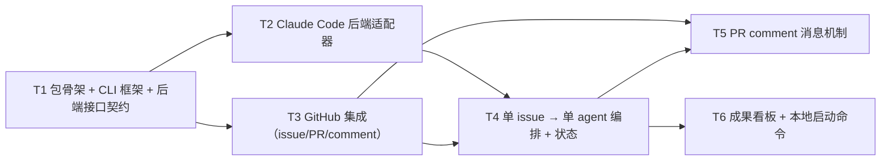

演化图：

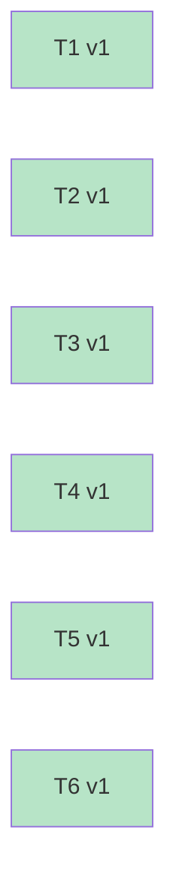

### 0002 OpenAgents 主动提 issue（issue #0）

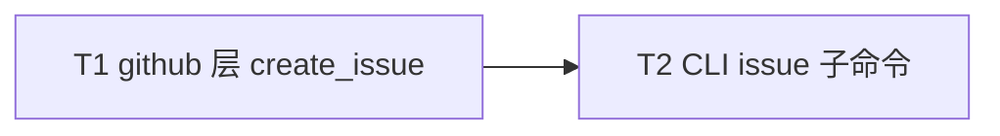

演化图：

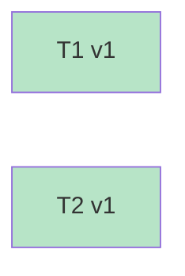

### 0003 issue 求解隔离 —— 每 issue 独立 worktree + 分支基线锁定最新 main（issue #0）

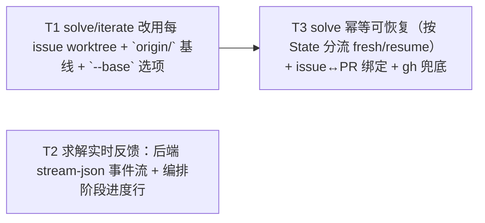

演化图：

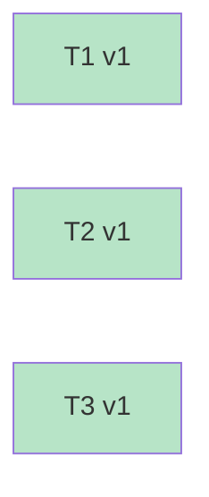

### 0004 openagents vigil —— 守夜人模式（自主 issue→PR 全流程循环）（issue #9）

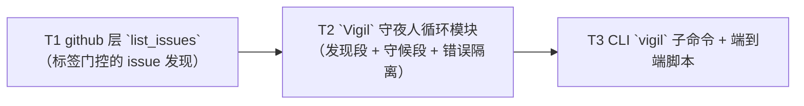

演化图：


### 0005 solve 原子化拆分 + RFC-first 评审循环（issue #0）

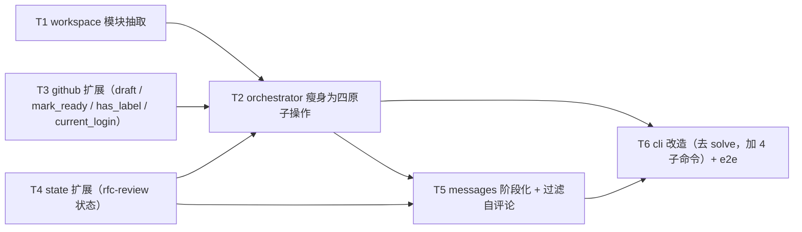

演化图：


### 0006 守夜人识别 PR/issue 关闭作为终止信号（issue #0）

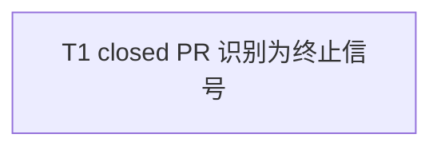

演化图：

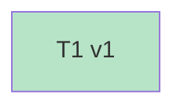

### 0007 守夜人恢复——激活 solving 为 resume 入口，修复 start_rfc 中途崩溃的孤儿 run（issue #0）

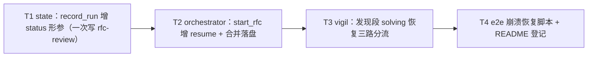

演化图：

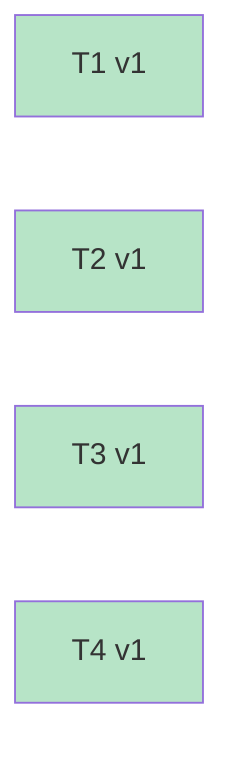

### 0008 PR 正文「端到端验证」指路牌（从 RFC 自动生成）（issue #0）

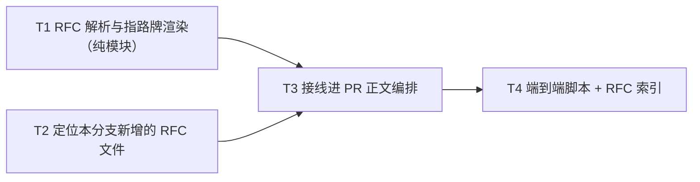

演化图：


### 0009 合并后自动 rebase 其他 open PR（issue #24）

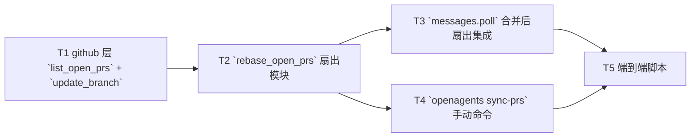

演化图：

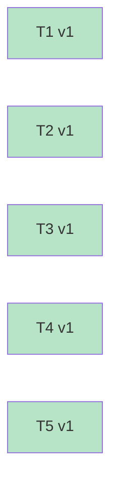

### 0010 gh 瞬时错误重试 + 守夜循环单轮容错（issue #0）

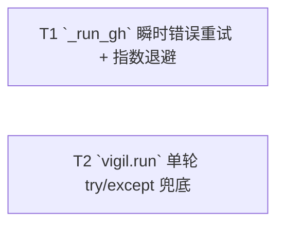

演化图：


### 0011 本地 Agent 身份 + 评论签名（区分自评论与真人评论，根治 poll 自循环）（issue #28）

```mermaid
graph LR
    nT1["T1 state 层 agent_id 持久化"]
    nT2["T2 identity 模块（身份解析 + 评论签名）"]
    nT3["T3 poll 判定剔除自评论 + 游标简化"]
    nT4["T4 orchestrator 回贴评论盖章"]
    nT5["T5 rebase 冲突评论盖章"]
    nT6["T6 CLI 接线 + 下线 current_login"]
    nT1 --> nT2
    nT2 --> nT3
    nT5 --> nT3
    nT2 --> nT4
    nT2 --> nT5
    nT3 --> nT6
    nT4 --> nT6
    nT5 --> nT6
```

演化图：

```mermaid
graph LR
    v_T1_1["T1 v1"]
    v_T2_1["T2 v1"]
    v_T3_1["T3 v1"]
    v_T4_1["T4 v1"]
    v_T5_1["T5 v1"]
    v_T6_1["T6 v1"]
    classDef st_done fill:#b7e4c7;
    class v_T1_1 st_done;
    class v_T2_1 st_done;
    class v_T3_1 st_done;
    class v_T4_1 st_done;
    class v_T5_1 st_done;
    class v_T6_1 st_done;
```

### 0012 test 分支门控流程 —— 人只在「提 issue」与「promote」介入（issue #32）

```mermaid
graph LR
    nT1["T1 reviewer 编排模块（N 并行 + 裁决聚合）"]
    nT2["T2 github 扩展（base/merge/label/branch）"]
    nT3["T3 state 扩展（rounds + STATUS_BLOCKED）"]
    nT4["T4 promote 模块（预检 + 快进 main）"]
    nT5["T5 闸接入（messages 路由 + orchestrator 评审/base）"]
    nT6["T6 CLI/vigil 接线（promote 命令 + base 默认 + init 兜底）"]
    nT2 --> nT4
    nT3 --> nT4
    nT1 --> nT5
    nT2 --> nT5
    nT3 --> nT5
    nT4 --> nT6
    nT5 --> nT6
```

演化图：

```mermaid
graph LR
    v_T1_1["T1 v1"]
    v_T2_1["T2 v1"]
    v_T3_1["T3 v1"]
    v_T4_1["T4 v1"]
    v_T5_1["T5 v1"]
    v_T6_1["T6 v1"]
    classDef st_done fill:#b7e4c7;
    class v_T1_1 st_done;
    class v_T2_1 st_done;
    class v_T3_1 st_done;
    class v_T4_1 st_done;
    class v_T5_1 st_done;
    class v_T6_1 st_done;
```

### 0013 实跑端到端脚本并把「合否 + 日志」作为 PR 评论（RFC-0008 指路牌 → 实跑结果延伸）（issue #31）

```mermaid
graph LR
    nT1["T1 e2e 实跑封装 + 结果评论渲染（纯模块）"]
    nT2["T2 rfc.script_path_for（复用 extract_e2e 定位脚本）"]
    nT3["T3 implement 转正前实跑 + 签名结果评论接线"]
    nT4["T4 端到端脚本 + RFC 索引"]
    nT1 --> nT3
    nT2 --> nT3
    nT3 --> nT4
```

演化图：

```mermaid
graph LR
    v_T1_1["T1 v1"]
    v_T2_1["T2 v1"]
    v_T3_1["T3 v1"]
    v_T4_1["T4 v1"]
    classDef st_done fill:#b7e4c7;
    class v_T1_1 st_done;
    class v_T2_1 st_done;
    class v_T3_1 st_done;
    class v_T4_1 st_done;
```

### 0014 用「Spec 活快照 + 演化历史」取代 RFC —— Spec 永远与代码一一对应，legacy 沉淀到历史（issue #35）

```mermaid
graph LR
    nT1["T1 数据层 + JSON Schema + 依赖/入口声明"]
    nT2["T2 spec validate（schema + 语义校验）"]
    nT3["T3 spec render → OVERVIEW.md（看板/关系图/冲突/DAG/演化图）"]
    nT4["T4 spec amend / abandon（历史追加 + 自动 render）"]
    nT5["T5 spec CLI + 编号校验脚本 + CI 接线"]
    nT6["T6 迁移脚本 + spec-driven skill + specs README + e2e"]
    nT1 --> nT2
    nT1 --> nT3
    nT1 --> nT4
    nT3 --> nT4
    nT2 --> nT5
    nT3 --> nT5
    nT4 --> nT5
    nT2 --> nT6
    nT3 --> nT6
```

演化图：

```mermaid
graph LR
    v_T1_1["T1 v1"]
    v_T2_1["T2 v1"]
    v_T3_1["T3 v1"]
    v_T4_1["T4 v1"]
    v_T5_1["T5 v1"]
    v_T6_1["T6 v1"]
    classDef st_done fill:#b7e4c7;
    class v_T1_1 st_done;
    class v_T2_1 st_done;
    class v_T3_1 st_done;
    class v_T4_1 st_done;
    class v_T5_1 st_done;
    class v_T6_1 st_done;
```

### 0015 spec 人类可读 summary：填 group 级 summary 字段 + render 大白话 TL;DR（issue #58）

```mermaid
graph LR
    nT1["T1 数据层：metadata 增 group 级 summary 字段"]
    nT2["T2 授权路径：spec new --summary（cli + mutate）"]
    nT3["T3 闸门：validate 强制 summary 非空"]
    nT4["T4 人读视图：render 顶部 TL;DR 区块"]
    nT5["T5 迁移：补齐 14 个现有 spec 的 summary + 重渲染"]
    nT1 --> nT2
    nT1 --> nT3
    nT1 --> nT4
    nT3 --> nT5
    nT4 --> nT5
```

演化图：

```mermaid
graph LR
    v_T1_1["T1 v1"]
    v_T2_1["T2 v1"]
    v_T3_1["T3 v1"]
    v_T4_1["T4 v1"]
    v_T5_1["T5 v1"]
    classDef st_done fill:#b7e4c7;
    class v_T1_1 st_done;
    class v_T2_1 st_done;
    class v_T3_1 st_done;
    class v_T4_1 st_done;
    class v_T5_1 st_done;
```

### 0017 PR 生命周期(create/ready/merge)下放 agent：draft 升为一等事实、level-triggered 自愈转正 + 合并硬闸兜底（issue #174）

```mermaid
graph LR
    nT1["T1 draft 升为 PR 快照事实 + deliver agent 承接转正职责"]
    nT3["T3 合并动作下放 merger agent + 确定性合并硬闸兜底"]
    nT2["T2 draft 升为 _Facts 一等事实 + _classify 自愈转正分支 + 生命周期直调下放"]
    nT1 --> nT2
    nT3 --> nT2
```

演化图：

```mermaid
graph LR
    v_T1_1["T1 v1"]
    v_T2_1["T2 v1"]
    v_T3_1["T3 v1"]
    classDef st_done fill:#b7e4c7;
    class v_T1_1 st_done;
    class v_T2_1 st_done;
    class v_T3_1 st_done;
```

### 0020 人类监督闸门：提 issue 前需求对齐 + vigil 分级 --hold 闸控（issue #59）

```mermaid
graph LR
    nT1["T1 前门对齐模块：把模糊想法复述成 X/边界Y/不做Z"]
    nT2["T2 hold 配置模型：解析 spec,merge 成闸门集合"]
    nT3["T3 流水线分级闸：hold 穿到 poll 两道闸分流"]
    nT4["T4 CLI 接线：issue 前门对齐 + vigil --hold 标志"]
    nT5["T5 e2e 脚本：演示停在 spec → 人批 → 继续"]
    nT2 --> nT3
    nT1 --> nT4
    nT2 --> nT4
    nT3 --> nT4
    nT3 --> nT5
    nT4 --> nT5
```

演化图：

```mermaid
graph LR
    v_T1_1["T1 v1"]
    v_T2_1["T2 v1"]
    v_T3_1["T3 v1"]
    v_T4_1["T4 v1"]
    v_T5_1["T5 v1"]
    classDef st_done fill:#b7e4c7;
    class v_T1_1 st_done;
    class v_T2_1 st_done;
    class v_T3_1 st_done;
    class v_T4_1 st_done;
    class v_T5_1 st_done;
```

### 0021 修复 reviewer 长回复截断在 VERDICT 之前→UNPARSED→假非PASS 空耗 rounds 误触 needs-human（issue #63）

```mermaid
graph LR
    nT1["T1 reviewer 侧:前置裁决 token + 首行解析 + 区分「评审无效」+ 单次重解析"]
    nT2["T2 编排层:评审无效不吃 round、空反馈不空转、独立重试上限后诚实升级"]
    nT1 --> nT2
```

演化图：

```mermaid
graph LR
    v_T1_1["T1 v1"]
    v_T2_1["T2 v1"]
    classDef st_done fill:#b7e4c7;
    class v_T1_1 st_done;
    class v_T2_1 st_done;
```

### 0022 代码闸可合并性预检 + poll 错误隔离 + 裁决评论幂等（issue #62）

```mermaid
graph LR
    nT1["T1 github.mergeability：查询 PR 可合并性（mergeable / mergeStateStatus）"]
    nT2["T2 代码闸可合并性预检 + poll 单 PR 错误隔离"]
    nT3["T3 裁决评论幂等：同一裁决不每轮重发"]
    nT1 --> nT2
```

演化图：

```mermaid
graph LR
    v_T1_1["T1 v1"]
    v_T2_1["T2 v1"]
    v_T3_1["T3 v1"]
    classDef st_done fill:#b7e4c7;
    class v_T1_1 st_done;
    class v_T2_1 st_done;
    class v_T3_1 st_done;
```

### 0023 退役 test 分支:main 持续推进 + release/vX.Y.Z 版本分支发布（issue #68）

```mermaid
graph LR
    nT1["T1 github 层:base 默认 main + 去 test 分支自举"]
    nT2["T2 orchestrator + vigil:base 默认 main"]
    nT3["T3 promote→release 模块:建 release/vX.Y.Z 分支 + 打 tag + 版本递增"]
    nT4["T4 CLI:release 子命令 + base 默认 main"]
    nT5["T5 CI 工作流 + indexheal 测试 + 旧 spec 0012 收尾"]
    nT1 --> nT3
    nT2 --> nT4
    nT3 --> nT4
```

演化图：

```mermaid
graph LR
    v_T1_1["T1 v1"]
    v_T2_1["T2 v1"]
    v_T3_1["T3 v1"]
    v_T4_1["T4 v1"]
    v_T5_1["T5 v1"]
    classDef st_done fill:#b7e4c7;
    class v_T1_1 st_done;
    class v_T2_1 st_done;
    class v_T3_1 st_done;
    class v_T4_1 st_done;
    class v_T5_1 st_done;
```

### 0024 spec 转 rust-RFC 形态:总览先行 + 单 spec 自包含（issue #69）

```mermaid
graph LR
    nT1["T1 spec 数据模型:组级 Overview 9 段 + Task 瘦身"]
    nT2["T2 校验质量门槛:必填段 + 自包含 warning + schema 瘦身"]
    nT3["T3 spec new 9 段脚手架 + signpost/cli/mutate 适配"]
    nT4["T4 skill + references + README + orchestrator 对齐 rust-RFC"]
    nT5["T5 回填 19 个存量 spec + e2e 脚本"]
    nT1 --> nT2
    nT2 --> nT3
    nT3 --> nT4
    nT3 --> nT5
```

演化图：

```mermaid
graph LR
    v_T1_1["T1 v1"]
    v_T2_1["T2 v1"]
    v_T3_1["T3 v1"]
    v_T4_1["T4 v1"]
    v_T5_1["T5 v1"]
    classDef st_done fill:#b7e4c7;
    class v_T1_1 st_done;
    class v_T2_1 st_done;
    class v_T3_1 st_done;
    class v_T4_1 st_done;
    class v_T5_1 st_done;
```

### 0025 brownfield 反向补全 RFC:扫存量代码生成 9 段 RFC 草稿（issue #73）

```mermaid
graph LR
    nT1["T1 代码盘点助手:扫 path 产出 inventory"]
    nT2["T2 编排方法 backfill_rfc + 反向 RFC prompt"]
    nT3["T3 CLI 接线 backfill-rfc <path>"]
    nT4["T4 e2e 脚本演示反向补全闭环"]
    nT1 --> nT2
    nT2 --> nT3
    nT3 --> nT4
```

演化图：

```mermaid
graph LR
    v_T1_1["T1 v1"]
    v_T2_1["T2 v1"]
    v_T3_1["T3 v1"]
    v_T4_1["T4 v1"]
    classDef st_done fill:#b7e4c7;
    class v_T1_1 st_done;
    class v_T2_1 st_done;
    class v_T3_1 st_done;
    class v_T4_1 st_done;
```

### 0026 README 最简用法:紧跟安装方法之后新增 Quickstart 段（issue #75）

```mermaid
graph LR
    nT1["T1 插入最简用法/Quickstart 段并同步目录锚点"]
    nT2["T2 e2e 脚本断言 Quickstart 段位置"]
    nT1 --> nT2
```

演化图：

```mermaid
graph LR
    v_T1_1["T1 v1"]
    v_T2_1["T2 v1"]
    classDef st_done fill:#b7e4c7;
    class v_T1_1 st_done;
    class v_T2_1 st_done;
```

### 0027 多仓库统管:单进程按配置文件并发守夜一组仓库（issue #77）

```mermaid
graph LR
    nT1["T1 配置加载:YAML 解析 + jsonschema 校验 + 默认合并"]
    nT2["T2 并发编排:每仓库一子进程跑现有 Vigil + 日志聚合 + 错误隔离"]
    nT3["T3 CLI 接线 vigil-all(--config/--once)"]
    nT4["T4 e2e 脚本演示多仓库统管闭环"]
    nT1 --> nT2
    nT2 --> nT3
    nT3 --> nT4
```

演化图：

```mermaid
graph LR
    v_T1_1["T1 v1"]
    v_T2_1["T2 v1"]
    v_T3_1["T3 v1"]
    v_T4_1["T4 v1"]
    classDef st_done fill:#b7e4c7;
    class v_T1_1 st_done;
    class v_T2_1 st_done;
    class v_T3_1 st_done;
    class v_T4_1 st_done;
```

### 0028 PR 自动化两处改进：spec 草稿 PR 内嵌 9 段总览摘要 + merge 冲突派 agent 语义解冲突（issue #79）

```mermaid
graph LR
    nT1["T1 改进1：总览摘要 digest + PR 正文接线"]
    nT2["T2 改进2：conflict.py 语义解冲突（纯决策 + IO 工厂）"]
    nT3["T3 改进2：接线 rebase / messages / cli（分层降级 + 门控）"]
    nT4["T4 hermetic e2e 脚本（无网络、不触真实 LLM）"]
    nT2 --> nT3
    nT1 --> nT4
    nT3 --> nT4
```

演化图：

```mermaid
graph LR
    v_T1_1["T1 v1"]
    v_T2_1["T2 v1"]
    v_T3_1["T3 v1"]
    v_T4_1["T4 v1"]
    classDef st_done fill:#b7e4c7;
    class v_T1_1 st_done;
    class v_T2_1 st_done;
    class v_T3_1 st_done;
    class v_T4_1 st_done;
```

### 0029 统一 rfc→spec 命名硬切并退场 rfc-driven-development 技能（issue #81）

```mermaid
graph LR
    nT1["T1 文档与技能退场"]
    nT2["T2 线上/持久化值硬切"]
    nT3["T3 orchestrator/backfill 内部标识符重命名"]
    nT4["T4 CLI 子命令与 messages/vigil 消费者对齐"]
    nT5["T5 残余 RFC-NNNN 注释清扫"]
    nT6["T6 端到端校验脚本：断言零残余 rfc"]
    nT2 --> nT3
    nT3 --> nT4
    nT4 --> nT5
    nT1 --> nT6
    nT5 --> nT6
```

演化图：

```mermaid
graph LR
    v_T1_1["T1 v1"]
    v_T2_1["T2 v1"]
    v_T3_1["T3 v1"]
    v_T4_1["T4 v1"]
    v_T5_1["T5 v1"]
    v_T6_1["T6 v1"]
    classDef st_pending fill:#eeeeee;
    class v_T1_1 st_pending;
    class v_T2_1 st_pending;
    class v_T3_1 st_pending;
    class v_T4_1 st_pending;
    class v_T5_1 st_pending;
    class v_T6_1 st_pending;
```

### 0030 init 环境体检：检测 browser MCP 与权限放行（非阻塞）+ 前端 e2e 方法论引导（issue #85）

```mermaid
graph LR
    nT1["T1 权限模式最小开关：常量改为读 OPENAGENTS_PERMISSION_MODE"]
    nT2["T2 体检核心模块 envcheck：browser MCP 检测 + 权限模式读取 + 报告渲染"]
    nT3["T3 把环境体检接进 openagents init（非阻塞）"]
    nT4["T4 条件式 browser-e2e 方法论文案：起草 prompt 模板 + reviewer rubric"]
    nT5["T5 e2e 脚本：体检两态输出 + 方法论文案注入断言"]
    nT1 --> nT2
    nT2 --> nT3
    nT3 --> nT5
    nT4 --> nT5
```

演化图：

```mermaid
graph LR
    v_T1_1["T1 v1"]
    v_T2_1["T2 v1"]
    v_T3_1["T3 v1"]
    v_T4_1["T4 v1"]
    v_T5_1["T5 v1"]
    classDef st_done fill:#b7e4c7;
    class v_T1_1 st_done;
    class v_T2_1 st_done;
    class v_T3_1 st_done;
    class v_T4_1 st_done;
    class v_T5_1 st_done;
```

### 0031 merge 闸解挂语义重设计：人解挂后派 agent 主动解冲突、有界重试再挂起（issue #84）

```mermaid
graph LR
    nT1["T1 state：block_gate/merge_attempts 字段 + 计数/重置方法"]
    nT2["T2 messages：merge 闸 armed 解挂语义 + MAX_MERGE_ATTEMPTS knob"]
    nT3["T3 hermetic e2e 脚本（无网络、不触真实 LLM/gh）"]
    nT1 --> nT2
    nT1 --> nT3
    nT2 --> nT3
```

演化图：

```mermaid
graph LR
    v_T1_1["T1 v1"]
    v_T2_1["T2 v1"]
    v_T3_1["T3 v1"]
    classDef st_done fill:#b7e4c7;
    class v_T1_1 st_done;
    class v_T2_1 st_done;
    class v_T3_1 st_done;
```

### 0032 needs-human 全程在 GitHub 闭环：阻塞留足信息 + 人回新评论即自动解挂喂内容重试（issue #89）

```mermaid
graph LR
    nT1["T1 state：block_watermark 字段 + setter"]
    nT2["T2 github：remove_label 幂等封装"]
    nT3["T3 blocknote：结构化阻塞评论构造（新模块）"]
    nT4["T4 identity：new_human_comments 读侧复活"]
    nT5["T5 messages：_block enrich + watermark + 回评论解挂路由"]
    nT6["T6 hermetic e2e 脚本（无网络、不触真实 LLM/gh）"]
    nT1 --> nT5
    nT2 --> nT5
    nT3 --> nT5
    nT4 --> nT5
    nT5 --> nT6
```

演化图：

```mermaid
graph LR
    v_T1_1["T1 v1"]
    v_T2_1["T2 v1"]
    v_T3_1["T3 v1"]
    v_T4_1["T4 v1"]
    v_T5_1["T5 v1"]
    v_T6_1["T6 v1"]
    classDef st_done fill:#b7e4c7;
    class v_T1_1 st_done;
    class v_T2_1 st_done;
    class v_T3_1 st_done;
    class v_T4_1 st_done;
    class v_T5_1 st_done;
    class v_T6_1 st_done;
```

### 0033 openagents init 新建远端后自动 git remote add origin（issue #93）

```mermaid
graph LR
    nT1["T1 _bootstrap 新建远端后 git remote add origin"]
    nT2["T2 回归测试 + e2e 覆盖 remote-add 路径"]
    nT1 --> nT2
```

演化图：

```mermaid
graph LR
    v_T1_1["T1 v1"]
    v_T2_1["T2 v1"]
    classDef st_done fill:#b7e4c7;
    class v_T1_1 st_done;
    class v_T2_1 st_done;
```

### 0034 冲突/挂起通知带可定位诊断 + 合并扇出重发收敛——让「具体什么 conflict」结构上答得出（issue #92）

```mermaid
graph LR
    nT1["T1 conflictdiag：merge-tree 诊断采集 + 格式化（新模块）"]
    nT2["T2 rebase：扇出冲突评论带诊断 + 已 needs-human 不重发"]
    nT3["T3 messages：merge 闸 blocker 带诊断 + 扇出注入诊断器"]
    nT4["T4 hermetic e2e 脚本（无网络、不触真实 LLM/gh/git 远端）"]
    nT1 --> nT2
    nT1 --> nT3
    nT2 --> nT4
    nT3 --> nT4
```

演化图：

```mermaid
graph LR
    v_T1_1["T1 v1"]
    v_T2_1["T2 v1"]
    v_T3_1["T3 v1"]
    v_T4_1["T4 v1"]
    classDef st_done fill:#b7e4c7;
    class v_T1_1 st_done;
    class v_T2_1 st_done;
    class v_T3_1 st_done;
    class v_T4_1 st_done;
```

### 0036 解挂后 agent 读取并正面回应人的评论：merge 闸也喂评论内容 + 编排层确定性贴回引用原评论（issue #97）

```mermaid
graph LR
    nT1["T1 state：unblock_detail 字段 + setter"]
    nT2["T2 replynote：引用原评论的回应构造（新模块）"]
    nT3["T3 conflict：解冲突器接受人类 guidance"]
    nT4["T4 orchestrator：原子操作回传 summary + 人类解挂 prompt + announce 开关"]
    nT5["T5 messages：merge 喂内容 + 三闸确定性贴回引用原评论"]
    nT6["T6 hermetic e2e 脚本（无网络、不触真实 LLM/gh）"]
    nT1 --> nT5
    nT2 --> nT5
    nT3 --> nT5
    nT4 --> nT5
    nT5 --> nT6
```

演化图：

```mermaid
graph LR
    v_T1_1["T1 v1"]
    v_T2_1["T2 v1"]
    v_T3_1["T3 v1"]
    v_T4_1["T4 v1"]
    v_T5_1["T5 v1"]
    v_T6_1["T6 v1"]
    classDef st_done fill:#b7e4c7;
    class v_T1_1 st_done;
    class v_T2_1 st_done;
    class v_T3_1 st_done;
    class v_T4_1 st_done;
    class v_T5_1 st_done;
    class v_T6_1 st_done;
```

### 0038 合并冲突改拉式同步 + 解冲突 agent 用带签名工具自回评论（issue #96）

```mermaid
graph LR
    nT1["T1 门2 拉式同步 + 删 push 扇出"]
    nT2["T2 删死代码 + CONFLICT_COMMENT 迁移"]
    nT3["T3 解冲突 agent 用带签名工具自回评论"]
```

演化图：

```mermaid
graph LR
    v_T1_1["T1 v1"]
    v_T2_1["T2 v1"]
    v_T3_1["T3 v1"]
    classDef st_done fill:#b7e4c7;
    class v_T1_1 st_done;
    class v_T2_1 st_done;
    class v_T3_1 st_done;
```

### 0039 vigil 多后端并发派单去重：引入「已派发」认领标签（第 3 道闸 + 过期回收）（issue #102）

```mermaid
graph LR
    nT1["T1 github 认领原语层"]
    nT2["T2 发现段第 3 道闸 + 过期回收"]
    nT3["T3 start_rfc 认领打标与清理"]
    nT4["T4 端到端去重成果测试（含浏览器看板断言）"]
    nT1 --> nT2
    nT1 --> nT3
    nT2 --> nT4
    nT3 --> nT4
```

演化图：

```mermaid
graph LR
    v_T1_1["T1 v1"]
    v_T2_1["T2 v1"]
    v_T3_1["T3 v1"]
    v_T4_1["T4 v1"]
    classDef st_done fill:#b7e4c7;
    class v_T1_1 st_done;
    class v_T2_1 st_done;
    class v_T3_1 st_done;
    class v_T4_1 st_done;
```

### 0040 重设计 e2e：说明书驱动 + 独立执行 + 证据评审门控（Phase 1 骨架）（issue #104）

```mermaid
graph LR
    nT1["T1 spec 增 e2e 粗规划字段 + validate 硬化"]
    nT2["T2 executor 角色：独立运行时验证 agent（cli/api/backend 形态）"]
    nT3["T3 证据固化 + 证据闸 reviewer"]
    nT4["T4 reviewer 职责收口 + RFC rubric 硬规则"]
    nT5["T5 编排接线：定稿→执行→证据闸门控合并 + 退役旧 smoke"]
    nT1 --> nT3
    nT1 --> nT5
    nT2 --> nT5
    nT3 --> nT5
    nT4 --> nT5
```

演化图：

```mermaid
graph LR
    v_T1_1["T1 v1"]
    v_T2_1["T2 v1"]
    v_T3_1["T3 v1"]
    v_T4_1["T4 v1"]
    v_T5_1["T5 v1"]
    classDef st_done fill:#b7e4c7;
    class v_T1_1 st_done;
    class v_T2_1 st_done;
    class v_T3_1 st_done;
    class v_T4_1 st_done;
    class v_T5_1 st_done;
```

### 0041 hold-merge PASS 后夯住待合并：已通过的 PR 冻结成 needs-human，消除同码复审震荡（issue #106）

```mermaid
graph LR
    nT2["T2 「✅ 已通过评审，待你合并」成功文案"]
    nT3["T3 净化 reviewer scratchpad"]
    nT1["T1 hold-merge 夯住 + merge-hold 解挂路由"]
    nT4["T4 端到端成果测试（含浏览器看板「冻结后稳定」断言）"]
    nT2 --> nT1
    nT1 --> nT4
    nT2 --> nT4
    nT3 --> nT4
```

演化图：

```mermaid
graph LR
    v_T1_1["T1 v1"]
    v_T2_1["T2 v1"]
    v_T3_1["T3 v1"]
    v_T4_1["T4 v1"]
    classDef st_done fill:#b7e4c7;
    class v_T1_1 st_done;
    class v_T2_1 st_done;
    class v_T3_1 st_done;
    class v_T4_1 st_done;
```

### 0042 PR close→reopen 后复活被冻死的 run：closed 不是真终态（issue #108）

```mermaid
graph LR
    nT1["T1 state：closed_at 字段 + set_closed_at setter"]
    nT2["T2 github：is_open / is_draft 只读薄封装"]
    nT3["T3 messages：复活窗口守卫 + reopen 复活 reconcile"]
    nT4["T4 端到端成果测试（含浏览器看板『close→reopen 复活』断言）"]
    nT1 --> nT3
    nT2 --> nT3
    nT1 --> nT4
    nT2 --> nT4
    nT3 --> nT4
```

演化图：

```mermaid
graph LR
    v_T1_1["T1 v1"]
    v_T2_1["T2 v1"]
    v_T3_1["T3 v1"]
    v_T4_1["T4 v1"]
    classDef st_done fill:#b7e4c7;
    class v_T1_1 st_done;
    class v_T2_1 st_done;
    class v_T3_1 st_done;
    class v_T4_1 st_done;
```

### 0043 issue 进入 RFC 前自检标题/正文是否影响修法：命中冲突先打 needs-human 对齐、不直接生成 spec（issue #111）

```mermaid
graph LR
    nT1["T1 issue 级评论出口 github.issue_comment"]
    nT2["T2 issuecheck 判读模块（裁决 + 对齐评论渲染）"]
    nT3["T3 precheck 接线（orchestrator 前置 + vigil 发现段闸）"]
    nT4["T4 端到端成果测试（#106 回归 + 浏览器对齐评论断言）"]
    nT1 --> nT3
    nT2 --> nT3
    nT3 --> nT4
```

演化图：

```mermaid
graph LR
    v_T1_1["T1 v1"]
    v_T2_1["T2 v1"]
    v_T3_1["T3 v1"]
    v_T4_1["T4 v1"]
    classDef st_done fill:#b7e4c7;
    class v_T1_1 st_done;
    class v_T2_1 st_done;
    class v_T3_1 st_done;
    class v_T4_1 st_done;
```

### 0044 「端到端跑真 app 并截图」验证 skill：UI/产品行为改动须有真实运行证据（issue #113）

```mermaid
graph LR
    nT1["T1 移植 skill 原文 + runbook 模板"]
    nT2["T2 reviewer rubric 硬化：宣称验证过但无证据 = REWORK"]
    nT3["T3 派单 prompt 判断纪律：三分类取证 + 反测试顶替"]
    nT4["T4 e2e 脚本（离线断言 + 浏览器自演示）+ 参考页 + README/索引"]
    nT1 --> nT4
    nT2 --> nT4
    nT3 --> nT4
```

演化图：

```mermaid
graph LR
    v_T1_1["T1 v1"]
    v_T2_1["T2 v1"]
    v_T3_1["T3 v1"]
    v_T4_1["T4 v1"]
    classDef st_done fill:#b7e4c7;
    class v_T1_1 st_done;
    class v_T2_1 st_done;
    class v_T3_1 st_done;
    class v_T4_1 st_done;
```

### 0045 Spec-0037 后清理旧 rebase/indexheal 口径（issue #110）

```mermaid
graph LR
    nT1["T1 conflictdiag 诊断模块去 rebase 口径"]
    nT2["T2 conflict 模块去 indexheal 降级链口径"]
    nT3["T3 邻接 runtime 注释扫尾（github/messages/orchestrator）"]
    nT4["T4 测试注释去 sync-prs/rebase_open_prs 口径"]
    nT5["T5 端到端成果测试脚本（组级死口径 grep 归零收口）"]
    nT1 --> nT5
    nT2 --> nT5
    nT3 --> nT5
    nT4 --> nT5
```

演化图：

```mermaid
graph LR
    v_T1_1["T1 v1"]
    v_T2_1["T2 v1"]
    v_T3_1["T3 v1"]
    v_T4_1["T4 v1"]
    v_T5_1["T5 v1"]
    classDef st_done fill:#b7e4c7;
    class v_T1_1 st_done;
    class v_T2_1 st_done;
    class v_T3_1 st_done;
    class v_T4_1 st_done;
    class v_T5_1 st_done;
```

### 0047 评审裁决按「实质内容」去重（同结论·理由不同照发）（issue #116）

```mermaid
graph LR
    nT1["T1 reviewer.extract_decision_content：裁决内容纯解析器"]
    nT2["T2 orchestrator._decision_already_posted：按结论+反馈内容去重"]
    nT1 --> nT2
```

演化图：

```mermaid
graph LR
    v_T1_1["T1 v1"]
    v_T2_1["T2 v1"]
    classDef st_done fill:#b7e4c7;
    class v_T1_1 st_done;
    class v_T2_1 st_done;
```

### 0048 Review 防「架构骨架冒充完整实现」：强化 reviewer prompt 防 design-as-implementation（issue #122）

```mermaid
graph LR
    nT1["T1 reviewer rubric 三处硬化（防 design-as-implementation）+ 单测"]
    nT2["T2 e2e 骨架冒充演练脚本（离线确定性 + 真实 rubric 文本对照 PR #105 复刻场景）"]
    nT1 --> nT2
```

演化图：

```mermaid
graph LR
    v_T1_1["T1 v1"]
    v_T2_1["T2 v1"]
    classDef st_done fill:#b7e4c7;
    class v_T1_1 st_done;
    class v_T2_1 st_done;
```

### 0049 vigil 多后端派单认领去互撕：resume 免认领 + 认领带归属 + 二次确认退让（issue #120）

```mermaid
graph LR
    nT1["T1 github：认领便签读原语 + 标签幂等 add（停 remove-then-add 互撕）"]
    nT2["T2 identity：认领便签标记 + 归属/年龄解析"]
    nT3["T3 vigil：_dispatch_kind/_claim_expired 归属感知闸"]
    nT4["T4 orchestrator+state：resume 免认领 + 署名认领 + 二次确认退让"]
    nT5["T5 成果测试：多后端竞态复现集成测试 + e2e 脚本"]
    nT1 --> nT2
    nT1 --> nT3
    nT2 --> nT3
    nT1 --> nT4
    nT2 --> nT4
    nT3 --> nT5
    nT4 --> nT5
```

演化图：

```mermaid
graph LR
    v_T1_1["T1 v1"]
    v_T2_1["T2 v1"]
    v_T3_1["T3 v1"]
    v_T4_1["T4 v1"]
    v_T5_1["T5 v1"]
    classDef st_done fill:#b7e4c7;
    class v_T1_1 st_done;
    class v_T2_1 st_done;
    class v_T3_1 st_done;
    class v_T4_1 st_done;
    class v_T5_1 st_done;
```

### 0050 Review 不通过理由增强可读性：强制 reviewer 反馈输出为一段简短中文（issue #124）

```mermaid
graph LR
    nT1["T1 _RUBRIC_TAIL 语言/长度硬化（理由必须一段简短中文）+ 单测"]
    nT2["T2 cli 离线 e2e：真实 render_decision 渲染评审评论 + 反馈摘要简短中文判据（浏览器闭环可选）"]
    nT1 --> nT2
```

演化图：

```mermaid
graph LR
    v_T1_1["T1 v1"]
    v_T2_1["T2 v1"]
    classDef st_done fill:#b7e4c7;
    class v_T1_1 st_done;
    class v_T2_1 st_done;
```

### 0051 统一 agent 执行后回贴 PR 评论：补齐 implement/iterate/finalize_runbook/executor/证据闸的静默步骤（可观测性收口）（issue #131）

```mermaid
graph LR
    nT1["T1 executor.render_result 纯函数（ExecutorResult→PR 评论）"]
    nT2["T2 evidence_gate.render_decision 纯函数（EvidenceDecision→PR 评论）"]
    nT3["T3 worknote 新模块：implement/iterate/runbook「本轮做了什么」渲染"]
    nT4["T4 orchestrator.implement 返回 result.summary（None→str）"]
    nT5["T5 messages 收口：_post_agent_report + 防刷屏去重 + 五处接线"]
    nT6["T6 成果测试：整链回执集成测试 + e2e 脚本"]
    nT1 --> nT5
    nT2 --> nT5
    nT3 --> nT5
    nT4 --> nT5
    nT5 --> nT6
```

演化图：

```mermaid
graph LR
    v_T1_1["T1 v1"]
    v_T2_1["T2 v1"]
    v_T3_1["T3 v1"]
    v_T4_1["T4 v1"]
    v_T5_1["T5 v1"]
    v_T6_1["T6 v1"]
    classDef st_done fill:#b7e4c7;
    class v_T1_1 st_done;
    class v_T2_1 st_done;
    class v_T3_1 st_done;
    class v_T4_1 st_done;
    class v_T5_1 st_done;
    class v_T6_1 st_done;
```

### 0052 统一 agent 上下文注入：所有派单入口带 PR 号 + 注入本 PR 对话历史（issue #129）

```mermaid
graph LR
    nT1["T1 agentcontext 新模块：build_agent_context（拉 PR 历史 + 分类去噪 + 截断 + PR 号）"]
    nT2["T2 reviewer：review 增 history 参数 + 落盘产物为准 rubric"]
    nT3["T3 orchestrator：四入口统一走 build_agent_context + 补 refine/implement 的 PR 号"]
    nT4["T4 成果测试：#128 式历史复现集成测试 + e2e 脚本"]
    nT1 --> nT3
    nT2 --> nT3
    nT1 --> nT4
    nT2 --> nT4
    nT3 --> nT4
```

演化图：

```mermaid
graph LR
    v_T1_1["T1 v1"]
    v_T2_1["T2 v1"]
    v_T3_1["T3 v1"]
    v_T4_1["T4 v1"]
    classDef st_done fill:#b7e4c7;
    class v_T1_1 st_done;
    class v_T2_1 st_done;
    class v_T3_1 st_done;
    class v_T4_1 st_done;
```

### 0053 代码评审闸每轮重审：代码状态未变时复用上轮 PASS（对照 k8s Tide sticky approve / tree-hash）（issue #133）

```mermaid
graph LR
    nT1["T1 state：PR 净 diff 指纹字段 + setter"]
    nT2["T2 github：PR 净 diff 指纹取值"]
    nT3["T3 messages：_process_coding 3c sticky 短路接线"]
    nT4["T4 e2e：sticky 复用 PASS 成果脚本"]
    nT1 --> nT3
    nT2 --> nT3
    nT3 --> nT4
```

演化图：

```mermaid
graph LR
    v_T1_1["T1 v1"]
    v_T2_1["T2 v1"]
    v_T3_1["T3 v1"]
    v_T4_1["T4 v1"]
    classDef st_done fill:#b7e4c7;
    class v_T1_1 st_done;
    class v_T2_1 st_done;
    class v_T3_1 st_done;
    class v_T4_1 st_done;
```

### 0054 vigil 逐闸旁路开关：--skip 按需关闭任一流水线闸门 + README 闸门树（issue #135）

```mermaid
graph LR
    nT1["T1 skip 解析模块 + 矛盾检测"]
    nT2["T2 逐闸消费：透传 Skip 到 5 道闸"]
    nT3["T3 CLI 接线 --skip + hold/skip 矛盾校验"]
    nT4["T4 README 闸门树"]
    nT5["T5 成果测试 e2e 脚本（离线闸控时间线）"]
    nT1 --> nT2
    nT1 --> nT3
    nT2 --> nT3
    nT1 --> nT4
    nT2 --> nT5
    nT3 --> nT5
```

演化图：

```mermaid
graph LR
    v_T1_1["T1 v1"]
    v_T2_1["T2 v1"]
    v_T3_1["T3 v1"]
    v_T4_1["T4 v1"]
    v_T5_1["T5 v1"]
    classDef st_done fill:#b7e4c7;
    class v_T1_1 st_done;
    class v_T2_1 st_done;
    class v_T3_1 st_done;
    class v_T4_1 st_done;
    class v_T5_1 st_done;
```

### 0055 e2e v2：能力感知 + 说明书直喂 + 合并 review（重设计 0040）（issue #123）

```mermaid
graph LR
    nT1["T1 能力状态量：envcheck 结构化 + 启动固化进 state + cli 接线"]
    nT2["T2 spec e2e 段瘦身：{intent,method} 换 {form,intent,acceptance}，砍 form 枚举"]
    nT3["T3 executor 重写：单一自主 agent 运行时自检真跑，删 form 分派"]
    nT4["T4 reviewer 合并职责：RFC 据 ui_capable 分流 + code reviewer 判证据/截图"]
    nT5["T5 编排+github：删 finalize_runbook + run_e2e 幂等 + code_fingerprint 排除证据目录"]
    nT6["T6 messages 流水线重排 + sticky + bad_ci_after_e2e + e2e 脚本"]
    nT2 --> nT3
    nT1 --> nT4
    nT1 --> nT5
    nT2 --> nT5
    nT3 --> nT6
    nT4 --> nT6
    nT5 --> nT6
```

演化图：

```mermaid
graph LR
    v_T1_1["T1 v1"]
    v_T2_1["T2 v1"]
    v_T3_1["T3 v1"]
    v_T4_1["T4 v1"]
    v_T5_1["T5 v1"]
    v_T6_1["T6 v1"]
    classDef st_done fill:#b7e4c7;
    class v_T1_1 st_done;
    class v_T2_1 st_done;
    class v_T3_1 st_done;
    class v_T4_1 st_done;
    class v_T5_1 st_done;
    class v_T6_1 st_done;
```

### 0056 vigil：git 交付/冲突下放 agent（rebase 自愈）+ harness head 前移硬闸（修订决策 7）（issue #140）

```mermaid
graph LR
    nT1["T1 workspace.py：assert_delivered head 前移硬闸 + 修订决策 7（force-with-lease 边界）"]
    nT2["T2 orchestrator.py：交付协议 prompt + 硬闸接线 + WorkspaceError 隔离 + 语义化 commit（含 backfill 反向补全路径）"]
    nT3["T3 e2e：分叉→rebase 自愈→force-with-lease 交付闭环（离线，真实本地 git）"]
    nT4["T4 executor.py：run_e2e 证据交付也下放 executor agent（注入交付协议形参 + 删 commit_and_push 死代码）"]
    nT5["T5 conflict.py：解冲突结果交付（commit+push）也下放 resolve agent"]
    nT1 --> nT2
    nT2 --> nT3
    nT2 --> nT4
    nT2 --> nT5
```

演化图：

```mermaid
graph LR
    v_T1_1["T1 v1"]
    v_T2_1["T2 v1"]
    v_T3_1["T3 v1"]
    v_T4_1["T4 v1"]
    v_T5_1["T5 v1"]
    classDef st_done fill:#b7e4c7;
    class v_T1_1 st_done;
    class v_T2_1 st_done;
    class v_T3_1 st_done;
    class v_T4_1 st_done;
    class v_T5_1 st_done;
```

### 0057 e2e 门控硬化：RFC 闸确定性强制 e2e 块 + 代码 review 两重测试交叉比对（issue #123）

```mermaid
graph LR
    nT1["T1 RFC 闸确定性 e2e 块检查：缺真实 e2e{intent,method} 块自动返工，不问 LLM"]
    nT2["T2 代码 review 两重测试交叉比对：自测(声明) vs 独立 executor(裁判)，独立缺失不得凭自测放行"]
```

演化图：

```mermaid
graph LR
    v_T1_1["T1 v1"]
    v_T2_1["T2 v1"]
    classDef st_done fill:#b7e4c7;
    class v_T1_1 st_done;
    class v_T2_1 st_done;
```

### 0060 架构重构（批次一）：核心收敛为 agents（提示词）+ recipes（编排），操作下放 agent，仅留最小硬闸 + runtime/utils 确定性层（issue #145）

```mermaid
graph LR
    nT1["T1 utils 确定性最小面：git + github 薄再导出"]
    nT2["T2 runtime.engine：run_agent 引擎（填占位符→派 backend→收结构化输出）"]
    nT3["T3 runtime.gates：最小硬闸（head 前移/轮次上限/PR 存在/证据溯源戳）"]
    nT4["T4 agents 提示词 5 个：planner/implementer/reviewer/deliver/tester（零逻辑）"]
    nT5["T5 runtime.context + runtime.state：占位符组装 + 新栈 run 状态"]
    nT6["T6 recipe solve_issue + cli 子命令 + e2e 脚本（竖切端到端）"]
    nT1 --> nT3
    nT1 --> nT5
    nT2 --> nT6
    nT3 --> nT6
    nT4 --> nT6
    nT5 --> nT6
```

演化图：

```mermaid
graph LR
    v_T1_1["T1 v1"]
    v_T2_1["T2 v1"]
    v_T3_1["T3 v1"]
    v_T4_1["T4 v1"]
    v_T5_1["T5 v1"]
    v_T6_1["T6 v1"]
    classDef st_done fill:#b7e4c7;
    class v_T1_1 st_done;
    class v_T2_1 st_done;
    class v_T3_1 st_done;
    class v_T4_1 st_done;
    class v_T5_1 st_done;
    class v_T6_1 st_done;
```

### 0061 架构重构（批次二）：立起 vigil/poll_comments/fleet 三条 recipe + triager/replier agent + utils 全量稳定面（issue #145）

```mermaid
graph LR
    nT1["T1 utils 全量稳定 import 面（薄再导出确定性原语）"]
    nT2["T2 triager + replier agent（零逻辑 Template 提示词）"]
    nT3["T3 vigil + poll_comments + fleet recipe（纯控制流）+ 循环上下文组装"]
    nT4["T4 CLI additive 接线新栈守候/守夜/舰队三命令"]
    nT1 --> nT2
    nT1 --> nT3
    nT2 --> nT3
    nT3 --> nT4
```

演化图：

```mermaid
graph LR
    v_T1_1["T1 v1"]
    v_T2_1["T2 v1"]
    v_T3_1["T3 v1"]
    v_T4_1["T4 v1"]
    classDef st_done fill:#b7e4c7;
    class v_T1_1 st_done;
    class v_T2_1 st_done;
    class v_T3_1 st_done;
    class v_T4_1 st_done;
```

### 0062 架构重构（收敛批）：全量迁移 RFC 生命周期 + PR 合并流水线到新栈，删旧两栈合一（issue #145）

```mermaid
graph LR
    nT1["T1 RFC 生命周期 recipes + drafter agent（additive）"]
    nT2["T2 merge_pr recipe + 合并流水线 gates（additive）"]
    nT3["T3 vigil 认领归属+过期回收 + 守候段接 merge_pr"]
    nT4["T4 CLI 全量改接新栈 + 删旧路由"]
    nT5["T5 物理搬迁 utils 原语 + 清空整个 flat 旧模块层"]
    nT6["T6 测试收敛 + docs 再生成"]
    nT2 --> nT3
    nT3 --> nT4
    nT4 --> nT5
    nT5 --> nT6
```

演化图：

```mermaid
graph LR
    v_T1_1["T1 v1"]
    v_T2_1["T2 v1"]
    v_T3_1["T3 v1"]
    v_T4_1["T4 v1"]
    v_T5_1["T5 v1"]
    v_T6_1["T6 v1"]
    classDef st_done fill:#b7e4c7;
    class v_T1_1 st_done;
    class v_T2_1 st_done;
    class v_T3_1 st_done;
    class v_T4_1 st_done;
    class v_T5_1 st_done;
    class v_T6_1 st_done;
```

### 0063 state 归一：折叠旧 State 进 RuntimeState 并删 state.py，flat 层收敛为 cli+__init__（issue #145）

```mermaid
graph LR
    nT1["T1 RuntimeState 扩容：agent_id/ui_capable 顶层存取 + 权威 STATUS_* 常量"]
    nT2["T2 identity 改接 RuntimeState（agent_id 存储）"]
    nT3["T3 release + results/board 改接 RuntimeState + utils.github"]
    nT4["T4 CLI 去 _state_for：ui_capable/agent_id/board/release 全走 RuntimeState"]
    nT5["T5 删 state.py + 收敛 state 测试 + docs 再生成"]
    nT1 --> nT2
    nT1 --> nT3
    nT3 --> nT4
    nT4 --> nT5
```

演化图：

```mermaid
graph LR
    v_T1_1["T1 v1"]
    v_T2_1["T2 v1"]
    v_T3_1["T3 v1"]
    v_T4_1["T4 v1"]
    v_T5_1["T5 v1"]
    classDef st_done fill:#b7e4c7;
    class v_T1_1 st_done;
    class v_T2_1 st_done;
    class v_T3_1 st_done;
    class v_T4_1 st_done;
    class v_T5_1 st_done;
```

### 0064 收敛 recipes 到 vigil+issue：声明式 stages YAML 定义 agent/human/skip 阶段归属（issue #161）

```mermaid
graph LR
    nT1["T1 配置层：.openagents/openagents.yml schema + 加载器"]
    nT2["T2 九阶段抽成 Vigil 类外独立自由函数：recipes/stages.py"]
    nT3["T3 run_vigil 策略路由编排 + CI/e2e/review 打回回环"]
    nT4["T4 backfill-rfc path 驱动单列：recipes/backfill.py"]
    nT5["T5 CLI 面收敛四命令 + 隐藏 reply-comment + 签名后校验硬化"]
    nT6["T6 删 5 旧 recipe + planner 合并 + 测试桩收敛 + docs 再生成"]
    nT1 --> nT3
    nT2 --> nT3
    nT2 --> nT4
    nT3 --> nT5
    nT4 --> nT5
    nT5 --> nT6
```

演化图：

```mermaid
graph LR
    v_T1_1["T1 v1"]
    v_T2_1["T2 v1"]
    v_T3_1["T3 v1"]
    v_T4_1["T4 v1"]
    v_T5_1["T5 v1"]
    v_T6_1["T6 v1"]
    classDef st_done fill:#b7e4c7;
    class v_T1_1 st_done;
    class v_T2_1 st_done;
    class v_T3_1 st_done;
    class v_T4_1 st_done;
    class v_T5_1 st_done;
    class v_T6_1 st_done;
```

### 0065 图驱动的并行守夜：LLM 排依赖边（落 GitHub 原生 dependencies）+ vigil level-triggered reconcile 并行跑前沿（issue #150）

```mermaid
graph LR
    nT1["T1 graph-curator agent（零逻辑 Template：issue 快照 + 已有边锚点 → 建议 blocked_by 边）"]
    nT2["T2 vigil 原地重写为 level-triggered reconcile（感知三纯函数 + SQLite 认领队列 + flock 存活证明 + 分支表）；CLI 改指"]
    nT1 --> nT2
```

演化图：

```mermaid
graph LR
    v_T1_1["T1 v1"]
    v_T2_1["T2 v1"]
    classDef st_done fill:#b7e4c7;
    class v_T1_1 st_done;
    class v_T2_1 st_done;
```
