# Spec overview

> Generated by `spec render`. Do not edit by hand (Spec-0014/T3).

## TL;DR

### 0001 MVP — The minimal bootstrapping loop from a single issue → a single agent → a real PR
OpenAgents' minimal viable bootstrapping loop: fetch an issue, assign an agent, and use the Claude Code backend to turn it into a real GitHub PR. Deliver the package skeleton, CLI, backend integration, single-issue orchestration, PR comment messaging mechanism, and results dashboard as the starting point for the entire project.

### 0002 OpenAgents proactively creates issues
Enable OpenAgents to proactively create issues in the repository in addition to passively taking on issues. Add create_issue to the github layer and an issue subcommand to the CLI, and apply a discovery label to automatically discovered issues, ensuring that the label exists.

### 0003 Issue-solving isolation — a separate worktree for each issue + branch baseline pinned to the latest main
Solve each issue in a separate git worktree, with the branch baseline pinned to the latest origin/main, to prevent cross-contamination between issues. Also add real-time event-stream feedback, interruptible and resumable idempotent solving, and unified CLI error handling (exceptions do not emit tracebacks).

### 0004 openagents vigil — Vigil mode (autonomous full-cycle issue→PR loop)
Vigil mode: let OpenAgents autonomously repeat the full “discover issues → solve them → submit PRs” workflow without human supervision. Includes label-gated issue discovery, a two-phase loop with discovery and waiting phases, per-issue error isolation, a vigil subcommand, and an end-to-end script.

### 0005 Split solve into atomic operations + RFC-first review loop
Split the original monolithic solve into four atomic operations and introduce an RFC-first review loop (write the RFC before writing code). Extract a workspace module, extend github/state, filter out self-comments by phase in messages, and replace solve in the CLI with 4 subcommands.

### 0006 Vigil recognizes PR/issue closure as a termination signal
Vigil must know when to stop: when a PR or issue is closed, recognize it as a termination signal and stop trying to solve it, avoiding wasted cycles on work that has already been abandoned.

### 0007 Vigil recovery—enable solving as a resume entry point and fix orphaned runs left by crashes midway through start_rfc
Fix orphaned runs left when Vigil crashes midway: treat the solving state as a resume entry point so that work can continue after a crash midway through start_rfc instead of starting over. Includes changes to state/orchestrator/vigil and a crash recovery script.

### 0008 “End-to-End Verification” signpost in the PR body (automatically generated from the RFC)
Automatically generate a signpost in the PR body explaining how to perform end-to-end verification, with content automatically parsed and rendered from the RFC added on the branch, so reviewers can see at a glance how to verify acceptance.

### 0009 Automatically rebase other open PRs after a merge
After a PR is merged into main, automatically rebase the remaining open PRs onto the latest main, eliminating manual rebasing. Includes list_open_prs/update_branch in the github layer, a fan-out module, post-merge integration, and a manual sync-prs command.

### 0010 gh transient-error retries + per-round fault tolerance in the Vigil loop
Make interactions with GitHub more resilient: retry gh commands with exponential backoff when transient errors occur, and wrap each round of the Vigil loop in try/except so that an error in one round does not bring down the entire loop.

### 0011 Local Agent Identity + Comment Signatures (Distinguish Self-Comments from Human Comments and Eliminate poll Self-Loops)
Give the local agent a persistent identity and sign its comments to distinguish comments it posted itself from human comments, eliminating the self-loop in which poll treats its own comments as new messages.

### 0012 test branch gating workflow — humans intervene only when filing an issue and during promote
Switch to a test branch gating workflow, with humans intervening only when filing an issue and during promote to production: N reviewers review in parallel and their decisions are aggregated; the promote module runs preflight checks and then fast-forwards main. All intermediate steps are fully automated.

### 0013 Actually run the end-to-end script and post “pass/fail + logs” as a PR comment (extending the RFC-0008 signpost → actual execution results)
Actually run the end-to-end script once before marking the PR ready, and post “whether it passed + logs” as a signed PR comment. This extends the 0008 signpost (explaining how to test) to actual execution results (providing the conclusion directly).

### 0014 Replace RFCs with “Spec live snapshots + evolution history” — Specs always correspond one-to-one with the code, and legacy content is retained in history
Replace RFCs with “Spec live snapshots + evolution history”: Specs always correspond one-to-one with the current code; older versions are retained in history, which is no longer a running log. Includes the data layer/schema, validate, render (OVERVIEW), amend/abandon, CLI, and migration.

### 0015 Human-readable spec summary: populate the group-level summary field + render a plain-language TL;DR
Add a plain-language TL;DR for human readers to every spec: add a group-level summary field to metadata, require it in spec new, enforce a nonempty value in validate, display it for each feature at the top of OVERVIEW in render, and migrate all existing specs to populate it. This is the foundation for the human oversight gate in #59.

### 0016 Automatic agent replies to new comments on issue pages (extending comment replies from PRs to issues)
Extend the “new human comment → signed agent reply” loop from PRs to issue pages: reply branch ② of vigil also reads issue-page comments for **admitted issue subjects that do not yet have a PR**, filters for new human comments based on signatures, and dispatches replier (with an issue-context prompt, answering questions only without changing code) to post through the issue-level signed-comment interface. Complete the issue primitives on the read and write sides (identity.new_human_comments_on_issue / post_signed_comment_on_issue, reusing the existing github.list_issue_comments/issue_comment), add an issue-comment cursor to state, and add a manual --issue interface to the reply-comment CLI. The admission flow handled by admitter (the one-time triage:human admission conversation) and this reply flow (ongoing Q&A for admitted issues) are naturally separated by the issue's admission state and do not interfere with each other.
- End-to-end intent: Prove that the closed loop “a new human comment appears on an issue page → the agent detects it → dispatches a replier → posts a signed reply to that issue” works through an offline deterministic execution path and does not trigger itself (its own signed reply is not treated as a new human comment in the next round).
  - Method: Form: backend-only orchestration, with no navigable product-facing frontend; the self-check tool list has no Playwright / Chrome DevTools MCP, so no browser e2e is specified. Instead, use an offline deterministic testing method (following the fake-github offline e2e style of Spec-0061/0065): the script scripts/e2e-spec-0016-issue-comment-agent-reply.sh repeatedly calls run_vigil(once=True), using injected fake github + fake backend to construct an issue that **has been admitted (has the ready label) and has no PR yet**, whose latest comment is an unsigned human comment. Assertions: 1. On that tick, vigil classifies this issue as ACTIONABLE:reply (rather than solve) and dispatches a replier; 2. The replier's reply is posted to that issue (gh issue comment) through identity.post_signed_comment_on_issue and carries this    instance's signature `<!-- openagents:agent=… -->`; 3. Run another tick: the latest comment now carries our signature → `_latest_is_ours` True → no duplicate reply is posted (no self-triggering infinite loop); 4. The manual posting path `oa reply-comment --issue N --body …` likewise posts to the issue through the signed posting path.

### 0017 Delegate the PR lifecycle (create/ready/merge) to agents: promote draft to a first-class fact, with level-triggered recovery to ready status + a hard merge gate as a backstop
Move the two PR lifecycle actions, mark_ready / merge, from deterministic one-shot direct calls to agent responsibilities, and add a level-triggered recovery path for drafts to eliminate the unrecoverable dead end where a missed one-shot action leaves the PR permanently stuck.
- End-to-end intent: Prove that the architectural contract of “delegating PR lifecycle actions to agents + level-triggered self-healing with draft status elevated to a first-class fact” holds in an offline deterministic flow—(1) the deliver agent's completion criteria include “the PR is not a draft” (marking it ready is its responsibility); (2) the steady-state reconcile branch table treats is_draft as a first-class dimension rechecked on every tick: a delivered but still-draft green+approved PR self-heals by being marked ready through _ACT_READY on the next tick, and is merged only on the following tick, with the draft self-healing branch strictly preceding the merge branch (no PR is merged while in draft status; with merge:human, the human receives a PR that has already been marked ready and can be merged directly—direct closure #168 gap); (3) delegate the merge action to the merger role, while the deterministic gates.assert_merge_allowed check enforces the irreversible boundary: all checks must be green and review-approved:<head sha7> must bind to the current head. Without approval the role is never dispatched, and unreviewed code never merges.
  - Method: This group consists purely of backend orchestration + agent prompts, with no navigable product-facing frontend; the tool list has been checked: no Playwright / Chrome DevTools MCP, so no browser e2e is planned. Offline deterministic testing is used instead (following the same approach as Spec-0060/0061/0064/0065): 1. Targeted snapshot/prompt pytest tests (fake gh JSON / Template.substitute, without accessing real repositories/networks/LLMs):    pr_snapshot parses isDraft→is_draft (true/false/missing→defaults to False); after is_draft is added to PRSnapshot, existing    construction sites can still instantiate it without any changes; deliver.PROMPT includes `gh pr ready` and the “not a draft” completion criterion; merger.PROMPT includes    `gh pr merge` and needs-human as a first-class exit path. 2. Targeted hard-gate pytest tests (injected fake CheckSnapshot/PRSnapshot snapshots, without network access): gates.assert_merge_allowed raises    GateError in each of three cases: CI is not entirely green / no review-approved label / label sha≠head; only all-green+approved@head    passes; stages.merge dispatches the merger agent when the gate passes, and does not dispatch an agent when the gate raises (assert that merger was not called). 3. Targeted reconcile branch-table pytest tests (pure function _classify / fake backend supplying canned decisions):    the _fingerprint field set == the complete set of dataclasses.fields(_Facts) and includes is_draft (marking ready changes fp = real progress);    green+approved@head+is_draft → _ACT_READY (assert never _ACT_MERGE); only non-draft PRs yield _ACT_MERGE;    the draft self-healing branch strictly precedes the merge branch; _do_ready calls github.mark_ready idempotently; _do_solve no longer directly calls    github.mark_ready (grep anchor); _do_merge dispatches merger through stages.merge. 4. Offline e2e script scripts/e2e-spec-0017-pr-lifecycle-delegated-to-agent.sh (ruff check + ruff    format --check + the targeted pytest tests above + grep anchors: no github.mark_ready in _do_solve, no    bare direct call to github.merge_pr in stages.merge), collected by the PR e2e signpost. Repeatedly call run_vigil(once=True), one step per tick:    a delivered+is_draft+green+approved PR → tick₁ marks it ready (is_draft False) → only tick₂ merges it;    with merge:human configured → tick₁ first marks it ready → tick₂ parks it as needs-human (assert that the human receives a non-draft PR). 5. Smoke test of the real autonomous loop (dogfood, Phase-3 human verification / runbook, not a deterministic CI gate): run oa vigil through one issue→PR,    observe that the PR is already non-draft after deliver, and that any remaining draft can be marked ready on the next iteration—record this in the runbook as outcome acceptance (Principle 8).

### 0020 Human oversight gates: requirements alignment before issue creation + tiered vigil --hold gates
Add two human oversight gates to OpenAgents: 'requirements alignment' before issue creation (restate a vague idea as what to do X / boundaries Y / what not to do Z for a human to confirm), and tiered --hold gates in the vigil autonomous loop (pause at key points such as spec approval and PR merging to wait for human approval). Shift humans from watching details to overseeing the big picture; insert configurable pauses only at key points, without changing the internal logic of the existing issue→PR automated workflow.

### 0021 Fix long reviewer replies being truncated before VERDICT → UNPARSED → false non-PASS results that waste rounds and incorrectly trigger needs-human
Fix the bug where long reviewer replies are truncated before the VERDICT line, causing parsing failures (UNPARSED) to be misclassified as 'non-PASS', needlessly consuming Vigil rounds and even incorrectly triggering needs-human. Approach: put the verdict token first, parse the first line, distinguish 'the review itself is invalid' from 'genuine REWORK', and add a single retry of the review and truthful escalation. Change only reviewer parsing and fault tolerance in the orchestration layer; do not change the verdict criteria themselves.

### 0022 Code gate mergeability precheck + poll error isolation + decision comment idempotency
Three improvements to the code gate (merge gate): precheck PR mergeability before merging (skip unmergeable PRs immediately, without busy-looping or crashing poll), isolate individual PR errors during poll so they do not bring down the entire round, and make decision comments idempotent to avoid spamming duplicate PASS comments. Migrated from legacy metadata (which originally had no summary; filled in based on the title and tasks).

### 0023 Retire the test branch: keep main advancing continuously + publish releases through release/vX.Y.Z version branches
Retire the test branch and reverse the old 'test gating' model: main becomes the branch for day-to-day automated flow (automatic merging after the reviewer gate passes and CI is fully green, keeping main advancing continuously). When releasing, publish main to a release/vX.Y.Z branch and create a vX.Y.Z tag (automatically increment the version number from the latest tag, defaulting to patch). The human touchpoint changes from promote to release; rename and redirect promote.py to release.py, change the default base from test→main throughout the pipeline, remove test branch bootstrapping, and trigger CI only for main.

### 0024 Convert specs to rust-RFC format: overview first + each spec self-contained
Restructure specs around a nine-section rust-RFC overview (overview first, each spec self-contained), moving the DAG + file assignments into Reference-level; align the data model/validation/skill/README/orchestrator, and backfill 19 existing specs.

### 0025 Brownfield RFC backfill: scan existing code to generate a 9-section RFC draft
Add a backfill-rfc <path> subcommand: scan existing code → dispatch a coding agent to reverse-engineer a draft spec with the 9 rust-RFC sections (fill in the four required sections based on the facts, and mark sections that are difficult to infer as needing completion) → after passing spec validate, open a draft PR for human review, bringing brownfield repositories into the RFC-driven closed loop.

### 0026 README minimal usage: add a Quickstart section immediately after the installation instructions
Insert a “Minimal Usage / Quickstart” section after “Installation” and before “Getting Started” in the README. Put the shortest usable path, init → issue → vigil, first, and make clear that everyday use requires only issue+vigil, while poll/watch/rfc and similar commands are single-step debugging tools that do not discover new issues. Change only the README wording and structure; do not change any CLI behavior.

### 0027 Multi-repository management: a single process runs Vigil concurrently across a set of repositories specified in a configuration file
Add the openagents vigil-all command: a single process reads one YAML configuration file (repository list + global defaults + optional per-repository overrides for interval/labels/base/hold), starts an isolated child process for each repository to reuse the existing Vigil recipe concurrently (discover → dispatch → wait), with each reading and writing its own .openagents/state.json, and aggregates logs with repository prefixes; zero changes to the single-repository vigil command or its underlying logic.

### 0028 Two PR automation improvements: embed a 9-section overview summary in spec draft PRs + dispatch an agent to resolve merge conflicts semantically
Embed the three overview summary sections in the spec draft PR body; dispatch a coding agent to resolve actual merge conflicts semantically, with tiered fallback from indexheal→agent→human.

### 0029 Make a uniform hard cutover from rfc to spec naming and retire the rfc-driven-development skill
Rename all remaining rfc naming in the repository to spec: delete the rfc-driven-development skill directory, update prose in CLAUDE.md/README, rename identifiers and CLI subcommands in openagents/+tests/, and make a hard cutover for three live/persisted values (GitHub label rfc-approved→spec-approved, status rfc-review→spec-review, reviewer kind 'rfc'→'spec'), with no compatibility shims. The cleanup covers every active source file and active template—including the signature tagline in the package-level docstring in openagents/__init__.py and RFC-0001 in the board template openagents/templates/board.html. Frozen/prior-art allowlist (explicitly retained, excluded from cleanup, and not falsely flagged by e2e): RFC-NNNN in the bodies of historical spec/design documents, rust-RFC form names, historical references in openagents/spec/ and tests/test_spec_* documenting the renaming of the old rfc.py, and historical script names scripts/e2e-rfc-*.sh.

### 0030 init environment health check: detect browser MCP and unrestricted permissions (non-blocking) + guidance on frontend e2e methodology
Add a non-blocking environment health check to the openagents init preflight: read ~/.claude.json to check whether browser MCP servers (playwright/chrome-devtools) are registered, and check whether the effective permission mode OpenAgents uses to launch claude allows all permissions (bypassPermissions). If either is missing, print installation/setup instructions without blocking init. Also add conditional guidance to the in-code methodology layer (drafting prompt templates + reviewer rubric): 'If browser tools are available, prioritize designing frontend browser e2e tests.' Only detection, guidance, and methodology wording; do not automatically modify MCP configuration or permissions, couple MCP to the orchestration core, or drive a browser to run assertions.

### 0031 Redesign merge gate unblocking semantics: after a human unblocks it, dispatch an agent to actively resolve conflicts, retry within a bound, and suspend again if necessary
After a human removes needs-human to unblock a merge conflict, do not immediately suspend again; instead, enter armed mode and dispatch an agent to retry conflict resolution within a bound, suspending again only if conflicts remain after the retry budget is exhausted

### 0032 Close the entire needs-human loop on GitHub: leave sufficient information when blocked + automatically unblock and feed the content back in for a retry as soon as a human posts a new comment
When blocked, leave one sufficiently informative structured comment tailored to the gate; detecting a new human comment posted after the block automatically removes needs-human + feeds the comment as detail to the corresponding gate agent and resumes the workflow—all human-agent communication takes place within PR comments (new comments only + filtering solely by human authorship as determined by the absence of a signature, selectively lifting RFC-0019's restriction on reading comments)

### 0033 Automatically run git remote add origin after openagents init creates a remote
Run git remote add origin after creating a GitHub repository during a cold start to fix no git remotes found errors in subsequent gh commands

### 0034 Conflict/blocking notifications with actionable diagnostics + reduced repeat notifications from merge fan-out—making it structurally possible to answer “what exactly is the conflict?”
Conflict notifications are no longer static canned messages without diagnostics: add worktree-free diagnostic collection using git merge-tree (a list of conflicting files + key hunk summaries), feed it into the “Where it is blocked” section of merge-gate blocking comments and merge fan-out conflict comments; also stop fan-out from mechanically reposting to PRs already marked needs-human, handing human–machine communication back to the blocked read-side feedback loop in #89

### 0035 Uniform hard timeouts for raw git network calls (fail-open) + progress logs for slow checks in the discovery phase
None of the raw git subprocess calls that access the network have timeout=. If any one gets stuck on a half-open socket hung by a network disruption, it polls indefinitely; because these calls run synchronously in the Vigil main loop, this freezes the entire round. Moreover, slow checks in the discovery phase produce no logs, so when they hang, there is no way to tell where execution stopped. Align with the existing _GH_TIMEOUT_SECONDS in github.py by adding a uniform subprocess timeout constant, _GIT_NET_TIMEOUT_SECONDS, and TimeoutExpired handling to the three git execution helpers (utils/git.py, utils/workspace.py, utils/release.py), with fail-open handling: a deduplication probe conservatively returns True on timeout (possibly in flight; skip retrying in the next round); fetch/push timeouts raise the existing WorkspaceError/RuntimeError and are isolated by the existing per-issue try/except, ensuring that execution never blocks indefinitely and that a single network disruption never kills the entire round. Also add stderr progress logs to the discovery phase (before _intake fetches labeled issues / before _admit calls the LLM for triage), so that if either check hangs, the output clearly identifies the corresponding line where execution stopped. Default behavior on the normal network path remains byte-for-byte unchanged.
- End-to-end intent: Prove that fail-open handling of network git timeouts really has teeth—stuck bare git commands no longer block indefinitely; deduplication probe timeouts conservatively return True (avoiding duplicate dispatches), and fetch/push timeouts are converted to the existing WorkspaceError/RuntimeError and isolated per issue/per round (without bringing down the entire round); also, the two slow checks in the discovery phase have stderr progress logs (when a check hangs, output stops at the corresponding line).
  - Method: A purely internal reliability change with no UI; the e2e test is the hermetic offline script scripts/e2e-spec-0035-git-net-timeout.sh: 1. Stub subprocess.run to raise TimeoutExpired and run the T1/T2 deduplication probes → assert that they return True (fail-open: 'possibly in flight'), without touching real git or the network. 2. Stub subprocess.run to raise TimeoutExpired and run T2 fetch (prepare/ensure/assert_delivered) → assert that it raises WorkspaceError; run T3 push (release) → assert that it raises RuntimeError. 3. Assert that the two T4 discovery-phase progress log lines (before retrieving labeled issues / before calling the LLM for triage) go to stderr. 4. Assert that behavior on the normal network path (subprocess returns normally) remains unchanged byte for byte: return values/exit codes do not change.

### 0036 After unblocking, the agent reads and directly responds to the human comment: the merge gate also passes in the comment content + the orchestration layer deterministically posts a reply quoting the original comment
Make comment-driven collaboration truly bidirectional: when any gate is unblocked (including the merge gate, which previously discarded the content), pass the human comment to the agent; after the agent completes its actions for this round, the orchestration layer deterministically posts one signed reply quoting the original comment (answer follow-up questions / explain what was done / clearly explain why it could not be resolved), reusing the existing posting mechanism, without relying on prompt memory or running into headless posting permission pitfalls

### 0038 Switch merge-conflict handling to pull-based synchronization + have the conflict-resolution agent reply to comments itself using a signed tool
Change Vigil merge/conflict handling from 'push-based fan-out + deterministic heal' to 'Gate 2 pull-based synchronization + agent autonomy'; have the conflict-resolution agent reply to human comments itself using the signed reply-comment tool (eliminating irrelevant replies at the root)

### 0039 vigil dispatch deduplication across concurrent backends: introduce a 'dispatched' claim label (third gate + expiration-based reclamation)
Add a GitHub 'dispatched' claim-label gate, visible across backends, to the discovery phase to reduce the probability of multiple backends dispatching the same issue to an acceptable level, and use label-event timestamps for expiration-based reclamation as a fallback for zombie claims.

### 0040 Redesign e2e: runbook-driven + independent execution + evidence review gate (Phase 1 skeleton)
Upgrade e2e from “the implementer writes a script along the way, runs it once inside implement, and posts a note without gating” to “the spec declares e2e intent → after completing the code, the implementer finalizes that intent into an executable runbook → an independent executor agent actually runs the system according to its form (cli/api/backend) and produces evidence files → an evidence gate reviewer compares the evidence against the RFC intent to gate merging.” Move the decision on “whether verification is required” up to the RFC gate, and transfer “behavioral acceptance” from the code reviewer to the evidence gate.
- End-to-end intent: Prove that the framework of “independent execution + persisted evidence + evidence-gated merging + upstream enforcement” has real teeth—FAIL evidence must block merging, and only PASS evidence may allow it.
  - Method: 1. Create a fixture PR/worktree + declare a runbook in cli form, then run the executor → evidence files are written to docs/e2e-results/<pr>/. 2. Feed evidence that “the intent was not achieved” to the evidence gate → it returns FAIL, and the flow takes iterate(reason=e2e) without calling merge_pr. 3. Feed evidence that “the intent was achieved” → it returns PASS and allows the merge as usual.

### 0041 Keep hold-merge firmly awaiting merge after PASS: freeze approved PRs as needs-human to eliminate repeated-review oscillation on the same code
When the reviewer returns PASS and hold.at_merge is set, change the PR behavior from 'idle in pr-open and review again next round' to 'set BLOCKED + add needs-human + post '✅ Review passed, ready for you to merge''. Reuse the existing freeze mechanism so poll automatically skips the PR and stops reviewing it, eliminating at the source the repeated-review oscillation in which a nondeterministic reviewer repeatedly returns PASS/REWORK for the same commit; also sanitize reviewer scratchpad content leaked into the hold comment.

### 0042 Revive runs frozen by PR close→reopen: closed is not a true terminal state
When poll discovers that the PR corresponding to a locally closed run has become OPEN again on GitHub (reopen), revive it as draft→rfc-review / ready for review→pr-open, clear closed, and resume the existing workflow; use a closed_at revival window to bound the cost of “issuing gh queries for every historical closed run on every poll to check for reopen”; once outside the window, the run is truly terminal; is_merged remains an irreversible terminal state and is excluded from revival.

### 0043 Before an issue enters RFC, self-check its title/body for conflicts that affect the fix approach: if a conflict is detected, first apply needs-human for alignment; do not generate a spec directly
Insert a lightweight issuecheck self-check before dispatching start_rfc in the Vigil discovery phase: use an injected backend to assess whether the issue title/body contains internal conflicts that would directly affect the fix approach (the title's fix approach ≠ the body's fix approach, root cause ≠ fix approach, mutually exclusive fix approaches with no choice made, fixing A while reporting B, known tradeoffs left unstated). If a conflict is detected, do not draft a spec; instead, apply needs-human and post an alignment comment listing the conflicts and candidate fixes, then wait for human alignment. If no conflict is detected, dispatch as usual. Use the needs-human label as a persistent freeze signal (_dispatch_kind skips it), so that the nondeterministic assessment runs only once for the same issue, without oscillation from repeated reviews.

### 0044 Verification skill for “running the real app end to end and taking screenshots”: UI/product behavior changes must have evidence from an actual run
Port the anti-laziness judgment/discipline skill for “running the real app end to end and taking screenshots” into the repository, and enforce “changes to externally observable product behavior must have tracked evidence from an actual run; claiming to have tested without evidence = REWORK” in OpenAgents task assignment prompts and the reviewer rubric, eliminating cases of “claiming to have tested without actually testing.”

### 0045 Clean up stale rebase/indexheal terminology after Spec-0037
Remove references such as rebase_open_prs, rebase.CONFLICT_COMMENT, and indexheal→conflict→manual intervention that remain in openagents/tests comments as current documentation after the deletion of rebase.py/indexheal.py/sync-prs, aligning the comments with the current pull-based synchronization model

### 0046 Claude silence timeout and shared invocation time budget
Claude stops invocations after a continuous period without output; Vigil and Claude share the existing total-duration configuration, record prolonged absence of output and budget exhaustion separately, and retain the existing termination and bounded retry flows.
- End-to-end intent: Verify termination after prolonged silence, budget exhaustion during active streaming, consistency between Vigil and backend budgets, budget disabling, and compatibility with process ownership and requeuing.
  - Method: bash scripts/e2e-spec-0046-claude-streaming-idle-watchdog.sh Use a fake Popen, real threads, and controlled events, without invoking real models or remote repositories; verify defaults, overrides, invalid values, and the disabled configuration, and verify that reaching the total duration limit and prolonged periods without output each record the actual reason. Continuous output does not extend the time limit, and unfinished work does not count as successful delivery.

### 0047 Deduplicate review decisions by substantive content (post decisions with the same verdict but different reasons)
Change deduplication in _post_review_decision from “same verdict = duplicate” to “duplicate only if both the verdict and feedback are the same”—when multiple REWORK rounds have different reasons, decision comments for intermediate rounds are no longer suppressed, so people monitoring the PR can see how the blockers evolve across rounds, while retaining the anti-spam deduplication for the “33 identical PASS comments” in PR #61.

### 0048 Review safeguards against “passing off an architectural skeleton as a complete implementation”: strengthen the reviewer prompt against design-as-implementation
Add a hard check against design-as-implementation to the reviewer's code/rfc rubric and the “no evidence = REWORK” rule, preventing PRs from passing off architecture documents, module skeletons, unit tests, or correctly placed gates as a complete implementation of an automated execution flow. Instead, require itemized proof of the main-flow trigger point, actual invocation, automatic artifact generation and commit, and positive-case passage/negative-case blocking. If any item is missing, return REWORK and state “Only the skeleton has been implemented; the complete flow has not been demonstrated.”

### 0049 vigil multi-backend dispatch and claim conflict prevention: no claim on resume + claims with ownership + yielding after a second check
Eliminate repeated contention over vigil claim labels across backends: stop claiming again on resume (immediate mitigation) + encode agent ownership in claims (signed claim comments) + yield after a read-after-write check following a claim, so that only one backend effectively claims a given issue at any time and other backends recognize that ownership and yield.

### 0050 Improve the readability of reasons for failed reviews: require reviewer feedback to be a single short paragraph in Chinese
Add a hard requirement to the output-format rules in the reviewer's _RUBRIC_TAIL: all human-facing decision reasons, including REASON/ISSUES/NEXT, must be written as a single short paragraph in Chinese (get straight to the point and avoid lengthy English text), so people can read and act on them directly in GitHub review comments; add corresponding unit tests that anchor this text, plus browser-based outcome e2e tests (render actual review comments, take screenshots, and assert that the feedback summary is brief and in Chinese).
- End-to-end intent: This change only hardens prompt text (adding a strict requirement to the reviewer's _RUBRIC_TAIL that reasons must be in concise Chinese), with no runtime behavior changes and no deliverable runnable in a browser. The verifiable deliverable for the constraint that “the feedback summary must be in concise Chinese” is a deterministic offline run through the real render_decision rendering path plus machine-verifiable readability criteria (CJK character proportion/length), rather than an end-to-end UI flow requiring a real LLM or browser interaction.
  - Method: 1. Run the offline portion of scripts/e2e-spec-0050-review-reason-chinese-readability.sh with all checks passing: ruff check + ruff format --check + the full pytest -q suite pass; grep anchor assertions verify that _RUBRIC_TAIL contains the T1 language/length hard-rule keywords (concise / Chinese / REASON·ISSUES·NEXT). 2. Feed a representative concise Chinese feedback fixture into the real reviewer.render_decision(kind=code) to render comment markdown, extract the “Feedback Summary” block, and assert that the CJK character proportion ≥ threshold and total length ≤ threshold. Save the rendered GitHub-style HTML page under the tracked docs/evidence/spec-0050/ directory. 3. RED countercheck: applying the same criteria to an “old-style lengthy English feedback fixture” should fail (low CJK character proportion/excessive length). Save the comparison HTML as evidence as well, demonstrating that the criteria can distinguish the cases and that a passing result is not a tautology.

### 0051 Unify PR comments posted after agent execution: fill in the silent steps in implement/iterate/finalize_runbook/executor/the evidence gate (centralizing observability)
Centralize “dispatch an agent to execute → post a signed explanatory comment on the PR when execution finishes” in the orchestration layer (messages), replacing scattered wiring in individual methods: provide render_* pure functions for executor/evidence_gate/orchestration steps, and consistently apply “execution finishes → render_* → identity.post_signed_comment (with deduplication to prevent comment spam)” at the convergence points in _process_rfc_review/_process_coding/_evidence_gate. Fill in the five silent steps—implement / iterate(ci·review·e2e) / finalize_runbook / run_executor / review_evidence—so that anyone watching the PR can see each step's progress (Principle 8), while preserving executor/evidence_gate's decoupled role of performing no IO (Principle 10).

### 0052 Unified agent context injection: include the PR number at every dispatch entry point + inject this PR's conversation history
Extract a unified build_agent_context(pr_number, extra_detail) entry point and route all agent dispatch entry points (all orchestrator atomic operations + reviewer) through it: this both ensures that the PR number is included in the prompt (add it for refine_rfc/implement) and injects this PR's conversation history (review verdicts from previous rounds + author replies + human comments, with authors and round numbers, truncated and denoised) into context, eliminating divergence caused by individual templates assembling it themselves; attach a rubric to reviewer stating that 'on-disk artifacts are authoritative; comments are for reference only' to preserve the value of its independent repository inspection.

### 0053 The code review gate re-reviews every round: reuse the previous round's PASS when the code state is unchanged (compare k8s Tide sticky approve / tree-hash)
Introduce a 'PR net-change fingerprint' short-circuit for the code review gate: persist the fingerprint when all reviewers vote PASS; before entering review_code in the next round, compare fingerprints and, if they match, reuse PASS and skip re-review—preventing repeated reviews of unchanged code triggered by the base advancing (BEHIND→update_branch→CI rerun).

### 0054 vigil per-gate bypass switch: --skip selectively disables any pipeline gate + README gate tree
Add the temporary CLI flag `openagents vigil --skip <gates>`, symmetric with --hold, using pure parsing with no IO. It can selectively treat any gate among issue/spec/code/ci/evidence (or all) as PASS and allow progress (the mergeability precheck gate does not support --skip—see Rationale alternative 4). By default, omitting the flag leaves all gates enabled, with zero regressions. Contradictory --hold and --skip settings for the same gate produce an error. Also document all gates as a tree in the README.

### 0055 e2e v2: capability awareness + direct specification input + combined review (redesign of 0040)
Redesign e2e from 0040's three layers of mechanical scaffolding—“form dispatch + runbook finalization + standalone evidence gate”—into “persist the browser capability state at startup → write prose test methods in the RFC (capability determines whether screenshots are required) → have an independent executor agent check its tools at runtime, perform actual runs, and write screenshots/statements into docs/e2e-results/<pr>/ → have the existing review assess both code and evidence (the reviewer personally views the images).” Remove finalize_runbook/form enumerations/the standalone evidence_gate; the pipeline runs the executor after CI, then review, with an idempotency gate based on a source fingerprint (excluding the evidence directory) and sticky reuse. If an evidence commit unexpectedly causes CI to fail, suspend via bad_ci_after_e2e.

### 0056 Vigil: delegate git delivery/conflict handling to the agent (rebase self-healing) + a mandatory harness gate for head advancement (revised decision 7)
Delegate git delivery/conflict self-healing from hardcoded harness logic to the agent (commit→record the pre-fetch base point BASE→rebase and resolve conflicts→push --force-with-lease=<branch>:BASE). The harness retains only one mandatory, non-bypassable gate for head advancement (origin/<branch>≠local HEAD → needs-human); revised decision 7 permits --force-with-lease, but only on the branch for this issue, and never bare force.

### 0057 e2e gate hardening: deterministic enforcement of e2e blocks at the RFC gate + cross-checking two layers of testing in code review
wind-palace PR #19 exposed how e2e v2 was bypassed by two nondeterministic LLM soft gates: the RFC gate failed to require a structured e2e block (it was fooled by the e2e discussion in the spec body) → run_e2e passed without running anything; code review treated the implementer's own tests (self-provided evidence in docs/evidence/) as grounds for approval and did not require independent executor evidence (docs/e2e-results/). This group of changes hardens these two soft rubric requirements: T1 adds a deterministic check at the RFC gate before calling the LLM—if a modified spec lacks a genuine e2e block (with nonempty intent+method), it is automatically sent back for rework without consulting the LLM; T2 explicitly states in the code review rubric that runtime verification has two layers (the implementer's own tests = claims / the independent executor = referee), requires cross-checking, and prohibits approval based on the implementer's own tests when independent evidence is missing. The two evidence directories remain separate (self-provided vs. independent evidence).

### 0058 needs-human deadlock self-recovery: remove the label as soon as a human reply crosses the watermark, then reset and resume
Fix the one-way needs-human deadlock: in graph-driven Vigil (Spec-0065), `_classify` branch ① is `needs-human ∈ labels → TERMINAL → polling stops`, and the only way to clear it is for a human to **manually remove the label**; a human replying with a comment on the parked PR has no effect—because ① short-circuits before ② (latest comment is from a human → reply). This violates Decision 5 (the agent comments first, and the workflow resumes after human review) and the promise made to users in the comment explaining the park blocker ('Once you clarify, the predicate automatically becomes active again'), and is the same class of problem as #140 (stuck without self-recovery). Fix: insert **unblocking preprocessing** in the producer's per-subject evaluation `_consider` (vigil.py), after `_sense` and before `_classify`—when the subject has `needs-human` and **the latest comment does not bear our signature** (= someone has spoken after the comment explaining the park reason, crossing the watermark), remove the `needs-human` label and strip it from the facts already sensed for this tick, so `_classify` immediately reevaluates from the beginning in the same tick (②reply → ③…⑪ conservatively reenter the merge pipeline). In the new model, the watermark is no longer the `block_watermark` field in state, but the live fact already computed by `_sense`: 'Does the latest comment bear our signature?' (the comment explaining the park reason must be signed and is always the last comment at the time of parking, so any newer **unsigned** human comment naturally crosses it); self-triggering is prevented by the signature check in `latest_comment_is_ours`, and the machine's own signed comments never unblock the subject. Rebuild, in the graph-driven stack using the single primitive 'remove label,' the unblocking loop implemented in the old flat stack under Spec-0032 (#89) and lost during the consolidation and migration in Spec-0062/0064.
- End-to-end intent: Demonstrate that needs-human is no longer a one-way deadlock: after a parked subject receives an unsigned human comment beyond the watermark, the label is removed within one Vigil cycle, the subject is reset from TERMINAL to a state that can advance, and it can reach subsequent gates; when only our own signed comments are present, it remains TERMINAL (to prevent self-triggering).
  - Method: Form: backend-only orchestration (form=cli), with no navigable product-facing frontend; the self-check tool list contains no Playwright / Chrome DevTools MCP, so no browser e2e tests are specified. Instead, use offline deterministic testing (without calling a real LLM): 1. Stub github: a PR labeled needs-human + a comment stream whose last entry is an **unsigned** human comment (beyond the    watermark of the signed comment explaining why the subject was parked); repeatedly drive single ticks with run_vigil(once=True) → assert that remove_label is called within that tick to remove needs-human,    and that _classify classifies the reset current state as non-TERMINAL (entering the reply/subsequent pipeline branch and able to reach subsequent gates). 2. Control: another PR labeled needs-human, but with our own signed comment as the latest comment → assert that remove_label is not called and the state remains TERMINAL. 3. Run the offline portion of scripts/e2e-spec-0058-needs-human-reply-unblock.sh with all checks passing: ruff check + ruff format --check +    the full pytest -q suite.

### 0059 Align comment conventions with PEP 257/PEP 8/Google: compliance at both the module and function docstring levels, making comments generated by the workflow compliant by construction
Bring the comment conventions and workflow-generated comments back into alignment with PEP 257/PEP 8/Google from their divergence from these authoritative standards: module docstrings use a plain-English summary on the first line + a blank line + usage examples + Exports: listing exports, with spec-id moved to a # comment at the top of the file (the '''# form is prohibited); function docstrings use a short, single-line imperative summary + structured Args:/Returns:/Raises: sections, with the spec reference kept on the second line. Update the sources in two places (the two code-comment-conventions.md files + the code-generation agents' PROMPT), and apply the rules in three sample locations.
- End-to-end intent: Demonstrate that the change to “bring comment conventions back into line with PEP 257/PEP 8/Google” holds through an offline, deterministic verification pipeline—the two code-comment-conventions.md files contain links to the three standards + three real-world project examples and cover key points at both the module and function levels; the code-generation agents’ (implementer/drafter/replier) PROMPTs have been injected with anchors for docstring rules at both levels; in the sample file engine.py, the module docstring no longer uses the '''# form, and spec-id has been moved up to the top of the file as a # comment, with an Exports: section; add Args: and Raises: to the vigil.py::run_vigil docstring.
  - Method: Form: documentation only (conventions md) + prompts (agents’ PROMPTs) + internal examples (engine/vigil docstrings), with no product-facing frontend to navigate; the self-check tool list has no Playwright / Chrome DevTools MCP, so no browser e2e is defined; offline, deterministic testing is used instead (following the same approach as Spec-0060/0064): 1. Targeted pytest tests (without accessing real LLMs/networks/repositories):    - test_agents_docstring_rule.py: assert that the implementer/drafter/replier PROMPT.template contains module-level anchors (Exports: / wording prohibiting '''# / moving spec-id up into a # comment) and function-level anchors (Args: / Raises: / a reminder to use the imperative mood).    - test_docstring_samples.py: assert that the first character of engine.__doc__ is not # and that it contains 'Exports:', and that the top of the file has a '# Spec-0060/T2' comment line; run_vigil.__doc__ contains 'Args:' and 'Raises:'. 2. grep anchors: both code-comment-conventions.md files contain peps.python.org/pep-0257 + pep-0008 + google.github.io/styleguide + three example links for argparse/requests/json; the module docstring in openagents/runtime/engine.py contains no ''''#' sequence. 3. ruff check + ruff format --check all pass. Script: scripts/e2e-spec-0059-docstring-conventions.sh (ruff + pytest for the two test files above + grep anchors), collected by the PR e2e signpost.

### 0060 Architecture refactoring (batch one): consolidate the core into agents (prompts) + recipes (orchestration), delegate operations to agents, and retain only minimal hard gates + a deterministic runtime/utils layer
Elevate the original intent that “all operations requiring judgment go through agents; humans handle only the big picture” from the git special case in #140 to an overarching architectural principle: the core retains only agents (string.Template prompts, zero logic) + recipes (pure control-flow orchestration); agents return structured decisions, and recipes route solely on those decisions (sequence/loop/branch), making no business judgments themselves; runtime is the sole mechanism layer (the run_agent engine + minimal hard gates: head advancement assertions/round limits/PR existence/evidence provenance stamps), and deterministic non-agent operations belong in utils. This group is batch one of a phased delivery: additively establish the new stack (runtime/agents/recipes/utils scaffolding) and run the solve_issue recipe (plan→implement→review loop while REWORK→deliver) end to end on one real issue to verify that the contract holds, without touching the old orchestrator/messages/vigil (their removal and the invalidation of the old spec are deferred to later batches).
- End-to-end intent: Prove that the architectural contract holds in a real execution flow—the solve_issue recipe routes solely according to the agent's structured verdict (PASS→next / REWORK→loop), with zero business judgment of its own; the minimal hard gates really provide a backstop (head has not advanced / round limit exceeded → raise); agents/* truly contains no logic, and recipes/* truly contains no direct git/gh/subprocess calls.
  - Method: This group consists purely of backend orchestration, with no frontend to navigate; the tool list has been checked: no Playwright / Chrome DevTools MCP is available, so no browser e2e is specified; deterministic offline testing is used instead: 1. Contract routing unit tests (tests/test_recipe_solve_issue.py, with a fake backend supplying canned structured outputs):    reviewer returns {'verdict':'REWORK'} twice in succession, then {'verdict':'PASS'} once → assert that implementer    is called iteratively 2 times and that the loop proceeds to next after PASS; deliver reports that head has not advanced → assert_head_advanced    raises; reviewer always returns REWORK → raises when round_cap reaches its limit. 2. Zero-logic / zero-IO grep anchors (e2e script): agents/*.py contains only Template( + OUTPUT_SCHEMA and no    def / import subprocess / gh / git calls; recipes/solve_issue.py contains no subprocess / 'gh' /    'git' / direct import github\|workspace (only through runtime.run_agent + gates). 3. Smoke test on a real issue (dogfood, Phase-3 human verification / runbook, not a deterministic CI gate): oa solve <real issue>    runs successfully through the new stack, with all PR CI checks green—the issue's fifth acceptance criterion, recorded in the runbook as outcome acceptance (principle 8), not put into the offline script. Script: scripts/e2e-spec-0060-agents-recipes-core.sh (ruff check + ruff format --check + targeted pytest + grep anchors), collected by the PR e2e signpost.

### 0061 Architecture refactoring (batch two): establish the three vigil/poll_comments/fleet recipes + triager/replier agents + the full stable utils interface
Building on the architectural contract from Spec-0060 batch one (all operations requiring judgment go through agents, recipes route solely on structured decisions, runtime retains minimal hard gates, and utils contains deterministic primitives), additively establish the three recipes deferred to subsequent batches (the vigil discovery→triage→dispatch loop / poll_comments responses to new human comments on PRs / fleet concurrency across multiple repositories) and two agents (triager takes over issue alignment and conflict self-check judgments from align+issuecheck; replier takes over comment reply judgments), and expand utils from the two thin git/github re-exports in batch one into a complete stable import interface covering release/notes/hold/skip/results/identity/config/envcheck/fleet_config—allowing the new stack to independently orchestrate the full lifecycle of an issue from discovery to delivery, without directly importing legacy modules. This remains additive: do not delete the legacy orchestrator/vigil/messages/fleet or their test stubs (their deletion and the invalidation of legacy specs are deferred to the final consolidation batch).
- End-to-end intent: Demonstrate that the batch-two architectural contract holds along the offline deterministic path—the vigil recipe routes solely according to the triager's structured decisions (actionable→dispatch / otherwise→_park), and the three deduplication gates deterministically filter for new items; poll_comments implements only the control flow of fetching new human comments→replier→posting signed replies→advancing the cursor, with error isolation for individual PR failures; fleet reuses the old Fleet supervisor to fan out vigil on the new stack; triager/replier contain zero logic, and none of the three recipes directly invokes gh/git/subprocess.
  - Method: Form: backend-only orchestration, with no navigable product-facing frontend; the self-check tool list contains neither Playwright nor Chrome DevTools MCP, so no browser e2e tests are planned; offline deterministic testing is used instead: 1. Contract routing + targeted pytest tests at each layer (a fake backend supplies canned structured decisions, without accessing a real LLM/network/repository):    vigil triage routing + the three deduplication gates; poll_comments cursor advancement/error isolation; fleet fan-out + worker; parsing and forwarding for the three CLI commands. 2. Zero-logic / zero-IO grep anchors (e2e script): triager/replier contain only Template( + OUTPUT_SCHEMA and no    def/subprocess; the three recipes contain no subprocess and do not directly import the underlying openagents.github/workspace modules (access is only through utils). 3. Real multi-repository Vigil smoke testing (dogfood, Phase-3 human validation / runbook, not a deterministic CI gate): oa vigil-new / oa fleet    run successfully, and all PR CI checks pass—recorded in the runbook as outcome acceptance (Principle 8), rather than included in the offline script. Script: scripts/e2e-spec-0061-agents-recipes-flows.sh (ruff check + ruff format --check +  targeted pytest tests + grep anchors), collected by the PR e2e signpost.

### 0062 Architectural refactoring (consolidation batch): fully migrate the RFC lifecycle + PR merge pipeline to the new stack, delete the old stack, and unify the two stacks
Building on the agents/recipes/runtime/utils stack established by Spec-0060/0061, reimplement in one pass the two major areas still 100% on the old stack—orchestrator's RFC lifecycle (rfc/backfill/refine/implement/iterate) and messages' PR merge pipeline (the mergeability/CI/e2e/review/merge stage machine)—as new-stack recipes along the established boundary (judgment goes to agents; mechanical operations stay in deterministic recipes/gates/utils). Switch the entire CLI to the new stack, then physically move the 15 primitives (including fleet/align) into utils and delete the 10 old modules devoted solely to orchestration/judgment (orchestrator/messages/vigil/reviewer/issuecheck/backfill/agentcontext/executor/conflict/conflictdiag), consolidate their test stubs, and reduce the flat layer to the three files cli/__init__/state, unifying the two stacks.

### 0063 state consolidation: fold the old State into RuntimeState and delete state.py, reducing the flat layer to cli+__init__
Complete the unification of the two stacks from Spec-0062: migrate the three remaining production reads of the old openagents/state.py (agent_id storage / ui_capable storage / all_runs+RunRecord for release+board) to runtime.RuntimeState in the new stack, source STATUS_* and BLOCKED_LABEL/PR from the authoritative sources (runtime + utils.github), then delete state.py—the flat top level will ultimately contain only cli.py + __init__.py. Because all of .openagents/ is gitignored and state files hold temporary local state, no data migration is required.

### 0064 Consolidate recipes into vigil+issue: declarative stages YAML defines agent/human/skip stage ownership
Consolidate the recipes layer from 6→3 (stages/vigil/backfill), and consolidate human-facing entry points into vigil+issue+backfill-rfc+release. Use a single declarative .openagents/openagents.yml (agents/three-state stages/release) as the single source of truth for “which agents to use + who controls each gate.” Extract stages into independent free functions outside the Vigil class, routed by run_vigil according to the stages policy, and connect the CI/e2e/review gates to a unified rejection loop: “failure→dispatch implementer to iterate→re-enter from conflict on the next round.”
- End-to-end intent: Prove that the architectural contract of “declarative stages policy routing + recipes-layer convergence from 6→3” holds in an offline deterministic flow—within the same issue loop, supplying different .openagents/openagents.yml files allows the three-state policies loaded by agent_config to actually drive run_vigil branches (agent→call the stage function / human→pause and wait for a human / skip→skip); the “no zero gates” guard blocks review:skip+merge:agent, and conflict/merge:skip is rejected; CI/e2e/review failures dispatch the implementer to iterate through a unified loop, with the next round re-entering at conflict; deterministic hard gates (head advancement/evidence stamps/round_cap) remain active at all times and are outside the control of stages; after convergence, recipes/ contains only stages/vigil/backfill, and the human-facing commands are only vigil/issue/backfill-rfc/release + the hidden reply-comment.
  - Method: Form: backend-only configuration + orchestration + CLI convergence, with no navigable product-facing frontend; the self-check tool list contains no Playwright / Chrome DevTools MCP, so no browser e2e is planned; use offline deterministic testing instead (the same approach as Spec-0060/0061/0062): 1. Targeted configuration-layer pytest tests (fake YAML strings, without touching real repositories/networks): agent_config parses agents/stages/release/    defaults/repos + full fallback to built-in defaults + per-repository override merging; validate the allowed values for each gate under the three-state model (conflict/merge reject    skip, rfc allows only agent/skip, and hard-gate names in stages are rejected outright); the “no zero gates” guard rejects review:skip+merge:agent;    rfc:skip emits an explicit warning. 2. Targeted orchestration-layer pytest tests (a fake backend supplies canned structured verdicts, without touching real LLMs/networks/repositories): assert the three    agent/human/skip branches in run_vigil according to the injected config; the merge pipeline follows the conflict→ci→e2e→review→merge order;    CI/e2e/review failure→dispatch implementer→re-enter at conflict in the next round; stages cannot disable deterministic hard gates. 3. grep anchors (e2e script): recipes/ contains only {stages,vigil,backfill,__init__}.py; zero matches across the repository for bare imports of the deleted    recipes (solve_issue/merge_pr/poll_comments/rfc_lifecycle/fleet) or agents.planner;    all nine atomic functions in stages take parameters explicitly (no positional arguments, no private defaults); ensure a closed loop for signing agent comment replies    (identity.post_signed_comment repairs a missing signature with an edit, rather than merely warning). 4. Real autonomous-loop smoke test (dogfood, Phase-3 human acceptance / runbook, not a deterministic CI gate): oa vigil uses a minimal    openagents.yml (rfc:skip + merge:human) to complete one issue→PR flow, with all PR CI checks green—record this in the runbook as outcome acceptance (Principle 8),    without putting it into the offline script. Script: scripts/e2e-spec-0064-declarative-stages-converge.sh (ruff check + ruff format --check + targeted pytest tests + grep anchors), collected by the PR e2e signpost.

### 0065 Graph-driven parallel Vigil: an LLM arranges dependency edges (stored in GitHub native dependencies) + vigil level-triggered reconcile runs the frontier in parallel
Refactor Vigil from “scan everything each round and process one issue serially” into two planes. Admission plane (agentic): new issues pass through a three-state gate; once approved, they receive a ready label as an admission token, after which an LLM curator arranges their dependencies and writes the edges into GitHub native issue dependencies (blocked_by, GA in 2025-08). Execution plane (mechanical): level-triggered reconcile—the producer reads the current GitHub state once per subject on each tick, and a pure function returns one of four verdicts (IN_FLIGHT / TERMINAL / QUIET / ACTIONABLE); only ACTIONABLE subjects enter the queue. Each of K persistent workers atomically claims one subject and runs a reconcile branch table (new input from a human → unmet dependencies → no PR → conflicts → CI → e2e → review → merge; the order constitutes hard dependencies), advancing until blocked on something external. State is stored according to a “decisions vs. facts” distinction: **decisions we make go into labels** (ready admission / needs-human terminal state / review verdicts—verdicts are tied to commits, so the label name must contain the head sha: `review-approved:<sha7>`; otherwise, a push after review would allow unreviewed code to be merged); **facts owned by GitHub are read from native state** (CI / mergeable are already tied to a sha; copying them into labels creates a second source of truth that must be reconciled). When an agent cannot proceed, the **normal way to finish is for the agent itself to apply needs-human + leave a reason** (a first-class exit: immediately TERMINAL, polling stops, zero additional LLM calls). Change detection is deliberately omitted (edges can be lost; see the k8s level-triggered principle). The cost is that three kinds of failure **the agent itself cannot see** require guardrails: it does not realize it is spinning its wheels (it will not proactively call for a human, and the comment it leaves each round refreshes the timestamp and silences the watchdog) → stamp an attempt fingerprint when finishing (stored in a GitHub comment; **the stamp itself must not change fp**, so facts exclude comment id, or the guardrail destroys itself by becoming an infinite loop); state should advance but does not (the agent was never invoked at all) → watchdog (age calculated from GitHub timestamps, zero local memory). Claims are stored in a single SQLite table (queue + ownership + crash count, one UNIQUE row per subject), and proof of liveness rests on fcntl.flock: acquiring the lock ⇒ the kernel has reclaimed the holder’s lock ⇒ the holder is indeed dead, so there are no leases and no guesses about death; duplicate execution is structurally impossible, rather than merely unlikely. SQLite and flock together constrain deployment to a single machine; the replacement points for multiple machines are contained in 4 claim functions. Continuing the convergence arc of 0062–0064: all control flow for both planes is inlined into internal functions in recipes.vigil, with no new modules; the old serial implementation is deleted outright (git history is the rollback point; no dead-code copy is retained), and the number of recipes remains 3 (stages / backfill / vigil). New files: agents/curator.py (a zero-logic Template for arranging dependencies), agents/admitter.py (a **fail-closed human gate** for the admission conversation in the human state of the three-state gate: it judges “has the human actually agreed?”—putting the fail-open triager in this role would classify even an explicit human “don’t do this yet” as dispatchable, immediately degrading the human gate into an agent gate biased toward “yes”; this gate must also **recognize humans** (accepting statements only from OWNER/MEMBER/COLLABORATOR) and apply a try stamp before invoking the agent, or the gate is fail-closed while the key hangs outside the door, and every failed agent judgment burns another LLM call on every tick), utils/proc.py (per-thread PID claim buckets + kill_tree + flock fd inheritance registration, allowing hard timeouts to kill precisely the process tree started by this invocation), and an offline e2e script; utils/github.py gains read-side functions (pr_snapshot / check_snapshot / list_blocked_by / add_blocked_by / pr_for_branch).

### 0066 Phase timing: wall-clock per-phase latency—an append-only side-channel event stream + reports reconstructed across rounds to locate pipeline bottlenecks
Add wall-clock phase timing to the Vigil pipeline: on each tick, append a timestamped phase-signal event through a side channel at the producer's decision choke point _consider to .openagents/timing.jsonl (zero file-level coupling with runtime-state.json; write failures do not bring down the main flow). Take phase directly from the level-triggered _Verdict classification (solve/rebase/fix-ci/e2e/review-or-fix/merge + awaiting-ci/effect/mergeability/blockers + in-flight + terminal states), naturally subdividing the merge segment that the old stack would collapse into a single open state into CI-wait / review-wait / merge. Add an independent runtime.timing module providing an append writer + an aggregator that reconstructs durations across rounds (a per-issue timeline + per-phase p50/p90 across issues + the longest tail). The oa report subcommand reads jsonl, outputs a text report, and labels the lower bound on wall-clock precision = polling interval.
- End-to-end intent: Demonstrate that “out-of-band wall-clock phase-timing instrumentation + duration reconstruction across iterations” works in an offline deterministic flow—repeatedly call run_vigil(once=True), advancing an issue cycle one tick at a time; on each tick, out-of-band instrumentation in _consider/_reconcile normalizes level-triggered _Verdict values into phase events and appends them to .openagents/timing.jsonl; across iterations, split “waiting for CI,” “waiting for review,” and “merging” into separate phases (instead of lumping them together into the old stack's single open phase); timing.record write failures are swallowed for fault tolerance, Vigil continues advancing normally, and _fingerprint remains unchanged before and after instrumentation (guardrail one does not undermine itself); oa report reads back the jsonl and aggregates per-phase durations for each issue + p50/p90 across issues + the longest tail, and indicates that the wall-clock precision floor = the polling interval.
  - Method: Form: backend-only instrumentation + aggregation + CLI reporting, with no navigable product-facing frontend; the self-check tool list contains no Playwright / Chrome DevTools MCP, so no browser e2e is specified; use offline deterministic testing instead (following the same approach as Spec-0060/0061/0064): 1. Targeted pytest for the timing module (standard library only, no network/repository access): record appends valid JSON with five keys + UTC ISO8601;    inject exceptions from open/write → record silently swallows them without raising (fault tolerance); load_events skips corrupted lines; timelines reconstructs    per-phase durations across iterations (including summing separate segments when a phase recurs, and a duration of 0 for the final terminal event); phase_stats produces per-phase    p50/p90 + the longest tail + a field for the interval precision floor. 2. Targeted pytest for vigil instrumentation (fake backend/github seam, no real LLM/network/repository access): after once runs one tick,    timing.jsonl is generated with dispatch/waiting/merging segments; _phase_of normalizes the four verdict values × facts state by state; when record raises an exception,    _consider/_reconcile still return normally (end-to-end fault tolerance); _fingerprint is equal before and after instrumentation (out-of-band instrumentation does not enter fp); in the merging segment,    awaiting-ci and review-or-fix are distinguishable. 3. Targeted pytest for the CLI: given a prepared timing.jsonl, oa report outputs a single-subject timeline + p50/p90 across subjects +    the text “precision floor = interval”; friendly messages for empty/missing files, exit code 0. 4. grep anchors (e2e script): runtime/timing.py exists and has zero recipes.vigil imports (no circular dependency); timing event    write sites occur only at the two locations _consider/_reconcile in vigil.py; record fault tolerance (an except fallback) is in place. Script: scripts/e2e-spec-0066-phase-timing-wall-clock.sh (ruff check + ruff format --check + targeted pytest + grep anchors), collected by the PR e2e signpost.

### 0067 oa init automatically generates the default .openagents/openagents.yml (the packaged template serves as the single source of truth; vigil runtime flags can still override it)
Include the repository-root openagents.yml.template in the package as package data and the single source of truth. Have oa init idempotently copy it to .openagents/openagents.yml (--force overwrites it), so first-time users immediately have a commented, directly editable declarative default; runtime --skip/--hold/--base continue to provide per-run overrides as before. Add an anti-drift test asserting that the packaged template is semantically equivalent to default_config().

### 0068 Eliminating shared .git lock contention during parallel Vigil worktree prepare: a single coarse-grained git-mutation serialization lock
Spec-0065 has already converted vigil into a K-worker parallel pool (--parallel K) and implemented P1/P3/P4/P5; the only remaining concurrency risk is P2—K workers concurrently running Workspace.prepare/ensure (fetch + worktree remove/prune/add + branch -D) against the same main repository's .git contend for packed-refs.lock / worktree management locks, and worktree prune has global side effects across workers that can mistakenly clean up another worker's partially created worktree. The fix follows Occam's razor (direction 1 suggested in the issue): add a process-level git-mutation serialization lock in utils/workspace.py (at module scope, analogous to state._LOCK) to serialize the entire sequence of shared .git mutations in prepare/ensure; prepare takes only seconds, while drafting + reconcile takes minutes, so serialization barely reduces parallelism while eliminating all git lock races in one step. Since prune is covered by the same lock, it can no longer collide with concurrent add operations. commit_and_push runs against each worktree's private index and is inherently isolated, so it does not acquire the lock.
- End-to-end intent: Prove that 'K workers concurrently creating worktrees in the same main repository's .git' no longer causes Git lock contention after adding a process-level serialization lock for git mutations—N (≥4) threads, each with a different issue_number/branch, call Workspace.prepare concurrently; all successfully create worktrees, with zero WorkspaceError instances, and git stderr contains neither cannot lock ref nor could not lock working tree; moreover, the shared .git mutation sections in prepare/ensure are mutually exclusive under the lock, while commit_and_push and assert_delivered do not acquire the lock.
  - Method: Form: a purely internal concurrency correctness fix (form=cli), with no navigable product-facing frontend; under the evidence-gathering discipline of 'purely internal → proportionate automated tests,' use concurrent regression testing (without accessing real LLMs / GitHub / the network, using only local temporary git repositories): 1. Workspace unit tests (tests/test_workspace.py): monkeypatch Workspace._git to record call order, and assert    that the .git mutation sections in prepare and ensure execute while _GIT_MUTATION_LOCK is held (the lock is already held upon entering the callback);    commit_and_push / assert_delivered do not acquire this lock. 2. Concurrent regression test (tests/test_workspace_concurrency.py): actually start N (≥4) threading.Thread instances to call prepare concurrently against the same    temporary git repository (each with a different issue_number/branch); after join, assert that all return valid worktree    paths, that there are zero WorkspaceError instances, and that captured git stderr contains neither 'cannot lock ref' nor 'could not lock working    tree'; document that removing the lock makes this test flaky (a control comparison, not run on an ongoing basis). 3. Run the offline portion of scripts/e2e-spec-0068-parallel-worktree-git-lock.sh with all checks passing: ruff check +    ruff format --check + pytest tests/test_workspace.py tests/test_workspace_concurrency.py.

### 0069 Integrate argcomplete Shell Tab completion into the openagents CLI (using the existing argparse parser as the single source of truth, with zero side effects)
Insert argcomplete.autocomplete(parser) before parse_args in cli.main() so that openagents/oa generates zsh/bash Tab completion directly from the existing argparse parser, covering all subcommands and options without manually maintaining a second command list; argcomplete has zero side effects for non-completion invocations (it intervenes only when the _ARGCOMPLETE environment variable is present), preserving existing CLI behavior. Also add argcomplete as a runtime dependency and document the one-time user setup steps in the README.
- End-to-end intent: Prove that the wiring in which argcomplete uses the existing argparse parser to generate Tab completion works in an offline, deterministic workflow with zero regressions—main() calls argcomplete.autocomplete(parser) before parse_args (intervening during the completion handshake, with zero side effects during normal invocation), and all subcommands and all vigil options are included in the parser (build_parser is the single source of truth for completion candidates); the CLI degrades gracefully without crashing when argcomplete is missing; argcomplete has been declared as a runtime dependency.
  - Method: Form: CLI/backend wiring only, with no navigable product-facing frontend; the self-check tool list contains neither Playwright nor Chrome DevTools MCP, so no browser e2e is specified. Offline, deterministic testing is used instead (following the same approach as Spec-0064/0066/0067): 1. Targeted CLI pytest tests (stub openagents.cli.argcomplete; hermetic, with no shell/network access): main([]) calls argcomplete.autocomplete exactly once before parse_args, with the ArgumentParser created by build_parser() as its argument, and main([]) still returns 2 (no command); stub openagents.cli.argcomplete as None → main([]) still returns 2 without raising an exception (graceful degradation); the complete set of subcommands registered by build_parser and all vigil options remain present (completion candidate coverage). 2. grep anchors (e2e script): cli.py contains the argcomplete import with graceful degradation and the autocomplete(parser) call; dependencies in pyproject.toml includes argcomplete. Script: scripts/e2e-spec-0069-argcomplete-shell-tab-completion.sh (ruff check + ruff format --check + targeted pytest tests + grep anchors), collected by the PR e2e signpost.

### 0070 openagents self-update precheck: check for and pull the latest version before every command (snapshot reinstall + re-execution)
Insert a self-update precheck before every execution of the openagents entry point: check whether the recorded branch is behind the source repository's remote (use git fetch to compare the local ref with remote/branch). If it is behind and an update is safe (current branch == recorded branch and the working tree is clean), run git pull --ff-only → uv tool install --force → os.execvp to re-execute the original command; if pulling fails or updating is unsafe, print actionable guidance and fail open to continue. Never block routine commands, switch branches, or modify a dirty working tree. Record the source repository path in ~/.openagents/source.json (default origin/main; OPENAGENTS_HOME can override the home directory); automatically detect and persist it when any command runs inside the source repository. Use OPENAGENTS_SELFUPDATE_DONE=1 as a re-execution guard to prevent loops, and OPENAGENTS_NO_SELF_UPDATE=1 as a hard switch to disable the entire precheck (for CI/tests). Implement the core logic as pure functions with injectable dependencies; keep tests hermetic by stubbing subprocess/execvp without accessing real git/uv/the network.
- End-to-end intent: Prove that the wiring for the “self-update precheck before every command at the openagents entry point” works through an offline, deterministic verification path with zero regressions—the precheck is a pure function with injectable dependencies (run/execvp/environ/stderr are all injected externally); the DISABLE/DONE guards short-circuit, as does the absence of source.json; when behind and safe, it completes the full cycle (pull --ff-only → uv tool install --force → execvp with DONE=1 set); unsafe conditions or any exception always fail open, printing a notice and continuing; cli.main() calls precheck before parse_args, and normal invocation behavior remains unchanged verbatim.
  - Method: Form: pure CLI/backend wiring, with no navigable product-facing frontend; the available self-check tools do not include Playwright / Chrome DevTools MCP, so no browser e2e is defined. Offline deterministic testing is used instead (following the same approach as Spec-0064/0066/0067/0069): 1. Targeted selfupdate pytest tests (inject fake run/execvp; hermetic, without touching real git/uv/network/shell): precheck is a complete no-op under DISABLE/DONE; no-op when source.json is absent; behind + safe → record pull --ff-only / uv tool install --force / execvp in order, with OPENAGENTS_SELFUPDATE_DONE=1 in the execvp environment; behind but current branch ≠ recorded branch / dirty working tree / fetch raises an error → print a notice and do not exec (fail-open); detect_source_repo writes to disk inside the source repository, but does not write to disk inside the target project; OPENAGENTS_HOME overrides home. 2. CLI wiring pytest tests: main() calls selfupdate.precheck exactly once before parse_args; when precheck is stubbed as a no-op, main([]) still returns 2 (normal behavior unchanged). 3. grep anchors (e2e script): cli.py contains a selfupdate.precheck call; selfupdate.py contains OPENAGENTS_NO_SELF_UPDATE / OPENAGENTS_SELFUPDATE_DONE / --ff-only / execvp; tests/conftest.py contains OPENAGENTS_NO_SELF_UPDATE. Script: scripts/e2e-spec-0070-self-update-precheck.sh (ruff check + ruff format --check + targeted pytest tests + grep anchors), collected by the PR e2e signpost.

### 0071 Harden “single writer” file ownership from a design-time declaration into an executable runtime guard (drawing on Rust's ownership model)
Multiple agents collaboratively writing to the same worktree creates an “agent version of a data race”—two agents may modify the same file simultaneously. Currently, this relies only on Principle 6, “each Task occupies a mutually exclusive set of files,” manual reviewer inspection, and self-discipline, while spec validate only checks at design time that files within the same group do not overlap, with no runtime enforcement. Drawing on Rust's “unique ownership + exclusive &mut” model, this spec turns that design-time declaration into something executable at runtime: add pure functions in spec.ownership (build a single writer index from tasks[].files + detect unauthorized writes in a changeset, always allowing generated artifacts), runtime.gates.assert_writes_owned (a hard gate that raises an exception, directly rejecting unauthorized writes after harness delivery), and the spec CLI `ownership` subcommand (print the ownership table / validate a changeset with --check). This iteration implements only the “file ownership” half (blocking unauthorized writes); versioned shared-state CAS + capability manifest are listed as Future.
- End-to-end intent: Demonstrate that the change that “hardens single-writer file ownership from a design-time declaration into an executable runtime guard” holds along an offline, deterministic verification path—spec.ownership can build a single-writer index from a group's tasks[].files and detect unauthorized writes (generated artifacts spec md/OVERVIEW/ARCHITECTURE are always allowed); the spec CLI `ownership` prints the ownership table without --check and, with --check, exits with code 1 for a changeset containing writes to unowned files; runtime.gates.assert_writes_owned raises GateError for unauthorized writes. All three layers can be exercised successfully against a real spec in this repository (the ownership assignments for 0071's own three Tasks).
  - Method: Form: backend only (spec.ownership parser + runtime.gates hard gate) + CLI (spec ownership subcommand), with no navigable product-facing frontend; the self-check tool list contains neither Playwright nor Chrome DevTools MCP, so no browser e2e is defined. Offline, deterministic testing is used instead (following the same approach as Spec-0059/0060/0064): 1. Targeted pytest tests (without accessing real LLMs/networks/repositories):    - test_spec_ownership.py: build_index maps files to a unique owner (the first declarer wins); owner_of returns None for unknown paths; generated_artifacts includes spec md/OVERVIEW/ARCHITECTURE; unowned_writes allows declared files and generated artifacts/blocks unowned files/sorts and deduplicates/returns an empty result for an empty changeset/passes through a custom specs_root.    - test_gates_ownership.py: assert_writes_owned allows declared files and generated artifacts, allows an empty changeset, raises GateError for unauthorized writes with a message listing the unauthorized files, and passes through a custom specs_root.    - test_spec_cli.py: ownership without --check prints an owner→path table; --check allows declared files; --check blocks writes to unowned files with exit code 1; --check without --group exits with code 2; --check with an unknown group exits with code 2. 2. Actual spec ownership runs: the output of uv run spec ownership includes the ownership assignments for 0071's three Tasks; uv run spec ownership --check --group 0071 allows “declared files + generated artifacts” and exits with code 1 for a changeset containing evil.py. 3. grep anchors: the first line of ownership.py is '# Spec-0071/T1'; gates.py contains assert_writes_owned; cli.py contains the 'ownership' subcommand. 4. ruff check + ruff format --check both pass completely. Script: scripts/e2e-spec-0071-single-writer-ownership-guard.sh (ruff + pytest on the three test files above + actual CLI runs + grep anchors), collected by the PR e2e signpost.

### 0072 Soft limit on the number of Tasks in a spec group: proactive warning when >6 + declarative exemption; deliver a large feature in one spec/one PR
Relax the spec-driven convention requiring groups to be split to contain ≤6 Tasks into a soft limit for readability: spec validate proactively emits a warning when >6, and declaring oversized-rationale grants an exemption; the single writer's files remain mutually exclusive, allowing a large feature to be completed within one spec/one PR

### 0073 openagents desktop app: parallel board + large streaming view + Tab navigation for items awaiting review
An Electron desktop frontend presents the parallel results of vigil --parallel N: N small board panes (results/status); click to open a large view showing the live streaming agent session; Tab jumps to the next pane awaiting review in priority order. Read-only presentation, with two backend additions: per-subject stream routing + a local daemon interface

### 0074 forge dispatch layer and Gitea driver: consolidate GitHub coupling into a replaceable hosting-platform seam
All OpenAgents platform operations go through utils/github.py (a thin wrapper around the gh CLI), which the orchestration layer (vigil/stages/gates/context/identity/release/cli/backfill) consumes as module functions—this is both the coupling point and a natural seam. This spec adds the utils/forge.py dispatch module (selects a driver by reading the new forge section in .openagents/openagents.yml; defaults to github, with no noticeable change for existing users) and the utils/gitea.py driver (the same public interface as github.py, targeting Gitea /api/v1, using stdlib urllib with zero new dependencies). Consumers change only their import line to `from openagents.utils import forge as github` (alias-import, with zero changes to hundreds of call sites). Semantic mappings: checks→commit combined status, mergeable→bool+UNKNOWN normalization, draft→WIP title prefix, blocked_by→issue dependencies, update_branch→POST /pulls/{index}/update, Closes #N maps to native Gitea closing keywords. Read the authentication token from an environment variable, preserving the rule against storing tokens. Replace hardcoded gh commands in the merger prompt with $merge_command/$verify_command placeholders populated by stages.merge through the driver. The Gitea path uses the hidden CLI subcommand `openagents merge-pr --pr N`; token handling stays inside the driver and out of the prompt. The first consumer is auto-designer’s Harness evolution orchestration, which uses local Gitea infrastructure (its spec-0032).
- End-to-end intent: Prove that 'forge backends are switchable' holds through an offline, deterministic flow—forge falls back to github by default (zero regressions for existing behavior); when forge=gitea, all public API functions call Gitea REST with correct semantic mappings (checks/mergeable/draft/deps/merge/update/label idempotency); the merger prompt contains no gh literals, and merge/verify commands are injected according to the forge; configuration validation rejects forge=gitea when the gitea section is missing.
  - Method: Form: backend only (forge dispatch + gitea driver + configuration section + parameterized prompts), with no navigable frontend; no real LLM/network/repository access, and all tests are offline and deterministic (using the same approach as Spec-0071): 1. Targeted pytest tests:    - test_forge.py: delegation to github by default, delegation to gitea after configure(gitea), constants (DISCOVERY_LABEL, etc.) available directly at import time with zero IO, lazy discovery through .openagents/openagents.yml after reset (repository created with tmp_path), and fail-open fallback to github for invalid YAML.    - test_gitea_driver.py: a fake HTTP layer (monkeypatch gitea._http) covers request shapes (method/path/body) and response parsing for all public API functions; semantic mappings checked individually—three-state classification of combined status + a count of 0 when there are no statuses, mergeable bool→MERGEABLE/CONFLICTING/missing→UNKNOWN, WIP prefix is_draft/mark_ready round trip, dependencies GET/POST shapes and 404→[], update 422 when already up to date→False, idempotent merge when already merged, idempotent error tolerance for label add/remove, label name→id resolution in create_issue, and backoff retries for transient 5xx errors.    - Add to test_agent_config.py: schema for the forge/gitea sections, an error when forge=gitea lacks a gitea section, and forge=github by default.    - Update test_agents_merger.py: PROMPT contains $merge_command/$verify_command and no gh literals.    - test_stages.py (if present)/new assertions: stages.merge injects merge_command/verify_command. 2. grep anchors: the first line of forge.py is '# Spec-0074/T1'; the first line of gitea.py is '# Spec-0074/T2'; import lines in vigil/stages/gates/context/identity/release/cli/backfill all take the form 'from openagents.utils import forge as github'; agents/merger.py contains no 'gh pr merge' literal. 3. ruff check + ruff format --check all pass. 4. One manual smoke-test run against real Gitea 1.22 (the consuming project's deploy/gitea instance in auto-designer): create issue→apply label→open PR→merge→issue closes automatically (an acceptance criterion for the consuming project's spec-0032/T5, excluded from this repository's CI). Script: scripts/e2e-spec-0074-gitea-forge-driver.sh (ruff + the pytest tests above + grep anchors).

### 0075 Structured needs-human handoff and label integrity guard
The Agent requests needs-human through a structured result. Vigil then adds the label and a signed comment through forge, and detects and restores unexpected label removals after every action to prevent Gitea PUT from overwriting workflow metadata.

### 0076 Technical Architecture Decisions and Pre-implementation Quality Gates for Delivery
Turn confirmed requirements into reviewable technical architecture decisions, validate the intervention layer, alternatives, and behavioral evidence before implementation, and recheck global repository invariants before merging.

### 0077 Repository evidence transferable across roles
Save objective repository facts verified by a role as a bounded evidence pack and pass it along the delivery chain, enabling subsequent roles to gather evidence incrementally based on differences, reducing repeated scans without reusing judgments or conclusions.

### 0078 Agent Invocation Protocol Fidelity and Privacy-Preserving Telemetry
Separate complete machine-readable output from length-limited summaries for humans, and record only the sequence of tool names to measure the investigation budget, ensuring reliable structured protocols and making experiment durations explainable.

### 0079 OpenAgents Claude Code API token usage observability
Collect API token usage from the final Claude Code stream-json event already consumed by OpenAgents, write it to a local ledger by role and invocation, and show both consumption and collection coverage in reports; when usage cannot be obtained, explicitly record unavailable, and never treat missing data as zero.

### 0081 Autonomous Failure Closure and the Single-Copy Prompt Contract
Remove the needs-human control protocol, terminal label states, human stages, and hold entry points, closing the unattended state machine with bounded retries and the automation-failed machine terminal state; also require large dynamic materials to be transmitted only once through context, with runtime overlap checks and stdin transport preventing prompt duplication and argv bloat.
- End-to-end intent: Prove that each invocation of every production role carries only one copy of dynamic material, and that the Claude Code subprocess neither exposes nor duplicates the prompt in argv; prove that model refusals, protocol errors, repeated crashes, zero progress, and timeouts all converge to an explainable automation-failed within a bounded number of invocations, that the model is not invoked again for the same facts, and that automation can revive the work on its own after the material facts change, with the entire active runtime surface no longer producing or consuming needs-human.
  - Method: Run scripts/e2e-spec-0081-autonomous-failure-and-prompt-contract.sh; the script uses a recording backend to cover the actual assembly paths for triage, draft, architecture, implement, reply, test, review, and merge, uses a unique sentinel to assert that it appears exactly once in the final prompt, and uses a Popen seam to assert that the prompt is passed only through stdin; it then injects retryable crashes, legacy needs-human output, zero progress, and fact changes into a temporary SQLite queue and a fake forge, asserting bounded invocation counts, persistence of the automation-failed label and a signed diagnostic containing a fingerprint, no redispatch for unchanged facts, and automatic clearing of the failure state and re-enqueuing for changed facts; finally, it scans active source code, templates, CLI help, and desktop types, where needs-human, OWNER_HUMAN, and --hold must not appear except in the dedicated migration script.

### 0082 Preserving the minimal goal and the generation delivery flow
Add minimal and generate-only delivery flows: both first write a compact Spec; the former has a single acceptance pass, while the latter uses a constrained executor to produce a PR directly and merge it mechanically, for isolated generation experiments without quality gates.

### 0083 v0.2 Causal Spec Contract
Formalize the experimentally validated, deep-evidence Spec Writer as the sole single-issue design role for v0.2.

### 0084 v0.2 post-Spec Curator DAG
Generate the dependency DAG and parallel batches together after a batch of Specs is complete; Curator no longer participates in the initial technical review.

### 0085 v0.2 Minimal Batch Development and Acceptance
Use a single batch runner to execute Spec, DAG, Developer, objective results, Acceptance, and mechanical merging.

### 0086 Auditable acceptance led by User Test
Use real user interactions instead of component self-verification as the primary evidence for v0.2 Acceptance, and preserve the complete results in an isolated copy.

### 0087 Artifact observation evidence handoff and development reinforcement loop
Obtain a version-matched, restricted diagnostic evidence bundle by issue; developers separately maintain the impacts on user feedback and diagnostic observations and validate each independently against its acceptance criteria. Only gaps in maintainer diagnostics are reported back through an authenticated runner for reinforcement.

### 0088 Approval identity and failure convergence for parallel delivery
Renumbering self-references in the Spec does not revoke semantic approval; reasonable design changes return to the existing review (not yet implemented), and failures without sufficient evidence are not automatically revived.

### 0089 Recovery of interrupted delivery and review version consistency
Resume delivery after an interruption, binding review and merge to the same pushed candidate; require a new review for legitimate version changes without incorrectly consuming the execution failure budget.

### 0090 Vigil workflow terminal states and closure of recoverable failures
Recheck the terminal state after merging and route recoverable failures back to the correct stage to avoid incorrectly leaving the workflow hanging and terminating the entire round

### 0091 Lightweight advisory coordination
Add bounded, advisory preflight planning and soft queue coordination without turning planning into a delivery barrier.

### 0092 Gitea.com-compatible evidence reading and capability declarations
Support legacy gzip evidence and read ZIP, restrict signed-download boundaries, and provide auto-designer with actual runtime capability checks and joint acceptance testing.
- End-to-end intent: The same evidence is actually retrieved by the reader through both the legacy self-hosted and Gitea.com paths, with no regression in the legacy path.
  - Method: Use synthetic authorization evidence and a separate probe issue to verify that both gzip and ZIP packages produce correct read-only copies during real prepare runs; separately check the capabilities of the actual deployment, redirect authentication boundaries, and rejection cases.

### 0093 Preserve execution conditions and an independent acceptance summary throughout the delivery chain
Validate and inject the publisher-provided safe execution contract so that Spec, architecture review, and code review preserve the prerequisites concerning the absence of human input, budgets, and artifact acceptance, without accessing the private grader.

## Task board

| Group | Task | Title | Status | Dependencies | Files |
|----|----|----|----|----|----|
| 0001 | 0001/T1 | Package skeleton + CLI framework + backend interface contract | done | — | openagents/__init__.py<br>openagents/cli.py<br>openagents/config.py<br>openagents/backends/__init__.py<br>openagents/backends/base.py<br>pyproject.toml<br>tests/test_cli.py<br>tests/test_config.py<br>tests/test_base.py |
| 0001 | 0001/T2 | Claude Code backend adapter | done | T1 | openagents/backends/claude_code.py<br>tests/test_backend_claude_code.py |
| 0001 | 0001/T3 | GitHub integration (issue/PR/comment) | done | T1 | openagents/github.py<br>tests/test_github.py |
| 0001 | 0001/T4 | Single issue → single agent orchestration + state | done | T2, T3 | openagents/orchestrator.py<br>openagents/state.py<br>tests/test_orchestrator.py<br>tests/test_state.py |
| 0001 | 0001/T5 | PR comment messaging mechanism | done | T3, T4 | openagents/messages.py<br>tests/test_messages.py |
| 0001 | 0001/T6 | Results dashboard + local launch command | done | T4 | openagents/results.py<br>openagents/templates/board.html<br>tests/test_results.py |
| 0002 | 0002/T1 | github layer create_issue | done | — | openagents/github.py<br>tests/test_github.py |
| 0002 | 0002/T2 | CLI issue subcommand | done | T1 | openagents/cli.py<br>tests/test_cli.py |
| 0003 | 0003/T1 | Switch solve/iterate to per-issue worktrees + an `origin/<base>` baseline + a `--base` option | done | — | openagents/orchestrator.py<br>openagents/cli.py<br>tests/test_orchestrator.py<br>tests/test_cli.py |
| 0003 | 0003/T2 | Real-time solving feedback: backend stream-json event stream + progress lines for orchestration stages | done | — | openagents/backends/claude_code.py<br>tests/test_backend_claude_code.py |
| 0003 | 0003/T3 | Idempotent, resumable solve (route to fresh/resume based on State) + issue↔PR binding + gh fallback | done | T1 | openagents/state.py<br>openagents/github.py<br>tests/test_state.py<br>tests/test_github.py |
| 0004 | 0004/T1 | github-layer `list_issues` (label-gated issue discovery) | done | — | openagents/github.py<br>tests/test_github.py |
| 0004 | 0004/T2 | `Vigil` loop module (discovery phase + waiting phase + error isolation) | done | T1 | openagents/vigil.py<br>tests/test_vigil.py |
| 0004 | 0004/T3 | CLI `vigil` subcommand + end-to-end script | done | T2 | openagents/cli.py<br>tests/test_cli.py<br>scripts/e2e-rfc-0004-vigil.sh |
| 0005 | 0005/T1 | Extract the workspace module | done | — | openagents/workspace.py<br>tests/test_workspace.py |
| 0005 | 0005/T2 | Slim down the orchestrator to four atomic operations | done | T1, T3, T4 | openagents/orchestrator.py<br>tests/test_orchestrator.py |
| 0005 | 0005/T3 | Extend github (draft / mark_ready / has_label / current_login) | done | — | openagents/github.py<br>tests/test_github.py |
| 0005 | 0005/T4 | Extend state (rfc-review status) | done | — | openagents/state.py<br>tests/test_state.py |
| 0005 | 0005/T5 | Phase-based messages + self-comment filtering | done | T2, T4 | openagents/messages.py<br>tests/test_messages.py |
| 0005 | 0005/T6 | Revise cli (remove solve, add 4 subcommands) + e2e | done | T2, T5 | openagents/cli.py<br>tests/test_cli.py<br>scripts/e2e-rfc-0005-rfc-first.sh |
| 0006 | 0006/T1 | Recognize a closed PR as a termination signal | done | — | openagents/github.py<br>openagents/state.py<br>openagents/messages.py<br>tests/test_github.py<br>tests/test_messages.py |
| 0007 | 0007/T1 | state: add a status parameter to record_run (write rfc-review in a single operation) | done | — | openagents/state.py<br>tests/test_state.py |
| 0007 | 0007/T2 | orchestrator: add resume to start_rfc + consolidate persistence | done | T1 | openagents/orchestrator.py<br>tests/test_orchestrator.py |
| 0007 | 0007/T3 | vigil: three-way routing for solving recovery in the discovery phase | done | T2 | openagents/vigil.py<br>tests/test_vigil.py |
| 0007 | 0007/T4 | e2e crash recovery script + README entry | done | T3 | scripts/e2e-rfc-0007-resume.sh<br>docs/rfcs/README.md |
| 0008 | 0008/T1 | RFC parsing and signpost rendering (pure module) | done | — | openagents/rfc.py<br>tests/test_rfc.py |
| 0008 | 0008/T2 | Locate the RFC file added on this branch | done | — | openagents/workspace.py<br>tests/test_workspace.py |
| 0008 | 0008/T3 | Wire into PR body assembly | done | T1, T2 | openagents/orchestrator.py<br>tests/test_orchestrator.py |
| 0008 | 0008/T4 | End-to-end script + RFC index | done | T3 | scripts/e2e-rfc-0008-pr-e2e-signpost.sh<br>docs/rfcs/README.md |
| 0009 | 0009/T1 | `list_open_prs` + `update_branch` in the github layer | done | — | openagents/github.py<br>tests/test_github.py |
| 0009 | 0009/T2 | `rebase_open_prs` fan-out module | done | T1 | openagents/rebase.py<br>tests/test_rebase.py |
| 0009 | 0009/T3 | Post-merge fan-out integration in `messages.poll` | done | T2 | openagents/messages.py<br>tests/test_messages.py |
| 0009 | 0009/T4 | Manual `openagents sync-prs` command | done | T2 | openagents/cli.py<br>tests/test_cli.py |
| 0009 | 0009/T5 | End-to-end script | done | T3, T4 | scripts/e2e-rfc-0009-auto-rebase.sh |
| 0010 | 0010/T1 | Transient-error retries + exponential backoff in `_run_gh` | done | — | openagents/github.py<br>tests/test_github.py |
| 0010 | 0010/T2 | Per-round try/except fallback in `vigil.run` | done | — | openagents/vigil.py<br>tests/test_vigil.py |
| 0011 | 0011/T1 | Persist agent_id in the state layer | done | — | openagents/state.py<br>tests/test_state.py |
| 0011 | 0011/T2 | identity module (identity resolution + comment signatures) | done | T1 | openagents/identity.py<br>tests/test_identity.py |
| 0011 | 0011/T3 | Exclude self-comments from poll processing decisions + simplify cursors | done | T2, T5 | openagents/messages.py<br>tests/test_messages.py |
| 0011 | 0011/T4 | Sign comments posted by the orchestrator | done | T2 | openagents/orchestrator.py<br>tests/test_orchestrator.py |
| 0011 | 0011/T5 | Sign rebase conflict comments | done | T2 | openagents/rebase.py<br>tests/test_rebase.py |
| 0011 | 0011/T6 | Wire up the CLI + remove current_login | done | T3, T4, T5 | openagents/cli.py<br>openagents/github.py<br>tests/test_cli.py<br>tests/test_github.py |
| 0012 | 0012/T1 | reviewer orchestration module (N parallel reviewers + decision aggregation) | done | — | openagents/reviewer.py<br>tests/test_reviewer.py |
| 0012 | 0012/T2 | github extensions (base/merge/label/branch) | done | — | openagents/github.py<br>tests/test_github.py |
| 0012 | 0012/T3 | state extensions (rounds + STATUS_BLOCKED) | done | — | openagents/state.py<br>tests/test_state.py |
| 0012 | 0012/T4 | promote module (preflight checks + fast-forward main) | done | T2, T3 | openagents/promote.py<br>tests/test_promote.py |
| 0012 | 0012/T5 | Gate integration (messages routing + orchestrator review/base) | done | T1, T2, T3 | openagents/messages.py<br>openagents/orchestrator.py<br>tests/test_messages.py<br>tests/test_orchestrator.py |
| 0012 | 0012/T6 | CLI/vigil wiring (promote command + base default + init fallback safeguard) | done | T4, T5 | openagents/cli.py<br>openagents/vigil.py<br>tests/test_cli.py<br>scripts/e2e-rfc-0012-gated-flow.sh |
| 0013 | 0013/T1 | e2e execution wrapper + result comment rendering (standalone module) | done | — | openagents/e2e.py<br>tests/test_e2e.py |
| 0013 | 0013/T2 | rfc.script_path_for (reuse extract_e2e to locate the script) | done | — | openagents/rfc.py<br>tests/test_rfc.py |
| 0013 | 0013/T3 | Wire actual execution and a signed result comment into implement before marking the PR ready | done | T1, T2 | openagents/orchestrator.py<br>tests/test_orchestrator.py |
| 0013 | 0013/T4 | End-to-end script + RFC index | done | T3 | scripts/e2e-rfc-0013-implement-e2e-comment.sh<br>docs/rfcs/README.md |
| 0014 | 0014/T1 | Data layer + JSON Schema + dependency/entry point declarations | done | — | openagents/spec/__init__.py<br>openagents/spec/model.py<br>openagents/spec/schema.py<br>pyproject.toml<br>tests/test_spec_model.py |
| 0014 | 0014/T2 | spec validate (schema + semantic validation) | done | T1 | openagents/spec/validate.py<br>tests/test_spec_validate.py |
| 0014 | 0014/T3 | spec render → OVERVIEW.md (boards/relationship graph/conflicts/DAG/evolution graph) | done | T1 | openagents/spec/render.py<br>tests/test_spec_render.py |
| 0014 | 0014/T4 | spec amend / abandon (append history + automatic render) | done | T1, T3 | openagents/spec/mutate.py<br>tests/test_spec_mutate.py |
| 0014 | 0014/T5 | spec CLI + number validation script + CI integration | done | T2, T3, T4 | openagents/spec/cli.py<br>scripts/check-spec-number-conflicts.py<br>.github/workflows/ci.yml<br>tests/test_spec_cli.py |
| 0014 | 0014/T6 | Migration script + spec-driven skill + specs README + e2e | done | T2, T3 | scripts/migrate-rfc-to-spec.py<br>tests/test_migrate_rfc_to_spec.py<br>.claude/skills/spec-driven-development/SKILL.md<br>.claude/skills/spec-driven-development/references/<br>docs/specs/README.md<br>scripts/e2e-spec-0014-spec-driven.sh |
| 0015 | 0015/T1 | Data layer: add a group-level summary field to metadata | done | — | openagents/spec/schema.py<br>openagents/spec/model.py<br>tests/test_spec_model.py |
| 0015 | 0015/T2 | Authorized path: spec new --summary (cli + mutate) | done | T1 | openagents/spec/mutate.py<br>openagents/spec/cli.py<br>tests/test_spec_mutate.py<br>tests/test_spec_cli.py |
| 0015 | 0015/T3 | Gate: validate enforces a nonempty summary | done | T1 | openagents/spec/validate.py<br>tests/test_spec_validate.py |
| 0015 | 0015/T4 | Human-readable view: TL;DR block at the top of render output | done | T1 | openagents/spec/render.py<br>tests/test_spec_render.py |
| 0015 | 0015/T5 | Migration: populate summary for the 14 existing specs + re-render | done | T3, T4 | docs/specs/OVERVIEW.md |
| 0016 | 0016/T1 | identity issue signature read/write primitives (new_human_comments_on_issue + post_signed_comment_on_issue) | done | — | openagents/utils/identity.py<br>tests/test_identity_issue_reply.py |
| 0016 | 0016/T2 | state issue-comment cursor (get/set_issue_cursor, independent namespace) | done | — | openagents/runtime/state.py<br>tests/test_runtime_state_issue_cursor.py |
| 0016 | 0016/T3 | replier issue prompt + context issue-reply placeholders (answer questions only, without changing code) | done | — | openagents/agents/replier.py<br>openagents/runtime/context.py<br>tests/test_agents_replier_issue.py<br>tests/test_runtime_context_issue_reply.py |
| 0016 | 0016/T4 | vigil wiring: _sense populates issue latest_comment_is_ours (only for ready issues without a PR) + _do_reply issue dispatch + offline e2e | done | T1, T2, T3 | openagents/recipes/vigil.py<br>tests/test_recipe_vigil_issue_reply.py<br>scripts/e2e-spec-0016-issue-comment-agent-reply.sh |
| 0016 | 0016/T5 | reply-comment --issue manual interface (mutually exclusive with --pr; exactly one required) | done | T1 | openagents/cli.py<br>tests/test_cli_issue_reply.py |
| 0017 | 0017/T1 | Promote draft to a PR snapshot fact + make the deliver agent responsible for marking PRs ready | done | — | openagents/utils/github.py<br>openagents/agents/deliver.py<br>tests/test_utils_github_vigil.py<br>tests/test_agents_deliver.py |
| 0017 | 0017/T3 | Delegate merging to the merger agent + retain a deterministic hard merge gate as a backstop | done | — | openagents/runtime/gates.py<br>openagents/agents/merger.py<br>openagents/recipes/stages.py<br>tests/test_runtime_gates.py<br>tests/test_recipe_stages.py<br>tests/test_agents_merger.py |
| 0017 | 0017/T2 | Promote draft to a first-class _Facts fact + add a _classify recovery branch for marking PRs ready + delegate direct lifecycle calls | done | T1, T3 | openagents/recipes/vigil.py<br>tests/test_recipe_vigil.py<br>tests/test_recipe_vigil_act.py<br>scripts/e2e-spec-0017-pr-lifecycle-delegated-to-agent.sh |
| 0020 | 0020/T1 | Entry-point alignment module: restate vague ideas as X / boundaries Y / what not to do Z | done | — | openagents/align.py<br>tests/test_align.py |
| 0020 | 0020/T2 | hold configuration model: parse spec,merge into a set of gates | done | — | openagents/hold.py<br>tests/test_hold.py |
| 0020 | 0020/T3 | Tiered pipeline gates: pass hold through to poll to branch at the two gates | done | T2 | openagents/vigil.py<br>openagents/messages.py<br>tests/test_vigil.py<br>tests/test_messages.py |
| 0020 | 0020/T4 | CLI wiring: alignment at the issue entry point + vigil --hold flag | done | T1, T2, T3 | openagents/cli.py<br>tests/test_cli.py |
| 0020 | 0020/T5 | e2e script: demonstrate pausing at spec → human approval → continuation | done | T3, T4 | scripts/e2e-spec-0020-hold-gate.sh |
| 0021 | 0021/T1 | Reviewer side: verdict token first + first-line parsing + distinguish 'invalid reviews' + a single retry of the review | done | — | openagents/reviewer.py<br>tests/test_reviewer.py |
| 0021 | 0021/T2 | Orchestration layer: invalid reviews do not consume rounds, empty feedback does not cause pointless iterations, and truthful escalation follows a separate retry limit | done | T1 | openagents/messages.py<br>tests/test_messages.py<br>openagents/state.py<br>tests/test_state.py |
| 0022 | 0022/T1 | github.mergeability: query PR mergeability (mergeable / mergeStateStatus) | done | — | openagents/github.py<br>tests/test_github.py |
| 0022 | 0022/T2 | Code gate mergeability precheck + per-PR error isolation in poll | done | T1 | openagents/messages.py<br>tests/test_messages.py |
| 0022 | 0022/T3 | Decision comment idempotency: do not repost the same decision every round | done | — | openagents/orchestrator.py<br>tests/test_orchestrator.py |
| 0023 | 0023/T1 | github layer: default base to main + remove test branch bootstrapping | done | — | openagents/github.py<br>tests/test_github.py<br>tests/test_ensure_prerequisites.py |
| 0023 | 0023/T2 | orchestrator + Vigil: default base to main | done | — | openagents/orchestrator.py<br>tests/test_orchestrator.py<br>openagents/vigil.py |
| 0023 | 0023/T3 | promote→release module: create a release/vX.Y.Z branch + create a tag + increment the version | done | T1 | openagents/release.py<br>tests/test_release.py<br>openagents/promote.py<br>tests/test_promote.py |
| 0023 | 0023/T4 | CLI: release subcommand + default base to main | done | T2, T3 | openagents/cli.py<br>tests/test_cli.py |
| 0023 | 0023/T5 | CI workflow + indexheal tests + wrap up old spec 0012 | done | — | .github/workflows/ci.yml<br>tests/test_indexheal.py<br>docs/specs/0012-test-branch-gated-flow.md<br>openagents/messages.py<br>openagents/state.py<br>scripts/e2e-spec-0023-release-flow.sh |
| 0024 | 0024/T1 | Spec data model: nine-section group-level Overview + streamlined Task | done | — | openagents/spec/model.py<br>tests/test_spec_model.py |
| 0024 | 0024/T2 | Validation quality bar: required sections + self-containment warnings + streamlined schema | done | T1 | openagents/spec/schema.py<br>openagents/spec/validate.py<br>tests/test_spec_validate.py |
| 0024 | 0024/T3 | Nine-section scaffolding for spec new + signpost/cli/mutate adaptations | done | T2 | openagents/spec/signpost.py<br>tests/test_spec_signpost.py<br>tests/test_spec_cli.py<br>tests/test_spec_mutate.py |
| 0024 | 0024/T4 | Align skill + references + README + orchestrator with rust-RFC | done | T3 | .claude/skills/spec-driven-development/SKILL.md<br>.claude/skills/spec-driven-development/references/task-fields.md<br>docs/specs/README.md<br>openagents/orchestrator.py<br>tests/test_orchestrator.py |
| 0024 | 0024/T5 | Backfill 19 existing specs + e2e scripts | done | T3 | scripts/e2e-spec-0024-rfc-form.sh<br>docs/specs/0023-retire-test-branch-main-advancing-release.md |
| 0025 | 0025/T1 | Code inventory helper: scan path to produce an inventory | done | — | openagents/backfill.py<br>tests/test_backfill.py |
| 0025 | 0025/T2 | Orchestration method backfill_rfc + reverse-engineering RFC prompt | done | T1 | openagents/orchestrator.py<br>tests/test_orchestrator.py |
| 0025 | 0025/T3 | CLI wiring for backfill-rfc <path> | done | T2 | openagents/cli.py<br>tests/test_cli.py |
| 0025 | 0025/T4 | e2e script demonstrating the backfill closed loop | done | T3 | scripts/e2e-spec-0025-backfill-rfc.sh |
| 0026 | 0026/T1 | Insert the Minimal Usage / Quickstart section and update the table-of-contents anchors accordingly | done | — | README.md |
| 0026 | 0026/T2 | Assert the Quickstart section's position in an e2e script | done | T1 | scripts/e2e-spec-0026-readme-quickstart.sh |
| 0027 | 0027/T1 | Configuration loading: YAML parsing + jsonschema validation + default merging | done | — | openagents/fleet_config.py<br>tests/test_fleet_config.py |
| 0027 | 0027/T2 | Concurrent orchestration: one child process per repository running the existing Vigil + log aggregation + error isolation | done | T1 | openagents/fleet.py<br>tests/test_fleet.py |
| 0027 | 0027/T3 | CLI wiring for vigil-all(--config/--once) | done | T2 | openagents/cli.py<br>tests/test_cli_fleet.py |
| 0027 | 0027/T4 | e2e script demonstrates the complete multi-repository management loop | done | T3 | scripts/e2e-spec-0027-vigil-all.sh |
| 0028 | 0028/T1 | Improvement 1: overview summary digest + PR body wiring | done | — | openagents/spec/signpost.py<br>openagents/orchestrator.py<br>tests/test_signpost_digest.py<br>tests/test_orchestrator_pr_body.py |
| 0028 | 0028/T2 | Improvement 2: semantic conflict resolution in conflict.py (pure decision logic + IO factory) | done | — | openagents/conflict.py<br>tests/test_conflict.py |
| 0028 | 0028/T3 | Improvement 2: wiring rebase / messages / cli (tiered fallback + gating) | done | T2 | openagents/rebase.py<br>openagents/messages.py<br>openagents/cli.py<br>tests/test_rebase_resolve.py<br>tests/test_messages_resolve.py |
| 0028 | 0028/T4 | Hermetic e2e script (no network access, no real LLM calls) | done | T1, T3 | scripts/e2e-spec-0028-pr-digest-and-conflict.sh |
| 0029 | 0029/T1 | Documentation updates and skill retirement | pending | — | CLAUDE.md<br>README.md<br>docs/specs/README.md<br>.claude/skills/rfc-driven-development/ |
| 0029 | 0029/T2 | Hard cutover of live/persisted values | pending | — | openagents/state.py<br>openagents/github.py<br>openagents/reviewer.py<br>tests/test_state.py<br>tests/test_github.py<br>tests/test_reviewer.py<br>tests/test_ensure_prerequisites.py |
| 0029 | 0029/T3 | Rename internal orchestrator/backfill identifiers | pending | T2 | openagents/orchestrator.py<br>openagents/backfill.py<br>tests/test_orchestrator.py<br>tests/test_orchestrator_pr_body.py<br>tests/test_backfill.py |
| 0029 | 0029/T4 | Align CLI subcommands and messages/vigil consumers | pending | T3 | openagents/cli.py<br>openagents/messages.py<br>openagents/vigil.py<br>tests/test_cli.py<br>tests/test_messages.py<br>tests/test_messages_resolve.py<br>tests/test_vigil.py |
| 0029 | 0029/T5 | Clean up remaining RFC-NNNN comments | pending | T4 | openagents/__init__.py<br>openagents/e2e.py<br>openagents/workspace.py<br>openagents/rebase.py<br>openagents/results.py<br>openagents/templates/board.html<br>openagents/release.py<br>openagents/config.py<br>openagents/fleet.py<br>openagents/identity.py<br>openagents/backends/__init__.py<br>openagents/backends/base.py<br>openagents/backends/claude_code.py<br>tests/test_e2e.py<br>tests/test_workspace.py<br>tests/test_rebase.py<br>tests/test_results.py<br>tests/test_release.py<br>tests/test_config.py<br>tests/test_fleet.py<br>tests/test_identity.py<br>tests/test_base.py<br>tests/test_backend_claude_code.py |
| 0029 | 0029/T6 | End-to-end validation script: assert zero remaining rfc | pending | T1, T5 | scripts/e2e-spec-0029-rfc-to-spec.sh |
| 0030 | 0030/T1 | Minimal permission-mode switch: change the constant to read OPENAGENTS_PERMISSION_MODE | done | — | openagents/backends/claude_code.py<br>tests/test_backend_claude_code.py |
| 0030 | 0030/T2 | Core health-check module envcheck: browser MCP detection + permission-mode retrieval + report rendering | done | T1 | openagents/envcheck.py<br>tests/test_envcheck.py |
| 0030 | 0030/T3 | Wire the environment health check into openagents init (non-blocking) | done | T2 | openagents/cli.py<br>tests/test_cli.py |
| 0030 | 0030/T4 | Conditional browser-e2e methodology wording: drafting prompt templates + reviewer rubric | done | — | openagents/orchestrator.py<br>openagents/reviewer.py<br>tests/test_orchestrator.py<br>tests/test_reviewer.py |
| 0030 | 0030/T5 | e2e script: assertions for health-check output in both states + methodology wording injection | done | T3, T4 | scripts/e2e-spec-0030-init-env-check.sh |
| 0031 | 0031/T1 | state: block_gate/merge_attempts fields + counting/reset methods | done | — | openagents/state.py<br>tests/test_state_merge_unblock.py |
| 0031 | 0031/T2 | messages: armed unblocking semantics for the merge gate + MAX_MERGE_ATTEMPTS knob | done | T1 | openagents/messages.py<br>tests/test_messages_merge_unblock.py |
| 0031 | 0031/T3 | Hermetic e2e script (no network access, no real LLM/gh calls) | done | T1, T2 | scripts/e2e-spec-0031-merge-unblock-agent-resolve.sh |
| 0032 | 0032/T1 | state: block_watermark field + setter | done | — | openagents/state.py<br>tests/test_state_needs_human_unblock.py |
| 0032 | 0032/T2 | github: idempotent remove_label wrapper | done | — | openagents/github.py<br>tests/test_github_remove_label.py |
| 0032 | 0032/T3 | blocknote: structured blocking comment construction (new module) | done | — | openagents/blocknote.py<br>tests/test_blocknote.py |
| 0032 | 0032/T4 | identity: revive comment reading with new_human_comments | done | — | openagents/identity.py<br>tests/test_identity_new_human_comments.py |
| 0032 | 0032/T5 | messages: enrich _block + watermark + routing to unblock on comment replies | done | T1, T2, T3, T4 | openagents/messages.py<br>tests/test_messages_needs_human_unblock.py |
| 0032 | 0032/T6 | Hermetic e2e script (no network, no real LLM/gh access) | done | T5 | scripts/e2e-spec-0032-needs-human-comment-unblock.sh |
| 0033 | 0033/T1 | Run git remote add origin after _bootstrap creates a remote | done | — | openagents/config.py |
| 0033 | 0033/T2 | Regression tests + e2e coverage for the remote-add path | done | T1 | tests/test_config.py<br>scripts/e2e-spec-0033-init-remote-add.sh |
| 0034 | 0034/T1 | conflictdiag: merge-tree diagnostic collection + formatting (new module) | done | — | openagents/conflictdiag.py<br>tests/test_conflictdiag.py |
| 0034 | 0034/T2 | rebase: fan-out conflict comments include diagnostics + no reposting for PRs already marked needs-human | done | T1 | openagents/rebase.py<br>tests/test_rebase_conflict_diag.py |
| 0034 | 0034/T3 | messages: merge-gate blockers include diagnostics + inject a diagnoser into fan-out | done | T1 | openagents/messages.py<br>tests/test_messages_conflict_diag.py |
| 0034 | 0034/T4 | Hermetic e2e script (no network, no access to real LLM/gh/git remotes) | done | T2, T3 | scripts/e2e-spec-0034-conflict-diagnostics.sh |
| 0035 | 0035/T1 | Harden git.py deduplication probes: return True on timeout (fail-open) + a progress breadcrumb before ls-remote | done | — | openagents/utils/git.py<br>tests/test_utils_git.py |
| 0035 | 0035/T2 | Harden workspace.py fetch: _git raises WorkspaceError on timeout + deduplication probes return True on timeout (fail-open) | done | — | openagents/utils/workspace.py<br>tests/test_workspace.py |
| 0035 | 0035/T3 | Harden release.py push: _git raises RuntimeError on timeout (covering branch push + tag push) | done | — | openagents/utils/release.py<br>tests/test_release.py |
| 0035 | 0035/T4 | Progress logs for slow checks in the discovery phase: two stderr lines, before _intake fetches issues + before _admit calls the LLM | done | — | openagents/recipes/vigil.py<br>tests/test_recipe_vigil_discovery.py |
| 0036 | 0036/T1 | state: unblock_detail field + setter | done | — | openagents/state.py<br>tests/test_state_unblock_detail.py |
| 0036 | 0036/T2 | replynote: constructing replies that quote the original comment (new module) | done | — | openagents/replynote.py<br>tests/test_replynote.py |
| 0036 | 0036/T3 | conflict: the conflict resolver accepts human guidance | done | — | openagents/conflict.py<br>tests/test_conflict_guidance.py |
| 0036 | 0036/T4 | orchestrator: atomic operations return summary + human-unblocking prompt + announce switch | done | — | openagents/orchestrator.py<br>tests/test_orchestrator_comment_reply.py |
| 0036 | 0036/T5 | messages: pass content to merge + deterministically post replies quoting the original comment for all three gates | done | T1, T2, T3, T4 | openagents/messages.py<br>tests/test_messages_comment_reply.py<br>tests/test_messages_needs_human_unblock.py<br>tests/test_messages_merge_unblock.py |
| 0036 | 0036/T6 | Hermetic e2e script (no network, no real LLM/gh access) | done | T5 | scripts/e2e-spec-0036-unblock-comment-read-and-reply.sh |
| 0038 | 0038/T1 | Gate 2 pull-based synchronization + remove push fan-out | done | — | openagents/messages.py<br>tests/test_messages.py<br>tests/test_messages_resolve.py<br>tests/test_messages_conflict_diag.py<br>tests/test_messages_merge_unblock.py<br>tests/test_messages_comment_reply.py |
| 0038 | 0038/T2 | Remove dead code + migrate CONFLICT_COMMENT | done | — | openagents/conflictdiag.py<br>tests/test_conflictdiag.py<br>scripts/e2e-spec-0034-conflict-diagnostics.sh |
| 0038 | 0038/T3 | Have the conflict-resolution agent reply to comments itself using a signed tool | done | — | openagents/conflict.py<br>openagents/cli.py<br>openagents/orchestrator.py<br>tests/test_conflict.py<br>tests/test_conflict_guidance.py<br>tests/test_cli.py<br>scripts/e2e-spec-0036-unblock-comment-read-and-reply.sh |
| 0039 | 0039/T1 | github claim primitive layer | done | — | openagents/github.py<br>tests/test_github_claim_label.py |
| 0039 | 0039/T2 | Third gate in the discovery phase + expiration-based reclamation | done | T1 | openagents/vigil.py<br>tests/test_vigil_claim.py |
| 0039 | 0039/T3 | Claim labeling and cleanup in start_rfc | done | T1 | openagents/orchestrator.py<br>tests/test_orchestrator_claim.py |
| 0039 | 0039/T4 | End-to-end tests of deduplication results (including browser dashboard assertions) | done | T2, T3 | scripts/e2e-spec-0039-vigil-claim-dedup.sh<br>tests/test_claim_dedup_integration.py |
| 0040 | 0040/T1 | Add e2e rough-planning fields to spec + strengthen validate | done | — | openagents/spec/schema.py<br>openagents/spec/model.py<br>openagents/spec/validate.py<br>openagents/spec/render.py<br>tests/test_spec_model.py<br>tests/test_spec_validate.py<br>tests/test_spec_render.py |
| 0040 | 0040/T2 | executor role: independent runtime verification agent (cli/api/backend forms) | done | — | openagents/executor.py<br>tests/test_executor.py |
| 0040 | 0040/T3 | Evidence persistence + evidence gate reviewer | done | T1 | openagents/evidence_gate.py<br>tests/test_evidence_gate.py |
| 0040 | 0040/T4 | Narrow reviewer responsibilities + hard RFC rubric rule | done | — | openagents/reviewer.py<br>tests/test_reviewer.py |
| 0040 | 0040/T5 | Wire up orchestration: finalize → execute → gate merging on evidence + retire the old smoke test | done | T1, T2, T3, T4 | openagents/orchestrator.py<br>openagents/messages.py<br>openagents/e2e.py<br>tests/test_orchestrator.py<br>tests/test_messages.py<br>tests/test_e2e.py |
| 0041 | 0041/T2 | '✅ Review passed, ready for you to merge' success message | done | — | openagents/blocknote.py<br>tests/test_blocknote_hold_merge.py |
| 0041 | 0041/T3 | Sanitize reviewer scratchpad content | done | — | openagents/reviewer.py<br>tests/test_reviewer_feedback_distill.py |
| 0041 | 0041/T1 | Stabilize hold-merge + route release from merge-hold | done | T2 | openagents/messages.py<br>tests/test_messages_hold_merge_freeze.py |
| 0041 | 0041/T4 | End-to-end outcome tests (including browser dashboard assertions for 'stability after freezing') | done | T1, T2, T3 | scripts/e2e-spec-0041-hold-merge-freeze.sh<br>tests/test_hold_merge_freeze_integration.py |
| 0042 | 0042/T1 | state: closed_at field + set_closed_at setter | done | — | openagents/state.py<br>tests/test_state_closed_at.py |
| 0042 | 0042/T2 | github: thin read-only wrappers is_open / is_draft | done | — | openagents/github.py<br>tests/test_github_is_open_draft.py |
| 0042 | 0042/T3 | messages: revival-window guard + reconciliation for revival on reopen | done | T1, T2 | openagents/messages.py<br>tests/test_messages_reopen_revive.py |
| 0042 | 0042/T4 | End-to-end outcome tests (including browser dashboard assertions for “close→reopen revival”) | done | T1, T2, T3 | scripts/e2e-spec-0042-reopen-revive-closed-run.sh<br>tests/test_reopen_revive_integration.py |
| 0043 | 0043/T1 | Issue-level comment interface github.issue_comment | done | — | openagents/github.py<br>tests/test_github_issue_comment.py |
| 0043 | 0043/T2 | issuecheck assessment module (verdict + alignment comment rendering) | done | — | openagents/issuecheck.py<br>tests/test_issuecheck.py |
| 0043 | 0043/T3 | precheck wiring (orchestrator precheck + Vigil discovery-phase gate) | done | T1, T2 | openagents/orchestrator.py<br>openagents/vigil.py<br>tests/test_orchestrator_precheck.py<br>tests/test_vigil_precheck_gate.py |
| 0043 | 0043/T4 | End-to-end outcome tests (#106 regression + browser assertions for the alignment comment) | done | T3 | scripts/e2e-spec-0043-issue-conflict-precheck.sh<br>tests/test_issue_precheck_integration.py |
| 0044 | 0044/T1 | Port the original skill text + runbook template | done | — | docs/skills/end-to-end-ui-screenshots/SKILL.md<br>docs/skills/end-to-end-ui-screenshots/references/reference-app.md<br>docs/skills/end-to-end-ui-screenshots/references/_runbook-template.md |
| 0044 | 0044/T2 | Strengthen the reviewer rubric: claiming verification without evidence = REWORK | done | — | openagents/reviewer.py<br>tests/test_reviewer.py |
| 0044 | 0044/T3 | Judgment discipline for task assignment prompts: three-way evidence classification + no substituting tests for actual runs | done | — | openagents/orchestrator.py<br>tests/test_orchestrator.py |
| 0044 | 0044/T4 | e2e script (offline assertions + browser self-demonstration) + reference page + README/index | done | T1, T2, T3 | scripts/e2e-spec-0044-e2e-screenshot-skill.sh<br>docs/skills/end-to-end-ui-screenshots/README.md<br>docs/skills/end-to-end-ui-screenshots/examples/reference-app.html |
| 0045 | 0045/T1 | Remove rebase terminology from the conflictdiag diagnostic module | done | — | openagents/conflictdiag.py |
| 0045 | 0045/T2 | Remove terminology describing the indexheal fallback chain from the conflict module | done | — | openagents/conflict.py |
| 0045 | 0045/T3 | Finish cleaning up adjacent runtime comments (github/messages/orchestrator) | done | — | openagents/github.py<br>openagents/messages.py<br>openagents/orchestrator.py |
| 0045 | 0045/T4 | Remove sync-prs/rebase_open_prs terminology from test comments | done | — | tests/test_messages_resolve.py<br>tests/test_messages.py<br>tests/test_conflict_guidance.py |
| 0045 | 0045/T5 | End-to-end outcome test script (final group-wide verification that grep finds zero stale references) | done | T1, T2, T3, T4 | scripts/e2e-spec-0045-cleanup-stale-idioms.sh |
| 0046 | 0046/T1 | Shared time budget for the backend watchdog and Vigil | done | — | openagents/backends/base.py<br>openagents/backends/claude_code.py<br>openagents/recipes/vigil.py |
| 0046 | 0046/T2 | Hermetic regression tests and offline validation entry point | done | T1 | tests/test_backend_claude_code.py<br>tests/test_recipe_vigil_act.py<br>tests/test_recipe_vigil.py<br>scripts/e2e-spec-0046-claude-streaming-idle-watchdog.sh |
| 0047 | 0047/T1 | reviewer.extract_decision_content: a pure parser for decision content | done | — | openagents/reviewer.py<br>tests/test_reviewer.py |
| 0047 | 0047/T2 | orchestrator._decision_already_posted: deduplicate by verdict + feedback content | done | T1 | openagents/orchestrator.py<br>tests/test_orchestrator.py |
| 0048 | 0048/T1 | Harden the reviewer rubric in three places against design-as-implementation + unit tests | done | — | openagents/reviewer.py<br>tests/test_reviewer.py |
| 0048 | 0048/T2 | e2e drill script for passing off a skeleton as a complete implementation (offline determinism + comparison against actual rubric text using a recreation of the PR #105 scenario) | done | T1 | scripts/e2e-spec-0048-anti-design-as-implementation-review.sh |
| 0049 | 0049/T1 | github: claim-note read primitive + idempotent label add (stop remove-then-add contention) | done | — | openagents/github.py<br>tests/test_github_claim_label.py |
| 0049 | 0049/T2 | identity: claim-note marker + ownership/age parsing | done | T1 | openagents/identity.py<br>tests/test_identity_claim.py |
| 0049 | 0049/T3 | vigil: ownership-aware gates in _dispatch_kind/_claim_expired | done | T1, T2 | openagents/vigil.py<br>tests/test_vigil_claim.py |
| 0049 | 0049/T4 | orchestrator+state: no claim on resume + signed claims + yielding after a second check | done | T1, T2 | openagents/orchestrator.py<br>openagents/state.py<br>tests/test_orchestrator_claim.py |
| 0049 | 0049/T5 | Outcome verification: integration tests reproducing multi-backend races + e2e script | done | T3, T4 | scripts/e2e-spec-0049-vigil-claim-ownership.sh<br>tests/test_claim_dedup_integration.py |
| 0050 | 0050/T1 | Harden _RUBRIC_TAIL language/length requirements (reasons must be a single short paragraph in Chinese) + unit tests | done | — | openagents/reviewer.py<br>tests/test_reviewer.py |
| 0050 | 0050/T2 | cli offline e2e: render review comments using the real render_decision + criteria for a brief Chinese feedback summary (optional browser validation loop) | done | T1 | scripts/e2e-spec-0050-review-reason-chinese-readability.sh |
| 0051 | 0051/T1 | executor.render_result pure function (ExecutorResult → PR comment) | done | — | openagents/executor.py<br>tests/test_executor.py |
| 0051 | 0051/T2 | evidence_gate.render_decision pure function (EvidenceDecision → PR comment) | done | — | openagents/evidence_gate.py<br>tests/test_evidence_gate.py |
| 0051 | 0051/T3 | New worknote module: rendering “what was done this round” for implement/iterate/runbook | done | — | openagents/worknote.py<br>tests/test_worknote.py |
| 0051 | 0051/T4 | orchestrator.implement returns result.summary (None → str) | done | — | openagents/orchestrator.py<br>tests/test_orchestrator.py |
| 0051 | 0051/T5 | Centralization in messages: _post_agent_report + deduplication to prevent comment spam + wiring at five points | done | T1, T2, T3, T4 | openagents/messages.py<br>tests/test_messages.py<br>tests/test_messages_agent_report.py |
| 0051 | 0051/T6 | Outcome tests: integration tests for reports across the full workflow + e2e script | done | T5 | scripts/e2e-spec-0051-unify-agent-run-report.sh<br>tests/test_agent_report_integration.py |
| 0052 | 0052/T1 | New agentcontext module: build_agent_context (fetch PR history + classify and denoise + truncate + PR number) | done | — | openagents/agentcontext.py<br>tests/test_agentcontext.py |
| 0052 | 0052/T2 | reviewer: add a history parameter to review + a rubric establishing on-disk artifacts as authoritative | done | — | openagents/reviewer.py<br>tests/test_reviewer_history.py |
| 0052 | 0052/T3 | orchestrator: route all four entry points through build_agent_context + add the PR number for refine/implement | done | T1, T2 | openagents/orchestrator.py<br>tests/test_orchestrator_context.py |
| 0052 | 0052/T4 | Outcome testing: integration test reproducing history like #128 + e2e script | done | T1, T2, T3 | scripts/e2e-spec-0052-agent-context-injection.sh<br>tests/test_agent_context_integration.py |
| 0053 | 0053/T1 | state: PR net-diff fingerprint field + setter | done | — | openagents/state.py<br>tests/test_state_code_fingerprint.py |
| 0053 | 0053/T2 | github: obtain the PR net-diff fingerprint | done | — | openagents/github.py<br>tests/test_github_code_fingerprint.py |
| 0053 | 0053/T3 | messages: wire up the _process_coding 3c sticky short-circuit | done | T1, T2 | openagents/messages.py<br>tests/test_messages_review_sticky.py |
| 0053 | 0053/T4 | e2e: script demonstrating sticky PASS reuse | done | T3 | scripts/e2e-spec-0053-review-sticky-pass.sh |
| 0054 | 0054/T1 | skip parsing module + conflict detection | done | — | openagents/skip.py<br>tests/test_skip.py |
| 0054 | 0054/T2 | Per-gate consumption: pass Skip through to the 5 gates | done | T1 | openagents/vigil.py<br>openagents/messages.py<br>tests/test_messages_skip.py |
| 0054 | 0054/T3 | CLI wiring for --skip + hold/skip conflict validation | done | T1, T2 | openagents/cli.py<br>tests/test_cli_skip.py |
| 0054 | 0054/T4 | README gate tree | done | T1 | README.md |
| 0054 | 0054/T5 | Outcome-testing e2e script (offline gate-control timeline) | done | T2, T3 | scripts/e2e-spec-0054-vigil-skip-gate.sh |
| 0055 | 0055/T1 | Capability state: structured envcheck + persistence into state at startup + CLI wiring | done | — | openagents/envcheck.py<br>openagents/state.py<br>openagents/cli.py<br>tests/test_envcheck.py<br>tests/test_state.py<br>tests/test_cli.py |
| 0055 | 0055/T2 | Streamline the spec e2e section: replace {form,intent,acceptance} with {intent,method}, and remove the form enumeration | done | — | openagents/spec/schema.py<br>openagents/spec/model.py<br>openagents/spec/validate.py<br>openagents/spec/render.py<br>openagents/spec/signpost.py<br>tests/test_spec_model.py<br>tests/test_spec_validate.py<br>tests/test_spec_render.py<br>tests/test_spec_signpost.py |
| 0055 | 0055/T3 | Rewrite the executor: a single autonomous agent checks its tools at runtime and performs actual runs; remove form dispatch | done | T2 | openagents/executor.py<br>tests/test_executor.py |
| 0055 | 0055/T4 | Combine reviewer responsibilities: branch RFC requirements based on ui_capable + have the code reviewer assess evidence/screenshots | done | T1 | openagents/reviewer.py<br>tests/test_reviewer.py |
| 0055 | 0055/T5 | Orchestration + github: remove finalize_runbook + make run_e2e idempotent + exclude the evidence directory from code_fingerprint | done | T1, T2 | openagents/orchestrator.py<br>openagents/github.py<br>tests/test_orchestrator.py<br>tests/test_github.py |
| 0055 | 0055/T6 | Reorder the messages pipeline + sticky + bad_ci_after_e2e + e2e script | done | T3, T4, T5 | openagents/messages.py<br>tests/test_messages.py<br>scripts/e2e-spec-0055-e2e-v2-capability-aware.sh |
| 0056 | 0056/T1 | workspace.py: assert_delivered mandatory gate for head advancement + revised decision 7 (force-with-lease boundaries) | done | — | openagents/workspace.py<br>tests/test_workspace.py |
| 0056 | 0056/T2 | orchestrator.py: delivery protocol prompt + mandatory gate wiring + WorkspaceError isolation + semantic commits (including the backfill path for reverse completion) | done | T1 | openagents/orchestrator.py<br>tests/test_orchestrator_delivery.py |
| 0056 | 0056/T3 | e2e: divergence→rebase self-healing→force-with-lease delivery end to end (offline, real local git) | done | T2 | scripts/e2e-spec-0056-git-delivery-rebase-selfheal.sh |
| 0056 | 0056/T4 | executor.py: delegate run_e2e evidence delivery to the executor agent as well (inject a delivery protocol parameter + remove dead commit_and_push code) | done | T2 | openagents/executor.py<br>tests/test_executor.py<br>tests/test_orchestrator.py |
| 0056 | 0056/T5 | conflict.py: delegate delivery of conflict resolution results (commit+push) to the resolve agent as well | done | T2 | openagents/conflict.py<br>tests/test_conflict.py<br>tests/test_conflict_guidance.py |
| 0057 | 0057/T1 | Deterministic e2e block check at the RFC gate: automatically send back for rework if a genuine e2e{intent,method} block is missing, without consulting the LLM | done | — | openagents/orchestrator.py<br>openagents/messages.py<br>tests/test_orchestrator.py<br>tests/test_messages.py |
| 0057 | 0057/T2 | Cross-checking two layers of testing in code review: the implementer's own tests (claims) vs. the independent executor (referee); approval must not be based on the implementer's own tests when independent evidence is missing | done | — | openagents/reviewer.py<br>tests/test_reviewer.py |
| 0058 | 0058/T1 | Producer unblocking preprocessing: needs-human + latest comment lacks our signature → remove label + strip it from facts, then reevaluate from the beginning and resume in this tick | done | — | openagents/recipes/vigil.py |
| 0058 | 0058/T2 | Unblocking-path tests + correction of the old 'needs-human is always TERMINAL' assertion + offline e2e script | done | T1 | tests/test_recipe_vigil.py<br>scripts/e2e-spec-0058-needs-human-reply-unblock.sh |
| 0059 | 0059/T1 | Align both code-comment-conventions.md files with authoritative standards at both the module and function docstring levels | pending | — | .claude/skills/rfc-driven-development/references/code-comment-conventions.md<br>.claude/skills/spec-driven-development/references/code-comment-conventions.md |
| 0059 | 0059/T2 | Inject authoritative docstring rules into code-generation agents' PROMPT + tests | done | T1 | openagents/agents/implementer.py<br>openagents/agents/drafter.py<br>openagents/agents/replier.py<br>tests/test_agents_docstring_rule.py |
| 0059 | 0059/T3 | Apply the rules in three sample locations: engine module docstring + vigil function docstring + assertion tests + e2e script | done | T1 | openagents/runtime/engine.py<br>openagents/recipes/vigil.py<br>tests/test_docstring_samples.py<br>scripts/e2e-spec-0059-docstring-conventions.sh |
| 0060 | 0060/T1 | Minimal deterministic utils surface: thin re-exports for git + github | done | — | openagents/utils/__init__.py<br>openagents/utils/git.py<br>openagents/utils/github.py<br>tests/test_utils_git.py<br>tests/test_utils_github.py |
| 0060 | 0060/T2 | runtime.engine: run_agent engine (fill placeholders→dispatch to backend→collect structured output) | done | — | openagents/runtime/__init__.py<br>openagents/runtime/engine.py<br>tests/test_runtime_engine.py |
| 0060 | 0060/T3 | runtime.gates: minimal hard gates (head advancement/round limits/PR existence/evidence provenance stamps) | done | T1 | openagents/runtime/gates.py<br>tests/test_runtime_gates.py |
| 0060 | 0060/T4 | Five agent prompts: planner/implementer/reviewer/deliver/tester (zero logic) | done | — | openagents/agents/__init__.py<br>openagents/agents/planner.py<br>openagents/agents/implementer.py<br>openagents/agents/reviewer.py<br>openagents/agents/deliver.py<br>openagents/agents/tester.py<br>tests/test_agents_prompts.py |
| 0060 | 0060/T5 | runtime.context + runtime.state: placeholder assembly + run state for the new stack | done | T1 | openagents/runtime/context.py<br>openagents/runtime/state.py<br>tests/test_runtime_context.py |
| 0060 | 0060/T6 | solve_issue recipe + cli subcommand + e2e script (end-to-end vertical slice) | done | T2, T3, T4, T5 | openagents/recipes/__init__.py<br>openagents/recipes/solve_issue.py<br>openagents/cli.py<br>tests/test_recipe_solve_issue.py<br>scripts/e2e-spec-0060-agents-recipes-core.sh |
| 0061 | 0061/T1 | Full stable utils import interface (thin re-exports of deterministic primitives) | done | — | openagents/utils/github.py<br>openagents/utils/git.py<br>openagents/utils/release.py<br>openagents/utils/notes.py<br>openagents/utils/hold.py<br>openagents/utils/skip.py<br>openagents/utils/results.py<br>openagents/utils/identity.py<br>openagents/utils/config.py<br>openagents/utils/envcheck.py<br>openagents/utils/fleet_config.py |
| 0061 | 0061/T2 | triager + replier agents (Template prompts with zero logic) | done | T1 | openagents/agents/triager.py<br>openagents/agents/replier.py |
| 0061 | 0061/T3 | vigil + poll_comments + fleet recipes (pure control flow) + loop context assembly | done | T1, T2 | openagents/recipes/vigil.py<br>openagents/recipes/poll_comments.py<br>openagents/recipes/fleet.py<br>openagents/runtime/context.py |
| 0061 | 0061/T4 | Additive CLI wiring for the new stack's three commands: comment polling/Vigil/fleet | done | T3 | openagents/cli.py<br>tests/test_agents_triager_replier.py<br>tests/test_recipe_vigil.py<br>tests/test_recipe_poll_comments.py<br>tests/test_recipe_fleet.py<br>tests/test_cli_new_stack.py<br>scripts/e2e-spec-0061-agents-recipes-flows.sh |
| 0062 | 0062/T1 | RFC lifecycle recipes + drafter agent (additive) | done | — | openagents/recipes/rfc_lifecycle.py<br>openagents/agents/drafter.py<br>tests/test_recipe_rfc_lifecycle.py<br>tests/test_agents_drafter.py |
| 0062 | 0062/T2 | merge_pr recipe + merge pipeline gates (additive) | done | — | openagents/recipes/merge_pr.py<br>openagents/runtime/gates.py<br>tests/test_recipe_merge_pr.py |
| 0062 | 0062/T3 | vigil claim ownership + expired-claim reclamation + connect the watch phase to merge_pr | done | T2 | openagents/recipes/vigil.py<br>openagents/recipes/poll_comments.py<br>openagents/runtime/state.py<br>tests/test_recipe_vigil.py<br>tests/test_recipe_poll_comments.py |
| 0062 | 0062/T4 | Switch the entire CLI to the new stack + delete old routing | done | T3 | openagents/cli.py<br>tests/test_cli_new_stack.py |
| 0062 | 0062/T5 | Physically move utils primitives + clear out the entire old flat module layer | done | T4 | openagents/utils/identity.py<br>openagents/utils/release.py<br>openagents/utils/notes.py<br>openagents/utils/blocknote.py<br>openagents/utils/replynote.py<br>openagents/utils/worknote.py<br>openagents/utils/hold.py<br>openagents/utils/skip.py<br>openagents/utils/results.py<br>openagents/utils/config.py<br>openagents/utils/envcheck.py<br>openagents/utils/fleet_config.py<br>openagents/utils/fleet.py<br>openagents/utils/workspace.py<br>openagents/utils/github.py<br>openagents/utils/align.py |
| 0062 | 0062/T6 | Test consolidation + docs regeneration | done | T5 | tests/test_orchestrator.py<br>tests/test_messages.py<br>tests/test_vigil.py<br>tests/test_issuecheck.py<br>tests/test_ensure_prerequisites.py |
| 0063 | 0063/T1 | Expand RuntimeState: top-level agent_id/ui_capable access + authoritative STATUS_* constants | done | — | openagents/runtime/state.py<br>tests/test_runtime_state_converge.py |
| 0063 | 0063/T2 | Switch identity to RuntimeState (agent_id storage) | done | T1 | openagents/utils/identity.py<br>tests/test_identity.py |
| 0063 | 0063/T3 | Switch release + results/board to RuntimeState + utils.github | done | T1 | openagents/utils/release.py<br>openagents/utils/results.py<br>tests/test_release.py<br>tests/test_results.py |
| 0063 | 0063/T4 | Remove _state_for from CLI: ui_capable/agent_id/board/release all use RuntimeState | done | T3 | openagents/cli.py<br>tests/test_cli.py |
| 0063 | 0063/T5 | Delete state.py + consolidate state tests + regenerate docs | done | T4 | openagents/state.py<br>tests/test_state.py<br>tests/test_state_closed_at.py<br>tests/test_state_code_fingerprint.py |
| 0064 | 0064/T1 | Configuration layer: .openagents/openagents.yml schema + loader | done | — | openagents/utils/agent_config.py<br>tests/test_agent_config.py |
| 0064 | 0064/T2 | Extract the nine stages into independent free functions outside the Vigil class: recipes/stages.py | done | — | openagents/recipes/stages.py<br>tests/test_recipe_stages.py |
| 0064 | 0064/T3 | run_vigil policy-based routing and orchestration + CI/e2e/review rejection loop | done | T1, T2 | openagents/recipes/vigil.py<br>tests/test_recipe_vigil.py |
| 0064 | 0064/T4 | Separate backfill-rfc as a path-driven recipe: recipes/backfill.py | done | T2 | openagents/recipes/backfill.py<br>tests/test_recipe_backfill.py |
| 0064 | 0064/T5 | Consolidate the CLI surface into four commands + hidden reply-comment + hardened post-signing verification | done | T3, T4 | openagents/cli.py<br>openagents/utils/identity.py<br>tests/test_cli_new_stack.py |
| 0064 | 0064/T6 | Remove 5 old recipes + merge planner + consolidate test stubs + regenerate docs | done | T5 | openagents/recipes/solve_issue.py<br>openagents/recipes/merge_pr.py<br>openagents/recipes/poll_comments.py<br>openagents/recipes/rfc_lifecycle.py<br>openagents/recipes/fleet.py<br>openagents/agents/planner.py |
| 0065 | 0065/T1 | graph-curator agent (zero-logic Template: issue snapshots + existing edges as anchors → proposed blocked_by edges) | done | — | openagents/agents/curator.py<br>openagents/agents/admitter.py<br>tests/test_agent_curator.py<br>tests/test_agent_admitter.py |
| 0065 | 0065/T2 | Rewrite vigil in place as level-triggered reconcile (three pure perception functions + SQLite claim queue + flock proof of liveness + branch table); repoint the CLI | done | T1 | openagents/recipes/vigil.py<br>openagents/recipes/stages.py<br>openagents/runtime/context.py<br>openagents/runtime/state.py<br>openagents/backends/claude_code.py<br>openagents/cli.py<br>openagents/utils/github.py<br>openagents/utils/proc.py<br>tests/test_recipe_vigil.py<br>tests/test_recipe_vigil_act.py<br>tests/test_recipe_vigil_queue.py<br>tests/test_recipe_vigil_admit.py<br>tests/conftest.py<br>tests/test_runtime_context.py<br>tests/test_github.py<br>tests/test_utils_github_vigil.py<br>tests/test_utils_proc.py<br>tests/test_backend_claude_code.py<br>tests/test_cli.py<br>scripts/e2e-spec-0065-graph-parallel-vigil.sh |
| 0066 | 0066/T1 | Independent runtime.timing module: append-only event writer (fault-tolerant) + aggregator that reconstructs durations across rounds | done | — | openagents/runtime/timing.py<br>tests/test_runtime_timing.py |
| 0066 | 0066/T2 | Vigil side-channel instrumentation: append phase signals in the producer's _consider (waiting/terminal segments) + the worker's _reconcile (active-action segments) | done | T1 | openagents/recipes/vigil.py<br>tests/test_recipe_vigil_timing.py |
| 0066 | 0066/T3 | oa report CLI subcommand: read timing.jsonl and output a text report with per-issue timelines + p50/p90 across issues | done | T1 | openagents/cli.py<br>tests/test_cli_timing.py |
| 0067 | 0067/T1 | Move the template into the package + packaging + scaffold_default_config + anti-drift/idempotency tests | done | — | openagents/data/openagents.yml.template<br>openagents.yml.template<br>openagents/utils/agent_config.py<br>tests/test_agent_config.py |
| 0067 | 0067/T2 | Wire up oa init: --force + idempotent generation + messages | done | T1 | openagents/cli.py<br>tests/test_cli.py |
| 0068 | 0068/T1 | Add a process-level git-mutation serialization lock in workspace.py, covering the shared .git mutation sections in prepare/ensure | done | — | openagents/utils/workspace.py<br>tests/test_workspace.py |
| 0068 | 0068/T2 | Concurrency regression test + offline e2e script: N threads concurrently prepare worktrees against the same main repository's .git with zero lock contention | done | T1 | tests/test_workspace_concurrency.py<br>scripts/e2e-spec-0068-parallel-worktree-git-lock.sh |
| 0069 | 0069/T1 | argcomplete wiring + dependency + documentation + tests | done | — | openagents/cli.py<br>pyproject.toml<br>README.md<br>tests/test_cli.py |
| 0070 | 0070/T1 | Self-update precheck module + main() wiring + hard network isolation for tests | done | — | openagents/utils/selfupdate.py<br>openagents/cli.py<br>tests/conftest.py<br>tests/test_selfupdate.py |
| 0071 | 0071/T1 | spec.ownership pure parser: single writer index + unauthorized-write detection (generated artifacts always allowed) | done | — | openagents/spec/ownership.py<br>tests/test_spec_ownership.py |
| 0071 | 0071/T2 | spec CLI `ownership` subcommand: print the ownership table / use --check to validate that a changeset contains no unauthorized writes | done | T1 | openagents/spec/cli.py<br>tests/test_spec_cli.py |
| 0071 | 0071/T3 | runtime.gates.assert_writes_owned hard gate: harness-side primitive for rejecting unauthorized writes + e2e script | done | T1 | openagents/runtime/gates.py<br>tests/test_gates_ownership.py<br>scripts/e2e-spec-0071-single-writer-ownership-guard.sh |
| 0072 | 0072/T1 | Add optional oversized-rationale to frontmatter + model round-trip | done | — | openagents/spec/schema.py<br>openagents/spec/model.py |
| 0072 | 0072/T2 | Rule 11 in the validate chain: warning for the >6 Task soft limit + declarative exemption | done | T1 | openagents/spec/validate.py |
| 0072 | 0072/T3 | Reframe the skill documentation: 6-Task soft limit + hard invariant of mutually exclusive files | done | — | .claude/skills/spec-driven-development/SKILL.md<br>.claude/skills/spec-driven-development/references/task-fields.md |
| 0072 | 0072/T4 | Unit tests for rule 11 + round-trip | done | T2 | tests/test_spec_validate.py<br>tests/test_spec_model.py |
| 0073 | 0073/T1 | Backend: route agent output by subject (stream tee) | done | — | openagents/utils/streams.py<br>openagents/backends/claude_code.py<br>openagents/recipes/vigil.py<br>tests/test_streams.py |
| 0073 | 0073/T2 | Backend: local daemon interface (HTTP+SSE) | done | T1 | openagents/desktop/__init__.py<br>openagents/desktop/daemon.py<br>openagents/cli.py<br>tests/test_desktop_daemon.py |
| 0073 | 0073/T3 | Frontend: Electron shell + client + App foundation | done | T2 | apps/desktop/package.json<br>apps/desktop/tsconfig.json<br>apps/desktop/electron.vite.config.ts<br>apps/desktop/src/main/index.ts<br>apps/desktop/src/preload/index.ts<br>apps/desktop/src/renderer/index.html<br>apps/desktop/src/renderer/src/main.tsx<br>apps/desktop/src/renderer/src/App.tsx<br>apps/desktop/src/renderer/src/daemon-client.ts<br>apps/desktop/src/renderer/src/types.ts |
| 0073 | 0073/T4 | Frontend: small board panes (board) | done | T3 | apps/desktop/src/renderer/src/board/Board.tsx<br>apps/desktop/src/renderer/src/board/Card.tsx<br>apps/desktop/src/renderer/src/board/useBoard.ts<br>apps/desktop/src/renderer/src/board/Board.test.tsx |
| 0073 | 0073/T5 | Frontend: large streaming view + quick switching | done | T3 | apps/desktop/src/renderer/src/detail/DetailOverlay.tsx<br>apps/desktop/src/renderer/src/detail/StreamView.tsx<br>apps/desktop/src/renderer/src/detail/useStream.ts<br>apps/desktop/src/renderer/src/detail/DetailOverlay.test.tsx |
| 0073 | 0073/T6 | Frontend: Tab navigation for items awaiting review + priorities | done | T3 | apps/desktop/src/renderer/src/nav/useTabNav.ts<br>apps/desktop/src/renderer/src/nav/pending.ts<br>apps/desktop/src/renderer/src/nav/pending.test.ts |
| 0074 | 0074/T1 | forge dispatch layer: configuration section + alias-import rewiring + merger prompt parameterization + hidden merge-pr command | done | — | openagents/utils/forge.py<br>openagents/utils/agent_config.py<br>openagents/data/openagents.yml.template<br>openagents/utils/github.py<br>openagents/agents/merger.py<br>openagents/recipes/vigil.py<br>openagents/recipes/stages.py<br>openagents/recipes/backfill.py<br>openagents/runtime/gates.py<br>openagents/runtime/context.py<br>openagents/utils/identity.py<br>openagents/utils/release.py<br>openagents/cli.py<br>tests/test_forge.py<br>tests/test_agents_merger.py<br>tests/test_recipe_vigil_admit.py<br>tests/test_recipe_vigil_discovery.py<br>tests/test_recipe_vigil.py |
| 0074 | 0074/T2 | Gitea driver: the same public interface as github.py, targeting Gitea /api/v1 (stdlib urllib, zero new dependencies) | done | T1 | openagents/utils/gitea.py<br>tests/test_gitea_driver.py<br>scripts/e2e-spec-0074-gitea-forge-driver.sh |
| 0075 | 0075/T1 | Formalize the needs-human integrity specification | done | — | docs/specs/0075-needs-human-label-integrity.md |
| 0075 | 0075/T2 | Add a structured needs-human control result | done | T1 | openagents/runtime/engine.py<br>tests/test_runtime_engine.py |
| 0075 | 0075/T3 | Centralize handoffs in Vigil and guard label integrity | done | T2 | openagents/recipes/vigil.py<br>openagents/agents/merger.py<br>tests/test_recipe_vigil_act.py<br>tests/test_recipe_vigil.py<br>tests/test_recipe_vigil_queue.py<br>tests/test_agents_merger.py |
| 0075 | 0075/T4 | Lock down the Gitea label-addition contract and complete E2E | done | T3 | openagents/utils/gitea.py<br>tests/test_gitea_driver.py<br>scripts/e2e-spec-0075-needs-human-label-integrity.sh |
| 0076 | 0076/T1 | Spec Architecture Decisions and Behavioral Acceptance Contract | done | — | openagents/spec/schema.py<br>openagents/spec/model.py<br>openagents/spec/mutate.py<br>openagents/spec/validate.py<br>tests/test_spec_model.py<br>tests/test_spec_mutate.py<br>tests/test_spec_validate.py |
| 0076 | 0076/T2 | Drafter Technical Architecture Output Contract and Skill Wiring | done | T1 | openagents/agents/drafter.py<br>openagents/runtime/context.py<br>tests/test_agents_drafter.py<br>tests/test_runtime_context.py |
| 0076 | 0076/T3 | Independent Architect Role and Architecture Adjudication | done | T1, T2 | openagents/agents/architect.py<br>tests/test_agents_architect.py |
| 0076 | 0076/T4 | Vigil Pre-implementation Architecture Gate and Final Integration Gate | done | T1, T3 | openagents/recipes/stages.py<br>openagents/recipes/vigil.py<br>openagents/runtime/gates.py<br>openagents/runtime/state.py<br>openagents/utils/agent_config.py<br>tests/test_recipe_stages.py<br>tests/test_recipe_vigil_act.py<br>tests/test_runtime_gates.py<br>tests/test_runtime_state.py<br>tests/test_agent_config.py |
| 0076 | 0076/T5 | Behavioral Evidence Manifest, Implementation Review, and End-to-end Falsification | done | T3, T4 | openagents/agents/tester.py<br>openagents/agents/reviewer.py<br>openagents/runtime/evidence.py<br>tests/test_runtime_evidence.py<br>scripts/e2e-spec-0076-architecture-decision-gate.sh |
| 0077 | 0077/T1 | Bounded objective evidence pack model | done | — | openagents/runtime/research.py<br>tests/test_runtime_research.py |
| 0077 | 0077/T2 | Role protocols and incremental evidence-gathering contract | done | T1 | openagents/agents/drafter.py<br>openagents/agents/implementer.py<br>tests/test_agents_prompts.py |
| 0077 | 0077/T3 | Evidence state propagation and role wiring | done | T1, T2 | openagents/runtime/state.py<br>openagents/recipes/stages.py<br>openagents/recipes/vigil.py<br>tests/test_runtime_state.py<br>tests/test_recipe_stages.py<br>tests/test_recipe_vigil_act.py |
| 0078 | 0078/T1 | Complete Machine Protocol Output | done | — | openagents/backends/base.py<br>openagents/backends/claude_code.py<br>openagents/runtime/engine.py<br>openagents/utils/align.py<br>tests/test_base.py<br>tests/test_backend_claude_code.py<br>tests/test_runtime_engine.py |
| 0078 | 0078/T2 | Minimal Tool Invocation Telemetry | done | T1 | openagents/runtime/tool_usage.py<br>tests/test_runtime_tool_usage.py |
| 0078 | 0078/T3 | Backend Event Wiring and Reporting | done | T1, T2 | openagents/cli.py<br>tests/test_cli_timing.py |
| 0079 | 0079/T1 | TokenUsage backend result contract | done | — | openagents/backends/base.py<br>tests/test_base.py |
| 0079 | 0079/T2 | Claude Code stream usage adaptation and integration into the existing execution path | done | T1 | openagents/backends/claude_code.py<br>openagents/runtime/engine.py<br>tests/test_backend_claude_code.py<br>tests/test_runtime_engine.py |
| 0079 | 0079/T3 | Invocation-level token ledger and runtime integration | done | T1 | openagents/runtime/token_usage.py<br>tests/test_runtime_token_usage.py |
| 0079 | 0079/T4 | Token reports and user contract | done | T3 | tests/test_cli_timing.py<br>docs/cli.md |
| 0079 | 0079/T5 | Offline end-to-end validation and live Claude Code API canary | done | T2, T3, T4 | scripts/e2e-spec-0079-token-usage-observability.sh<br>scripts/live-spec-0079-token-usage-observability.sh<br>scripts/live_spec_0079_token_usage_observability.py |
| 0081 | 0081/T1 | Single-Copy Prompt Envelope and Retirement of the needs-human Model Protocol | done | — | openagents/runtime/engine.py<br>openagents/runtime/context.py<br>openagents/backends/claude_code.py<br>openagents/agents/admitter.py<br>openagents/agents/architect.py<br>openagents/agents/curator.py<br>openagents/agents/deliver.py<br>openagents/agents/drafter.py<br>openagents/agents/implementer.py<br>openagents/agents/merger.py<br>openagents/agents/replier.py<br>openagents/agents/reviewer.py<br>openagents/agents/tester.py<br>openagents/agents/triager.py<br>openagents/recipes/stages.py<br>tests/test_runtime_engine.py<br>tests/test_runtime_context.py<br>tests/test_runtime_context_issue_reply.py<br>tests/test_backend_claude_code.py<br>tests/test_agents_architect.py<br>tests/test_agents_deliver.py<br>tests/test_agents_docstring_rule.py<br>tests/test_agents_drafter.py<br>tests/test_agents_merger.py<br>tests/test_agents_prompts.py<br>tests/test_agents_replier_issue.py<br>tests/test_agents_triager_replier.py<br>tests/test_recipe_stages.py<br>tests/test_prompt_contract.py |
| 0081 | 0081/T2 | Fingerprint-Bound Autonomous Failure Closure and Automatic Revival | done | T1 | openagents/recipes/vigil.py<br>openagents/runtime/gates.py<br>openagents/runtime/legacy.py<br>openagents/runtime/state.py<br>openagents/runtime/token_usage.py<br>openagents/utils/blocknote.py<br>openagents/utils/forge.py<br>openagents/utils/gitea.py<br>openagents/utils/github.py<br>openagents/utils/notes.py<br>openagents/utils/release.py<br>openagents/utils/workspace.py<br>openagents/desktop/daemon.py<br>apps/desktop/src/renderer/src/types.ts<br>apps/desktop/src/renderer/src/nav/pending.ts<br>apps/desktop/src/renderer/src/nav/pending.test.ts<br>tests/conftest.py<br>tests/test_blocknote.py<br>tests/test_blocknote_hold_merge.py<br>tests/test_desktop_daemon.py<br>tests/test_ensure_prerequisites.py<br>tests/test_gitea_driver.py<br>tests/test_github.py<br>tests/test_github_remove_label.py<br>tests/test_recipe_vigil.py<br>tests/test_recipe_vigil_act.py<br>tests/test_recipe_vigil_admit.py<br>tests/test_recipe_vigil_queue.py<br>tests/test_recipe_vigil_timing.py<br>tests/test_release.py<br>tests/test_runtime_gates.py<br>tests/test_runtime_state_converge.py |
| 0081 | 0081/T3 | Removal of Human Stage Owners, the hold CLI, and Configuration Surfaces | done | — | openagents/cli.py<br>openagents/data/openagents.yml.template<br>openagents/utils/agent_config.py<br>openagents/utils/fleet.py<br>openagents/utils/hold.py<br>openagents/utils/skip.py<br>tests/test_agent_config.py<br>tests/test_cli.py<br>tests/test_cli_new_stack.py<br>tests/test_hold.py<br>tests/test_skip.py |
| 0081 | 0081/T4 | Legacy State Migration, Current Documentation, and End-to-End Proof of Retirement | done | T2, T3 | README.md<br>docs/specs/0081-autonomous-failure-and-prompt-contract.md<br>scripts/e2e-spec-0058-needs-human-reply-unblock.sh<br>scripts/e2e-spec-0081-autonomous-failure-and-prompt-contract.sh<br>scripts/migrate-needs-human-state.py<br>tests/test_migrate_needs_human_state.py |
| 0082 | 0082/T1 | Implement the three-step minimal delivery flow | done | — | openagents/utils/agent_config.py<br>openagents/data/openagents.yml.template<br>openagents/agents/spec_writer.py<br>openagents/agents/acceptance.py<br>openagents/agents/implementer.py<br>openagents/agents/executor.py<br>openagents/recipes/stages.py<br>openagents/recipes/vigil.py<br>tests/test_agent_config.py<br>tests/test_agents_prompts.py<br>tests/test_recipe_stages.py<br>tests/test_recipe_vigil_act.py<br>tests/test_recipe_vigil.py |
| 0082 | 0082/T2 | Verify the minimal flow's role sequence and fail-closed behavior | done | T1 | scripts/e2e-spec-0082-minimal-objective-delivery-flow.sh |
| 0083 | 0083/T1 | Formalize the Deep-Evidence Spec Writer and Hard Production Gates | done | — | openagents/agents/spec_writer.py<br>openagents/recipes/stages.py<br>tests/test_agents_prompts.py<br>tests/test_recipe_stages.py |
| 0084 | 0084/T1 | Implement frozen Spec nodes, DAG validation, and topological batches | done | — | openagents/agents/spec_curator.py<br>openagents/v02/model.py<br>openagents/v02/planner.py<br>tests/test_v02_planner.py |
| 0085 | 0085/T1 | Implement the Developer contract and an injectable batch runner | done | — | openagents/agents/developer.py<br>openagents/v02/runner.py<br>openagents/v02/audit.py<br>tests/test_v02_runner.py<br>tests/test_v02_audit.py |
| 0085 | 0085/T2 | Declare the v0.2 flow and command entry point | done | T1 | openagents/utils/agent_config.py<br>openagents/data/openagents.yml.template<br>openagents/cli.py<br>tests/test_agent_config.py<br>tests/test_cli.py |
| 0085 | 0085/T3 | Integrate the NexAU coding backend with a Messages gateway | done | T1 | openagents/backends/nexau.py<br>openagents/v02/node_runtime.py<br>openagents/data/nexau/agent.yaml<br>openagents/data/nexau/system.md<br>openagents/data/nexau/run_shell_command.tool.yaml<br>openagents/data/nexau/complete_task.tool.yaml<br>docker/v02-nexau.Dockerfile |
| 0085 | 0085/T4 | Tighten contract consistency and behavioral acceptance in the minimal flow | done | T1 | openagents/agents/spec_writer.py<br>openagents/agents/acceptance.py<br>openagents/recipes/stages.py<br>openagents/v02/openagents_adapter.py<br>tests/test_recipe_stages.py<br>tests/test_agents_prompts.py |
| 0086 | 0086/T1 | Implement an isolated User Test runner and artifact ledger | done | — | openagents/runtime/user_test.py<br>tests/test_runtime_user_test.py |
| 0086 | 0086/T2 | Integrate User Test into the v0.2 Acceptance gate | done | T1 | openagents/agents/acceptance.py<br>openagents/recipes/stages.py<br>openagents/runtime/evidence.py<br>openagents/v02/openagents_adapter.py<br>openagents/v02/model.py |
| 0086 | 0086/T3 | Provide CLI configuration options and traceable documentation | done | T1, T2 | openagents/cli.py<br>docs/specs/0086-user-test-acceptance.md |
| 0087 | 0087/T1 | Restricted attachment access, role responsibilities, and reinforcement reporting | done | — | openagents/observations/evidence.py<br>openagents/observations/gaps.py<br>openagents/runtime/engine.py<br>openagents/utils/gitea.py<br>openagents/recipes/stages.py<br>openagents/recipes/vigil.py<br>openagents/v02/openagents_adapter.py<br>openagents/runtime/context.py<br>tests/test_observation_evidence.py |
| 0088 | 0088/T1 | Versioned design digests and approval auditing | pending | — | openagents/spec/model.py<br>openagents/runtime/gates.py<br>openagents/recipes/stages.py<br>openagents/runtime/state.py<br>tests/test_spec_model.py<br>tests/test_runtime_gates.py<br>tests/test_recipe_stages.py<br>tests/test_runtime_state.py |
| 0088 | 0088/T2 | Consistent reading and writing of failure markers and conservative convergence when evidence is missing | done | T1 | openagents/recipes/vigil.py<br>tests/test_recipe_vigil.py<br>tests/test_recipe_vigil_act.py<br>scripts/e2e-spec-0088.sh |
| 0089 | 0089/T1 | Resume delivery and verify the same candidate through to merge | done | — | openagents/agents/deliver.py<br>openagents/agents/executor.py<br>openagents/agents/merger.py<br>openagents/agents/reviewer.py<br>openagents/agents/tester.py<br>openagents/cli.py<br>openagents/recipes/stages.py<br>openagents/recipes/vigil.py<br>openagents/runtime/gates.py<br>openagents/utils/gitea.py<br>openagents/utils/github.py<br>openagents/utils/workspace.py<br>tests/test_forge.py<br>tests/test_gitea_driver.py<br>tests/test_github.py<br>tests/test_recipe_stages.py<br>tests/test_recipe_vigil.py<br>tests/test_recipe_vigil_act.py<br>tests/test_recipe_vigil_timing.py<br>tests/test_runtime_gates.py<br>tests/test_workspace.py<br>tests/test_delivery_recovery_git.py<br>tests/test_delivery_recovery_stress.py<br>scripts/e2e-delivery-review-recovery.sh<br>scripts/stress_delivery_recovery.py<br>docs/specs/2026-09-09-delivery-review-recovery-design.md<br>docs/specs/2026-09-09-delivery-review-snapshot-tests-design.md<br>docs/specs/2026-09-09-delivery-recovery-stress-design.md |
| 0089 | 0089/T2 | Clean up the Claude process group and close out the post-recovery exit boundary | in-progress | T1 | openagents/backends/claude_code.py<br>tests/test_backend_claude_code.py<br>docs/specs/0089-delivery-review-recovery.md |
| 0090 | 0090/T1 | Terminal-state verification and routing recoverable failures back | done | — | openagents/recipes/vigil.py<br>openagents/runtime/gates.py<br>tests/test_recipe_vigil.py<br>tests/test_recipe_vigil_act.py<br>tests/test_runtime_gates.py<br>scripts/e2e-spec-0090.sh<br>docs/specs/0090-convergence-safety.md |
| 0091 | 0091/T1 | Bounded advisory preflight and soft scheduling | done | — | openagents/agents/coordinator.py<br>openagents/backends/claude_code.py<br>openagents/backends/nexau.py<br>openagents/data/openagents.yml.template<br>openagents/recipes/vigil.py<br>openagents/runtime/engine.py<br>openagents/runtime/preflight.py<br>openagents/utils/agent_config.py<br>tests/test_backend_claude_code.py<br>tests/test_backend_nexau.py<br>tests/test_preflight.py<br>tests/test_recipe_vigil_act.py<br>tools/preflight_stress.py<br>docs/specs/0091-lightweight-preflight.md |
| 0092 | 0092/T1 | Dual-format evidence decoding compatible with legacy handles | done | — | openagents/observations/evidence.py<br>tests/test_observation_evidence.py |
| 0092 | 0092/T2 | Restricted signed downloads exclusively for Gitea.com | done | — | openagents/utils/gitea.py<br>tests/test_observation_transport.py |
| 0092 | 0092/T3 | An actual reader capability command with no side effects | done | T1, T2 | openagents/cli.py<br>openagents/observations/capabilities.py<br>tests/test_observation_capabilities.py<br>tests/test_cli.py |
| 0092 | 0092/T4 | Joint contract examples and upgrade acceptance testing | done | T1, T2, T3 | tests/fixtures/observation_transport_contract.json<br>scripts/check_observation_reader.py<br>tests/test_observation_reader_contract.py<br>docs/integrations/ahe-beta.md<br>docs/RELEASING.md<br>docs/cli.md |
| 0093 | 0093/T1 | Safe execution contract reading and capability declaration | done | — | openagents/observations/execution_contracts.py<br>openagents/observations/evidence.py<br>openagents/observations/capabilities.py<br>scripts/check_observation_reader.py<br>tests/test_observation_execution_contracts.py<br>tests/test_observation_evidence.py<br>tests/test_observation_reader_contract.py<br>tests/test_observation_capabilities.py<br>openagents/utils/agent_config.py<br>openagents/data/openagents.yml.template<br>tests/test_agent_config.py |
| 0093 | 0093/T2 | Unified context injection and checks on conditions of use for roles | done | T1 | openagents/cli.py<br>openagents/v02/openagents_adapter.py<br>tests/test_v02_openagents_adapter.py<br>openagents/backends/nexau.py<br>tests/test_backend_nexau.py<br>openagents/runtime/engine.py<br>openagents/runtime/context.py<br>openagents/agents/spec_writer.py<br>openagents/agents/architect.py<br>openagents/agents/implementer.py<br>openagents/agents/reviewer.py<br>tests/test_runtime_engine.py<br>tests/test_runtime_context.py<br>tests/test_agents_architect.py<br>openagents/agents/drafter.py<br>openagents/agents/developer.py<br>openagents/runtime/state.py<br>openagents/recipes/vigil.py<br>openagents/recipes/stages.py |
| 0093 | 0093/T3 | Combined transport and acceptance testing with real roles | in-progress | T1, T2 | scripts/e2e-spec-0093-execution-contracts.sh<br>tests/test_backend_nexau_http.py<br>tests/test_execution_contract_delivery.py<br>docs/integrations/ahe-beta.md<br>docs/RELEASING.md<br>tests/fixtures/execution_evidence_contract.json |

## Cross-Spec relationships

```mermaid
graph LR
    subgraph G0001[0001 mvp-issue-to-pr-loop]
        n0001_T1["T1 Package skeleton + CLI framework + backend interface contract"]
        n0001_T2["T2 Claude Code backend adapter"]
        n0001_T3["T3 GitHub integration (issue/PR/comment)"]
        n0001_T4["T4 Single issue → single agent orchestration + state"]
        n0001_T5["T5 PR comment messaging mechanism"]
        n0001_T6["T6 Results dashboard + local launch command"]
    end
    subgraph G0002[0002 create-issue]
        n0002_T1["T1 github layer create_issue"]
        n0002_T2["T2 CLI issue subcommand"]
    end
    subgraph G0003[0003 issue-worktree-isolation]
        n0003_T1["T1 Switch solve/iterate to per-issue worktrees + an `origin/<base>` baseline + a `--base` option"]
        n0003_T2["T2 Real-time solving feedback: backend stream-json event stream + progress lines for orchestration stages"]
        n0003_T3["T3 Idempotent, resumable solve (route to fresh/resume based on State) + issue↔PR binding + gh fallback"]
    end
    subgraph G0004[0004 vigil-autonomous-loop]
        n0004_T1["T1 github-layer `list_issues` (label-gated issue discovery)"]
        n0004_T2["T2 `Vigil` loop module (discovery phase + waiting phase + error isolation)"]
        n0004_T3["T3 CLI `vigil` subcommand + end-to-end script"]
    end
    subgraph G0005[0005 solve-atomization-rfc-first-loop]
        n0005_T1["T1 Extract the workspace module"]
        n0005_T2["T2 Slim down the orchestrator to four atomic operations"]
        n0005_T3["T3 Extend github (draft / mark_ready / has_label / current_login)"]
        n0005_T4["T4 Extend state (rfc-review status)"]
        n0005_T5["T5 Phase-based messages + self-comment filtering"]
        n0005_T6["T6 Revise cli (remove solve, add 4 subcommands) + e2e"]
    end
    subgraph G0006[0006 closed-pr-issue-termination]
        n0006_T1["T1 Recognize a closed PR as a termination signal"]
    end
    subgraph G0007[0007 vigil-solving-resume]
        n0007_T1["T1 state: add a status parameter to record_run (write rfc-review in a single operation)"]
        n0007_T2["T2 orchestrator: add resume to start_rfc + consolidate persistence"]
        n0007_T3["T3 vigil: three-way routing for solving recovery in the discovery phase"]
        n0007_T4["T4 e2e crash recovery script + README entry"]
    end
    subgraph G0008[0008 pr-e2e-signpost]
        n0008_T1["T1 RFC parsing and signpost rendering (pure module)"]
        n0008_T2["T2 Locate the RFC file added on this branch"]
        n0008_T3["T3 Wire into PR body assembly"]
        n0008_T4["T4 End-to-end script + RFC index"]
    end
    subgraph G0009[0009 auto-rebase-open-prs-on-merge]
        n0009_T1["T1 `list_open_prs` + `update_branch` in the github layer"]
        n0009_T2["T2 `rebase_open_prs` fan-out module"]
        n0009_T3["T3 Post-merge fan-out integration in `messages.poll`"]
        n0009_T4["T4 Manual `openagents sync-prs` command"]
        n0009_T5["T5 End-to-end script"]
    end
    subgraph G0010[0010 gh-transient-retry-and-vigil-round-guard]
        n0010_T1["T1 Transient-error retries + exponential backoff in `_run_gh`"]
        n0010_T2["T2 Per-round try/except fallback in `vigil.run`"]
    end
    subgraph G0011[0011 agent-identity-comment-signature]
        n0011_T1["T1 Persist agent_id in the state layer"]
        n0011_T2["T2 identity module (identity resolution + comment signatures)"]
        n0011_T3["T3 Exclude self-comments from poll processing decisions + simplify cursors"]
        n0011_T4["T4 Sign comments posted by the orchestrator"]
        n0011_T5["T5 Sign rebase conflict comments"]
        n0011_T6["T6 Wire up the CLI + remove current_login"]
    end
    subgraph G0012[0012 test-branch-gated-flow]
        n0012_T1["T1 reviewer orchestration module (N parallel reviewers + decision aggregation)"]
        n0012_T2["T2 github extensions (base/merge/label/branch)"]
        n0012_T3["T3 state extensions (rounds + STATUS_BLOCKED)"]
        n0012_T4["T4 promote module (preflight checks + fast-forward main)"]
        n0012_T5["T5 Gate integration (messages routing + orchestrator review/base)"]
        n0012_T6["T6 CLI/vigil wiring (promote command + base default + init fallback safeguard)"]
    end
    subgraph G0013[0013 implement-e2e-run-result-comment]
        n0013_T1["T1 e2e execution wrapper + result comment rendering (standalone module)"]
        n0013_T2["T2 rfc.script_path_for (reuse extract_e2e to locate the script)"]
        n0013_T3["T3 Wire actual execution and a signed result comment into implement before marking the PR ready"]
        n0013_T4["T4 End-to-end script + RFC index"]
    end
    subgraph G0014[0014 spec-snapshot-replaces-rfc]
        n0014_T1["T1 Data layer + JSON Schema + dependency/entry point declarations"]
        n0014_T2["T2 spec validate (schema + semantic validation)"]
        n0014_T3["T3 spec render → OVERVIEW.md (boards/relationship graph/conflicts/DAG/evolution graph)"]
        n0014_T4["T4 spec amend / abandon (append history + automatic render)"]
        n0014_T5["T5 spec CLI + number validation script + CI integration"]
        n0014_T6["T6 Migration script + spec-driven skill + specs README + e2e"]
    end
    subgraph G0015[0015 spec-human-summary]
        n0015_T1["T1 Data layer: add a group-level summary field to metadata"]
        n0015_T2["T2 Authorized path: spec new --summary (cli + mutate)"]
        n0015_T3["T3 Gate: validate enforces a nonempty summary"]
        n0015_T4["T4 Human-readable view: TL;DR block at the top of render output"]
        n0015_T5["T5 Migration: populate summary for the 14 existing specs + re-render"]
    end
    subgraph G0016[0016 issue-comment-agent-reply]
        n0016_T1["T1 identity issue signature read/write primitives (new_human_comments_on_issue + post_signed_comment_on_issue)"]
        n0016_T2["T2 state issue-comment cursor (get/set_issue_cursor, independent namespace)"]
        n0016_T3["T3 replier issue prompt + context issue-reply placeholders (answer questions only, without changing code)"]
        n0016_T4["T4 vigil wiring: _sense populates issue latest_comment_is_ours (only for ready issues without a PR) + _do_reply issue dispatch + offline e2e"]
        n0016_T5["T5 reply-comment --issue manual interface (mutually exclusive with --pr; exactly one required)"]
    end
    subgraph G0017[0017 pr-lifecycle-delegated-to-agent]
        n0017_T1["T1 Promote draft to a PR snapshot fact + make the deliver agent responsible for marking PRs ready"]
        n0017_T3["T3 Delegate merging to the merger agent + retain a deterministic hard merge gate as a backstop"]
        n0017_T2["T2 Promote draft to a first-class _Facts fact + add a _classify recovery branch for marking PRs ready + delegate direct lifecycle calls"]
    end
    subgraph G0020[0020 human-oversight-gates]
        n0020_T1["T1 Entry-point alignment module: restate vague ideas as X / boundaries Y / what not to do Z"]
        n0020_T2["T2 hold configuration model: parse spec,merge into a set of gates"]
        n0020_T3["T3 Tiered pipeline gates: pass hold through to poll to branch at the two gates"]
        n0020_T4["T4 CLI wiring: alignment at the issue entry point + vigil --hold flag"]
        n0020_T5["T5 e2e script: demonstrate pausing at spec → human approval → continuation"]
    end
    subgraph G0021[0021 reviewer-truncated-verdict-fix]
        n0021_T1["T1 Reviewer side: verdict token first + first-line parsing + distinguish 'invalid reviews' + a single retry of the review"]
        n0021_T2["T2 Orchestration layer: invalid reviews do not consume rounds, empty feedback does not cause pointless iterations, and truthful escalation follows a separate retry limit"]
    end
    subgraph G0022[0022 merge-gate-mergeability-precheck]
        n0022_T1["T1 github.mergeability: query PR mergeability (mergeable / mergeStateStatus)"]
        n0022_T2["T2 Code gate mergeability precheck + per-PR error isolation in poll"]
        n0022_T3["T3 Decision comment idempotency: do not repost the same decision every round"]
    end
    subgraph G0023[0023 retire-test-branch-main-advancing-release]
        n0023_T1["T1 github layer: default base to main + remove test branch bootstrapping"]
        n0023_T2["T2 orchestrator + Vigil: default base to main"]
        n0023_T3["T3 promote→release module: create a release/vX.Y.Z branch + create a tag + increment the version"]
        n0023_T4["T4 CLI: release subcommand + default base to main"]
        n0023_T5["T5 CI workflow + indexheal tests + wrap up old spec 0012"]
    end
    subgraph G0024[0024 spec-rfc-form-overview-first]
        n0024_T1["T1 Spec data model: nine-section group-level Overview + streamlined Task"]
        n0024_T2["T2 Validation quality bar: required sections + self-containment warnings + streamlined schema"]
        n0024_T3["T3 Nine-section scaffolding for spec new + signpost/cli/mutate adaptations"]
        n0024_T4["T4 Align skill + references + README + orchestrator with rust-RFC"]
        n0024_T5["T5 Backfill 19 existing specs + e2e scripts"]
    end
    subgraph G0025[0025 brownfield-backfill-rfc]
        n0025_T1["T1 Code inventory helper: scan path to produce an inventory"]
        n0025_T2["T2 Orchestration method backfill_rfc + reverse-engineering RFC prompt"]
        n0025_T3["T3 CLI wiring for backfill-rfc <path>"]
        n0025_T4["T4 e2e script demonstrating the backfill closed loop"]
    end
    subgraph G0026[0026 readme-quickstart-after-install]
        n0026_T1["T1 Insert the Minimal Usage / Quickstart section and update the table-of-contents anchors accordingly"]
        n0026_T2["T2 Assert the Quickstart section's position in an e2e script"]
    end
    subgraph G0027[0027 multi-repo-vigil]
        n0027_T1["T1 Configuration loading: YAML parsing + jsonschema validation + default merging"]
        n0027_T2["T2 Concurrent orchestration: one child process per repository running the existing Vigil + log aggregation + error isolation"]
        n0027_T3["T3 CLI wiring for vigil-all(--config/--once)"]
        n0027_T4["T4 e2e script demonstrates the complete multi-repository management loop"]
    end
    subgraph G0028[0028 pr-digest-and-conflict-agent]
        n0028_T1["T1 Improvement 1: overview summary digest + PR body wiring"]
        n0028_T2["T2 Improvement 2: semantic conflict resolution in conflict.py (pure decision logic + IO factory)"]
        n0028_T3["T3 Improvement 2: wiring rebase / messages / cli (tiered fallback + gating)"]
        n0028_T4["T4 Hermetic e2e script (no network access, no real LLM calls)"]
    end
    subgraph G0029[0029 unify-rfc-to-spec-naming]
        n0029_T1["T1 Documentation updates and skill retirement"]
        n0029_T2["T2 Hard cutover of live/persisted values"]
        n0029_T3["T3 Rename internal orchestrator/backfill identifiers"]
        n0029_T4["T4 Align CLI subcommands and messages/vigil consumers"]
        n0029_T5["T5 Clean up remaining RFC-NNNN comments"]
        n0029_T6["T6 End-to-end validation script: assert zero remaining rfc"]
    end
    subgraph G0030[0030 init-browser-e2e-env-check]
        n0030_T1["T1 Minimal permission-mode switch: change the constant to read OPENAGENTS_PERMISSION_MODE"]
        n0030_T2["T2 Core health-check module envcheck: browser MCP detection + permission-mode retrieval + report rendering"]
        n0030_T3["T3 Wire the environment health check into openagents init (non-blocking)"]
        n0030_T4["T4 Conditional browser-e2e methodology wording: drafting prompt templates + reviewer rubric"]
        n0030_T5["T5 e2e script: assertions for health-check output in both states + methodology wording injection"]
    end
    subgraph G0031[0031 merge-unblock-agent-resolve]
        n0031_T1["T1 state: block_gate/merge_attempts fields + counting/reset methods"]
        n0031_T2["T2 messages: armed unblocking semantics for the merge gate + MAX_MERGE_ATTEMPTS knob"]
        n0031_T3["T3 Hermetic e2e script (no network access, no real LLM/gh calls)"]
    end
    subgraph G0032[0032 needs-human-comment-unblock-loop]
        n0032_T1["T1 state: block_watermark field + setter"]
        n0032_T2["T2 github: idempotent remove_label wrapper"]
        n0032_T3["T3 blocknote: structured blocking comment construction (new module)"]
        n0032_T4["T4 identity: revive comment reading with new_human_comments"]
        n0032_T5["T5 messages: enrich _block + watermark + routing to unblock on comment replies"]
        n0032_T6["T6 Hermetic e2e script (no network, no real LLM/gh access)"]
    end
    subgraph G0033[0033 init-remote-add-origin]
        n0033_T1["T1 Run git remote add origin after _bootstrap creates a remote"]
        n0033_T2["T2 Regression tests + e2e coverage for the remote-add path"]
    end
    subgraph G0034[0034 conflict-notification-diagnostics]
        n0034_T1["T1 conflictdiag: merge-tree diagnostic collection + formatting (new module)"]
        n0034_T2["T2 rebase: fan-out conflict comments include diagnostics + no reposting for PRs already marked needs-human"]
        n0034_T3["T3 messages: merge-gate blockers include diagnostics + inject a diagnoser into fan-out"]
        n0034_T4["T4 Hermetic e2e script (no network, no access to real LLM/gh/git remotes)"]
    end
    subgraph G0035[0035 git-net-timeout-and-discovery-progress]
        n0035_T1["T1 Harden git.py deduplication probes: return True on timeout (fail-open) + a progress breadcrumb before ls-remote"]
        n0035_T2["T2 Harden workspace.py fetch: _git raises WorkspaceError on timeout + deduplication probes return True on timeout (fail-open)"]
        n0035_T3["T3 Harden release.py push: _git raises RuntimeError on timeout (covering branch push + tag push)"]
        n0035_T4["T4 Progress logs for slow checks in the discovery phase: two stderr lines, before _intake fetches issues + before _admit calls the LLM"]
    end
    subgraph G0036[0036 unblock-comment-read-and-reply]
        n0036_T1["T1 state: unblock_detail field + setter"]
        n0036_T2["T2 replynote: constructing replies that quote the original comment (new module)"]
        n0036_T3["T3 conflict: the conflict resolver accepts human guidance"]
        n0036_T4["T4 orchestrator: atomic operations return summary + human-unblocking prompt + announce switch"]
        n0036_T5["T5 messages: pass content to merge + deterministically post replies quoting the original comment for all three gates"]
        n0036_T6["T6 Hermetic e2e script (no network, no real LLM/gh access)"]
    end
    subgraph G0038[0038 pull-sync-and-agent-reply]
        n0038_T1["T1 Gate 2 pull-based synchronization + remove push fan-out"]
        n0038_T2["T2 Remove dead code + migrate CONFLICT_COMMENT"]
        n0038_T3["T3 Have the conflict-resolution agent reply to comments itself using a signed tool"]
    end
    subgraph G0039[0039 vigil-dispatch-claim-label]
        n0039_T1["T1 github claim primitive layer"]
        n0039_T2["T2 Third gate in the discovery phase + expiration-based reclamation"]
        n0039_T3["T3 Claim labeling and cleanup in start_rfc"]
        n0039_T4["T4 End-to-end tests of deduplication results (including browser dashboard assertions)"]
    end
    subgraph G0040[0040 e2e-runbook-driven-evidence-gate]
        n0040_T1["T1 Add e2e rough-planning fields to spec + strengthen validate"]
        n0040_T2["T2 executor role: independent runtime verification agent (cli/api/backend forms)"]
        n0040_T3["T3 Evidence persistence + evidence gate reviewer"]
        n0040_T4["T4 Narrow reviewer responsibilities + hard RFC rubric rule"]
        n0040_T5["T5 Wire up orchestration: finalize → execute → gate merging on evidence + retire the old smoke test"]
    end
    subgraph G0041[0041 hold-merge-freeze]
        n0041_T2["T2 '✅ Review passed, ready for you to merge' success message"]
        n0041_T3["T3 Sanitize reviewer scratchpad content"]
        n0041_T1["T1 Stabilize hold-merge + route release from merge-hold"]
        n0041_T4["T4 End-to-end outcome tests (including browser dashboard assertions for 'stability after freezing')"]
    end
    subgraph G0042[0042 reopen-revive-closed-run]
        n0042_T1["T1 state: closed_at field + set_closed_at setter"]
        n0042_T2["T2 github: thin read-only wrappers is_open / is_draft"]
        n0042_T3["T3 messages: revival-window guard + reconciliation for revival on reopen"]
        n0042_T4["T4 End-to-end outcome tests (including browser dashboard assertions for “close→reopen revival”)"]
    end
    subgraph G0043[0043 issue-conflict-precheck]
        n0043_T1["T1 Issue-level comment interface github.issue_comment"]
        n0043_T2["T2 issuecheck assessment module (verdict + alignment comment rendering)"]
        n0043_T3["T3 precheck wiring (orchestrator precheck + Vigil discovery-phase gate)"]
        n0043_T4["T4 End-to-end outcome tests (#106 regression + browser assertions for the alignment comment)"]
    end
    subgraph G0044[0044 e2e-real-app-screenshot-evidence-skill]
        n0044_T1["T1 Port the original skill text + runbook template"]
        n0044_T2["T2 Strengthen the reviewer rubric: claiming verification without evidence = REWORK"]
        n0044_T3["T3 Judgment discipline for task assignment prompts: three-way evidence classification + no substituting tests for actual runs"]
        n0044_T4["T4 e2e script (offline assertions + browser self-demonstration) + reference page + README/index"]
    end
    subgraph G0045[0045 cleanup-rebase-indexheal-stale-idioms]
        n0045_T1["T1 Remove rebase terminology from the conflictdiag diagnostic module"]
        n0045_T2["T2 Remove terminology describing the indexheal fallback chain from the conflict module"]
        n0045_T3["T3 Finish cleaning up adjacent runtime comments (github/messages/orchestrator)"]
        n0045_T4["T4 Remove sync-prs/rebase_open_prs terminology from test comments"]
        n0045_T5["T5 End-to-end outcome test script (final group-wide verification that grep finds zero stale references)"]
    end
    subgraph G0046[0046 claude-streaming-idle-watchdog]
        n0046_T1["T1 Shared time budget for the backend watchdog and Vigil"]
        n0046_T2["T2 Hermetic regression tests and offline validation entry point"]
    end
    subgraph G0047[0047 review-dedup-by-content]
        n0047_T1["T1 reviewer.extract_decision_content: a pure parser for decision content"]
        n0047_T2["T2 orchestrator._decision_already_posted: deduplicate by verdict + feedback content"]
    end
    subgraph G0048[0048 anti-design-as-implementation-review]
        n0048_T1["T1 Harden the reviewer rubric in three places against design-as-implementation + unit tests"]
        n0048_T2["T2 e2e drill script for passing off a skeleton as a complete implementation (offline determinism + comparison against actual rubric text using a recreation of the PR #105 scenario)"]
    end
    subgraph G0049[0049 vigil-claim-ownership-anti-thrash]
        n0049_T1["T1 github: claim-note read primitive + idempotent label add (stop remove-then-add contention)"]
        n0049_T2["T2 identity: claim-note marker + ownership/age parsing"]
        n0049_T3["T3 vigil: ownership-aware gates in _dispatch_kind/_claim_expired"]
        n0049_T4["T4 orchestrator+state: no claim on resume + signed claims + yielding after a second check"]
        n0049_T5["T5 Outcome verification: integration tests reproducing multi-backend races + e2e script"]
    end
    subgraph G0050[0050 review-reason-chinese-readability]
        n0050_T1["T1 Harden _RUBRIC_TAIL language/length requirements (reasons must be a single short paragraph in Chinese) + unit tests"]
        n0050_T2["T2 cli offline e2e: render review comments using the real render_decision + criteria for a brief Chinese feedback summary (optional browser validation loop)"]
    end
    subgraph G0051[0051 unify-agent-run-report]
        n0051_T1["T1 executor.render_result pure function (ExecutorResult → PR comment)"]
        n0051_T2["T2 evidence_gate.render_decision pure function (EvidenceDecision → PR comment)"]
        n0051_T3["T3 New worknote module: rendering “what was done this round” for implement/iterate/runbook"]
        n0051_T4["T4 orchestrator.implement returns result.summary (None → str)"]
        n0051_T5["T5 Centralization in messages: _post_agent_report + deduplication to prevent comment spam + wiring at five points"]
        n0051_T6["T6 Outcome tests: integration tests for reports across the full workflow + e2e script"]
    end
    subgraph G0052[0052 unified-agent-context-injection]
        n0052_T1["T1 New agentcontext module: build_agent_context (fetch PR history + classify and denoise + truncate + PR number)"]
        n0052_T2["T2 reviewer: add a history parameter to review + a rubric establishing on-disk artifacts as authoritative"]
        n0052_T3["T3 orchestrator: route all four entry points through build_agent_context + add the PR number for refine/implement"]
        n0052_T4["T4 Outcome testing: integration test reproducing history like #128 + e2e script"]
    end
    subgraph G0053[0053 review-gate-sticky-pass]
        n0053_T1["T1 state: PR net-diff fingerprint field + setter"]
        n0053_T2["T2 github: obtain the PR net-diff fingerprint"]
        n0053_T3["T3 messages: wire up the _process_coding 3c sticky short-circuit"]
        n0053_T4["T4 e2e: script demonstrating sticky PASS reuse"]
    end
    subgraph G0054[0054 vigil-skip-gate-bypass]
        n0054_T1["T1 skip parsing module + conflict detection"]
        n0054_T2["T2 Per-gate consumption: pass Skip through to the 5 gates"]
        n0054_T3["T3 CLI wiring for --skip + hold/skip conflict validation"]
        n0054_T4["T4 README gate tree"]
        n0054_T5["T5 Outcome-testing e2e script (offline gate-control timeline)"]
    end
    subgraph G0055[0055 e2e-v2-capability-aware]
        n0055_T1["T1 Capability state: structured envcheck + persistence into state at startup + CLI wiring"]
        n0055_T2["T2 Streamline the spec e2e section: replace {form,intent,acceptance} with {intent,method}, and remove the form enumeration"]
        n0055_T3["T3 Rewrite the executor: a single autonomous agent checks its tools at runtime and performs actual runs; remove form dispatch"]
        n0055_T4["T4 Combine reviewer responsibilities: branch RFC requirements based on ui_capable + have the code reviewer assess evidence/screenshots"]
        n0055_T5["T5 Orchestration + github: remove finalize_runbook + make run_e2e idempotent + exclude the evidence directory from code_fingerprint"]
        n0055_T6["T6 Reorder the messages pipeline + sticky + bad_ci_after_e2e + e2e script"]
    end
    subgraph G0056[0056 git-delivery-rebase-selfheal]
        n0056_T1["T1 workspace.py: assert_delivered mandatory gate for head advancement + revised decision 7 (force-with-lease boundaries)"]
        n0056_T2["T2 orchestrator.py: delivery protocol prompt + mandatory gate wiring + WorkspaceError isolation + semantic commits (including the backfill path for reverse completion)"]
        n0056_T3["T3 e2e: divergence→rebase self-healing→force-with-lease delivery end to end (offline, real local git)"]
        n0056_T4["T4 executor.py: delegate run_e2e evidence delivery to the executor agent as well (inject a delivery protocol parameter + remove dead commit_and_push code)"]
        n0056_T5["T5 conflict.py: delegate delivery of conflict resolution results (commit+push) to the resolve agent as well"]
    end
    subgraph G0057[0057 e2e-gate-hardening]
        n0057_T1["T1 Deterministic e2e block check at the RFC gate: automatically send back for rework if a genuine e2e{intent,method} block is missing, without consulting the LLM"]
        n0057_T2["T2 Cross-checking two layers of testing in code review: the implementer's own tests (claims) vs. the independent executor (referee); approval must not be based on the implementer's own tests when independent evidence is missing"]
    end
    subgraph G0058[0058 needs-human-reply-unblock]
        n0058_T1["T1 Producer unblocking preprocessing: needs-human + latest comment lacks our signature → remove label + strip it from facts, then reevaluate from the beginning and resume in this tick"]
        n0058_T2["T2 Unblocking-path tests + correction of the old 'needs-human is always TERMINAL' assertion + offline e2e script"]
    end
    subgraph G0059[0059 docstring-conventions-pep257]
        n0059_T1["T1 Align both code-comment-conventions.md files with authoritative standards at both the module and function docstring levels"]
        n0059_T2["T2 Inject authoritative docstring rules into code-generation agents' PROMPT + tests"]
        n0059_T3["T3 Apply the rules in three sample locations: engine module docstring + vigil function docstring + assertion tests + e2e script"]
    end
    subgraph G0060[0060 agents-recipes-core]
        n0060_T1["T1 Minimal deterministic utils surface: thin re-exports for git + github"]
        n0060_T2["T2 runtime.engine: run_agent engine (fill placeholders→dispatch to backend→collect structured output)"]
        n0060_T3["T3 runtime.gates: minimal hard gates (head advancement/round limits/PR existence/evidence provenance stamps)"]
        n0060_T4["T4 Five agent prompts: planner/implementer/reviewer/deliver/tester (zero logic)"]
        n0060_T5["T5 runtime.context + runtime.state: placeholder assembly + run state for the new stack"]
        n0060_T6["T6 solve_issue recipe + cli subcommand + e2e script (end-to-end vertical slice)"]
    end
    subgraph G0061[0061 agents-recipes-flows]
        n0061_T1["T1 Full stable utils import interface (thin re-exports of deterministic primitives)"]
        n0061_T2["T2 triager + replier agents (Template prompts with zero logic)"]
        n0061_T3["T3 vigil + poll_comments + fleet recipes (pure control flow) + loop context assembly"]
        n0061_T4["T4 Additive CLI wiring for the new stack's three commands: comment polling/Vigil/fleet"]
    end
    subgraph G0062[0062 agents-recipes-converge]
        n0062_T1["T1 RFC lifecycle recipes + drafter agent (additive)"]
        n0062_T2["T2 merge_pr recipe + merge pipeline gates (additive)"]
        n0062_T3["T3 vigil claim ownership + expired-claim reclamation + connect the watch phase to merge_pr"]
        n0062_T4["T4 Switch the entire CLI to the new stack + delete old routing"]
        n0062_T5["T5 Physically move utils primitives + clear out the entire old flat module layer"]
        n0062_T6["T6 Test consolidation + docs regeneration"]
    end
    subgraph G0063[0063 state-converge]
        n0063_T1["T1 Expand RuntimeState: top-level agent_id/ui_capable access + authoritative STATUS_* constants"]
        n0063_T2["T2 Switch identity to RuntimeState (agent_id storage)"]
        n0063_T3["T3 Switch release + results/board to RuntimeState + utils.github"]
        n0063_T4["T4 Remove _state_for from CLI: ui_capable/agent_id/board/release all use RuntimeState"]
        n0063_T5["T5 Delete state.py + consolidate state tests + regenerate docs"]
    end
    subgraph G0064[0064 declarative-stages-converge]
        n0064_T1["T1 Configuration layer: .openagents/openagents.yml schema + loader"]
        n0064_T2["T2 Extract the nine stages into independent free functions outside the Vigil class: recipes/stages.py"]
        n0064_T3["T3 run_vigil policy-based routing and orchestration + CI/e2e/review rejection loop"]
        n0064_T4["T4 Separate backfill-rfc as a path-driven recipe: recipes/backfill.py"]
        n0064_T5["T5 Consolidate the CLI surface into four commands + hidden reply-comment + hardened post-signing verification"]
        n0064_T6["T6 Remove 5 old recipes + merge planner + consolidate test stubs + regenerate docs"]
    end
    subgraph G0065[0065 issue-graph-parallel-vigil]
        n0065_T1["T1 graph-curator agent (zero-logic Template: issue snapshots + existing edges as anchors → proposed blocked_by edges)"]
        n0065_T2["T2 Rewrite vigil in place as level-triggered reconcile (three pure perception functions + SQLite claim queue + flock proof of liveness + branch table); repoint the CLI"]
    end
    subgraph G0066[0066 phase-timing-wall-clock]
        n0066_T1["T1 Independent runtime.timing module: append-only event writer (fault-tolerant) + aggregator that reconstructs durations across rounds"]
        n0066_T2["T2 Vigil side-channel instrumentation: append phase signals in the producer's _consider (waiting/terminal segments) + the worker's _reconcile (active-action segments)"]
        n0066_T3["T3 oa report CLI subcommand: read timing.jsonl and output a text report with per-issue timelines + p50/p90 across issues"]
    end
    subgraph G0067[0067 init-scaffold-config]
        n0067_T1["T1 Move the template into the package + packaging + scaffold_default_config + anti-drift/idempotency tests"]
        n0067_T2["T2 Wire up oa init: --force + idempotent generation + messages"]
    end
    subgraph G0068[0068 parallel-worktree-git-lock]
        n0068_T1["T1 Add a process-level git-mutation serialization lock in workspace.py, covering the shared .git mutation sections in prepare/ensure"]
        n0068_T2["T2 Concurrency regression test + offline e2e script: N threads concurrently prepare worktrees against the same main repository's .git with zero lock contention"]
    end
    subgraph G0069[0069 argcomplete-shell-tab-completion]
        n0069_T1["T1 argcomplete wiring + dependency + documentation + tests"]
    end
    subgraph G0070[0070 self-update-precheck]
        n0070_T1["T1 Self-update precheck module + main() wiring + hard network isolation for tests"]
    end
    subgraph G0071[0071 single-writer-ownership-guard]
        n0071_T1["T1 spec.ownership pure parser: single writer index + unauthorized-write detection (generated artifacts always allowed)"]
        n0071_T2["T2 spec CLI `ownership` subcommand: print the ownership table / use --check to validate that a changeset contains no unauthorized writes"]
        n0071_T3["T3 runtime.gates.assert_writes_owned hard gate: harness-side primitive for rejecting unauthorized writes + e2e script"]
    end
    subgraph G0072[0072 task-count-soft-cap]
        n0072_T1["T1 Add optional oversized-rationale to frontmatter + model round-trip"]
        n0072_T2["T2 Rule 11 in the validate chain: warning for the >6 Task soft limit + declarative exemption"]
        n0072_T3["T3 Reframe the skill documentation: 6-Task soft limit + hard invariant of mutually exclusive files"]
        n0072_T4["T4 Unit tests for rule 11 + round-trip"]
    end
    subgraph G0073[0073 desktop-app]
        n0073_T1["T1 Backend: route agent output by subject (stream tee)"]
        n0073_T2["T2 Backend: local daemon interface (HTTP+SSE)"]
        n0073_T3["T3 Frontend: Electron shell + client + App foundation"]
        n0073_T4["T4 Frontend: small board panes (board)"]
        n0073_T5["T5 Frontend: large streaming view + quick switching"]
        n0073_T6["T6 Frontend: Tab navigation for items awaiting review + priorities"]
    end
    subgraph G0074[0074 gitea-forge-driver]
        n0074_T1["T1 forge dispatch layer: configuration section + alias-import rewiring + merger prompt parameterization + hidden merge-pr command"]
        n0074_T2["T2 Gitea driver: the same public interface as github.py, targeting Gitea /api/v1 (stdlib urllib, zero new dependencies)"]
    end
    subgraph G0075[0075 needs-human-label-integrity]
        n0075_T1["T1 Formalize the needs-human integrity specification"]
        n0075_T2["T2 Add a structured needs-human control result"]
        n0075_T3["T3 Centralize handoffs in Vigil and guard label integrity"]
        n0075_T4["T4 Lock down the Gitea label-addition contract and complete E2E"]
    end
    subgraph G0076[0076 architecture-decision-gate]
        n0076_T1["T1 Spec Architecture Decisions and Behavioral Acceptance Contract"]
        n0076_T2["T2 Drafter Technical Architecture Output Contract and Skill Wiring"]
        n0076_T3["T3 Independent Architect Role and Architecture Adjudication"]
        n0076_T4["T4 Vigil Pre-implementation Architecture Gate and Final Integration Gate"]
        n0076_T5["T5 Behavioral Evidence Manifest, Implementation Review, and End-to-end Falsification"]
    end
    subgraph G0077[0077 transferable-repository-evidence]
        n0077_T1["T1 Bounded objective evidence pack model"]
        n0077_T2["T2 Role protocols and incremental evidence-gathering contract"]
        n0077_T3["T3 Evidence state propagation and role wiring"]
    end
    subgraph G0078[0078 agent-invocation-observability]
        n0078_T1["T1 Complete Machine Protocol Output"]
        n0078_T2["T2 Minimal Tool Invocation Telemetry"]
        n0078_T3["T3 Backend Event Wiring and Reporting"]
    end
    subgraph G0079[0079 token-usage-observability]
        n0079_T1["T1 TokenUsage backend result contract"]
        n0079_T2["T2 Claude Code stream usage adaptation and integration into the existing execution path"]
        n0079_T3["T3 Invocation-level token ledger and runtime integration"]
        n0079_T4["T4 Token reports and user contract"]
        n0079_T5["T5 Offline end-to-end validation and live Claude Code API canary"]
    end
    subgraph G0081[0081 autonomous-failure-and-prompt-contract]
        n0081_T1["T1 Single-Copy Prompt Envelope and Retirement of the needs-human Model Protocol"]
        n0081_T2["T2 Fingerprint-Bound Autonomous Failure Closure and Automatic Revival"]
        n0081_T3["T3 Removal of Human Stage Owners, the hold CLI, and Configuration Surfaces"]
        n0081_T4["T4 Legacy State Migration, Current Documentation, and End-to-End Proof of Retirement"]
    end
    subgraph G0082[0082 minimal-objective-delivery-flow]
        n0082_T1["T1 Implement the three-step minimal delivery flow"]
        n0082_T2["T2 Verify the minimal flow's role sequence and fail-closed behavior"]
    end
    subgraph G0083[0083 v02-causal-spec-contract]
        n0083_T1["T1 Formalize the Deep-Evidence Spec Writer and Hard Production Gates"]
    end
    subgraph G0084[0084 v02-post-spec-dag]
        n0084_T1["T1 Implement frozen Spec nodes, DAG validation, and topological batches"]
    end
    subgraph G0085[0085 v02-batch-delivery]
        n0085_T1["T1 Implement the Developer contract and an injectable batch runner"]
        n0085_T2["T2 Declare the v0.2 flow and command entry point"]
        n0085_T3["T3 Integrate the NexAU coding backend with a Messages gateway"]
        n0085_T4["T4 Tighten contract consistency and behavioral acceptance in the minimal flow"]
    end
    subgraph G0086[0086 user-test-acceptance]
        n0086_T1["T1 Implement an isolated User Test runner and artifact ledger"]
        n0086_T2["T2 Integrate User Test into the v0.2 Acceptance gate"]
        n0086_T3["T3 Provide CLI configuration options and traceable documentation"]
    end
    subgraph G0087[0087 artifact-observation-delivery]
        n0087_T1["T1 Restricted attachment access, role responsibilities, and reinforcement reporting"]
    end
    subgraph G0088[0088 delivery-failure-convergence]
        n0088_T1["T1 Versioned design digests and approval auditing"]
        n0088_T2["T2 Consistent reading and writing of failure markers and conservative convergence when evidence is missing"]
    end
    subgraph G0089[0089 delivery-review-recovery]
        n0089_T1["T1 Resume delivery and verify the same candidate through to merge"]
        n0089_T2["T2 Clean up the Claude process group and close out the post-recovery exit boundary"]
    end
    subgraph G0090[0090 convergence-safety]
        n0090_T1["T1 Terminal-state verification and routing recoverable failures back"]
    end
    subgraph G0091[0091 lightweight-preflight]
        n0091_T1["T1 Bounded advisory preflight and soft scheduling"]
    end
    subgraph G0092[0092 gitea-com-evidence-reader]
        n0092_T1["T1 Dual-format evidence decoding compatible with legacy handles"]
        n0092_T2["T2 Restricted signed downloads exclusively for Gitea.com"]
        n0092_T3["T3 An actual reader capability command with no side effects"]
        n0092_T4["T4 Joint contract examples and upgrade acceptance testing"]
    end
    subgraph G0093[0093 execution-contract-preservation]
        n0093_T1["T1 Safe execution contract reading and capability declaration"]
        n0093_T2["T2 Unified context injection and checks on conditions of use for roles"]
        n0093_T3["T3 Combined transport and acceptance testing with real roles"]
    end
    n0001_T2 --> n0001_T1
    n0001_T3 --> n0001_T1
    n0001_T4 --> n0001_T2
    n0001_T4 --> n0001_T3
    n0001_T5 --> n0001_T3
    n0001_T5 --> n0001_T4
    n0001_T6 --> n0001_T4
    n0002_T2 --> n0002_T1
    n0003_T3 --> n0003_T1
    n0004_T2 --> n0004_T1
    n0004_T3 --> n0004_T2
    n0005_T2 --> n0005_T1
    n0005_T2 --> n0005_T3
    n0005_T2 --> n0005_T4
    n0005_T5 --> n0005_T2
    n0005_T5 --> n0005_T4
    n0005_T6 --> n0005_T2
    n0005_T6 --> n0005_T5
    n0007_T2 --> n0007_T1
    n0007_T3 --> n0007_T2
    n0007_T4 --> n0007_T3
    n0008_T3 --> n0008_T1
    n0008_T3 --> n0008_T2
    n0008_T4 --> n0008_T3
    n0009_T2 --> n0009_T1
    n0009_T3 --> n0009_T2
    n0009_T4 --> n0009_T2
    n0009_T5 --> n0009_T3
    n0009_T5 --> n0009_T4
    n0011_T2 --> n0011_T1
    n0011_T3 --> n0011_T2
    n0011_T3 --> n0011_T5
    n0011_T4 --> n0011_T2
    n0011_T5 --> n0011_T2
    n0011_T6 --> n0011_T3
    n0011_T6 --> n0011_T4
    n0011_T6 --> n0011_T5
    n0012_T4 --> n0012_T2
    n0012_T4 --> n0012_T3
    n0012_T5 --> n0012_T1
    n0012_T5 --> n0012_T2
    n0012_T5 --> n0012_T3
    n0012_T6 --> n0012_T4
    n0012_T6 --> n0012_T5
    n0013_T3 --> n0013_T1
    n0013_T3 --> n0013_T2
    n0013_T4 --> n0013_T3
    n0014_T2 --> n0014_T1
    n0014_T3 --> n0014_T1
    n0014_T4 --> n0014_T1
    n0014_T4 --> n0014_T3
    n0014_T5 --> n0014_T2
    n0014_T5 --> n0014_T3
    n0014_T5 --> n0014_T4
    n0014_T6 --> n0014_T2
    n0014_T6 --> n0014_T3
    n0015_T2 --> n0015_T1
    n0015_T3 --> n0015_T1
    n0015_T4 --> n0015_T1
    n0015_T5 --> n0015_T3
    n0015_T5 --> n0015_T4
    n0016_T4 --> n0016_T1
    n0016_T4 --> n0016_T2
    n0016_T4 --> n0016_T3
    n0016_T5 --> n0016_T1
    n0017_T2 --> n0017_T1
    n0017_T2 --> n0017_T3
    n0020_T3 --> n0020_T2
    n0020_T4 --> n0020_T1
    n0020_T4 --> n0020_T2
    n0020_T4 --> n0020_T3
    n0020_T5 --> n0020_T3
    n0020_T5 --> n0020_T4
    n0021_T2 --> n0021_T1
    n0022_T2 --> n0022_T1
    n0023_T3 --> n0023_T1
    n0023_T4 --> n0023_T2
    n0023_T4 --> n0023_T3
    n0024_T2 --> n0024_T1
    n0024_T3 --> n0024_T2
    n0024_T4 --> n0024_T3
    n0024_T5 --> n0024_T3
    n0025_T2 --> n0025_T1
    n0025_T3 --> n0025_T2
    n0025_T4 --> n0025_T3
    n0026_T2 --> n0026_T1
    n0027_T2 --> n0027_T1
    n0027_T3 --> n0027_T2
    n0027_T4 --> n0027_T3
    n0028_T3 --> n0028_T2
    n0028_T4 --> n0028_T1
    n0028_T4 --> n0028_T3
    n0029_T3 --> n0029_T2
    n0029_T4 --> n0029_T3
    n0029_T5 --> n0029_T4
    n0029_T6 --> n0029_T1
    n0029_T6 --> n0029_T5
    n0030_T2 --> n0030_T1
    n0030_T3 --> n0030_T2
    n0030_T5 --> n0030_T3
    n0030_T5 --> n0030_T4
    n0031_T2 --> n0031_T1
    n0031_T3 --> n0031_T1
    n0031_T3 --> n0031_T2
    n0032_T5 --> n0032_T1
    n0032_T5 --> n0032_T2
    n0032_T5 --> n0032_T3
    n0032_T5 --> n0032_T4
    n0032_T6 --> n0032_T5
    n0033_T2 --> n0033_T1
    n0034_T2 --> n0034_T1
    n0034_T3 --> n0034_T1
    n0034_T4 --> n0034_T2
    n0034_T4 --> n0034_T3
    n0036_T5 --> n0036_T1
    n0036_T5 --> n0036_T2
    n0036_T5 --> n0036_T3
    n0036_T5 --> n0036_T4
    n0036_T6 --> n0036_T5
    n0039_T2 --> n0039_T1
    n0039_T3 --> n0039_T1
    n0039_T4 --> n0039_T2
    n0039_T4 --> n0039_T3
    n0040_T3 --> n0040_T1
    n0040_T5 --> n0040_T1
    n0040_T5 --> n0040_T2
    n0040_T5 --> n0040_T3
    n0040_T5 --> n0040_T4
    n0041_T1 --> n0041_T2
    n0041_T4 --> n0041_T1
    n0041_T4 --> n0041_T2
    n0041_T4 --> n0041_T3
    n0042_T3 --> n0042_T1
    n0042_T3 --> n0042_T2
    n0042_T4 --> n0042_T1
    n0042_T4 --> n0042_T2
    n0042_T4 --> n0042_T3
    n0043_T3 --> n0043_T1
    n0043_T3 --> n0043_T2
    n0043_T4 --> n0043_T3
    n0044_T4 --> n0044_T1
    n0044_T4 --> n0044_T2
    n0044_T4 --> n0044_T3
    n0045_T5 --> n0045_T1
    n0045_T5 --> n0045_T2
    n0045_T5 --> n0045_T3
    n0045_T5 --> n0045_T4
    n0046_T2 --> n0046_T1
    n0047_T2 --> n0047_T1
    n0048_T2 --> n0048_T1
    n0049_T2 --> n0049_T1
    n0049_T3 --> n0049_T1
    n0049_T3 --> n0049_T2
    n0049_T4 --> n0049_T1
    n0049_T4 --> n0049_T2
    n0049_T5 --> n0049_T3
    n0049_T5 --> n0049_T4
    n0050_T2 --> n0050_T1
    n0051_T5 --> n0051_T1
    n0051_T5 --> n0051_T2
    n0051_T5 --> n0051_T3
    n0051_T5 --> n0051_T4
    n0051_T6 --> n0051_T5
    n0052_T3 --> n0052_T1
    n0052_T3 --> n0052_T2
    n0052_T4 --> n0052_T1
    n0052_T4 --> n0052_T2
    n0052_T4 --> n0052_T3
    n0053_T3 --> n0053_T1
    n0053_T3 --> n0053_T2
    n0053_T4 --> n0053_T3
    n0054_T2 --> n0054_T1
    n0054_T3 --> n0054_T1
    n0054_T3 --> n0054_T2
    n0054_T4 --> n0054_T1
    n0054_T5 --> n0054_T2
    n0054_T5 --> n0054_T3
    n0055_T3 --> n0055_T2
    n0055_T4 --> n0055_T1
    n0055_T5 --> n0055_T1
    n0055_T5 --> n0055_T2
    n0055_T6 --> n0055_T3
    n0055_T6 --> n0055_T4
    n0055_T6 --> n0055_T5
    n0056_T2 --> n0056_T1
    n0056_T3 --> n0056_T2
    n0056_T4 --> n0056_T2
    n0056_T5 --> n0056_T2
    n0058_T2 --> n0058_T1
    n0059_T2 --> n0059_T1
    n0059_T3 --> n0059_T1
    n0060_T3 --> n0060_T1
    n0060_T5 --> n0060_T1
    n0060_T6 --> n0060_T2
    n0060_T6 --> n0060_T3
    n0060_T6 --> n0060_T4
    n0060_T6 --> n0060_T5
    n0061_T2 --> n0061_T1
    n0061_T3 --> n0061_T1
    n0061_T3 --> n0061_T2
    n0061_T4 --> n0061_T3
    n0062_T3 --> n0062_T2
    n0062_T4 --> n0062_T3
    n0062_T5 --> n0062_T4
    n0062_T6 --> n0062_T5
    n0063_T2 --> n0063_T1
    n0063_T3 --> n0063_T1
    n0063_T4 --> n0063_T3
    n0063_T5 --> n0063_T4
    n0064_T3 --> n0064_T1
    n0064_T3 --> n0064_T2
    n0064_T4 --> n0064_T2
    n0064_T5 --> n0064_T3
    n0064_T5 --> n0064_T4
    n0064_T6 --> n0064_T5
    n0065_T2 --> n0065_T1
    n0066_T2 --> n0066_T1
    n0066_T3 --> n0066_T1
    n0067_T2 --> n0067_T1
    n0068_T2 --> n0068_T1
    n0071_T2 --> n0071_T1
    n0071_T3 --> n0071_T1
    n0072_T2 --> n0072_T1
    n0072_T4 --> n0072_T2
    n0073_T2 --> n0073_T1
    n0073_T3 --> n0073_T2
    n0073_T4 --> n0073_T3
    n0073_T5 --> n0073_T3
    n0073_T6 --> n0073_T3
    n0074_T2 --> n0074_T1
    n0075_T2 --> n0075_T1
    n0075_T3 --> n0075_T2
    n0075_T4 --> n0075_T3
    n0076_T2 --> n0076_T1
    n0076_T3 --> n0076_T1
    n0076_T3 --> n0076_T2
    n0076_T4 --> n0076_T1
    n0076_T4 --> n0076_T3
    n0076_T5 --> n0076_T3
    n0076_T5 --> n0076_T4
    n0077_T2 --> n0077_T1
    n0077_T3 --> n0077_T1
    n0077_T3 --> n0077_T2
    n0078_T2 --> n0078_T1
    n0078_T3 --> n0078_T1
    n0078_T3 --> n0078_T2
    n0079_T2 --> n0079_T1
    n0079_T3 --> n0079_T1
    n0079_T4 --> n0079_T3
    n0079_T5 --> n0079_T2
    n0079_T5 --> n0079_T3
    n0079_T5 --> n0079_T4
    n0081_T2 --> n0081_T1
    n0081_T4 --> n0081_T2
    n0081_T4 --> n0081_T3
    n0082_T2 --> n0082_T1
    n0085_T2 --> n0085_T1
    n0085_T3 --> n0085_T1
    n0085_T4 --> n0085_T1
    n0086_T2 --> n0086_T1
    n0086_T3 --> n0086_T1
    n0086_T3 --> n0086_T2
    n0088_T2 --> n0088_T1
    n0089_T2 --> n0089_T1
    n0092_T3 --> n0092_T1
    n0092_T3 --> n0092_T2
    n0092_T4 --> n0092_T1
    n0092_T4 --> n0092_T2
    n0092_T4 --> n0092_T3
    n0093_T2 --> n0093_T1
    n0093_T3 --> n0093_T1
    n0093_T3 --> n0093_T2
    n0023_T1 -.supersedes.-> n0012_T2
    n0023_T2 -.supersedes.-> n0012_T5
    n0023_T3 -.supersedes.-> n0012_T4
    n0023_T4 -.supersedes.-> n0012_T6
```

## File ownership overlaps

| File | Groups |
|----|----|
| .claude/skills/spec-driven-development/SKILL.md | 0014, 0024, 0072 |
| .claude/skills/spec-driven-development/references/task-fields.md | 0024, 0072 |
| .github/workflows/ci.yml | 0014, 0023 |
| README.md | 0026, 0029, 0054, 0069, 0081 |
| apps/desktop/src/renderer/src/nav/pending.test.ts | 0073, 0081 |
| apps/desktop/src/renderer/src/nav/pending.ts | 0073, 0081 |
| apps/desktop/src/renderer/src/types.ts | 0073, 0081 |
| docs/RELEASING.md | 0092, 0093 |
| docs/cli.md | 0079, 0092 |
| docs/integrations/ahe-beta.md | 0092, 0093 |
| docs/rfcs/README.md | 0007, 0008, 0013 |
| docs/specs/README.md | 0014, 0024, 0029 |
| openagents/__init__.py | 0001, 0029 |
| openagents/agents/acceptance.py | 0082, 0085, 0086 |
| openagents/agents/admitter.py | 0065, 0081 |
| openagents/agents/architect.py | 0076, 0081, 0093 |
| openagents/agents/curator.py | 0065, 0081 |
| openagents/agents/deliver.py | 0017, 0060, 0081, 0089 |
| openagents/agents/developer.py | 0085, 0093 |
| openagents/agents/drafter.py | 0059, 0062, 0076, 0077, 0081, 0093 |
| openagents/agents/executor.py | 0082, 0089 |
| openagents/agents/implementer.py | 0059, 0060, 0077, 0081, 0082, 0093 |
| openagents/agents/merger.py | 0017, 0074, 0075, 0081, 0089 |
| openagents/agents/planner.py | 0060, 0064 |
| openagents/agents/replier.py | 0016, 0059, 0061, 0081 |
| openagents/agents/reviewer.py | 0060, 0076, 0081, 0089, 0093 |
| openagents/agents/spec_writer.py | 0082, 0083, 0085, 0093 |
| openagents/agents/tester.py | 0060, 0076, 0081, 0089 |
| openagents/agents/triager.py | 0061, 0081 |
| openagents/backends/__init__.py | 0001, 0029 |
| openagents/backends/base.py | 0001, 0029, 0046, 0078, 0079 |
| openagents/backends/claude_code.py | 0001, 0003, 0029, 0030, 0046, 0065, 0073, 0078, 0079, 0081, 0089, 0091 |
| openagents/backends/nexau.py | 0085, 0091, 0093 |
| openagents/backfill.py | 0025, 0029 |
| openagents/blocknote.py | 0032, 0041 |
| openagents/cli.py | 0001, 0002, 0003, 0004, 0005, 0009, 0011, 0012, 0016, 0020, 0023, 0025, 0027, 0028, 0029, 0030, 0038, 0054, 0055, 0060, 0061, 0062, 0063, 0064, 0065, 0066, 0067, 0069, 0070, 0073, 0074, 0078, 0081, 0085, 0086, 0089, 0092, 0093 |
| openagents/config.py | 0001, 0029, 0033 |
| openagents/conflict.py | 0028, 0036, 0038, 0045, 0056 |
| openagents/conflictdiag.py | 0034, 0038, 0045 |
| openagents/data/openagents.yml.template | 0067, 0074, 0081, 0082, 0085, 0091, 0093 |
| openagents/desktop/daemon.py | 0073, 0081 |
| openagents/e2e.py | 0013, 0029, 0040 |
| openagents/envcheck.py | 0030, 0055 |
| openagents/evidence_gate.py | 0040, 0051 |
| openagents/executor.py | 0040, 0051, 0055, 0056 |
| openagents/fleet.py | 0027, 0029 |
| openagents/github.py | 0001, 0002, 0003, 0004, 0005, 0006, 0009, 0010, 0011, 0012, 0022, 0023, 0029, 0032, 0039, 0042, 0043, 0045, 0049, 0053, 0055 |
| openagents/identity.py | 0011, 0029, 0032, 0049 |
| openagents/messages.py | 0001, 0005, 0006, 0009, 0011, 0012, 0020, 0021, 0022, 0023, 0028, 0029, 0031, 0032, 0034, 0036, 0038, 0040, 0041, 0042, 0045, 0051, 0053, 0054, 0055, 0057 |
| openagents/observations/capabilities.py | 0092, 0093 |
| openagents/observations/evidence.py | 0087, 0092, 0093 |
| openagents/orchestrator.py | 0001, 0003, 0005, 0007, 0008, 0011, 0012, 0013, 0022, 0023, 0024, 0025, 0028, 0029, 0030, 0036, 0038, 0039, 0040, 0043, 0044, 0045, 0047, 0049, 0051, 0052, 0055, 0056, 0057 |
| openagents/promote.py | 0012, 0023 |
| openagents/rebase.py | 0009, 0011, 0028, 0029, 0034 |
| openagents/recipes/backfill.py | 0064, 0074 |
| openagents/recipes/fleet.py | 0061, 0064 |
| openagents/recipes/merge_pr.py | 0062, 0064 |
| openagents/recipes/poll_comments.py | 0061, 0062, 0064 |
| openagents/recipes/rfc_lifecycle.py | 0062, 0064 |
| openagents/recipes/solve_issue.py | 0060, 0064 |
| openagents/recipes/stages.py | 0017, 0064, 0065, 0074, 0076, 0077, 0081, 0082, 0083, 0085, 0086, 0087, 0088, 0089, 0093 |
| openagents/recipes/vigil.py | 0016, 0017, 0035, 0046, 0058, 0059, 0061, 0062, 0064, 0065, 0066, 0073, 0074, 0075, 0076, 0077, 0081, 0082, 0087, 0088, 0089, 0090, 0091, 0093 |
| openagents/release.py | 0023, 0029 |
| openagents/results.py | 0001, 0029 |
| openagents/reviewer.py | 0012, 0021, 0029, 0030, 0040, 0041, 0044, 0047, 0048, 0050, 0052, 0055, 0057 |
| openagents/rfc.py | 0008, 0013 |
| openagents/runtime/context.py | 0016, 0060, 0061, 0065, 0074, 0076, 0081, 0087, 0093 |
| openagents/runtime/engine.py | 0059, 0060, 0075, 0078, 0079, 0081, 0087, 0091, 0093 |
| openagents/runtime/evidence.py | 0076, 0086 |
| openagents/runtime/gates.py | 0017, 0060, 0062, 0071, 0074, 0076, 0081, 0088, 0089, 0090 |
| openagents/runtime/state.py | 0016, 0060, 0062, 0063, 0065, 0076, 0077, 0081, 0088, 0093 |
| openagents/runtime/token_usage.py | 0079, 0081 |
| openagents/spec/cli.py | 0014, 0015, 0071 |
| openagents/spec/model.py | 0014, 0015, 0024, 0040, 0055, 0072, 0076, 0088 |
| openagents/spec/mutate.py | 0014, 0015, 0076 |
| openagents/spec/render.py | 0014, 0015, 0040, 0055 |
| openagents/spec/schema.py | 0014, 0015, 0024, 0040, 0055, 0072, 0076 |
| openagents/spec/signpost.py | 0024, 0028, 0055 |
| openagents/spec/validate.py | 0014, 0015, 0024, 0040, 0055, 0072, 0076 |
| openagents/state.py | 0001, 0003, 0005, 0006, 0007, 0011, 0012, 0021, 0023, 0029, 0031, 0032, 0036, 0042, 0049, 0053, 0055, 0063 |
| openagents/templates/board.html | 0001, 0029 |
| openagents/utils/agent_config.py | 0064, 0067, 0074, 0076, 0081, 0082, 0085, 0091, 0093 |
| openagents/utils/align.py | 0062, 0078 |
| openagents/utils/blocknote.py | 0062, 0081 |
| openagents/utils/config.py | 0061, 0062 |
| openagents/utils/envcheck.py | 0061, 0062 |
| openagents/utils/fleet.py | 0062, 0081 |
| openagents/utils/fleet_config.py | 0061, 0062 |
| openagents/utils/forge.py | 0074, 0081 |
| openagents/utils/git.py | 0035, 0060, 0061 |
| openagents/utils/gitea.py | 0074, 0075, 0081, 0087, 0089, 0092 |
| openagents/utils/github.py | 0017, 0060, 0061, 0062, 0065, 0074, 0081, 0089 |
| openagents/utils/hold.py | 0061, 0062, 0081 |
| openagents/utils/identity.py | 0016, 0061, 0062, 0063, 0064, 0074 |
| openagents/utils/notes.py | 0061, 0062, 0081 |
| openagents/utils/release.py | 0035, 0061, 0062, 0063, 0074, 0081 |
| openagents/utils/results.py | 0061, 0062, 0063 |
| openagents/utils/skip.py | 0061, 0062, 0081 |
| openagents/utils/workspace.py | 0035, 0062, 0068, 0081, 0089 |
| openagents/v02/model.py | 0084, 0086 |
| openagents/v02/openagents_adapter.py | 0085, 0086, 0087, 0093 |
| openagents/vigil.py | 0004, 0007, 0010, 0012, 0020, 0023, 0029, 0039, 0043, 0049, 0054 |
| openagents/workspace.py | 0005, 0008, 0029, 0056 |
| pyproject.toml | 0001, 0014, 0069 |
| scripts/check_observation_reader.py | 0092, 0093 |
| scripts/e2e-spec-0034-conflict-diagnostics.sh | 0034, 0038 |
| scripts/e2e-spec-0036-unblock-comment-read-and-reply.sh | 0036, 0038 |
| scripts/e2e-spec-0058-needs-human-reply-unblock.sh | 0058, 0081 |
| tests/conftest.py | 0065, 0070, 0081 |
| tests/test_agent_config.py | 0064, 0067, 0076, 0081, 0082, 0085, 0093 |
| tests/test_agents_architect.py | 0076, 0081, 0093 |
| tests/test_agents_deliver.py | 0017, 0081 |
| tests/test_agents_docstring_rule.py | 0059, 0081 |
| tests/test_agents_drafter.py | 0062, 0076, 0081 |
| tests/test_agents_merger.py | 0017, 0074, 0075, 0081 |
| tests/test_agents_prompts.py | 0060, 0077, 0081, 0082, 0083, 0085 |
| tests/test_agents_replier_issue.py | 0016, 0081 |
| tests/test_agents_triager_replier.py | 0061, 0081 |
| tests/test_backend_claude_code.py | 0001, 0003, 0029, 0030, 0046, 0065, 0078, 0079, 0081, 0089, 0091 |
| tests/test_backend_nexau.py | 0091, 0093 |
| tests/test_backfill.py | 0025, 0029 |
| tests/test_base.py | 0001, 0029, 0078, 0079 |
| tests/test_blocknote.py | 0032, 0081 |
| tests/test_blocknote_hold_merge.py | 0041, 0081 |
| tests/test_claim_dedup_integration.py | 0039, 0049 |
| tests/test_cli.py | 0001, 0002, 0003, 0004, 0005, 0009, 0011, 0012, 0020, 0023, 0025, 0029, 0030, 0038, 0055, 0063, 0065, 0067, 0069, 0081, 0085, 0092 |
| tests/test_cli_new_stack.py | 0061, 0062, 0064, 0081 |
| tests/test_cli_timing.py | 0066, 0078, 0079 |
| tests/test_config.py | 0001, 0029, 0033 |
| tests/test_conflict.py | 0028, 0038, 0056 |
| tests/test_conflict_guidance.py | 0036, 0038, 0045, 0056 |
| tests/test_conflictdiag.py | 0034, 0038 |
| tests/test_desktop_daemon.py | 0073, 0081 |
| tests/test_e2e.py | 0013, 0029, 0040 |
| tests/test_ensure_prerequisites.py | 0023, 0029, 0062, 0081 |
| tests/test_envcheck.py | 0030, 0055 |
| tests/test_evidence_gate.py | 0040, 0051 |
| tests/test_executor.py | 0040, 0051, 0055, 0056 |
| tests/test_fleet.py | 0027, 0029 |
| tests/test_forge.py | 0074, 0089 |
| tests/test_gitea_driver.py | 0074, 0075, 0081, 0089 |
| tests/test_github.py | 0001, 0002, 0003, 0004, 0005, 0006, 0009, 0010, 0011, 0012, 0022, 0023, 0029, 0055, 0065, 0081, 0089 |
| tests/test_github_claim_label.py | 0039, 0049 |
| tests/test_github_remove_label.py | 0032, 0081 |
| tests/test_hold.py | 0020, 0081 |
| tests/test_identity.py | 0011, 0029, 0063 |
| tests/test_issuecheck.py | 0043, 0062 |
| tests/test_messages.py | 0001, 0005, 0006, 0009, 0011, 0012, 0020, 0021, 0022, 0029, 0038, 0040, 0045, 0051, 0055, 0057, 0062 |
| tests/test_messages_comment_reply.py | 0036, 0038 |
| tests/test_messages_conflict_diag.py | 0034, 0038 |
| tests/test_messages_merge_unblock.py | 0031, 0036, 0038 |
| tests/test_messages_needs_human_unblock.py | 0032, 0036 |
| tests/test_messages_resolve.py | 0028, 0029, 0038, 0045 |
| tests/test_observation_capabilities.py | 0092, 0093 |
| tests/test_observation_evidence.py | 0087, 0092, 0093 |
| tests/test_observation_reader_contract.py | 0092, 0093 |
| tests/test_orchestrator.py | 0001, 0003, 0005, 0007, 0008, 0011, 0012, 0013, 0022, 0023, 0024, 0025, 0029, 0030, 0040, 0044, 0047, 0051, 0055, 0056, 0057, 0062 |
| tests/test_orchestrator_claim.py | 0039, 0049 |
| tests/test_orchestrator_pr_body.py | 0028, 0029 |
| tests/test_promote.py | 0012, 0023 |
| tests/test_rebase.py | 0009, 0011, 0029 |
| tests/test_recipe_poll_comments.py | 0061, 0062 |
| tests/test_recipe_stages.py | 0017, 0064, 0076, 0077, 0081, 0082, 0083, 0085, 0088, 0089 |
| tests/test_recipe_vigil.py | 0017, 0046, 0058, 0061, 0062, 0064, 0065, 0074, 0075, 0081, 0082, 0088, 0089, 0090 |
| tests/test_recipe_vigil_act.py | 0017, 0046, 0065, 0075, 0076, 0077, 0081, 0082, 0088, 0089, 0090, 0091 |
| tests/test_recipe_vigil_admit.py | 0065, 0074, 0081 |
| tests/test_recipe_vigil_discovery.py | 0035, 0074 |
| tests/test_recipe_vigil_queue.py | 0065, 0075, 0081 |
| tests/test_recipe_vigil_timing.py | 0066, 0081, 0089 |
| tests/test_release.py | 0023, 0029, 0035, 0063, 0081 |
| tests/test_results.py | 0001, 0029, 0063 |
| tests/test_reviewer.py | 0012, 0021, 0029, 0030, 0040, 0044, 0047, 0048, 0050, 0055, 0057 |
| tests/test_rfc.py | 0008, 0013 |
| tests/test_runtime_context.py | 0060, 0065, 0076, 0081, 0093 |
| tests/test_runtime_context_issue_reply.py | 0016, 0081 |
| tests/test_runtime_engine.py | 0060, 0075, 0078, 0079, 0081, 0093 |
| tests/test_runtime_gates.py | 0017, 0060, 0076, 0081, 0088, 0089, 0090 |
| tests/test_runtime_state.py | 0076, 0077, 0088 |
| tests/test_runtime_state_converge.py | 0063, 0081 |
| tests/test_skip.py | 0054, 0081 |
| tests/test_spec_cli.py | 0014, 0015, 0024, 0071 |
| tests/test_spec_model.py | 0014, 0015, 0024, 0040, 0055, 0072, 0076, 0088 |
| tests/test_spec_mutate.py | 0014, 0015, 0024, 0076 |
| tests/test_spec_render.py | 0014, 0015, 0040, 0055 |
| tests/test_spec_signpost.py | 0024, 0055 |
| tests/test_spec_validate.py | 0014, 0015, 0024, 0040, 0055, 0072, 0076 |
| tests/test_state.py | 0001, 0003, 0005, 0007, 0011, 0012, 0021, 0029, 0055, 0063 |
| tests/test_state_closed_at.py | 0042, 0063 |
| tests/test_state_code_fingerprint.py | 0053, 0063 |
| tests/test_utils_git.py | 0035, 0060 |
| tests/test_utils_github_vigil.py | 0017, 0065 |
| tests/test_vigil.py | 0004, 0007, 0010, 0020, 0029, 0062 |
| tests/test_vigil_claim.py | 0039, 0049 |
| tests/test_workspace.py | 0005, 0008, 0029, 0035, 0056, 0068, 0089 |

## Spec details

### 0001 MVP — The minimal bootstrapping loop from a single issue → a single agent → a real PR (issue #0)

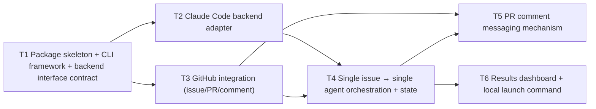

Evolution graph:

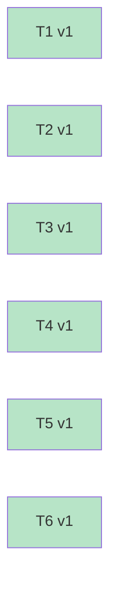

### 0002 OpenAgents proactively creates issues (issue #0)

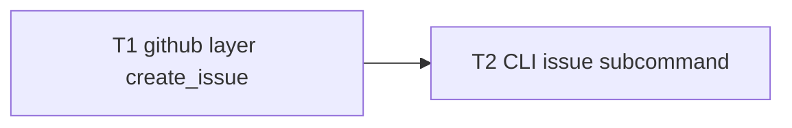

Evolution graph:

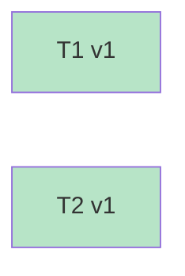

### 0003 Issue-solving isolation — a separate worktree for each issue + branch baseline pinned to the latest main (issue #0)

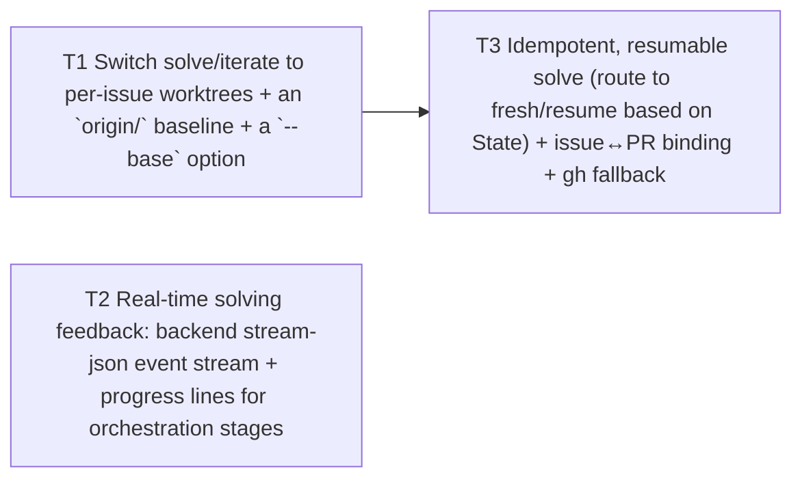

Evolution graph:

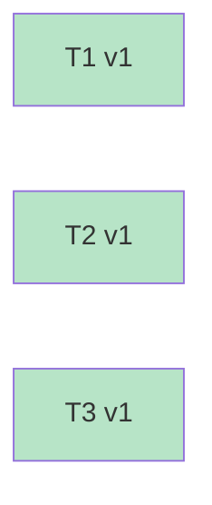

### 0004 openagents vigil — Vigil mode (autonomous full-cycle issue→PR loop) (issue #9)

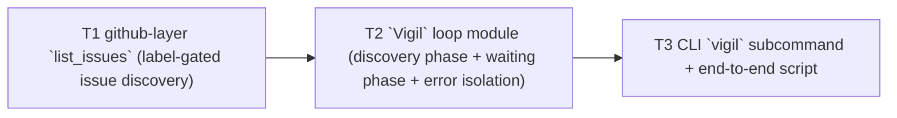

Evolution graph:


### 0005 Split solve into atomic operations + RFC-first review loop (issue #0)

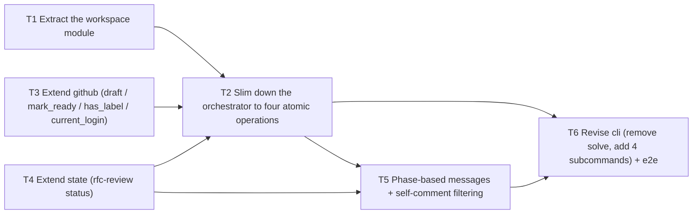

Evolution graph:


### 0006 Vigil recognizes PR/issue closure as a termination signal (issue #0)

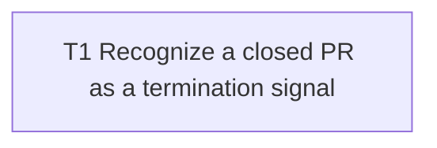

Evolution graph:

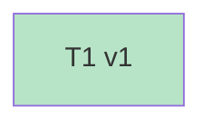

### 0007 Vigil recovery—enable solving as a resume entry point and fix orphaned runs left by crashes midway through start_rfc (issue #0)

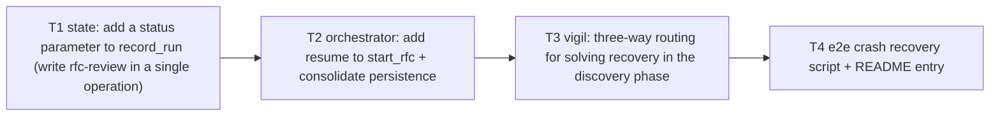

Evolution graph:

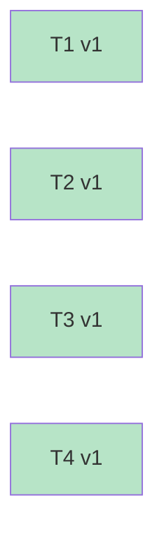

### 0008 “End-to-End Verification” signpost in the PR body (automatically generated from the RFC) (issue #0)

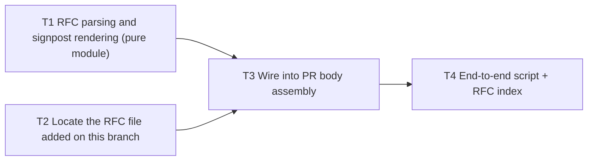

Evolution graph:


### 0009 Automatically rebase other open PRs after a merge (issue #24)

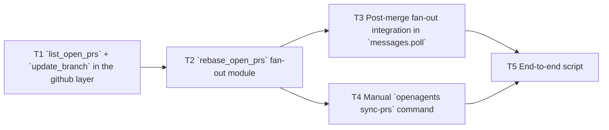

Evolution graph:

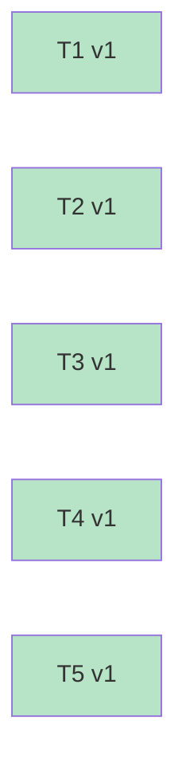

### 0010 gh transient-error retries + per-round fault tolerance in the Vigil loop (issue #0)

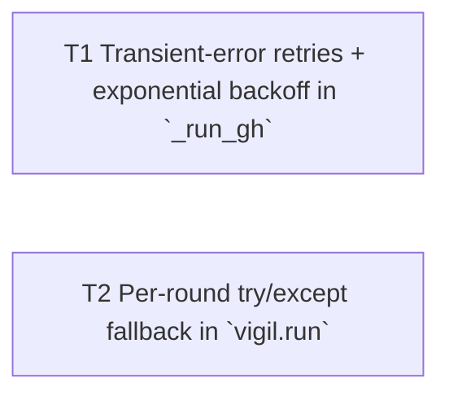

Evolution graph:


### 0011 Local Agent Identity + Comment Signatures (Distinguish Self-Comments from Human Comments and Eliminate poll Self-Loops) (issue #28)

```mermaid
graph LR
    nT1["T1 Persist agent_id in the state layer"]
    nT2["T2 identity module (identity resolution + comment signatures)"]
    nT3["T3 Exclude self-comments from poll processing decisions + simplify cursors"]
    nT4["T4 Sign comments posted by the orchestrator"]
    nT5["T5 Sign rebase conflict comments"]
    nT6["T6 Wire up the CLI + remove current_login"]
    nT1 --> nT2
    nT2 --> nT3
    nT5 --> nT3
    nT2 --> nT4
    nT2 --> nT5
    nT3 --> nT6
    nT4 --> nT6
    nT5 --> nT6
```

Evolution graph:

```mermaid
graph LR
    v_T1_1["T1 v1"]
    v_T2_1["T2 v1"]
    v_T3_1["T3 v1"]
    v_T4_1["T4 v1"]
    v_T5_1["T5 v1"]
    v_T6_1["T6 v1"]
    classDef st_done fill:#b7e4c7;
    class v_T1_1 st_done;
    class v_T2_1 st_done;
    class v_T3_1 st_done;
    class v_T4_1 st_done;
    class v_T5_1 st_done;
    class v_T6_1 st_done;
```

### 0012 test branch gating workflow — humans intervene only when filing an issue and during promote (issue #32)

```mermaid
graph LR
    nT1["T1 reviewer orchestration module (N parallel reviewers + decision aggregation)"]
    nT2["T2 github extensions (base/merge/label/branch)"]
    nT3["T3 state extensions (rounds + STATUS_BLOCKED)"]
    nT4["T4 promote module (preflight checks + fast-forward main)"]
    nT5["T5 Gate integration (messages routing + orchestrator review/base)"]
    nT6["T6 CLI/vigil wiring (promote command + base default + init fallback safeguard)"]
    nT2 --> nT4
    nT3 --> nT4
    nT1 --> nT5
    nT2 --> nT5
    nT3 --> nT5
    nT4 --> nT6
    nT5 --> nT6
```

Evolution graph:

```mermaid
graph LR
    v_T1_1["T1 v1"]
    v_T2_1["T2 v1"]
    v_T3_1["T3 v1"]
    v_T4_1["T4 v1"]
    v_T5_1["T5 v1"]
    v_T6_1["T6 v1"]
    classDef st_done fill:#b7e4c7;
    class v_T1_1 st_done;
    class v_T2_1 st_done;
    class v_T3_1 st_done;
    class v_T4_1 st_done;
    class v_T5_1 st_done;
    class v_T6_1 st_done;
```

### 0013 Actually run the end-to-end script and post “pass/fail + logs” as a PR comment (extending the RFC-0008 signpost → actual execution results) (issue #31)

```mermaid
graph LR
    nT1["T1 e2e execution wrapper + result comment rendering (standalone module)"]
    nT2["T2 rfc.script_path_for (reuse extract_e2e to locate the script)"]
    nT3["T3 Wire actual execution and a signed result comment into implement before marking the PR ready"]
    nT4["T4 End-to-end script + RFC index"]
    nT1 --> nT3
    nT2 --> nT3
    nT3 --> nT4
```

Evolution graph:

```mermaid
graph LR
    v_T1_1["T1 v1"]
    v_T2_1["T2 v1"]
    v_T3_1["T3 v1"]
    v_T4_1["T4 v1"]
    classDef st_done fill:#b7e4c7;
    class v_T1_1 st_done;
    class v_T2_1 st_done;
    class v_T3_1 st_done;
    class v_T4_1 st_done;
```

### 0014 Replace RFCs with “Spec live snapshots + evolution history” — Specs always correspond one-to-one with the code, and legacy content is retained in history (issue #35)

```mermaid
graph LR
    nT1["T1 Data layer + JSON Schema + dependency/entry point declarations"]
    nT2["T2 spec validate (schema + semantic validation)"]
    nT3["T3 spec render → OVERVIEW.md (boards/relationship graph/conflicts/DAG/evolution graph)"]
    nT4["T4 spec amend / abandon (append history + automatic render)"]
    nT5["T5 spec CLI + number validation script + CI integration"]
    nT6["T6 Migration script + spec-driven skill + specs README + e2e"]
    nT1 --> nT2
    nT1 --> nT3
    nT1 --> nT4
    nT3 --> nT4
    nT2 --> nT5
    nT3 --> nT5
    nT4 --> nT5
    nT2 --> nT6
    nT3 --> nT6
```

Evolution graph:

```mermaid
graph LR
    v_T1_1["T1 v1"]
    v_T2_1["T2 v1"]
    v_T3_1["T3 v1"]
    v_T4_1["T4 v1"]
    v_T5_1["T5 v1"]
    v_T6_1["T6 v1"]
    classDef st_done fill:#b7e4c7;
    class v_T1_1 st_done;
    class v_T2_1 st_done;
    class v_T3_1 st_done;
    class v_T4_1 st_done;
    class v_T5_1 st_done;
    class v_T6_1 st_done;
```

### 0015 Human-readable spec summary: populate the group-level summary field + render a plain-language TL;DR (issue #58)

```mermaid
graph LR
    nT1["T1 Data layer: add a group-level summary field to metadata"]
    nT2["T2 Authorized path: spec new --summary (cli + mutate)"]
    nT3["T3 Gate: validate enforces a nonempty summary"]
    nT4["T4 Human-readable view: TL;DR block at the top of render output"]
    nT5["T5 Migration: populate summary for the 14 existing specs + re-render"]
    nT1 --> nT2
    nT1 --> nT3
    nT1 --> nT4
    nT3 --> nT5
    nT4 --> nT5
```

Evolution graph:

```mermaid
graph LR
    v_T1_1["T1 v1"]
    v_T2_1["T2 v1"]
    v_T3_1["T3 v1"]
    v_T4_1["T4 v1"]
    v_T5_1["T5 v1"]
    classDef st_done fill:#b7e4c7;
    class v_T1_1 st_done;
    class v_T2_1 st_done;
    class v_T3_1 st_done;
    class v_T4_1 st_done;
    class v_T5_1 st_done;
```

### 0016 Automatic agent replies to new comments on issue pages (extending comment replies from PRs to issues) (issue #149)

```mermaid
graph LR
    nT1["T1 identity issue signature read/write primitives (new_human_comments_on_issue + post_signed_comment_on_issue)"]
    nT2["T2 state issue-comment cursor (get/set_issue_cursor, independent namespace)"]
    nT3["T3 replier issue prompt + context issue-reply placeholders (answer questions only, without changing code)"]
    nT4["T4 vigil wiring: _sense populates issue latest_comment_is_ours (only for ready issues without a PR) + _do_reply issue dispatch + offline e2e"]
    nT5["T5 reply-comment --issue manual interface (mutually exclusive with --pr; exactly one required)"]
    nT1 --> nT4
    nT2 --> nT4
    nT3 --> nT4
    nT1 --> nT5
```

Evolution graph:

```mermaid
graph LR
    v_T1_1["T1 v1"]
    v_T2_1["T2 v1"]
    v_T3_1["T3 v1"]
    v_T4_1["T4 v1"]
    v_T5_1["T5 v1"]
    classDef st_done fill:#b7e4c7;
    class v_T1_1 st_done;
    class v_T2_1 st_done;
    class v_T3_1 st_done;
    class v_T4_1 st_done;
    class v_T5_1 st_done;
```

### 0017 Delegate the PR lifecycle (create/ready/merge) to agents: promote draft to a first-class fact, with level-triggered recovery to ready status + a hard merge gate as a backstop (issue #174)

```mermaid
graph LR
    nT1["T1 Promote draft to a PR snapshot fact + make the deliver agent responsible for marking PRs ready"]
    nT3["T3 Delegate merging to the merger agent + retain a deterministic hard merge gate as a backstop"]
    nT2["T2 Promote draft to a first-class _Facts fact + add a _classify recovery branch for marking PRs ready + delegate direct lifecycle calls"]
    nT1 --> nT2
    nT3 --> nT2
```

Evolution graph:

```mermaid
graph LR
    v_T1_1["T1 v1"]
    v_T2_1["T2 v1"]
    v_T3_1["T3 v1"]
    classDef st_done fill:#b7e4c7;
    class v_T1_1 st_done;
    class v_T2_1 st_done;
    class v_T3_1 st_done;
```

### 0020 Human oversight gates: requirements alignment before issue creation + tiered vigil --hold gates (issue #59)

```mermaid
graph LR
    nT1["T1 Entry-point alignment module: restate vague ideas as X / boundaries Y / what not to do Z"]
    nT2["T2 hold configuration model: parse spec,merge into a set of gates"]
    nT3["T3 Tiered pipeline gates: pass hold through to poll to branch at the two gates"]
    nT4["T4 CLI wiring: alignment at the issue entry point + vigil --hold flag"]
    nT5["T5 e2e script: demonstrate pausing at spec → human approval → continuation"]
    nT2 --> nT3
    nT1 --> nT4
    nT2 --> nT4
    nT3 --> nT4
    nT3 --> nT5
    nT4 --> nT5
```

Evolution graph:

```mermaid
graph LR
    v_T1_1["T1 v1"]
    v_T2_1["T2 v1"]
    v_T3_1["T3 v1"]
    v_T4_1["T4 v1"]
    v_T5_1["T5 v1"]
    classDef st_done fill:#b7e4c7;
    class v_T1_1 st_done;
    class v_T2_1 st_done;
    class v_T3_1 st_done;
    class v_T4_1 st_done;
    class v_T5_1 st_done;
```

### 0021 Fix long reviewer replies being truncated before VERDICT → UNPARSED → false non-PASS results that waste rounds and incorrectly trigger needs-human (issue #63)

```mermaid
graph LR
    nT1["T1 Reviewer side: verdict token first + first-line parsing + distinguish 'invalid reviews' + a single retry of the review"]
    nT2["T2 Orchestration layer: invalid reviews do not consume rounds, empty feedback does not cause pointless iterations, and truthful escalation follows a separate retry limit"]
    nT1 --> nT2
```

Evolution graph:

```mermaid
graph LR
    v_T1_1["T1 v1"]
    v_T2_1["T2 v1"]
    classDef st_done fill:#b7e4c7;
    class v_T1_1 st_done;
    class v_T2_1 st_done;
```

### 0022 Code gate mergeability precheck + poll error isolation + decision comment idempotency (issue #62)

```mermaid
graph LR
    nT1["T1 github.mergeability: query PR mergeability (mergeable / mergeStateStatus)"]
    nT2["T2 Code gate mergeability precheck + per-PR error isolation in poll"]
    nT3["T3 Decision comment idempotency: do not repost the same decision every round"]
    nT1 --> nT2
```

Evolution graph:

```mermaid
graph LR
    v_T1_1["T1 v1"]
    v_T2_1["T2 v1"]
    v_T3_1["T3 v1"]
    classDef st_done fill:#b7e4c7;
    class v_T1_1 st_done;
    class v_T2_1 st_done;
    class v_T3_1 st_done;
```

### 0023 Retire the test branch: keep main advancing continuously + publish releases through release/vX.Y.Z version branches (issue #68)

```mermaid
graph LR
    nT1["T1 github layer: default base to main + remove test branch bootstrapping"]
    nT2["T2 orchestrator + Vigil: default base to main"]
    nT3["T3 promote→release module: create a release/vX.Y.Z branch + create a tag + increment the version"]
    nT4["T4 CLI: release subcommand + default base to main"]
    nT5["T5 CI workflow + indexheal tests + wrap up old spec 0012"]
    nT1 --> nT3
    nT2 --> nT4
    nT3 --> nT4
```

Evolution graph:

```mermaid
graph LR
    v_T1_1["T1 v1"]
    v_T2_1["T2 v1"]
    v_T3_1["T3 v1"]
    v_T4_1["T4 v1"]
    v_T5_1["T5 v1"]
    classDef st_done fill:#b7e4c7;
    class v_T1_1 st_done;
    class v_T2_1 st_done;
    class v_T3_1 st_done;
    class v_T4_1 st_done;
    class v_T5_1 st_done;
```

### 0024 Convert specs to rust-RFC format: overview first + each spec self-contained (issue #69)

```mermaid
graph LR
    nT1["T1 Spec data model: nine-section group-level Overview + streamlined Task"]
    nT2["T2 Validation quality bar: required sections + self-containment warnings + streamlined schema"]
    nT3["T3 Nine-section scaffolding for spec new + signpost/cli/mutate adaptations"]
    nT4["T4 Align skill + references + README + orchestrator with rust-RFC"]
    nT5["T5 Backfill 19 existing specs + e2e scripts"]
    nT1 --> nT2
    nT2 --> nT3
    nT3 --> nT4
    nT3 --> nT5
```

Evolution graph:

```mermaid
graph LR
    v_T1_1["T1 v1"]
    v_T2_1["T2 v1"]
    v_T3_1["T3 v1"]
    v_T4_1["T4 v1"]
    v_T5_1["T5 v1"]
    classDef st_done fill:#b7e4c7;
    class v_T1_1 st_done;
    class v_T2_1 st_done;
    class v_T3_1 st_done;
    class v_T4_1 st_done;
    class v_T5_1 st_done;
```

### 0025 Brownfield RFC backfill: scan existing code to generate a 9-section RFC draft (issue #73)

```mermaid
graph LR
    nT1["T1 Code inventory helper: scan path to produce an inventory"]
    nT2["T2 Orchestration method backfill_rfc + reverse-engineering RFC prompt"]
    nT3["T3 CLI wiring for backfill-rfc <path>"]
    nT4["T4 e2e script demonstrating the backfill closed loop"]
    nT1 --> nT2
    nT2 --> nT3
    nT3 --> nT4
```

Evolution graph:

```mermaid
graph LR
    v_T1_1["T1 v1"]
    v_T2_1["T2 v1"]
    v_T3_1["T3 v1"]
    v_T4_1["T4 v1"]
    classDef st_done fill:#b7e4c7;
    class v_T1_1 st_done;
    class v_T2_1 st_done;
    class v_T3_1 st_done;
    class v_T4_1 st_done;
```

### 0026 README minimal usage: add a Quickstart section immediately after the installation instructions (issue #75)

```mermaid
graph LR
    nT1["T1 Insert the Minimal Usage / Quickstart section and update the table-of-contents anchors accordingly"]
    nT2["T2 Assert the Quickstart section's position in an e2e script"]
    nT1 --> nT2
```

Evolution graph:

```mermaid
graph LR
    v_T1_1["T1 v1"]
    v_T2_1["T2 v1"]
    classDef st_done fill:#b7e4c7;
    class v_T1_1 st_done;
    class v_T2_1 st_done;
```

### 0027 Multi-repository management: a single process runs Vigil concurrently across a set of repositories specified in a configuration file (issue #77)

```mermaid
graph LR
    nT1["T1 Configuration loading: YAML parsing + jsonschema validation + default merging"]
    nT2["T2 Concurrent orchestration: one child process per repository running the existing Vigil + log aggregation + error isolation"]
    nT3["T3 CLI wiring for vigil-all(--config/--once)"]
    nT4["T4 e2e script demonstrates the complete multi-repository management loop"]
    nT1 --> nT2
    nT2 --> nT3
    nT3 --> nT4
```

Evolution graph:

```mermaid
graph LR
    v_T1_1["T1 v1"]
    v_T2_1["T2 v1"]
    v_T3_1["T3 v1"]
    v_T4_1["T4 v1"]
    classDef st_done fill:#b7e4c7;
    class v_T1_1 st_done;
    class v_T2_1 st_done;
    class v_T3_1 st_done;
    class v_T4_1 st_done;
```

### 0028 Two PR automation improvements: embed a 9-section overview summary in spec draft PRs + dispatch an agent to resolve merge conflicts semantically (issue #79)

```mermaid
graph LR
    nT1["T1 Improvement 1: overview summary digest + PR body wiring"]
    nT2["T2 Improvement 2: semantic conflict resolution in conflict.py (pure decision logic + IO factory)"]
    nT3["T3 Improvement 2: wiring rebase / messages / cli (tiered fallback + gating)"]
    nT4["T4 Hermetic e2e script (no network access, no real LLM calls)"]
    nT2 --> nT3
    nT1 --> nT4
    nT3 --> nT4
```

Evolution graph:

```mermaid
graph LR
    v_T1_1["T1 v1"]
    v_T2_1["T2 v1"]
    v_T3_1["T3 v1"]
    v_T4_1["T4 v1"]
    classDef st_done fill:#b7e4c7;
    class v_T1_1 st_done;
    class v_T2_1 st_done;
    class v_T3_1 st_done;
    class v_T4_1 st_done;
```

### 0029 Make a uniform hard cutover from rfc to spec naming and retire the rfc-driven-development skill (issue #81)

```mermaid
graph LR
    nT1["T1 Documentation updates and skill retirement"]
    nT2["T2 Hard cutover of live/persisted values"]
    nT3["T3 Rename internal orchestrator/backfill identifiers"]
    nT4["T4 Align CLI subcommands and messages/vigil consumers"]
    nT5["T5 Clean up remaining RFC-NNNN comments"]
    nT6["T6 End-to-end validation script: assert zero remaining rfc"]
    nT2 --> nT3
    nT3 --> nT4
    nT4 --> nT5
    nT1 --> nT6
    nT5 --> nT6
```

Evolution graph:

```mermaid
graph LR
    v_T1_1["T1 v1"]
    v_T2_1["T2 v1"]
    v_T3_1["T3 v1"]
    v_T4_1["T4 v1"]
    v_T5_1["T5 v1"]
    v_T6_1["T6 v1"]
    classDef st_pending fill:#eeeeee;
    class v_T1_1 st_pending;
    class v_T2_1 st_pending;
    class v_T3_1 st_pending;
    class v_T4_1 st_pending;
    class v_T5_1 st_pending;
    class v_T6_1 st_pending;
```

### 0030 init environment health check: detect browser MCP and unrestricted permissions (non-blocking) + guidance on frontend e2e methodology (issue #85)

```mermaid
graph LR
    nT1["T1 Minimal permission-mode switch: change the constant to read OPENAGENTS_PERMISSION_MODE"]
    nT2["T2 Core health-check module envcheck: browser MCP detection + permission-mode retrieval + report rendering"]
    nT3["T3 Wire the environment health check into openagents init (non-blocking)"]
    nT4["T4 Conditional browser-e2e methodology wording: drafting prompt templates + reviewer rubric"]
    nT5["T5 e2e script: assertions for health-check output in both states + methodology wording injection"]
    nT1 --> nT2
    nT2 --> nT3
    nT3 --> nT5
    nT4 --> nT5
```

Evolution graph:

```mermaid
graph LR
    v_T1_1["T1 v1"]
    v_T2_1["T2 v1"]
    v_T3_1["T3 v1"]
    v_T4_1["T4 v1"]
    v_T5_1["T5 v1"]
    classDef st_done fill:#b7e4c7;
    class v_T1_1 st_done;
    class v_T2_1 st_done;
    class v_T3_1 st_done;
    class v_T4_1 st_done;
    class v_T5_1 st_done;
```

### 0031 Redesign merge gate unblocking semantics: after a human unblocks it, dispatch an agent to actively resolve conflicts, retry within a bound, and suspend again if necessary (issue #84)

```mermaid
graph LR
    nT1["T1 state: block_gate/merge_attempts fields + counting/reset methods"]
    nT2["T2 messages: armed unblocking semantics for the merge gate + MAX_MERGE_ATTEMPTS knob"]
    nT3["T3 Hermetic e2e script (no network access, no real LLM/gh calls)"]
    nT1 --> nT2
    nT1 --> nT3
    nT2 --> nT3
```

Evolution graph:

```mermaid
graph LR
    v_T1_1["T1 v1"]
    v_T2_1["T2 v1"]
    v_T3_1["T3 v1"]
    classDef st_done fill:#b7e4c7;
    class v_T1_1 st_done;
    class v_T2_1 st_done;
    class v_T3_1 st_done;
```

### 0032 Close the entire needs-human loop on GitHub: leave sufficient information when blocked + automatically unblock and feed the content back in for a retry as soon as a human posts a new comment (issue #89)

```mermaid
graph LR
    nT1["T1 state: block_watermark field + setter"]
    nT2["T2 github: idempotent remove_label wrapper"]
    nT3["T3 blocknote: structured blocking comment construction (new module)"]
    nT4["T4 identity: revive comment reading with new_human_comments"]
    nT5["T5 messages: enrich _block + watermark + routing to unblock on comment replies"]
    nT6["T6 Hermetic e2e script (no network, no real LLM/gh access)"]
    nT1 --> nT5
    nT2 --> nT5
    nT3 --> nT5
    nT4 --> nT5
    nT5 --> nT6
```

Evolution graph:

```mermaid
graph LR
    v_T1_1["T1 v1"]
    v_T2_1["T2 v1"]
    v_T3_1["T3 v1"]
    v_T4_1["T4 v1"]
    v_T5_1["T5 v1"]
    v_T6_1["T6 v1"]
    classDef st_done fill:#b7e4c7;
    class v_T1_1 st_done;
    class v_T2_1 st_done;
    class v_T3_1 st_done;
    class v_T4_1 st_done;
    class v_T5_1 st_done;
    class v_T6_1 st_done;
```

### 0033 Automatically run git remote add origin after openagents init creates a remote (issue #93)

```mermaid
graph LR
    nT1["T1 Run git remote add origin after _bootstrap creates a remote"]
    nT2["T2 Regression tests + e2e coverage for the remote-add path"]
    nT1 --> nT2
```

Evolution graph:

```mermaid
graph LR
    v_T1_1["T1 v1"]
    v_T2_1["T2 v1"]
    classDef st_done fill:#b7e4c7;
    class v_T1_1 st_done;
    class v_T2_1 st_done;
```

### 0034 Conflict/blocking notifications with actionable diagnostics + reduced repeat notifications from merge fan-out—making it structurally possible to answer “what exactly is the conflict?” (issue #92)

```mermaid
graph LR
    nT1["T1 conflictdiag: merge-tree diagnostic collection + formatting (new module)"]
    nT2["T2 rebase: fan-out conflict comments include diagnostics + no reposting for PRs already marked needs-human"]
    nT3["T3 messages: merge-gate blockers include diagnostics + inject a diagnoser into fan-out"]
    nT4["T4 Hermetic e2e script (no network, no access to real LLM/gh/git remotes)"]
    nT1 --> nT2
    nT1 --> nT3
    nT2 --> nT4
    nT3 --> nT4
```

Evolution graph:

```mermaid
graph LR
    v_T1_1["T1 v1"]
    v_T2_1["T2 v1"]
    v_T3_1["T3 v1"]
    v_T4_1["T4 v1"]
    classDef st_done fill:#b7e4c7;
    class v_T1_1 st_done;
    class v_T2_1 st_done;
    class v_T3_1 st_done;
    class v_T4_1 st_done;
```

### 0035 Uniform hard timeouts for raw git network calls (fail-open) + progress logs for slow checks in the discovery phase (issue #147)

```mermaid
graph LR
    nT1["T1 Harden git.py deduplication probes: return True on timeout (fail-open) + a progress breadcrumb before ls-remote"]
    nT2["T2 Harden workspace.py fetch: _git raises WorkspaceError on timeout + deduplication probes return True on timeout (fail-open)"]
    nT3["T3 Harden release.py push: _git raises RuntimeError on timeout (covering branch push + tag push)"]
    nT4["T4 Progress logs for slow checks in the discovery phase: two stderr lines, before _intake fetches issues + before _admit calls the LLM"]
```

Evolution graph:

```mermaid
graph LR
    v_T1_1["T1 v1"]
    v_T2_1["T2 v1"]
    v_T3_1["T3 v1"]
    v_T4_1["T4 v1"]
    classDef st_done fill:#b7e4c7;
    class v_T1_1 st_done;
    class v_T2_1 st_done;
    class v_T3_1 st_done;
    class v_T4_1 st_done;
```

### 0036 After unblocking, the agent reads and directly responds to the human comment: the merge gate also passes in the comment content + the orchestration layer deterministically posts a reply quoting the original comment (issue #97)

```mermaid
graph LR
    nT1["T1 state: unblock_detail field + setter"]
    nT2["T2 replynote: constructing replies that quote the original comment (new module)"]
    nT3["T3 conflict: the conflict resolver accepts human guidance"]
    nT4["T4 orchestrator: atomic operations return summary + human-unblocking prompt + announce switch"]
    nT5["T5 messages: pass content to merge + deterministically post replies quoting the original comment for all three gates"]
    nT6["T6 Hermetic e2e script (no network, no real LLM/gh access)"]
    nT1 --> nT5
    nT2 --> nT5
    nT3 --> nT5
    nT4 --> nT5
    nT5 --> nT6
```

Evolution graph:

```mermaid
graph LR
    v_T1_1["T1 v1"]
    v_T2_1["T2 v1"]
    v_T3_1["T3 v1"]
    v_T4_1["T4 v1"]
    v_T5_1["T5 v1"]
    v_T6_1["T6 v1"]
    classDef st_done fill:#b7e4c7;
    class v_T1_1 st_done;
    class v_T2_1 st_done;
    class v_T3_1 st_done;
    class v_T4_1 st_done;
    class v_T5_1 st_done;
    class v_T6_1 st_done;
```

### 0038 Switch merge-conflict handling to pull-based synchronization + have the conflict-resolution agent reply to comments itself using a signed tool (issue #96)

```mermaid
graph LR
    nT1["T1 Gate 2 pull-based synchronization + remove push fan-out"]
    nT2["T2 Remove dead code + migrate CONFLICT_COMMENT"]
    nT3["T3 Have the conflict-resolution agent reply to comments itself using a signed tool"]
```

Evolution graph:

```mermaid
graph LR
    v_T1_1["T1 v1"]
    v_T2_1["T2 v1"]
    v_T3_1["T3 v1"]
    classDef st_done fill:#b7e4c7;
    class v_T1_1 st_done;
    class v_T2_1 st_done;
    class v_T3_1 st_done;
```

### 0039 vigil dispatch deduplication across concurrent backends: introduce a "dispatched" claim label (third gate + expiration-based reclamation) (issue #102)

```mermaid
graph LR
    nT1["T1 github claim primitive layer"]
    nT2["T2 Third gate in the discovery phase + expiration-based reclamation"]
    nT3["T3 Claim labeling and cleanup in start_rfc"]
    nT4["T4 End-to-end tests of deduplication results (including browser dashboard assertions)"]
    nT1 --> nT2
    nT1 --> nT3
    nT2 --> nT4
    nT3 --> nT4
```

Evolution graph:

```mermaid
graph LR
    v_T1_1["T1 v1"]
    v_T2_1["T2 v1"]
    v_T3_1["T3 v1"]
    v_T4_1["T4 v1"]
    classDef st_done fill:#b7e4c7;
    class v_T1_1 st_done;
    class v_T2_1 st_done;
    class v_T3_1 st_done;
    class v_T4_1 st_done;
```

### 0040 Redesign e2e: runbook-driven + independent execution + evidence review gate (Phase 1 skeleton) (issue #104)

```mermaid
graph LR
    nT1["T1 Add e2e rough-planning fields to spec + strengthen validate"]
    nT2["T2 executor role: independent runtime verification agent (cli/api/backend forms)"]
    nT3["T3 Evidence persistence + evidence gate reviewer"]
    nT4["T4 Narrow reviewer responsibilities + hard RFC rubric rule"]
    nT5["T5 Wire up orchestration: finalize → execute → gate merging on evidence + retire the old smoke test"]
    nT1 --> nT3
    nT1 --> nT5
    nT2 --> nT5
    nT3 --> nT5
    nT4 --> nT5
```

Evolution graph:

```mermaid
graph LR
    v_T1_1["T1 v1"]
    v_T2_1["T2 v1"]
    v_T3_1["T3 v1"]
    v_T4_1["T4 v1"]
    v_T5_1["T5 v1"]
    classDef st_done fill:#b7e4c7;
    class v_T1_1 st_done;
    class v_T2_1 st_done;
    class v_T3_1 st_done;
    class v_T4_1 st_done;
    class v_T5_1 st_done;
```

### 0041 Keep hold-merge firmly awaiting merge after PASS: freeze approved PRs as needs-human to eliminate repeated-review oscillation on the same code (issue #106)

```mermaid
graph LR
    nT2["T2 '✅ Review passed, ready for you to merge' success message"]
    nT3["T3 Sanitize reviewer scratchpad content"]
    nT1["T1 Stabilize hold-merge + route release from merge-hold"]
    nT4["T4 End-to-end outcome tests (including browser dashboard assertions for 'stability after freezing')"]
    nT2 --> nT1
    nT1 --> nT4
    nT2 --> nT4
    nT3 --> nT4
```

Evolution graph:

```mermaid
graph LR
    v_T1_1["T1 v1"]
    v_T2_1["T2 v1"]
    v_T3_1["T3 v1"]
    v_T4_1["T4 v1"]
    classDef st_done fill:#b7e4c7;
    class v_T1_1 st_done;
    class v_T2_1 st_done;
    class v_T3_1 st_done;
    class v_T4_1 st_done;
```

### 0042 Revive runs frozen by PR close→reopen: closed is not a true terminal state (issue #108)

```mermaid
graph LR
    nT1["T1 state: closed_at field + set_closed_at setter"]
    nT2["T2 github: thin read-only wrappers is_open / is_draft"]
    nT3["T3 messages: revival-window guard + reconciliation for revival on reopen"]
    nT4["T4 End-to-end outcome tests (including browser dashboard assertions for “close→reopen revival”)"]
    nT1 --> nT3
    nT2 --> nT3
    nT1 --> nT4
    nT2 --> nT4
    nT3 --> nT4
```

Evolution graph:

```mermaid
graph LR
    v_T1_1["T1 v1"]
    v_T2_1["T2 v1"]
    v_T3_1["T3 v1"]
    v_T4_1["T4 v1"]
    classDef st_done fill:#b7e4c7;
    class v_T1_1 st_done;
    class v_T2_1 st_done;
    class v_T3_1 st_done;
    class v_T4_1 st_done;
```

### 0043 Before an issue enters RFC, self-check its title/body for conflicts that affect the fix approach: if a conflict is detected, first apply needs-human for alignment; do not generate a spec directly (issue #111)

```mermaid
graph LR
    nT1["T1 Issue-level comment interface github.issue_comment"]
    nT2["T2 issuecheck assessment module (verdict + alignment comment rendering)"]
    nT3["T3 precheck wiring (orchestrator precheck + Vigil discovery-phase gate)"]
    nT4["T4 End-to-end outcome tests (#106 regression + browser assertions for the alignment comment)"]
    nT1 --> nT3
    nT2 --> nT3
    nT3 --> nT4
```

Evolution graph:

```mermaid
graph LR
    v_T1_1["T1 v1"]
    v_T2_1["T2 v1"]
    v_T3_1["T3 v1"]
    v_T4_1["T4 v1"]
    classDef st_done fill:#b7e4c7;
    class v_T1_1 st_done;
    class v_T2_1 st_done;
    class v_T3_1 st_done;
    class v_T4_1 st_done;
```

### 0044 Verification skill for “running the real app end to end and taking screenshots”: UI/product behavior changes must have evidence from an actual run (issue #113)

```mermaid
graph LR
    nT1["T1 Port the original skill text + runbook template"]
    nT2["T2 Strengthen the reviewer rubric: claiming verification without evidence = REWORK"]
    nT3["T3 Judgment discipline for task assignment prompts: three-way evidence classification + no substituting tests for actual runs"]
    nT4["T4 e2e script (offline assertions + browser self-demonstration) + reference page + README/index"]
    nT1 --> nT4
    nT2 --> nT4
    nT3 --> nT4
```

Evolution graph:

```mermaid
graph LR
    v_T1_1["T1 v1"]
    v_T2_1["T2 v1"]
    v_T3_1["T3 v1"]
    v_T4_1["T4 v1"]
    classDef st_done fill:#b7e4c7;
    class v_T1_1 st_done;
    class v_T2_1 st_done;
    class v_T3_1 st_done;
    class v_T4_1 st_done;
```

### 0045 Clean up stale rebase/indexheal terminology after Spec-0037 (issue #110)

```mermaid
graph LR
    nT1["T1 Remove rebase terminology from the conflictdiag diagnostic module"]
    nT2["T2 Remove terminology describing the indexheal fallback chain from the conflict module"]
    nT3["T3 Finish cleaning up adjacent runtime comments (github/messages/orchestrator)"]
    nT4["T4 Remove sync-prs/rebase_open_prs terminology from test comments"]
    nT5["T5 End-to-end outcome test script (final group-wide verification that grep finds zero stale references)"]
    nT1 --> nT5
    nT2 --> nT5
    nT3 --> nT5
    nT4 --> nT5
```

Evolution graph:

```mermaid
graph LR
    v_T1_1["T1 v1"]
    v_T2_1["T2 v1"]
    v_T3_1["T3 v1"]
    v_T4_1["T4 v1"]
    v_T5_1["T5 v1"]
    classDef st_done fill:#b7e4c7;
    class v_T1_1 st_done;
    class v_T2_1 st_done;
    class v_T3_1 st_done;
    class v_T4_1 st_done;
    class v_T5_1 st_done;
```

### 0046 Claude silence timeout and shared invocation time budget (issue #148)

```mermaid
graph LR
    nT1["T1 Shared time budget for the backend watchdog and Vigil"]
    nT2["T2 Hermetic regression tests and offline validation entry point"]
    nT1 --> nT2
```

Evolution graph:

```mermaid
graph LR
    v_T1_1["T1 v1"]
    v_T2_1["T2 v1"]
    classDef st_done fill:#b7e4c7;
    class v_T1_1 st_done;
    class v_T2_1 st_done;
```

### 0047 Deduplicate review decisions by substantive content (post decisions with the same verdict but different reasons) (issue #116)

```mermaid
graph LR
    nT1["T1 reviewer.extract_decision_content: a pure parser for decision content"]
    nT2["T2 orchestrator._decision_already_posted: deduplicate by verdict + feedback content"]
    nT1 --> nT2
```

Evolution graph:

```mermaid
graph LR
    v_T1_1["T1 v1"]
    v_T2_1["T2 v1"]
    classDef st_done fill:#b7e4c7;
    class v_T1_1 st_done;
    class v_T2_1 st_done;
```

### 0048 Review safeguards against “passing off an architectural skeleton as a complete implementation”: strengthen the reviewer prompt against design-as-implementation (issue #122)

```mermaid
graph LR
    nT1["T1 Harden the reviewer rubric in three places against design-as-implementation + unit tests"]
    nT2["T2 e2e drill script for passing off a skeleton as a complete implementation (offline determinism + comparison against actual rubric text using a recreation of the PR #105 scenario)"]
    nT1 --> nT2
```

Evolution graph:

```mermaid
graph LR
    v_T1_1["T1 v1"]
    v_T2_1["T2 v1"]
    classDef st_done fill:#b7e4c7;
    class v_T1_1 st_done;
    class v_T2_1 st_done;
```

### 0049 vigil multi-backend dispatch and claim conflict prevention: no claim on resume + claims with ownership + yielding after a second check (issue #120)

```mermaid
graph LR
    nT1["T1 github: claim-note read primitive + idempotent label add (stop remove-then-add contention)"]
    nT2["T2 identity: claim-note marker + ownership/age parsing"]
    nT3["T3 vigil: ownership-aware gates in _dispatch_kind/_claim_expired"]
    nT4["T4 orchestrator+state: no claim on resume + signed claims + yielding after a second check"]
    nT5["T5 Outcome verification: integration tests reproducing multi-backend races + e2e script"]
    nT1 --> nT2
    nT1 --> nT3
    nT2 --> nT3
    nT1 --> nT4
    nT2 --> nT4
    nT3 --> nT5
    nT4 --> nT5
```

Evolution graph:

```mermaid
graph LR
    v_T1_1["T1 v1"]
    v_T2_1["T2 v1"]
    v_T3_1["T3 v1"]
    v_T4_1["T4 v1"]
    v_T5_1["T5 v1"]
    classDef st_done fill:#b7e4c7;
    class v_T1_1 st_done;
    class v_T2_1 st_done;
    class v_T3_1 st_done;
    class v_T4_1 st_done;
    class v_T5_1 st_done;
```

### 0050 Improve the readability of reasons for failed reviews: require reviewer feedback to be a single short paragraph in Chinese (issue #124)

```mermaid
graph LR
    nT1["T1 Harden _RUBRIC_TAIL language/length requirements (reasons must be a single short paragraph in Chinese) + unit tests"]
    nT2["T2 cli offline e2e: render review comments using the real render_decision + criteria for a brief Chinese feedback summary (optional browser validation loop)"]
    nT1 --> nT2
```

Evolution graph:

```mermaid
graph LR
    v_T1_1["T1 v1"]
    v_T2_1["T2 v1"]
    classDef st_done fill:#b7e4c7;
    class v_T1_1 st_done;
    class v_T2_1 st_done;
```

### 0051 Unify PR comments posted after agent execution: fill in the silent steps in implement/iterate/finalize_runbook/executor/the evidence gate (centralizing observability) (issue #131)

```mermaid
graph LR
    nT1["T1 executor.render_result pure function (ExecutorResult → PR comment)"]
    nT2["T2 evidence_gate.render_decision pure function (EvidenceDecision → PR comment)"]
    nT3["T3 New worknote module: rendering “what was done this round” for implement/iterate/runbook"]
    nT4["T4 orchestrator.implement returns result.summary (None → str)"]
    nT5["T5 Centralization in messages: _post_agent_report + deduplication to prevent comment spam + wiring at five points"]
    nT6["T6 Outcome tests: integration tests for reports across the full workflow + e2e script"]
    nT1 --> nT5
    nT2 --> nT5
    nT3 --> nT5
    nT4 --> nT5
    nT5 --> nT6
```

Evolution graph:

```mermaid
graph LR
    v_T1_1["T1 v1"]
    v_T2_1["T2 v1"]
    v_T3_1["T3 v1"]
    v_T4_1["T4 v1"]
    v_T5_1["T5 v1"]
    v_T6_1["T6 v1"]
    classDef st_done fill:#b7e4c7;
    class v_T1_1 st_done;
    class v_T2_1 st_done;
    class v_T3_1 st_done;
    class v_T4_1 st_done;
    class v_T5_1 st_done;
    class v_T6_1 st_done;
```

### 0052 Unified agent context injection: include the PR number at every dispatch entry point + inject this PR's conversation history (issue #129)

```mermaid
graph LR
    nT1["T1 New agentcontext module: build_agent_context (fetch PR history + classify and denoise + truncate + PR number)"]
    nT2["T2 reviewer: add a history parameter to review + a rubric establishing on-disk artifacts as authoritative"]
    nT3["T3 orchestrator: route all four entry points through build_agent_context + add the PR number for refine/implement"]
    nT4["T4 Outcome testing: integration test reproducing history like #128 + e2e script"]
    nT1 --> nT3
    nT2 --> nT3
    nT1 --> nT4
    nT2 --> nT4
    nT3 --> nT4
```

Evolution graph:

```mermaid
graph LR
    v_T1_1["T1 v1"]
    v_T2_1["T2 v1"]
    v_T3_1["T3 v1"]
    v_T4_1["T4 v1"]
    classDef st_done fill:#b7e4c7;
    class v_T1_1 st_done;
    class v_T2_1 st_done;
    class v_T3_1 st_done;
    class v_T4_1 st_done;
```

### 0053 The code review gate re-reviews every round: reuse the previous round's PASS when the code state is unchanged (compare k8s Tide sticky approve / tree-hash) (issue #133)

```mermaid
graph LR
    nT1["T1 state: PR net-diff fingerprint field + setter"]
    nT2["T2 github: obtain the PR net-diff fingerprint"]
    nT3["T3 messages: wire up the _process_coding 3c sticky short-circuit"]
    nT4["T4 e2e: script demonstrating sticky PASS reuse"]
    nT1 --> nT3
    nT2 --> nT3
    nT3 --> nT4
```

Evolution graph:

```mermaid
graph LR
    v_T1_1["T1 v1"]
    v_T2_1["T2 v1"]
    v_T3_1["T3 v1"]
    v_T4_1["T4 v1"]
    classDef st_done fill:#b7e4c7;
    class v_T1_1 st_done;
    class v_T2_1 st_done;
    class v_T3_1 st_done;
    class v_T4_1 st_done;
```

### 0054 vigil per-gate bypass switch: --skip selectively disables any pipeline gate + README gate tree (issue #135)

```mermaid
graph LR
    nT1["T1 skip parsing module + conflict detection"]
    nT2["T2 Per-gate consumption: pass Skip through to the 5 gates"]
    nT3["T3 CLI wiring for --skip + hold/skip conflict validation"]
    nT4["T4 README gate tree"]
    nT5["T5 Outcome-testing e2e script (offline gate-control timeline)"]
    nT1 --> nT2
    nT1 --> nT3
    nT2 --> nT3
    nT1 --> nT4
    nT2 --> nT5
    nT3 --> nT5
```

Evolution graph:

```mermaid
graph LR
    v_T1_1["T1 v1"]
    v_T2_1["T2 v1"]
    v_T3_1["T3 v1"]
    v_T4_1["T4 v1"]
    v_T5_1["T5 v1"]
    classDef st_done fill:#b7e4c7;
    class v_T1_1 st_done;
    class v_T2_1 st_done;
    class v_T3_1 st_done;
    class v_T4_1 st_done;
    class v_T5_1 st_done;
```

### 0055 e2e v2: capability awareness + direct specification input + combined review (redesign of 0040) (issue #123)

```mermaid
graph LR
    nT1["T1 Capability state: structured envcheck + persistence into state at startup + CLI wiring"]
    nT2["T2 Streamline the spec e2e section: replace {form,intent,acceptance} with {intent,method}, and remove the form enumeration"]
    nT3["T3 Rewrite the executor: a single autonomous agent checks its tools at runtime and performs actual runs; remove form dispatch"]
    nT4["T4 Combine reviewer responsibilities: branch RFC requirements based on ui_capable + have the code reviewer assess evidence/screenshots"]
    nT5["T5 Orchestration + github: remove finalize_runbook + make run_e2e idempotent + exclude the evidence directory from code_fingerprint"]
    nT6["T6 Reorder the messages pipeline + sticky + bad_ci_after_e2e + e2e script"]
    nT2 --> nT3
    nT1 --> nT4
    nT1 --> nT5
    nT2 --> nT5
    nT3 --> nT6
    nT4 --> nT6
    nT5 --> nT6
```

Evolution graph:

```mermaid
graph LR
    v_T1_1["T1 v1"]
    v_T2_1["T2 v1"]
    v_T3_1["T3 v1"]
    v_T4_1["T4 v1"]
    v_T5_1["T5 v1"]
    v_T6_1["T6 v1"]
    classDef st_done fill:#b7e4c7;
    class v_T1_1 st_done;
    class v_T2_1 st_done;
    class v_T3_1 st_done;
    class v_T4_1 st_done;
    class v_T5_1 st_done;
    class v_T6_1 st_done;
```

### 0056 Vigil: delegate git delivery/conflict handling to the agent (rebase self-healing) + a mandatory harness gate for head advancement (revised decision 7) (issue #140)

```mermaid
graph LR
    nT1["T1 workspace.py: assert_delivered mandatory gate for head advancement + revised decision 7 (force-with-lease boundaries)"]
    nT2["T2 orchestrator.py: delivery protocol prompt + mandatory gate wiring + WorkspaceError isolation + semantic commits (including the backfill path for reverse completion)"]
    nT3["T3 e2e: divergence→rebase self-healing→force-with-lease delivery end to end (offline, real local git)"]
    nT4["T4 executor.py: delegate run_e2e evidence delivery to the executor agent as well (inject a delivery protocol parameter + remove dead commit_and_push code)"]
    nT5["T5 conflict.py: delegate delivery of conflict resolution results (commit+push) to the resolve agent as well"]
    nT1 --> nT2
    nT2 --> nT3
    nT2 --> nT4
    nT2 --> nT5
```

Evolution graph:

```mermaid
graph LR
    v_T1_1["T1 v1"]
    v_T2_1["T2 v1"]
    v_T3_1["T3 v1"]
    v_T4_1["T4 v1"]
    v_T5_1["T5 v1"]
    classDef st_done fill:#b7e4c7;
    class v_T1_1 st_done;
    class v_T2_1 st_done;
    class v_T3_1 st_done;
    class v_T4_1 st_done;
    class v_T5_1 st_done;
```

### 0057 e2e gate hardening: deterministic enforcement of e2e blocks at the RFC gate + cross-checking two layers of testing in code review (issue #123)

```mermaid
graph LR
    nT1["T1 Deterministic e2e block check at the RFC gate: automatically send back for rework if a genuine e2e{intent,method} block is missing, without consulting the LLM"]
    nT2["T2 Cross-checking two layers of testing in code review: the implementer's own tests (claims) vs. the independent executor (referee); approval must not be based on the implementer's own tests when independent evidence is missing"]
```

Evolution graph:

```mermaid
graph LR
    v_T1_1["T1 v1"]
    v_T2_1["T2 v1"]
    classDef st_done fill:#b7e4c7;
    class v_T1_1 st_done;
    class v_T2_1 st_done;
```

### 0058 needs-human deadlock self-recovery: remove the label as soon as a human reply crosses the watermark, then reset and resume (issue #163)

```mermaid
graph LR
    nT1["T1 Producer unblocking preprocessing: needs-human + latest comment lacks our signature → remove label + strip it from facts, then reevaluate from the beginning and resume in this tick"]
    nT2["T2 Unblocking-path tests + correction of the old 'needs-human is always TERMINAL' assertion + offline e2e script"]
    nT1 --> nT2
```

Evolution graph:

```mermaid
graph LR
    v_T1_1["T1 v1"]
    v_T2_1["T2 v1"]
    classDef st_done fill:#b7e4c7;
    class v_T1_1 st_done;
    class v_T2_1 st_done;
```

### 0059 Align comment conventions with PEP 257/PEP 8/Google: compliance at both the module and function docstring levels, making comments generated by the workflow compliant by construction (issue #160)

```mermaid
graph LR
    nT1["T1 Align both code-comment-conventions.md files with authoritative standards at both the module and function docstring levels"]
    nT2["T2 Inject authoritative docstring rules into code-generation agents' PROMPT + tests"]
    nT3["T3 Apply the rules in three sample locations: engine module docstring + vigil function docstring + assertion tests + e2e script"]
    nT1 --> nT2
    nT1 --> nT3
```

Evolution graph:

```mermaid
graph LR
    v_T1_1["T1 v1"]
    v_T2_1["T2 v1"]
    v_T3_1["T3 v1"]
    classDef st_done fill:#b7e4c7;
    classDef st_pending fill:#eeeeee;
    class v_T1_1 st_pending;
    class v_T2_1 st_done;
    class v_T3_1 st_done;
```

### 0060 Architecture refactoring (batch one): consolidate the core into agents (prompts) + recipes (orchestration), delegate operations to agents, and retain only minimal hard gates + a deterministic runtime/utils layer (issue #145)

```mermaid
graph LR
    nT1["T1 Minimal deterministic utils surface: thin re-exports for git + github"]
    nT2["T2 runtime.engine: run_agent engine (fill placeholders→dispatch to backend→collect structured output)"]
    nT3["T3 runtime.gates: minimal hard gates (head advancement/round limits/PR existence/evidence provenance stamps)"]
    nT4["T4 Five agent prompts: planner/implementer/reviewer/deliver/tester (zero logic)"]
    nT5["T5 runtime.context + runtime.state: placeholder assembly + run state for the new stack"]
    nT6["T6 solve_issue recipe + cli subcommand + e2e script (end-to-end vertical slice)"]
    nT1 --> nT3
    nT1 --> nT5
    nT2 --> nT6
    nT3 --> nT6
    nT4 --> nT6
    nT5 --> nT6
```

Evolution graph:

```mermaid
graph LR
    v_T1_1["T1 v1"]
    v_T2_1["T2 v1"]
    v_T3_1["T3 v1"]
    v_T4_1["T4 v1"]
    v_T5_1["T5 v1"]
    v_T6_1["T6 v1"]
    classDef st_done fill:#b7e4c7;
    class v_T1_1 st_done;
    class v_T2_1 st_done;
    class v_T3_1 st_done;
    class v_T4_1 st_done;
    class v_T5_1 st_done;
    class v_T6_1 st_done;
```

### 0061 Architecture refactoring (batch two): establish the three vigil/poll_comments/fleet recipes + triager/replier agents + the full stable utils interface (issue #145)

```mermaid
graph LR
    nT1["T1 Full stable utils import interface (thin re-exports of deterministic primitives)"]
    nT2["T2 triager + replier agents (Template prompts with zero logic)"]
    nT3["T3 vigil + poll_comments + fleet recipes (pure control flow) + loop context assembly"]
    nT4["T4 Additive CLI wiring for the new stack's three commands: comment polling/Vigil/fleet"]
    nT1 --> nT2
    nT1 --> nT3
    nT2 --> nT3
    nT3 --> nT4
```

Evolution graph:

```mermaid
graph LR
    v_T1_1["T1 v1"]
    v_T2_1["T2 v1"]
    v_T3_1["T3 v1"]
    v_T4_1["T4 v1"]
    classDef st_done fill:#b7e4c7;
    class v_T1_1 st_done;
    class v_T2_1 st_done;
    class v_T3_1 st_done;
    class v_T4_1 st_done;
```

### 0062 Architectural refactoring (consolidation batch): fully migrate the RFC lifecycle + PR merge pipeline to the new stack, delete the old stack, and unify the two stacks (issue #145)

```mermaid
graph LR
    nT1["T1 RFC lifecycle recipes + drafter agent (additive)"]
    nT2["T2 merge_pr recipe + merge pipeline gates (additive)"]
    nT3["T3 vigil claim ownership + expired-claim reclamation + connect the watch phase to merge_pr"]
    nT4["T4 Switch the entire CLI to the new stack + delete old routing"]
    nT5["T5 Physically move utils primitives + clear out the entire old flat module layer"]
    nT6["T6 Test consolidation + docs regeneration"]
    nT2 --> nT3
    nT3 --> nT4
    nT4 --> nT5
    nT5 --> nT6
```

Evolution graph:

```mermaid
graph LR
    v_T1_1["T1 v1"]
    v_T2_1["T2 v1"]
    v_T3_1["T3 v1"]
    v_T4_1["T4 v1"]
    v_T5_1["T5 v1"]
    v_T6_1["T6 v1"]
    classDef st_done fill:#b7e4c7;
    class v_T1_1 st_done;
    class v_T2_1 st_done;
    class v_T3_1 st_done;
    class v_T4_1 st_done;
    class v_T5_1 st_done;
    class v_T6_1 st_done;
```

### 0063 state consolidation: fold the old State into RuntimeState and delete state.py, reducing the flat layer to cli+__init__ (issue #145)

```mermaid
graph LR
    nT1["T1 Expand RuntimeState: top-level agent_id/ui_capable access + authoritative STATUS_* constants"]
    nT2["T2 Switch identity to RuntimeState (agent_id storage)"]
    nT3["T3 Switch release + results/board to RuntimeState + utils.github"]
    nT4["T4 Remove _state_for from CLI: ui_capable/agent_id/board/release all use RuntimeState"]
    nT5["T5 Delete state.py + consolidate state tests + regenerate docs"]
    nT1 --> nT2
    nT1 --> nT3
    nT3 --> nT4
    nT4 --> nT5
```

Evolution graph:

```mermaid
graph LR
    v_T1_1["T1 v1"]
    v_T2_1["T2 v1"]
    v_T3_1["T3 v1"]
    v_T4_1["T4 v1"]
    v_T5_1["T5 v1"]
    classDef st_done fill:#b7e4c7;
    class v_T1_1 st_done;
    class v_T2_1 st_done;
    class v_T3_1 st_done;
    class v_T4_1 st_done;
    class v_T5_1 st_done;
```

### 0064 Consolidate recipes into vigil+issue: declarative stages YAML defines agent/human/skip stage ownership (issue #161)

```mermaid
graph LR
    nT1["T1 Configuration layer: .openagents/openagents.yml schema + loader"]
    nT2["T2 Extract the nine stages into independent free functions outside the Vigil class: recipes/stages.py"]
    nT3["T3 run_vigil policy-based routing and orchestration + CI/e2e/review rejection loop"]
    nT4["T4 Separate backfill-rfc as a path-driven recipe: recipes/backfill.py"]
    nT5["T5 Consolidate the CLI surface into four commands + hidden reply-comment + hardened post-signing verification"]
    nT6["T6 Remove 5 old recipes + merge planner + consolidate test stubs + regenerate docs"]
    nT1 --> nT3
    nT2 --> nT3
    nT2 --> nT4
    nT3 --> nT5
    nT4 --> nT5
    nT5 --> nT6
```

Evolution graph:

```mermaid
graph LR
    v_T1_1["T1 v1"]
    v_T2_1["T2 v1"]
    v_T3_1["T3 v1"]
    v_T4_1["T4 v1"]
    v_T5_1["T5 v1"]
    v_T6_1["T6 v1"]
    classDef st_done fill:#b7e4c7;
    class v_T1_1 st_done;
    class v_T2_1 st_done;
    class v_T3_1 st_done;
    class v_T4_1 st_done;
    class v_T5_1 st_done;
    class v_T6_1 st_done;
```

### 0065 Graph-driven parallel Vigil: an LLM arranges dependency edges (stored in GitHub native dependencies) + vigil level-triggered reconcile runs the frontier in parallel (issue #150)

```mermaid
graph LR
    nT1["T1 graph-curator agent (zero-logic Template: issue snapshots + existing edges as anchors → proposed blocked_by edges)"]
    nT2["T2 Rewrite vigil in place as level-triggered reconcile (three pure perception functions + SQLite claim queue + flock proof of liveness + branch table); repoint the CLI"]
    nT1 --> nT2
```

Evolution graph:

```mermaid
graph LR
    v_T1_1["T1 v1"]
    v_T2_1["T2 v1"]
    classDef st_done fill:#b7e4c7;
    class v_T1_1 st_done;
    class v_T2_1 st_done;
```

### 0066 Phase timing: wall-clock per-phase latency—an append-only side-channel event stream + reports reconstructed across rounds to locate pipeline bottlenecks (issue #157)

```mermaid
graph LR
    nT1["T1 Independent runtime.timing module: append-only event writer (fault-tolerant) + aggregator that reconstructs durations across rounds"]
    nT2["T2 Vigil side-channel instrumentation: append phase signals in the producer's _consider (waiting/terminal segments) + the worker's _reconcile (active-action segments)"]
    nT3["T3 oa report CLI subcommand: read timing.jsonl and output a text report with per-issue timelines + p50/p90 across issues"]
    nT1 --> nT2
    nT1 --> nT3
```

Evolution graph:

```mermaid
graph LR
    v_T1_1["T1 v1"]
    v_T2_1["T2 v1"]
    v_T3_1["T3 v1"]
    classDef st_done fill:#b7e4c7;
    class v_T1_1 st_done;
    class v_T2_1 st_done;
    class v_T3_1 st_done;
```

### 0067 oa init automatically generates the default .openagents/openagents.yml (the packaged template serves as the single source of truth; vigil runtime flags can still override it) (issue #165)

```mermaid
graph LR
    nT1["T1 Move the template into the package + packaging + scaffold_default_config + anti-drift/idempotency tests"]
    nT2["T2 Wire up oa init: --force + idempotent generation + messages"]
    nT1 --> nT2
```

Evolution graph:

```mermaid
graph LR
    v_T1_1["T1 v1"]
    v_T2_1["T2 v1"]
    classDef st_done fill:#b7e4c7;
    class v_T1_1 st_done;
    class v_T2_1 st_done;
```

### 0068 Eliminating shared .git lock contention during parallel Vigil worktree prepare: a single coarse-grained git-mutation serialization lock (issue #137)

```mermaid
graph LR
    nT1["T1 Add a process-level git-mutation serialization lock in workspace.py, covering the shared .git mutation sections in prepare/ensure"]
    nT2["T2 Concurrency regression test + offline e2e script: N threads concurrently prepare worktrees against the same main repository's .git with zero lock contention"]
    nT1 --> nT2
```

Evolution graph:

```mermaid
graph LR
    v_T1_1["T1 v1"]
    v_T2_1["T2 v1"]
    classDef st_done fill:#b7e4c7;
    class v_T1_1 st_done;
    class v_T2_1 st_done;
```

### 0069 Integrate argcomplete Shell Tab completion into the openagents CLI (using the existing argparse parser as the single source of truth, with zero side effects) (issue #151)

```mermaid
graph LR
    nT1["T1 argcomplete wiring + dependency + documentation + tests"]
```

Evolution graph:

```mermaid
graph LR
    v_T1_1["T1 v1"]
    classDef st_done fill:#b7e4c7;
    class v_T1_1 st_done;
```

### 0070 openagents self-update precheck: check for and pull the latest version before every command (snapshot reinstall + re-execution) (issue #146)

```mermaid
graph LR
    nT1["T1 Self-update precheck module + main() wiring + hard network isolation for tests"]
```

Evolution graph:

```mermaid
graph LR
    v_T1_1["T1 v1"]
    classDef st_done fill:#b7e4c7;
    class v_T1_1 st_done;
```

### 0071 Harden “single writer” file ownership from a design-time declaration into an executable runtime guard (drawing on Rust's ownership model) (issue #71)

```mermaid
graph LR
    nT1["T1 spec.ownership pure parser: single writer index + unauthorized-write detection (generated artifacts always allowed)"]
    nT2["T2 spec CLI `ownership` subcommand: print the ownership table / use --check to validate that a changeset contains no unauthorized writes"]
    nT3["T3 runtime.gates.assert_writes_owned hard gate: harness-side primitive for rejecting unauthorized writes + e2e script"]
    nT1 --> nT2
    nT1 --> nT3
```

Evolution graph:

```mermaid
graph LR
    v_T1_1["T1 v1"]
    v_T2_1["T2 v1"]
    v_T3_1["T3 v1"]
    classDef st_done fill:#b7e4c7;
    class v_T1_1 st_done;
    class v_T2_1 st_done;
    class v_T3_1 st_done;
```

### 0072 Soft limit on the number of Tasks in a spec group: proactive warning when >6 + declarative exemption; deliver a large feature in one spec/one PR (issue #156)

```mermaid
graph LR
    nT1["T1 Add optional oversized-rationale to frontmatter + model round-trip"]
    nT2["T2 Rule 11 in the validate chain: warning for the >6 Task soft limit + declarative exemption"]
    nT3["T3 Reframe the skill documentation: 6-Task soft limit + hard invariant of mutually exclusive files"]
    nT4["T4 Unit tests for rule 11 + round-trip"]
    nT1 --> nT2
    nT2 --> nT4
```

Evolution graph:

```mermaid
graph LR
    v_T1_1["T1 v1"]
    v_T2_1["T2 v1"]
    v_T3_1["T3 v1"]
    v_T4_1["T4 v1"]
    classDef st_done fill:#b7e4c7;
    class v_T1_1 st_done;
    class v_T2_1 st_done;
    class v_T3_1 st_done;
    class v_T4_1 st_done;
```

### 0073 openagents desktop app: parallel board + large streaming view + Tab navigation for items awaiting review (issue #170)

```mermaid
graph LR
    nT1["T1 Backend: route agent output by subject (stream tee)"]
    nT2["T2 Backend: local daemon interface (HTTP+SSE)"]
    nT3["T3 Frontend: Electron shell + client + App foundation"]
    nT4["T4 Frontend: small board panes (board)"]
    nT5["T5 Frontend: large streaming view + quick switching"]
    nT6["T6 Frontend: Tab navigation for items awaiting review + priorities"]
    nT1 --> nT2
    nT2 --> nT3
    nT3 --> nT4
    nT3 --> nT5
    nT3 --> nT6
```

Evolution graph:

```mermaid
graph LR
    v_T1_1["T1 v1"]
    v_T2_1["T2 v1"]
    v_T3_1["T3 v1"]
    v_T4_1["T4 v1"]
    v_T5_1["T5 v1"]
    v_T6_1["T6 v1"]
    classDef st_done fill:#b7e4c7;
    class v_T1_1 st_done;
    class v_T2_1 st_done;
    class v_T3_1 st_done;
    class v_T4_1 st_done;
    class v_T5_1 st_done;
    class v_T6_1 st_done;
```

### 0074 forge dispatch layer and Gitea driver: consolidate GitHub coupling into a replaceable hosting-platform seam (issue #0)

```mermaid
graph LR
    nT1["T1 forge dispatch layer: configuration section + alias-import rewiring + merger prompt parameterization + hidden merge-pr command"]
    nT2["T2 Gitea driver: the same public interface as github.py, targeting Gitea /api/v1 (stdlib urllib, zero new dependencies)"]
    nT1 --> nT2
```

Evolution graph:

```mermaid
graph LR
    v_T1_1["T1 v1"]
    v_T2_1["T2 v1"]
    classDef st_done fill:#b7e4c7;
    class v_T1_1 st_done;
    class v_T2_1 st_done;
```

### 0075 Structured needs-human handoff and label integrity guard (issue #0)

```mermaid
graph LR
    nT1["T1 Formalize the needs-human integrity specification"]
    nT2["T2 Add a structured needs-human control result"]
    nT3["T3 Centralize handoffs in Vigil and guard label integrity"]
    nT4["T4 Lock down the Gitea label-addition contract and complete E2E"]
    nT1 --> nT2
    nT2 --> nT3
    nT3 --> nT4
```

Evolution graph:

```mermaid
graph LR
    v_T1_1["T1 v1"]
    v_T2_1["T2 v1"]
    v_T3_1["T3 v1"]
    v_T4_1["T4 v1"]
    classDef st_done fill:#b7e4c7;
    class v_T1_1 st_done;
    class v_T2_1 st_done;
    class v_T3_1 st_done;
    class v_T4_1 st_done;
```

### 0076 Technical Architecture Decisions and Pre-implementation Quality Gates for Delivery (issue #0)

```mermaid
graph LR
    nT1["T1 Spec Architecture Decisions and Behavioral Acceptance Contract"]
    nT2["T2 Drafter Technical Architecture Output Contract and Skill Wiring"]
    nT3["T3 Independent Architect Role and Architecture Adjudication"]
    nT4["T4 Vigil Pre-implementation Architecture Gate and Final Integration Gate"]
    nT5["T5 Behavioral Evidence Manifest, Implementation Review, and End-to-end Falsification"]
    nT1 --> nT2
    nT1 --> nT3
    nT2 --> nT3
    nT1 --> nT4
    nT3 --> nT4
    nT3 --> nT5
    nT4 --> nT5
```

Evolution graph:

```mermaid
graph LR
    v_T1_1["T1 v1"]
    v_T2_1["T2 v1"]
    v_T3_1["T3 v1"]
    v_T4_1["T4 v1"]
    v_T5_1["T5 v1"]
    classDef st_done fill:#b7e4c7;
    class v_T1_1 st_done;
    class v_T2_1 st_done;
    class v_T3_1 st_done;
    class v_T4_1 st_done;
    class v_T5_1 st_done;
```

### 0077 Repository evidence transferable across roles (issue #0)

```mermaid
graph LR
    nT1["T1 Bounded objective evidence pack model"]
    nT2["T2 Role protocols and incremental evidence-gathering contract"]
    nT3["T3 Evidence state propagation and role wiring"]
    nT1 --> nT2
    nT1 --> nT3
    nT2 --> nT3
```

Evolution graph:

```mermaid
graph LR
    v_T1_1["T1 v1"]
    v_T2_1["T2 v1"]
    v_T3_1["T3 v1"]
    classDef st_done fill:#b7e4c7;
    class v_T1_1 st_done;
    class v_T2_1 st_done;
    class v_T3_1 st_done;
```

### 0078 Agent Invocation Protocol Fidelity and Privacy-Preserving Telemetry (issue #0)

```mermaid
graph LR
    nT1["T1 Complete Machine Protocol Output"]
    nT2["T2 Minimal Tool Invocation Telemetry"]
    nT3["T3 Backend Event Wiring and Reporting"]
    nT1 --> nT2
    nT1 --> nT3
    nT2 --> nT3
```

Evolution graph:

```mermaid
graph LR
    v_T1_1["T1 v1"]
    v_T2_1["T2 v1"]
    v_T3_1["T3 v1"]
    classDef st_done fill:#b7e4c7;
    class v_T1_1 st_done;
    class v_T2_1 st_done;
    class v_T3_1 st_done;
```

### 0079 OpenAgents Claude Code API token usage observability (issue #0)

```mermaid
graph LR
    nT1["T1 TokenUsage backend result contract"]
    nT2["T2 Claude Code stream usage adaptation and integration into the existing execution path"]
    nT3["T3 Invocation-level token ledger and runtime integration"]
    nT4["T4 Token reports and user contract"]
    nT5["T5 Offline end-to-end validation and live Claude Code API canary"]
    nT1 --> nT2
    nT1 --> nT3
    nT3 --> nT4
    nT2 --> nT5
    nT3 --> nT5
    nT4 --> nT5
```

Evolution graph:

```mermaid
graph LR
    v_T1_1["T1 v1"]
    v_T2_1["T2 v1"]
    v_T3_1["T3 v1"]
    v_T4_1["T4 v1"]
    v_T5_1["T5 v1"]
    classDef st_done fill:#b7e4c7;
    class v_T1_1 st_done;
    class v_T2_1 st_done;
    class v_T3_1 st_done;
    class v_T4_1 st_done;
    class v_T5_1 st_done;
```

### 0081 Autonomous Failure Closure and the Single-Copy Prompt Contract (issue #0)

```mermaid
graph LR
    nT1["T1 Single-Copy Prompt Envelope and Retirement of the needs-human Model Protocol"]
    nT2["T2 Fingerprint-Bound Autonomous Failure Closure and Automatic Revival"]
    nT3["T3 Removal of Human Stage Owners, the hold CLI, and Configuration Surfaces"]
    nT4["T4 Legacy State Migration, Current Documentation, and End-to-End Proof of Retirement"]
    nT1 --> nT2
    nT2 --> nT4
    nT3 --> nT4
```

Evolution graph:

```mermaid
graph LR
    v_T1_1["T1 v1"]
    v_T2_1["T2 v1"]
    v_T3_1["T3 v1"]
    v_T4_1["T4 v1"]
    classDef st_done fill:#b7e4c7;
    class v_T1_1 st_done;
    class v_T2_1 st_done;
    class v_T3_1 st_done;
    class v_T4_1 st_done;
```

### 0082 Preserving the minimal goal and the generation delivery flow (issue #0)

```mermaid
graph LR
    nT1["T1 Implement the three-step minimal delivery flow"]
    nT2["T2 Verify the minimal flow's role sequence and fail-closed behavior"]
    nT1 --> nT2
```

Evolution graph:

```mermaid
graph LR
    v_T1_1["T1 v1"]
    v_T2_1["T2 v1"]
    classDef st_done fill:#b7e4c7;
    class v_T1_1 st_done;
    class v_T2_1 st_done;
```

### 0083 v0.2 Causal Spec Contract (issue #0)

```mermaid
graph LR
    nT1["T1 Formalize the Deep-Evidence Spec Writer and Hard Production Gates"]
```

Evolution graph:

```mermaid
graph LR
    v_T1_1["T1 v1"]
    classDef st_done fill:#b7e4c7;
    class v_T1_1 st_done;
```

### 0084 v0.2 post-Spec Curator DAG (issue #0)

```mermaid
graph LR
    nT1["T1 Implement frozen Spec nodes, DAG validation, and topological batches"]
```

Evolution graph:

```mermaid
graph LR
    v_T1_1["T1 v1"]
    classDef st_done fill:#b7e4c7;
    class v_T1_1 st_done;
```

### 0085 v0.2 Minimal Batch Development and Acceptance (issue #0)

```mermaid
graph LR
    nT1["T1 Implement the Developer contract and an injectable batch runner"]
    nT2["T2 Declare the v0.2 flow and command entry point"]
    nT3["T3 Integrate the NexAU coding backend with a Messages gateway"]
    nT4["T4 Tighten contract consistency and behavioral acceptance in the minimal flow"]
    nT1 --> nT2
    nT1 --> nT3
    nT1 --> nT4
```

Evolution graph:

```mermaid
graph LR
    v_T1_1["T1 v1"]
    v_T2_1["T2 v1"]
    v_T3_1["T3 v1"]
    v_T4_1["T4 v1"]
    classDef st_done fill:#b7e4c7;
    class v_T1_1 st_done;
    class v_T2_1 st_done;
    class v_T3_1 st_done;
    class v_T4_1 st_done;
```

### 0086 Auditable acceptance led by User Test (issue #0)

```mermaid
graph LR
    nT1["T1 Implement an isolated User Test runner and artifact ledger"]
    nT2["T2 Integrate User Test into the v0.2 Acceptance gate"]
    nT3["T3 Provide CLI configuration options and traceable documentation"]
    nT1 --> nT2
    nT1 --> nT3
    nT2 --> nT3
```

Evolution graph:

```mermaid
graph LR
    v_T1_1["T1 v1"]
    v_T2_1["T2 v1"]
    v_T3_1["T3 v1"]
    classDef st_done fill:#b7e4c7;
    class v_T1_1 st_done;
    class v_T2_1 st_done;
    class v_T3_1 st_done;
```

### 0087 Artifact observation evidence handoff and development reinforcement loop (issue #0)

```mermaid
graph LR
    nT1["T1 Restricted attachment access, role responsibilities, and reinforcement reporting"]
```

Evolution graph:

```mermaid
graph LR
    v_T1_1["T1 v1"]
    classDef st_done fill:#b7e4c7;
    class v_T1_1 st_done;
```

### 0088 Approval identity and failure convergence for parallel delivery (issue #0)

```mermaid
graph LR
    nT1["T1 Versioned design digests and approval auditing"]
    nT2["T2 Consistent reading and writing of failure markers and conservative convergence when evidence is missing"]
    nT1 --> nT2
```

Evolution graph:

```mermaid
graph LR
    v_T1_1["T1 v1"]
    v_T2_1["T2 v1"]
    classDef st_done fill:#b7e4c7;
    classDef st_pending fill:#eeeeee;
    class v_T1_1 st_pending;
    class v_T2_1 st_done;
```

### 0089 Recovery of interrupted delivery and review version consistency (issue #0)

```mermaid
graph LR
    nT1["T1 Resume delivery and verify the same candidate through to merge"]
    nT2["T2 Clean up the Claude process group and close out the post-recovery exit boundary"]
    nT1 --> nT2
```

Evolution graph:

```mermaid
graph LR
    v_T1_1["T1 v1"]
    v_T2_1["T2 v1"]
    classDef st_done fill:#b7e4c7;
    classDef st_in_progress fill:#fff3b0;
    class v_T1_1 st_done;
    class v_T2_1 st_in_progress;
```

### 0090 Vigil workflow terminal states and closure of recoverable failures (issue #0)

```mermaid
graph LR
    nT1["T1 Terminal-state verification and routing recoverable failures back"]
```

Evolution graph:

```mermaid
graph LR
    v_T1_1["T1 v1"]
    classDef st_done fill:#b7e4c7;
    class v_T1_1 st_done;
```

### 0091 Lightweight advisory coordination (issue #0)

```mermaid
graph LR
    nT1["T1 Bounded advisory preflight and soft scheduling"]
```

Evolution graph:

```mermaid
graph LR
    v_T1_1["T1 v1"]
    classDef st_done fill:#b7e4c7;
    class v_T1_1 st_done;
```

### 0092 Gitea.com-compatible evidence reading and capability declarations (issue #0)

```mermaid
graph LR
    nT1["T1 Dual-format evidence decoding compatible with legacy handles"]
    nT2["T2 Restricted signed downloads exclusively for Gitea.com"]
    nT3["T3 An actual reader capability command with no side effects"]
    nT4["T4 Joint contract examples and upgrade acceptance testing"]
    nT1 --> nT3
    nT2 --> nT3
    nT1 --> nT4
    nT2 --> nT4
    nT3 --> nT4
```

Evolution graph:

```mermaid
graph LR
    v_T1_1["T1 v1"]
    v_T2_1["T2 v1"]
    v_T3_1["T3 v1"]
    v_T4_1["T4 v1"]
    classDef st_done fill:#b7e4c7;
    class v_T1_1 st_done;
    class v_T2_1 st_done;
    class v_T3_1 st_done;
    class v_T4_1 st_done;
```

### 0093 Preserve execution conditions and an independent acceptance summary throughout the delivery chain (issue #0)

```mermaid
graph LR
    nT1["T1 Safe execution contract reading and capability declaration"]
    nT2["T2 Unified context injection and checks on conditions of use for roles"]
    nT3["T3 Combined transport and acceptance testing with real roles"]
    nT1 --> nT2
    nT1 --> nT3
    nT2 --> nT3
```

Evolution graph:

```mermaid
graph LR
    v_T1_1["T1 v1"]
    v_T2_1["T2 v1"]
    v_T3_1["T3 v1"]
    classDef st_done fill:#b7e4c7;
    classDef st_in_progress fill:#fff3b0;
    class v_T1_1 st_done;
    class v_T2_1 st_done;
    class v_T3_1 st_in_progress;
```
