# Spec 总览（OVERVIEW）

> 本文件由 `spec render` 自动生成，请勿手工编辑（Spec-0014/T3）。

## 全局看板

| 组 | 任务 | 标题 | 状态 | 依赖 | 涉及文件 |
|----|----|----|----|----|----|
| 0001 | 0001/T1 | 包骨架 + CLI 框架 + 后端接口契约 | done | — | openagents/__init__.py<br>openagents/cli.py<br>openagents/config.py<br>openagents/backends/__init__.py<br>openagents/backends/base.py<br>pyproject.toml<br>tests/test_cli.py<br>tests/test_config.py<br>tests/test_base.py |
| 0001 | 0001/T2 | Claude Code 后端适配器 | done | T1 | openagents/backends/claude_code.py<br>tests/test_backend_claude_code.py |
| 0001 | 0001/T3 | GitHub 集成（issue/PR/comment） | done | T1 | openagents/github.py<br>tests/test_github.py |
| 0001 | 0001/T4 | 单 issue → 单 agent 编排 + 状态 | done | T2, T3 | openagents/orchestrator.py<br>openagents/state.py<br>tests/test_orchestrator.py<br>tests/test_state.py |
| 0001 | 0001/T5 | PR comment 消息机制 | done | T3, T4 | openagents/messages.py<br>tests/test_messages.py |
| 0001 | 0001/T6 | 成果看板 + 本地启动命令 | done | T4 | openagents/results.py<br>openagents/templates/board.html<br>tests/test_results.py |
| 0002 | 0002/T1 | github 层 create_issue | done | — | openagents/github.py<br>tests/test_github.py |
| 0002 | 0002/T2 | CLI issue 子命令 | done | T1 | openagents/cli.py<br>tests/test_cli.py |
| 0002 | 0002/T3 | issue 自动附加发现标签 + 确保标签存在（决策 5/6） | done | T2 | — |
| 0003 | 0003/T1 | solve/iterate 改用每 issue worktree + `origin/<base>` 基线 + `--base` 选项 | done | — | openagents/orchestrator.py<br>openagents/cli.py<br>tests/test_orchestrator.py<br>tests/test_cli.py |
| 0003 | 0003/T2 | 求解实时反馈：后端 stream-json 事件流 + 编排阶段进度行 | done | — | openagents/backends/claude_code.py<br>tests/test_backend_claude_code.py |
| 0003 | 0003/T3 | solve 幂等可恢复（按 State 分流 fresh/resume）+ issue↔PR 绑定 + gh 兜底 | done | T1 | openagents/state.py<br>openagents/github.py<br>tests/test_state.py<br>tests/test_github.py |
| 0003 | 0003/T4 | CLI 统一错误处理（运行期异常 → 干净退出，不吐 traceback） | done | T1 | — |
| 0004 | 0004/T1 | github 层 `list_issues`（标签门控的 issue 发现） | done | — | openagents/github.py<br>tests/test_github.py |
| 0004 | 0004/T2 | `Vigil` 守夜人循环模块（发现段 + 守候段 + 错误隔离） | done | T1 | openagents/vigil.py<br>tests/test_vigil.py |
| 0004 | 0004/T3 | CLI `vigil` 子命令 + 端到端脚本 | done | T2 | openagents/cli.py<br>tests/test_cli.py<br>scripts/e2e-rfc-0004-vigil.sh |
| 0005 | 0005/T1 | workspace 模块抽取 | done | — | openagents/workspace.py<br>tests/test_workspace.py |
| 0005 | 0005/T2 | orchestrator 瘦身为四原子操作 | done | T1, T3, T4 | openagents/orchestrator.py<br>tests/test_orchestrator.py |
| 0005 | 0005/T3 | github 扩展（draft / mark_ready / has_label / current_login） | done | — | openagents/github.py<br>tests/test_github.py |
| 0005 | 0005/T4 | state 扩展（rfc-review 状态） | done | — | openagents/state.py<br>tests/test_state.py |
| 0005 | 0005/T5 | messages 阶段化 + 过滤自评论 | done | T2, T4 | openagents/messages.py<br>tests/test_messages.py |
| 0005 | 0005/T6 | cli 改造（去 solve，加 4 子命令）+ e2e | done | T2, T5 | openagents/cli.py<br>tests/test_cli.py<br>scripts/e2e-rfc-0005-rfc-first.sh |
| 0006 | 0006/T1 | closed PR 识别为终止信号 | done | — | openagents/github.py<br>openagents/state.py<br>openagents/messages.py<br>tests/test_github.py<br>tests/test_messages.py |
| 0007 | 0007/T1 | state：record_run 增 status 形参（一次写 rfc-review） | done | — | openagents/state.py<br>tests/test_state.py |
| 0007 | 0007/T2 | orchestrator：start_rfc 增 resume + 合并落盘 | done | T1 | openagents/orchestrator.py<br>tests/test_orchestrator.py |
| 0007 | 0007/T3 | vigil：发现段 solving 恢复三路分流 | done | T2 | openagents/vigil.py<br>tests/test_vigil.py |
| 0007 | 0007/T4 | e2e 崩溃恢复脚本 + README 登记 | done | T3 | scripts/e2e-rfc-0007-resume.sh<br>docs/rfcs/README.md |
| 0008 | 0008/T1 | RFC 解析与指路牌渲染（纯模块） | done | — | openagents/rfc.py<br>tests/test_rfc.py |
| 0008 | 0008/T2 | 定位本分支新增的 RFC 文件 | done | — | openagents/workspace.py<br>tests/test_workspace.py |
| 0008 | 0008/T3 | 接线进 PR 正文编排 | done | T1, T2 | openagents/orchestrator.py<br>tests/test_orchestrator.py |
| 0008 | 0008/T4 | 端到端脚本 + RFC 索引 | done | T3 | scripts/e2e-rfc-0008-pr-e2e-signpost.sh<br>docs/rfcs/README.md |
| 0009 | 0009/T1 | github 层 `list_open_prs` + `update_branch` | done | — | openagents/github.py<br>tests/test_github.py |
| 0009 | 0009/T2 | `rebase_open_prs` 扇出模块 | done | T1 | openagents/rebase.py<br>tests/test_rebase.py |
| 0009 | 0009/T3 | `messages.poll` 合并后扇出集成 | done | T2 | openagents/messages.py<br>tests/test_messages.py |
| 0009 | 0009/T4 | `openagents sync-prs` 手动命令 | done | T2 | openagents/cli.py<br>tests/test_cli.py |
| 0009 | 0009/T5 | 端到端脚本 | done | T3, T4 | scripts/e2e-rfc-0009-auto-rebase.sh |
| 0010 | 0010/T1 | `_run_gh` 瞬时错误重试 + 指数退避 | done | — | openagents/github.py<br>tests/test_github.py |
| 0010 | 0010/T2 | `vigil.run` 单轮 try/except 兜底 | done | — | openagents/vigil.py<br>tests/test_vigil.py |
| 0011 | 0011/T1 | state 层 agent_id 持久化 | done | — | openagents/state.py<br>tests/test_state.py |
| 0011 | 0011/T2 | identity 模块（身份解析 + 评论签名） | done | T1 | openagents/identity.py<br>tests/test_identity.py |
| 0011 | 0011/T3 | poll 判定剔除自评论 + 游标简化 | done | T2, T5 | openagents/messages.py<br>tests/test_messages.py |
| 0011 | 0011/T4 | orchestrator 回贴评论盖章 | done | T2 | openagents/orchestrator.py<br>tests/test_orchestrator.py |
| 0011 | 0011/T5 | rebase 冲突评论盖章 | done | T2 | openagents/rebase.py<br>tests/test_rebase.py |
| 0011 | 0011/T6 | CLI 接线 + 下线 current_login | done | T3, T4, T5 | openagents/cli.py<br>openagents/github.py<br>tests/test_cli.py<br>tests/test_github.py |
| 0012 | 0012/T1 | reviewer 编排模块（N 并行 + 裁决聚合） | done | — | openagents/reviewer.py<br>tests/test_reviewer.py |
| 0012 | 0012/T2 | github 扩展（base/merge/label/branch） | done | — | openagents/github.py<br>tests/test_github.py |
| 0012 | 0012/T3 | state 扩展（rounds + STATUS_BLOCKED） | done | — | openagents/state.py<br>tests/test_state.py |
| 0012 | 0012/T4 | promote 模块（预检 + 快进 main） | done | T2, T3 | openagents/promote.py<br>tests/test_promote.py |
| 0012 | 0012/T5 | 闸接入（messages 路由 + orchestrator 评审/base） | done | T1, T2, T3 | openagents/messages.py<br>openagents/orchestrator.py<br>tests/test_messages.py<br>tests/test_orchestrator.py |
| 0012 | 0012/T6 | CLI/vigil 接线（promote 命令 + base 默认 + init 兜底） | done | T4, T5 | openagents/cli.py<br>openagents/vigil.py<br>tests/test_cli.py<br>scripts/e2e-rfc-0012-gated-flow.sh |
| 0013 | 0013/T1 | e2e 实跑封装 + 结果评论渲染（纯模块） | done | — | openagents/e2e.py<br>tests/test_e2e.py |
| 0013 | 0013/T2 | rfc.script_path_for（复用 extract_e2e 定位脚本） | done | — | openagents/rfc.py<br>tests/test_rfc.py |
| 0013 | 0013/T3 | implement 转正前实跑 + 签名结果评论接线 | done | T1, T2 | openagents/orchestrator.py<br>tests/test_orchestrator.py |
| 0013 | 0013/T4 | 端到端脚本 + RFC 索引 | done | T3 | scripts/e2e-rfc-0013-implement-e2e-comment.sh<br>docs/rfcs/README.md |
| 0014 | 0014/T1 | 数据层 + JSON Schema + 依赖/入口声明 | done | — | openagents/spec/__init__.py<br>openagents/spec/model.py<br>openagents/spec/schema.py<br>pyproject.toml<br>tests/test_spec_model.py |
| 0014 | 0014/T2 | spec validate（schema + 语义校验） | done | T1 | openagents/spec/validate.py<br>tests/test_spec_validate.py |
| 0014 | 0014/T3 | spec render → OVERVIEW.md（看板/关系图/冲突/DAG/演化图） | done | T1 | openagents/spec/render.py<br>tests/test_spec_render.py |
| 0014 | 0014/T4 | spec amend / abandon（历史追加 + 自动 render） | done | T1, T3 | openagents/spec/mutate.py<br>tests/test_spec_mutate.py |
| 0014 | 0014/T5 | spec CLI + 编号校验脚本 + CI 接线 | done | T2, T3, T4 | openagents/spec/cli.py<br>scripts/check-spec-number-conflicts.py<br>.github/workflows/ci.yml<br>tests/test_spec_cli.py |
| 0014 | 0014/T6 | 迁移脚本 + spec-driven skill + specs README + e2e | done | T2, T3 | scripts/migrate-rfc-to-spec.py<br>tests/test_migrate_rfc_to_spec.py<br>.claude/skills/spec-driven-development/SKILL.md<br>.claude/skills/spec-driven-development/references/<br>docs/specs/README.md<br>scripts/e2e-spec-0014-spec-driven.sh |
| 0020 | 0020/T1 | 前门对齐模块：把模糊想法复述成 X/边界Y/不做Z | done | — | openagents/align.py<br>tests/test_align.py |
| 0020 | 0020/T2 | hold 配置模型：解析 spec,merge 成闸门集合 | done | — | openagents/hold.py<br>tests/test_hold.py |
| 0020 | 0020/T3 | 流水线分级闸：hold 穿到 poll 两道闸分流 | done | T2 | openagents/vigil.py<br>openagents/messages.py<br>tests/test_vigil.py<br>tests/test_messages.py |
| 0020 | 0020/T4 | CLI 接线：issue 前门对齐 + vigil --hold 标志 | done | T1, T2, T3 | openagents/cli.py<br>tests/test_cli.py |
| 0020 | 0020/T5 | e2e 脚本：演示停在 spec → 人批 → 继续 | done | T3, T4 | scripts/e2e-spec-0020-hold-gate.sh |
| 0021 | 0021/T1 | reviewer 侧:前置裁决 token + 首行解析 + 区分「评审无效」+ 单次重解析 | pending | — | openagents/reviewer.py<br>tests/test_reviewer.py |
| 0021 | 0021/T2 | 编排层:评审无效不吃 round、空反馈不空转、独立重试上限后诚实升级 | pending | T1 | openagents/messages.py<br>tests/test_messages.py<br>openagents/state.py<br>tests/test_state.py |

## 跨 feature 关系图

```mermaid
graph LR
    subgraph G0001[0001 mvp-issue-to-pr-loop]
        n0001_T1["T1 包骨架 + CLI 框架 + 后端接口契约"]
        n0001_T2["T2 Claude Code 后端适配器"]
        n0001_T3["T3 GitHub 集成（issue/PR/comment）"]
        n0001_T4["T4 单 issue → 单 agent 编排 + 状态"]
        n0001_T5["T5 PR comment 消息机制"]
        n0001_T6["T6 成果看板 + 本地启动命令"]
    end
    subgraph G0002[0002 create-issue]
        n0002_T1["T1 github 层 create_issue"]
        n0002_T2["T2 CLI issue 子命令"]
        n0002_T3["T3 issue 自动附加发现标签 + 确保标签存在（决策 5/6）"]
    end
    subgraph G0003[0003 issue-worktree-isolation]
        n0003_T1["T1 solve/iterate 改用每 issue worktree + `origin/<base>` 基线 + `--base` 选项"]
        n0003_T2["T2 求解实时反馈：后端 stream-json 事件流 + 编排阶段进度行"]
        n0003_T3["T3 solve 幂等可恢复（按 State 分流 fresh/resume）+ issue↔PR 绑定 + gh 兜底"]
        n0003_T4["T4 CLI 统一错误处理（运行期异常 → 干净退出，不吐 traceback）"]
    end
    subgraph G0004[0004 vigil-autonomous-loop]
        n0004_T1["T1 github 层 `list_issues`（标签门控的 issue 发现）"]
        n0004_T2["T2 `Vigil` 守夜人循环模块（发现段 + 守候段 + 错误隔离）"]
        n0004_T3["T3 CLI `vigil` 子命令 + 端到端脚本"]
    end
    subgraph G0005[0005 solve-atomization-rfc-first-loop]
        n0005_T1["T1 workspace 模块抽取"]
        n0005_T2["T2 orchestrator 瘦身为四原子操作"]
        n0005_T3["T3 github 扩展（draft / mark_ready / has_label / current_login）"]
        n0005_T4["T4 state 扩展（rfc-review 状态）"]
        n0005_T5["T5 messages 阶段化 + 过滤自评论"]
        n0005_T6["T6 cli 改造（去 solve，加 4 子命令）+ e2e"]
    end
    subgraph G0006[0006 closed-pr-issue-termination]
        n0006_T1["T1 closed PR 识别为终止信号"]
    end
    subgraph G0007[0007 vigil-solving-resume]
        n0007_T1["T1 state：record_run 增 status 形参（一次写 rfc-review）"]
        n0007_T2["T2 orchestrator：start_rfc 增 resume + 合并落盘"]
        n0007_T3["T3 vigil：发现段 solving 恢复三路分流"]
        n0007_T4["T4 e2e 崩溃恢复脚本 + README 登记"]
    end
    subgraph G0008[0008 pr-e2e-signpost]
        n0008_T1["T1 RFC 解析与指路牌渲染（纯模块）"]
        n0008_T2["T2 定位本分支新增的 RFC 文件"]
        n0008_T3["T3 接线进 PR 正文编排"]
        n0008_T4["T4 端到端脚本 + RFC 索引"]
    end
    subgraph G0009[0009 auto-rebase-open-prs-on-merge]
        n0009_T1["T1 github 层 `list_open_prs` + `update_branch`"]
        n0009_T2["T2 `rebase_open_prs` 扇出模块"]
        n0009_T3["T3 `messages.poll` 合并后扇出集成"]
        n0009_T4["T4 `openagents sync-prs` 手动命令"]
        n0009_T5["T5 端到端脚本"]
    end
    subgraph G0010[0010 gh-transient-retry-and-vigil-round-guard]
        n0010_T1["T1 `_run_gh` 瞬时错误重试 + 指数退避"]
        n0010_T2["T2 `vigil.run` 单轮 try/except 兜底"]
    end
    subgraph G0011[0011 agent-identity-comment-signature]
        n0011_T1["T1 state 层 agent_id 持久化"]
        n0011_T2["T2 identity 模块（身份解析 + 评论签名）"]
        n0011_T3["T3 poll 判定剔除自评论 + 游标简化"]
        n0011_T4["T4 orchestrator 回贴评论盖章"]
        n0011_T5["T5 rebase 冲突评论盖章"]
        n0011_T6["T6 CLI 接线 + 下线 current_login"]
    end
    subgraph G0012[0012 test-branch-gated-flow]
        n0012_T1["T1 reviewer 编排模块（N 并行 + 裁决聚合）"]
        n0012_T2["T2 github 扩展（base/merge/label/branch）"]
        n0012_T3["T3 state 扩展（rounds + STATUS_BLOCKED）"]
        n0012_T4["T4 promote 模块（预检 + 快进 main）"]
        n0012_T5["T5 闸接入（messages 路由 + orchestrator 评审/base）"]
        n0012_T6["T6 CLI/vigil 接线（promote 命令 + base 默认 + init 兜底）"]
    end
    subgraph G0013[0013 implement-e2e-run-result-comment]
        n0013_T1["T1 e2e 实跑封装 + 结果评论渲染（纯模块）"]
        n0013_T2["T2 rfc.script_path_for（复用 extract_e2e 定位脚本）"]
        n0013_T3["T3 implement 转正前实跑 + 签名结果评论接线"]
        n0013_T4["T4 端到端脚本 + RFC 索引"]
    end
    subgraph G0014[0014 spec-snapshot-replaces-rfc]
        n0014_T1["T1 数据层 + JSON Schema + 依赖/入口声明"]
        n0014_T2["T2 spec validate（schema + 语义校验）"]
        n0014_T3["T3 spec render → OVERVIEW.md（看板/关系图/冲突/DAG/演化图）"]
        n0014_T4["T4 spec amend / abandon（历史追加 + 自动 render）"]
        n0014_T5["T5 spec CLI + 编号校验脚本 + CI 接线"]
        n0014_T6["T6 迁移脚本 + spec-driven skill + specs README + e2e"]
    end
    subgraph G0020[0020 human-oversight-gates]
        n0020_T1["T1 前门对齐模块：把模糊想法复述成 X/边界Y/不做Z"]
        n0020_T2["T2 hold 配置模型：解析 spec,merge 成闸门集合"]
        n0020_T3["T3 流水线分级闸：hold 穿到 poll 两道闸分流"]
        n0020_T4["T4 CLI 接线：issue 前门对齐 + vigil --hold 标志"]
        n0020_T5["T5 e2e 脚本：演示停在 spec → 人批 → 继续"]
    end
    subgraph G0021[0021 reviewer-truncated-verdict-fix]
        n0021_T1["T1 reviewer 侧:前置裁决 token + 首行解析 + 区分「评审无效」+ 单次重解析"]
        n0021_T2["T2 编排层:评审无效不吃 round、空反馈不空转、独立重试上限后诚实升级"]
    end
    n0001_T2 --> n0001_T1
    n0001_T3 --> n0001_T1
    n0001_T4 --> n0001_T2
    n0001_T4 --> n0001_T3
    n0001_T5 --> n0001_T3
    n0001_T5 --> n0001_T4
    n0001_T6 --> n0001_T4
    n0002_T2 --> n0002_T1
    n0002_T3 --> n0002_T2
    n0003_T3 --> n0003_T1
    n0003_T4 --> n0003_T1
    n0004_T2 --> n0004_T1
    n0004_T3 --> n0004_T2
    n0005_T2 --> n0005_T1
    n0005_T2 --> n0005_T3
    n0005_T2 --> n0005_T4
    n0005_T5 --> n0005_T2
    n0005_T5 --> n0005_T4
    n0005_T6 --> n0005_T2
    n0005_T6 --> n0005_T5
    n0007_T2 --> n0007_T1
    n0007_T3 --> n0007_T2
    n0007_T4 --> n0007_T3
    n0008_T3 --> n0008_T1
    n0008_T3 --> n0008_T2
    n0008_T4 --> n0008_T3
    n0009_T2 --> n0009_T1
    n0009_T3 --> n0009_T2
    n0009_T4 --> n0009_T2
    n0009_T5 --> n0009_T3
    n0009_T5 --> n0009_T4
    n0011_T2 --> n0011_T1
    n0011_T3 --> n0011_T2
    n0011_T3 --> n0011_T5
    n0011_T4 --> n0011_T2
    n0011_T5 --> n0011_T2
    n0011_T6 --> n0011_T3
    n0011_T6 --> n0011_T4
    n0011_T6 --> n0011_T5
    n0012_T4 --> n0012_T2
    n0012_T4 --> n0012_T3
    n0012_T5 --> n0012_T1
    n0012_T5 --> n0012_T2
    n0012_T5 --> n0012_T3
    n0012_T6 --> n0012_T4
    n0012_T6 --> n0012_T5
    n0013_T3 --> n0013_T1
    n0013_T3 --> n0013_T2
    n0013_T4 --> n0013_T3
    n0014_T2 --> n0014_T1
    n0014_T3 --> n0014_T1
    n0014_T4 --> n0014_T1
    n0014_T4 --> n0014_T3
    n0014_T5 --> n0014_T2
    n0014_T5 --> n0014_T3
    n0014_T5 --> n0014_T4
    n0014_T6 --> n0014_T2
    n0014_T6 --> n0014_T3
    n0020_T3 --> n0020_T2
    n0020_T4 --> n0020_T1
    n0020_T4 --> n0020_T2
    n0020_T4 --> n0020_T3
    n0020_T5 --> n0020_T3
    n0020_T5 --> n0020_T4
    n0021_T2 --> n0021_T1
```

## 文件冲突报告

| 文件 | 涉及组 |
|----|----|
| docs/rfcs/README.md | 0007, 0008, 0013 |
| openagents/backends/claude_code.py | 0001, 0003 |
| openagents/cli.py | 0001, 0002, 0003, 0004, 0005, 0009, 0011, 0012, 0020 |
| openagents/github.py | 0001, 0002, 0003, 0004, 0005, 0006, 0009, 0010, 0011, 0012 |
| openagents/messages.py | 0001, 0005, 0006, 0009, 0011, 0012, 0020, 0021 |
| openagents/orchestrator.py | 0001, 0003, 0005, 0007, 0008, 0011, 0012, 0013 |
| openagents/rebase.py | 0009, 0011 |
| openagents/reviewer.py | 0012, 0021 |
| openagents/rfc.py | 0008, 0013 |
| openagents/state.py | 0001, 0003, 0005, 0006, 0007, 0011, 0012, 0021 |
| openagents/vigil.py | 0004, 0007, 0010, 0012, 0020 |
| openagents/workspace.py | 0005, 0008 |
| pyproject.toml | 0001, 0014 |
| tests/test_backend_claude_code.py | 0001, 0003 |
| tests/test_cli.py | 0001, 0002, 0003, 0004, 0005, 0009, 0011, 0012, 0020 |
| tests/test_github.py | 0001, 0002, 0003, 0004, 0005, 0006, 0009, 0010, 0011, 0012 |
| tests/test_messages.py | 0001, 0005, 0006, 0009, 0011, 0012, 0020, 0021 |
| tests/test_orchestrator.py | 0001, 0003, 0005, 0007, 0008, 0011, 0012, 0013 |
| tests/test_rebase.py | 0009, 0011 |
| tests/test_reviewer.py | 0012, 0021 |
| tests/test_rfc.py | 0008, 0013 |
| tests/test_state.py | 0001, 0003, 0005, 0007, 0011, 0012, 0021 |
| tests/test_vigil.py | 0004, 0007, 0010, 0020 |
| tests/test_workspace.py | 0005, 0008 |

## 各 feature 详情

### 0001 MVP — 单 issue → 单 agent → 真实 PR 的最小自举闭环（issue #0）

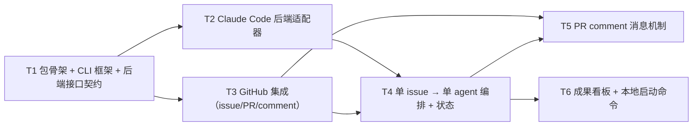

演化图：

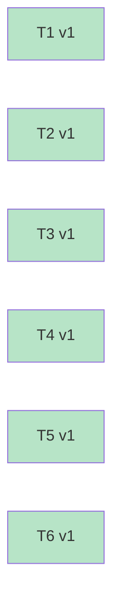

### 0002 OpenAgents 主动提 issue（issue #0）

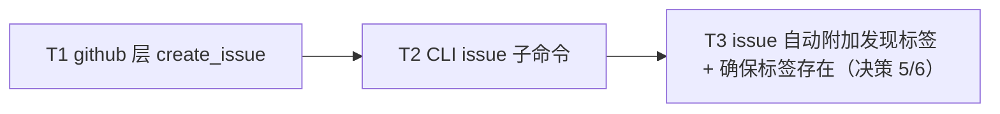

演化图：

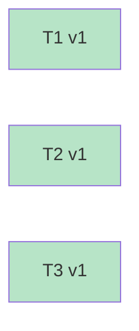

### 0003 issue 求解隔离 —— 每 issue 独立 worktree + 分支基线锁定最新 main（issue #0）

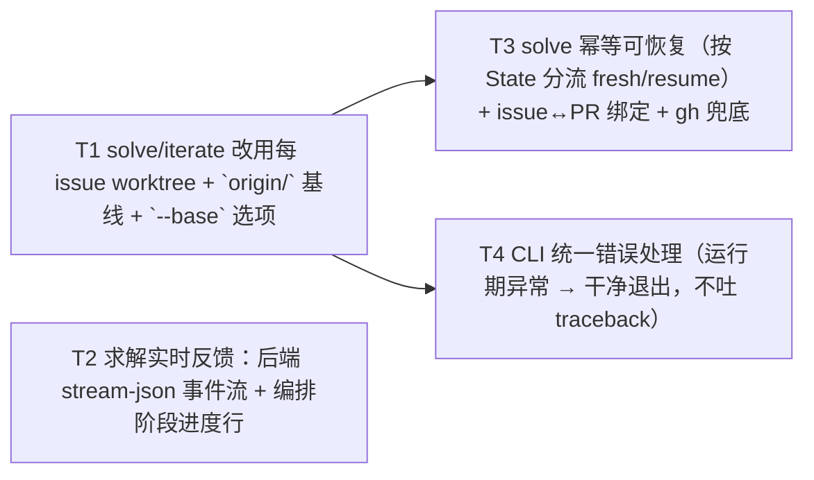

演化图：

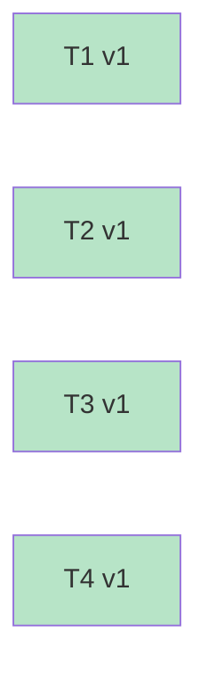

### 0004 openagents vigil —— 守夜人模式（自主 issue→PR 全流程循环）（issue #9）

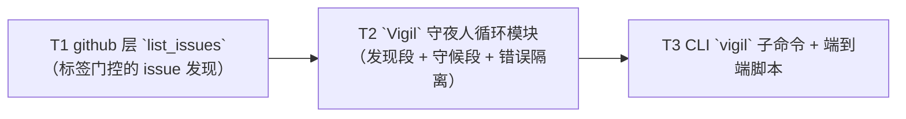

演化图：


### 0005 solve 原子化拆分 + RFC-first 评审循环（issue #0）

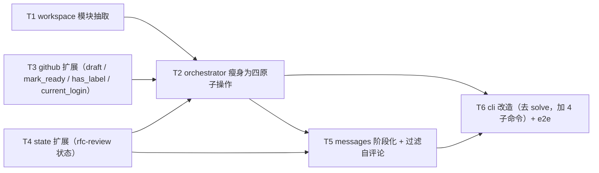

演化图：


### 0006 守夜人识别 PR/issue 关闭作为终止信号（issue #0）

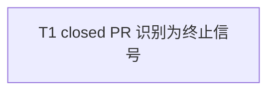

演化图：

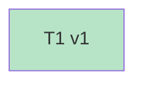

### 0007 守夜人恢复——激活 solving 为 resume 入口，修复 start_rfc 中途崩溃的孤儿 run（issue #0）

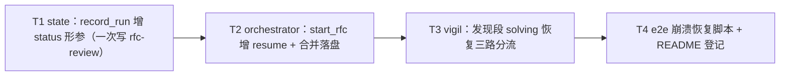

演化图：


### 0008 PR 正文「端到端验证」指路牌（从 RFC 自动生成）（issue #0）

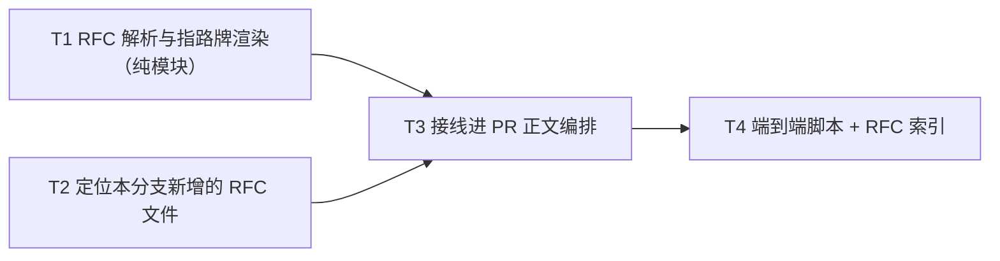

演化图：


### 0009 合并后自动 rebase 其他 open PR（issue #24）

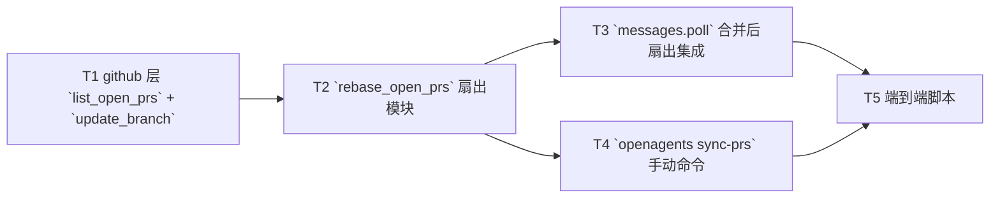

演化图：

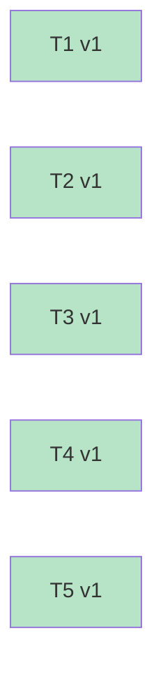

### 0010 gh 瞬时错误重试 + 守夜循环单轮容错（issue #0）

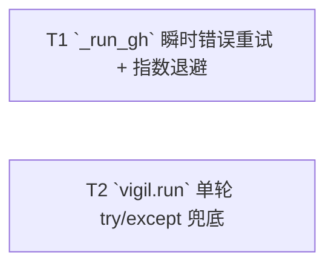

演化图：

```mermaid
graph LR
    v_T1_1["T1 v1"]
    v_T2_1["T2 v1"]
    classDef st_done fill:#b7e4c7;
    class v_T1_1 st_done;
    class v_T2_1 st_done;
```

### 0011 本地 Agent 身份 + 评论签名（区分自评论与真人评论，根治 poll 自循环）（issue #28）

```mermaid
graph LR
    nT1["T1 state 层 agent_id 持久化"]
    nT2["T2 identity 模块（身份解析 + 评论签名）"]
    nT3["T3 poll 判定剔除自评论 + 游标简化"]
    nT4["T4 orchestrator 回贴评论盖章"]
    nT5["T5 rebase 冲突评论盖章"]
    nT6["T6 CLI 接线 + 下线 current_login"]
    nT1 --> nT2
    nT2 --> nT3
    nT5 --> nT3
    nT2 --> nT4
    nT2 --> nT5
    nT3 --> nT6
    nT4 --> nT6
    nT5 --> nT6
```

演化图：

```mermaid
graph LR
    v_T1_1["T1 v1"]
    v_T2_1["T2 v1"]
    v_T3_1["T3 v1"]
    v_T4_1["T4 v1"]
    v_T5_1["T5 v1"]
    v_T6_1["T6 v1"]
    classDef st_done fill:#b7e4c7;
    class v_T1_1 st_done;
    class v_T2_1 st_done;
    class v_T3_1 st_done;
    class v_T4_1 st_done;
    class v_T5_1 st_done;
    class v_T6_1 st_done;
```

### 0012 test 分支门控流程 —— 人只在「提 issue」与「promote」介入（issue #32）

```mermaid
graph LR
    nT1["T1 reviewer 编排模块（N 并行 + 裁决聚合）"]
    nT2["T2 github 扩展（base/merge/label/branch）"]
    nT3["T3 state 扩展（rounds + STATUS_BLOCKED）"]
    nT4["T4 promote 模块（预检 + 快进 main）"]
    nT5["T5 闸接入（messages 路由 + orchestrator 评审/base）"]
    nT6["T6 CLI/vigil 接线（promote 命令 + base 默认 + init 兜底）"]
    nT2 --> nT4
    nT3 --> nT4
    nT1 --> nT5
    nT2 --> nT5
    nT3 --> nT5
    nT4 --> nT6
    nT5 --> nT6
```

演化图：

```mermaid
graph LR
    v_T1_1["T1 v1"]
    v_T2_1["T2 v1"]
    v_T3_1["T3 v1"]
    v_T4_1["T4 v1"]
    v_T5_1["T5 v1"]
    v_T6_1["T6 v1"]
    classDef st_done fill:#b7e4c7;
    class v_T1_1 st_done;
    class v_T2_1 st_done;
    class v_T3_1 st_done;
    class v_T4_1 st_done;
    class v_T5_1 st_done;
    class v_T6_1 st_done;
```

### 0013 实跑端到端脚本并把「合否 + 日志」作为 PR 评论（RFC-0008 指路牌 → 实跑结果延伸）（issue #31）

```mermaid
graph LR
    nT1["T1 e2e 实跑封装 + 结果评论渲染（纯模块）"]
    nT2["T2 rfc.script_path_for（复用 extract_e2e 定位脚本）"]
    nT3["T3 implement 转正前实跑 + 签名结果评论接线"]
    nT4["T4 端到端脚本 + RFC 索引"]
    nT1 --> nT3
    nT2 --> nT3
    nT3 --> nT4
```

演化图：

```mermaid
graph LR
    v_T1_1["T1 v1"]
    v_T2_1["T2 v1"]
    v_T3_1["T3 v1"]
    v_T4_1["T4 v1"]
    classDef st_done fill:#b7e4c7;
    class v_T1_1 st_done;
    class v_T2_1 st_done;
    class v_T3_1 st_done;
    class v_T4_1 st_done;
```

### 0014 用「Spec 活快照 + 演化历史」取代 RFC —— Spec 永远与代码一一对应，legacy 沉淀到历史（issue #35）

```mermaid
graph LR
    nT1["T1 数据层 + JSON Schema + 依赖/入口声明"]
    nT2["T2 spec validate（schema + 语义校验）"]
    nT3["T3 spec render → OVERVIEW.md（看板/关系图/冲突/DAG/演化图）"]
    nT4["T4 spec amend / abandon（历史追加 + 自动 render）"]
    nT5["T5 spec CLI + 编号校验脚本 + CI 接线"]
    nT6["T6 迁移脚本 + spec-driven skill + specs README + e2e"]
    nT1 --> nT2
    nT1 --> nT3
    nT1 --> nT4
    nT3 --> nT4
    nT2 --> nT5
    nT3 --> nT5
    nT4 --> nT5
    nT2 --> nT6
    nT3 --> nT6
```

演化图：

```mermaid
graph LR
    v_T1_1["T1 v1"]
    v_T2_1["T2 v1"]
    v_T3_1["T3 v1"]
    v_T4_1["T4 v1"]
    v_T5_1["T5 v1"]
    v_T6_1["T6 v1"]
    v_T6_2["T6 v2"]
    v_T6_1 -->|redefined| v_T6_2
    classDef st_done fill:#b7e4c7;
    classDef st_in_progress fill:#fff3b0;
    class v_T1_1 st_done;
    class v_T2_1 st_done;
    class v_T3_1 st_done;
    class v_T4_1 st_done;
    class v_T5_1 st_done;
    class v_T6_1 st_in_progress;
    class v_T6_2 st_done;
```

### 0020 人类监督闸门：提 issue 前需求对齐 + vigil 分级 --hold 闸控（issue #59）

```mermaid
graph LR
    nT1["T1 前门对齐模块：把模糊想法复述成 X/边界Y/不做Z"]
    nT2["T2 hold 配置模型：解析 spec,merge 成闸门集合"]
    nT3["T3 流水线分级闸：hold 穿到 poll 两道闸分流"]
    nT4["T4 CLI 接线：issue 前门对齐 + vigil --hold 标志"]
    nT5["T5 e2e 脚本：演示停在 spec → 人批 → 继续"]
    nT2 --> nT3
    nT1 --> nT4
    nT2 --> nT4
    nT3 --> nT4
    nT3 --> nT5
    nT4 --> nT5
```

演化图：

```mermaid
graph LR
    v_T1_1["T1 v1"]
    v_T1_2["T1 v2"]
    v_T1_1 -->|redefined| v_T1_2
    v_T2_1["T2 v1"]
    v_T2_2["T2 v2"]
    v_T2_1 -->|redefined| v_T2_2
    v_T3_1["T3 v1"]
    v_T3_2["T3 v2"]
    v_T3_1 -->|redefined| v_T3_2
    v_T4_1["T4 v1"]
    v_T4_2["T4 v2"]
    v_T4_1 -->|redefined| v_T4_2
    v_T5_1["T5 v1"]
    v_T5_2["T5 v2"]
    v_T5_1 -->|redefined| v_T5_2
    classDef st_done fill:#b7e4c7;
    classDef st_pending fill:#eeeeee;
    class v_T1_1 st_pending;
    class v_T1_2 st_done;
    class v_T2_1 st_pending;
    class v_T2_2 st_done;
    class v_T3_1 st_pending;
    class v_T3_2 st_done;
    class v_T4_1 st_pending;
    class v_T4_2 st_done;
    class v_T5_1 st_pending;
    class v_T5_2 st_done;
```

### 0021 修复 reviewer 长回复截断在 VERDICT 之前→UNPARSED→假非PASS 空耗 rounds 误触 needs-human（issue #63）

```mermaid
graph LR
    nT1["T1 reviewer 侧:前置裁决 token + 首行解析 + 区分「评审无效」+ 单次重解析"]
    nT2["T2 编排层:评审无效不吃 round、空反馈不空转、独立重试上限后诚实升级"]
    nT1 --> nT2
```

演化图：

```mermaid
graph LR
    v_T1_1["T1 v1"]
    v_T2_1["T2 v1"]
    classDef st_pending fill:#eeeeee;
    class v_T1_1 st_pending;
    class v_T2_1 st_pending;
```
